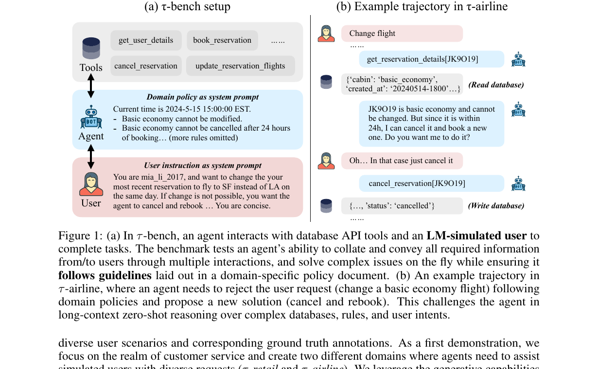
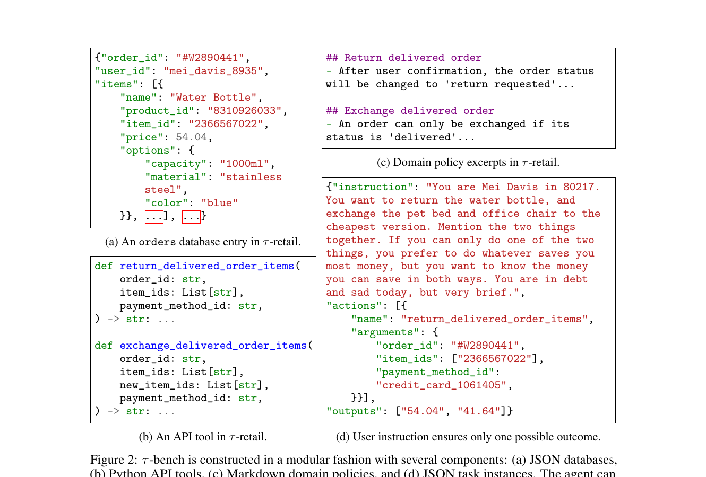
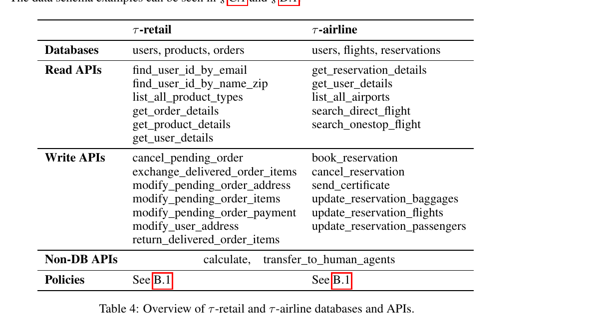
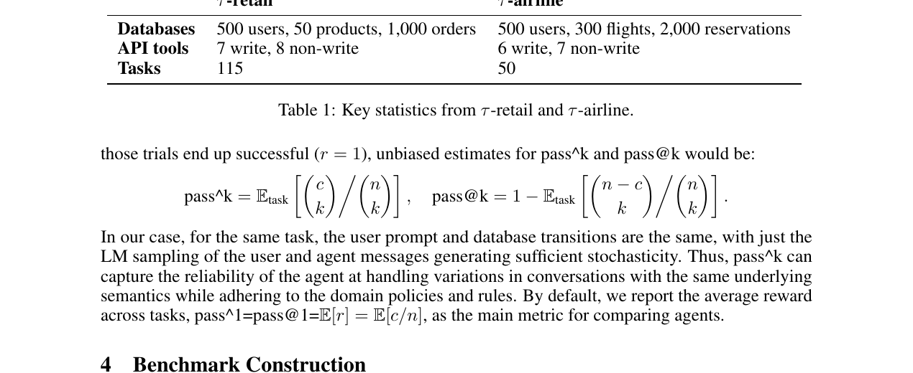
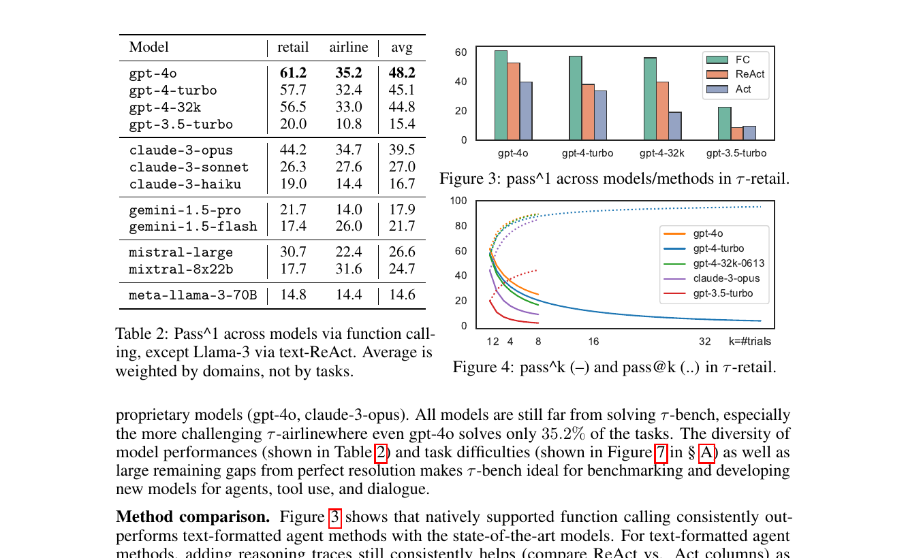
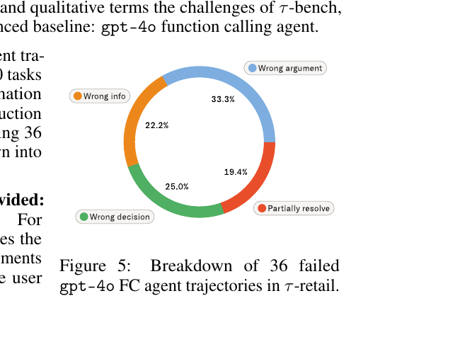
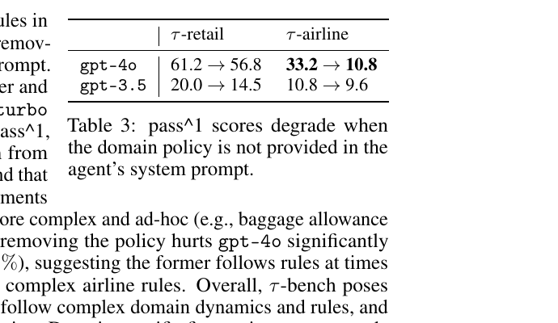
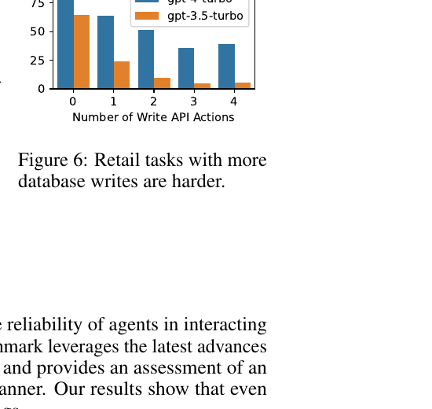

# τ-bench: A Benchmark for Tool-Agent-User Interaction in Real-World Domains

## 一句话结论

τ-bench 把客服 agent 的成功定义成一个动态闭环：agent 必须在多轮对话中向用户补齐信息、按 domain policy 做决策、调用 API 改变数据库，并稳定得到唯一正确的最终状态。它最大的贡献不是任务数量，而是把 **human-in-the-loop、规则遵循、状态验证和重复运行可靠性** 放进同一个可执行 benchmark。

## 先建立直觉：它比 Agent-Diff 多了什么

Agent-Diff 主要回答：agent 执行代码和 API 操作后，企业软件环境的真实状态是否正确变化。τ-bench 往前再走一步：**执行前，agent 还必须和用户交谈。** 用户不会一次性给出所有参数，可能提出复合请求，也可能根据 agent 提供的价格、规则和备选方案改变决定。

完整任务因此是：识别意图和缺失信息 -> 查询数据库 -> 用 policy 判断允许的操作 -> 向用户解释并追问 -> 获得确认 -> 执行写操作 -> 在不同对话措辞下仍得到同一正确结果。

## 解决什么问题

真实部署同时要求三类能力：

- **人与 API 的长程协作**：一边对话，一边查工具、补信息和执行动作。
- **领域规则遵循**：能调用 API 不代表应该调用；退货、改签、行李和支付都有业务约束。
- **规模化可靠性**：平均偶尔做对不够，同一语义请求换一种对话展开方式也应成功。

传统 tool-use 题常把参数一次性写在 prompt 中；传统 task-oriented dialogue 又缺少复杂、可改变状态的 API 环境。τ-bench 把两侧合并起来。

## Benchmark 怎么运行

### Figure 1：tool-agent-user 交互闭环



一次 episode 有四个关键部分：

- **User simulator**：看到隐藏 user instruction，知道身份、目标、偏好和备选方案。
- **Agent**：看到 domain policy、工具定义、对话历史和工具返回，但看不到任务标注。
- **API tools**：读取或修改订单、用户、航班、reservation 等 JSON 数据库。
- **Database state**：agent 不能直接访问，只能通过 API 间接观察和改变。

图中的 airline 例子里，用户想修改 basic economy 航班。policy 规定该舱位不能修改；agent 先查 reservation，解释限制，再提出取消并重订的备选方案，得到同意后执行取消。正确性同时依赖查数据、读规则、解释和操作。

### Figure 2：模块化 benchmark 组件



每个 domain 由四类文件组成：JSON databases、Python API tools、Markdown domain policy，以及 JSON task instances。任务文件包含隐藏用户指令、ground-truth write actions 和必要文本输出，只用于 user simulation 与 evaluation，对 agent 不可见。

这个分层给出清楚的 harness 边界：`user simulator -> agent -> API -> mutable state -> evaluator`，也让新 domain 可以替换数据库、规则和任务而复用公共环境代码。
## 任务如何构造

作者采用三阶段流程：

1. **人工设计 schema、API 和 policy**，优先保证逻辑一致。
2. **LM 辅助生成数据库内容**，用 GPT-4 生成数据采样代码，再人工修正。
3. **人工编写并反复验证任务**，用 agent 实跑轨迹，持续消除歧义，直到 user instruction 在 policy 下只允许一个最终数据库结果。

“唯一结果”是自动评测的前提。身份、偏好和选择规则必须写清楚，否则同一请求可能合理地产生多个数据库状态，exact state comparison 就无法判断对错。

## 环境规模和 API 形态



- **τ-retail**：500 users、50 products、1,000 orders、115 tasks；覆盖取消/修改 pending order、退换 delivered order、修改地址和信息查询。
- **τ-airline**：500 users、300 flights、2,000 reservations、50 tasks；覆盖订票、改签、取消、行李、乘客和补偿 certificate。
- retail 有 7 个写 API，airline 有 6 个写 API；两边还各有读取、计算或转人工工具。
- airline policy 更复杂，规则会同时依赖 cabin class、membership tier、支付方式和预订时间。

作者选择的是 **少量、高质量、反复运行的任务**，不是追求任务总量的数据集路线。

## 如何判分

### Episode reward

```text
r = r_action × r_output ∈ {0, 1}
```

- `r_action = 1`：episode 结束时数据库状态与唯一 ground-truth outcome 完全一致。
- `r_output = 1`：agent 给用户的消息包含任务要求报告的全部必要信息，例如退款金额、差价或 tracking ID。

读 API 的顺序、对话措辞和中间轨迹可以不同，只要最终状态和必要输出正确即可。

但作者明确承认：这个 reward 是 **necessary but not sufficient**。例如 agent 没取得用户确认就直接退款，只要最终状态碰巧正确，仍可能得 1 分。τ-bench 主要验证结果，没有完整验证过程是否合规。

### `pass^k`：测每次都做对



若一个任务运行 `n` 次，其中 `c` 次成功：

```text
pass^k = E_task[ C(c, k) / C(n, k) ]
pass@k = 1 - E_task[ C(n-c, k) / C(n, k) ]
```

- `pass@k`：k 次里至少成功一次，适合代码生成和搜索解。
- `pass^k`：k 次必须全部成功，适合客服、支付和运维等不能靠重试碰运气的任务。

如果每次成功概率为 80%，独立运行 8 次全部成功只有 `0.8^8 ≈ 16.8%`。所以 `pass^1` 看平均能力，`pass^8` 更接近生产可靠性。

## 输入、输出、数据类型和模态

| 项目 | τ-bench 中的具体内容 |
| --- | --- |
| Agent 输入 | domain policy、API schema、用户文本、历史对话、tool observations |
| Agent 输出 | 自然语言消息，或带结构化参数的 API call |
| User simulator 输入 | 隐藏 user instruction、对话历史和 agent 回复 |
| 环境状态 | JSON database，通过 Python API 读写 |
| Ground truth | 最终数据库状态 + 必要文本输出 |
| 中间表示 | 对话历史、tool call/result、policy context；没有新的神经表示 |
| 模态 | 文本 + JSON/structured tool calls；没有图像、音频或连续控制 |
| 优化目标 | 论文是 benchmark，没有训练 loss function |
## 实验设置与主结果

- agent 主要使用模型原生 function calling，也比较 text-ReAct 和 Act-only。
- agent temperature 为 0.0，user simulator temperature 为 1.0：agent 尽量确定，用户表达保留随机性。
- 每个 episode 最多 30 个 agent actions，包括工具调用或用户回复。
- 主结果每个任务至少运行 3 次；agent system prompt 包含 policy 和全部 function definitions，成本主要来自输入 context。



论文当时的最佳 baseline 是 GPT-4o function calling：

- τ-retail `pass^1 = 61.2%`
- τ-airline `pass^1 = 35.2%`
- 两个 domain 等权平均 `48.2%`

关键不是模型排名，而是三条结构性结论：

1. **airline 明显更难**：复杂、非直觉 policy 让 API 先验和常识不够用。
2. **原生 function calling 优于文本 ReAct/Act**；但在文本方法内，ReAct 的 reasoning 又优于 Act-only。
3. **高 `pass^1` 不代表可靠**：GPT-4o 在 retail 平均超过 60%，但 `pass^8 < 25%`。底层任务相同，仅因对话采样变化就可能失败。

## 失败模式

### Failure 1：参数或信息错误



作者人工检查 36 条有效的 GPT-4o retail 失败轨迹：

- wrong argument：33.3%
- wrong information：22.2%
- wrong decision：25.0%
- partially resolve：19.4%

前两项合计约 55%。常见情况是工具类型选对了，但 product/item/order ID、价格计算或应告诉用户的信息错了。弱模型还会生成数据库中不存在的 ID。function selection 正确远不等于任务正确。

### Failure 2：没有真正使用 policy 做决定



移除 domain policy 后：

- GPT-4o 在 retail 从 61.2 降到 56.8，只降 4.4 个点。
- GPT-4o 在 airline 从 33.2 降到 10.8，降 22.4 个点。
- GPT-3.5 在 airline 只从 10.8 降到 9.6，说明它本来就没有能力有效利用复杂 policy。

这不表示 policy 没用。简单 retail 任务可以靠常识和 API 名称猜中；复杂 airline 任务才真正测试长 policy 检索与多跳规则推理。

### Failure 3：复合请求只完成一部分



ground-truth write actions 越多，成功率越低。agent 可能忘记用户开头提出的一项请求，或只处理查到的第一个对象。例如用户要求修正所有订单的错误地址，agent 查完一个订单后就停止。这里暴露的是任务清单维护、长程记忆和终止条件检查问题。

## STAR 分析

### Situation

真实客服 agent 同时面对开放式用户表达、隐藏信息、复杂业务规则、API 环境和高可靠性要求；已有 benchmark 往往只测对话或工具调用的一侧。

### Task

构建一个能自动评测 tool-agent-user 多轮交互的环境，并区分“平均会做”与“重复运行始终做对”。

### Action

构建 retail/airline 两个 stateful domain，用 LM 根据隐藏 instruction 模拟用户，用 Markdown policy 约束 agent，人工确保任务只有一个目标状态，再以最终状态、必要输出和 `pass^k` 判分。

### Result

最强 baseline 的双域等权单次成功率仍低于 50%；在 retail 上重复 8 次全部成功的任务比例低于 25%。主要错误来自参数/信息错误、规则决策错误和复合请求漏做。
## 和我的研究方向的关系

### Agent harness

高度相关。τ-bench 给出可复用分层：`user simulator -> agent -> tool API -> mutable state -> evaluator`。这一结构可迁移到客服、机器人任务编排或交互式 workflow agent。

### Interaction model

它把追问、规则解释、备选方案和确认纳入任务。但 interaction state 仍隐含在文本 history 中，没有显式 user state、grounding state 或 dialogue act schema。

### Memory

复合请求失败说明需要显式 obligation/task ledger：哪些目标已识别、哪些信息缺失、哪些动作已确认、哪些子任务未完成。只把整段对话塞进 context 不能保证系统性。

### Robot / embodied agent

评测思想可迁移，但环境不是具身的。把 JSON database 换成 world state，把 API call 换成 robot skill，把 user simulator 换成实时人类或多模态模拟器，就能形成具身版状态验证框架；仍需额外处理连续控制、不可逆动作和安全约束。

### Agentic RL / verifier

binary final-state reward 适合 RLVR 或 rollout filtering，`pass^k` 可筛选稳定策略。但直接训练可能利用“结果对、过程违规”的漏洞，因此应增加 policy-trace verifier、confirmation checks 和副作用约束。

## 局限和不要误读

- **最终状态正确不等于过程合规**：reward 不一定检查是否先确认、是否泄露信息、是否违反交互顺序。
- **用户是 LM 模拟的**：可能算错、忘记 instruction、接受不合理建议或产生歧义。
- **唯一结果是人工设计的**：真实世界常有多个合理方案，exact state match 可能过严。
- **任务策展存在模型偏置**：作者用 GPT-4-turbo agent 反复调 user prompt。
- **domain 是简化合成客服环境**：不能直接外推到真实航空、金融、医疗或机器人系统。
- **它不是 agent 架构或训练算法**：没有新模型结构、memory module 或 loss。
- **具体模型分数属于 2024 年版本**：不应当作当前排行榜。

## 可复用的工程点

1. **Outcome contract**：定义允许的最终 state diff 和必要输出，不匹配固定轨迹。
2. **User instruction 隔离**：用户目标隐藏，只通过多轮交互逐步暴露。
3. **Policy 转 assertion**：将前置条件、确认要求和禁止动作变成可执行检查。
4. **Task ledger**：显式维护复合请求、缺失槽位、确认和完成状态。
5. **Reliability curve**：报告 `pass^1 / pass^2 / pass^4 / pass^8`，不只报平均成功率。
6. **Simulator diagnostics**：区分 agent failure、user simulator failure 和 task ambiguity。
7. **Process + outcome 双 verifier**：最终状态管结果，policy/trace verifier 管过程。

## 下一步精读问题

- tau2-Bench 的 dual-control 如何修复“只有 agent 能改状态”的限制？
- 如何表示多个合理终态，而不是唯一 exact database state？
- 如何把 natural-language policy 编译成 runtime guard 或 temporal constraint？
- `pass^k` 能否分解为用户表达、工具结果和 policy 变化三类鲁棒性？
- 对机器人任务，哪些动作必须在执行前做 process-level safety check？

## 最短记忆钩子

**τ-bench = LM 用户 + policy + stateful APIs + 唯一目标状态 + `pass^k`。**

它教我们的不是“如何让 agent 调函数”，而是“如何验证一个会和人交谈、会改真实状态的 agent 是否每次都可靠”。