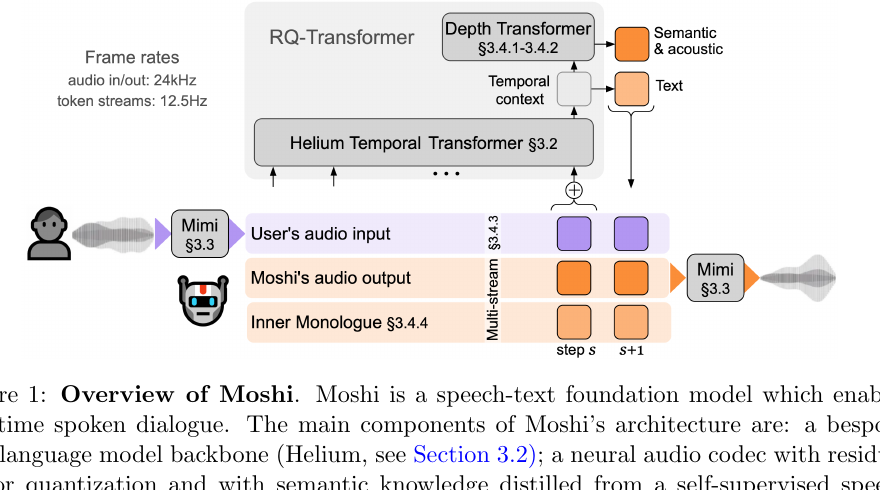
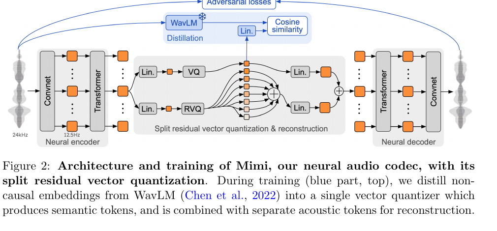
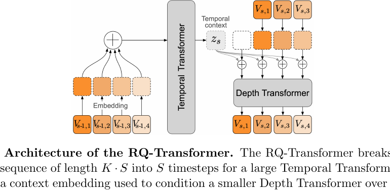
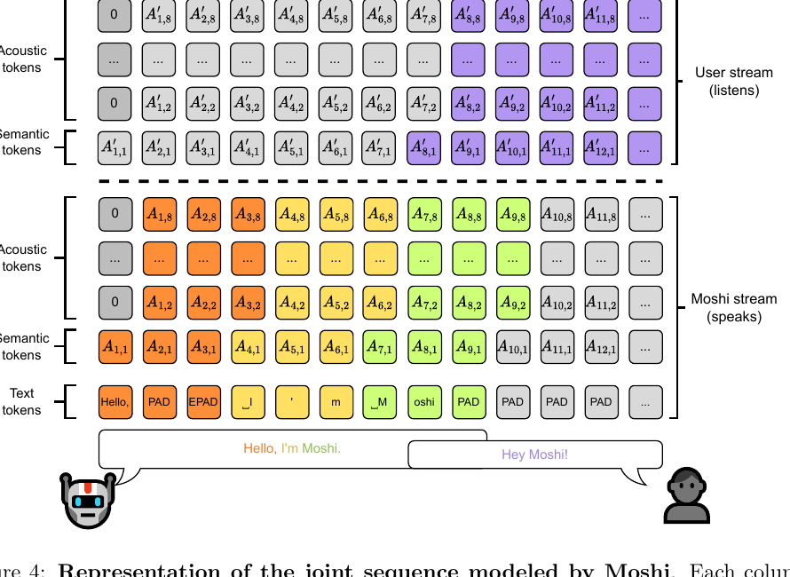

# Moshi: a speech-text foundation model for real-time dialogue

## -1. 白话基础版：先别看公式

如果你现在觉得 Moshi 很难，不是因为你基础差，而是因为它同时混了四层东西：

```text
声音工程：waveform / codec / audio token
语言模型：Transformer / LLM / hidden state
实时系统：streaming / latency / 每 80ms 一帧
对话交互：full-duplex / interruption / overlap / turn-taking
```

所以不要一上来读公式。先建立一个工程心智模型。

### -1.1 传统语音助手在干嘛？

传统语音助手通常是串行 pipeline：

```text
麦克风声音
  -> VAD 判断你说完没
  -> ASR 把声音转成文字
  -> LLM 根据文字想答案
  -> TTS 把答案文字念出来
```

这个结构的问题是：

- 它通常要等你说完。
- 中间只剩文字，语气、停顿、犹豫、笑声、打断意图大多丢了。
- 系统自己说话时，通常不太会自然处理用户突然插话。

### -1.2 Moshi 换了什么思路？

Moshi 不把“文字”当唯一中间层，而是直接建模声音 token。

可以先理解成：

```text
声音 -> 声音 token -> 模型预测下一小段声音 token -> 声音
```

它仍然有 text token，但这个 text token 主要是 Moshi 自己说话时的“语言骨架”，不是传统 ASR 那种把用户语音先完整转写成文本再交给 LLM。

### -1.3 Mimi 是啥？

Mimi 是“声音版 tokenizer + decoder”。

文本 LLM 需要 tokenizer：

```text
"hello" -> token ids -> LLM
```

Moshi 处理声音也需要类似东西：

```text
waveform -> Mimi -> audio token ids -> Moshi
Moshi output audio token ids -> Mimi -> waveform
```

所以 Mimi 的角色不是聊天大脑，而是声音和 token 之间的转换器。

### -1.4 audio token 是啥？

audio token 可以理解成“声音的小编号”。

真实声音是连续波形，模型不能直接像处理文字一样处理它。Mimi 把声音切成一帧一帧，每帧用几个离散编号表示。

论文里 Moshi/Mimi 的关键数字是：

```text
音频采样率：24kHz
token 帧率：12.5Hz
也就是大约每 80ms 产生一组 audio tokens
每帧 8 个 audio quantizer streams
```

直觉上就是：

```text
每 80ms:
  当前声音片段 -> 一组 token 编号
```

### -1.5 full-duplex 是啥？

full-duplex 就是一边听一边说。

电话是 full-duplex：你说话时对方也能说，你们可以重叠。

很多语音助手更像 half-duplex / turn-based：

```text
你说 -> 它听
你停 -> 它想
它说 -> 你最好别说
```

Moshi 的目标是更像真实对话：

```text
你说话时，它仍然在听
它说话时，你也可以打断
它可以选择继续说、停、插一句、backchannel
```

注意：论文证明的是架构支持和模型能力，不等于所有产品策略都已经完美。

### -1.6 stream 是啥？

stream 就是连续不断来的数据。

Moshi 里至少有两条重要的音频 stream：

```text
User stream：用户声音流
Moshi stream：系统自己的声音流
```

这点特别关键。传统系统常常把对话切成“用户回合”和“系统回合”。Moshi 不这么切，它同时维护两条流。

所以它能表达：

```text
用户正在说，Moshi 静音
用户静音，Moshi 正在说
用户和 Moshi 同时说
Moshi 说到一半，用户插话
Moshi 发出短 backchannel
```

### -1.7 hidden state 是啥？

hidden state 可以理解成模型每一步的“脑内状态”。

模型每 80ms 处理一次 token，不只是输出一个 token，它内部还会形成一个向量，表示它对当前上下文的理解。

上一篇 turn-taking 论文就是在问：

```text
Moshi 的 hidden state 里，
有没有包含“用户快说完了”“该不该接话”“该不该继续沉默”的信号？
```

所以他们不是喂 JSON 给 LLM，而是拿 Moshi 的内部连续状态做分析。

### -1.8 先用一句话记住 Moshi

> Moshi 是一个每 80ms 同时看用户声音流、生成自己声音流的 speech-to-speech Transformer；Mimi 负责声音和 token 的互转，Inner Monologue 负责给 Moshi 自己要说的话加文本骨架。

## 0. 先回答：Moshi 是啥？

Moshi 是 Kyutai 做的一个实时全双工语音对话模型。

你可以先粗暴理解成：

> Moshi 不是“ASR 把用户语音转文字 -> LLM 生成文字 -> TTS 播出来”的传统语音助手，而是一个直接在 speech/audio token 层面做对话的模型。它可以一直听，也可以一直生成声音；系统说话和用户说话可以重叠。

它的论文标题叫 speech-text foundation model，是因为它同时建模：

- speech/audio tokens：声音本身，包含语音、静音、音色、语气、非文本信息。
- text tokens：主要用来增强 Moshi 自己要说的话的语言质量。

最关键的是 full-duplex：

> Moshi always listens and always generates sound, either speech or silence.

也就是说，Moshi 每个时间步都在处理用户音频流，同时也在决定自己这一路输出是说话还是“自然静音”。

## 1. 为什么它重要？

普通语音对话系统的问题是串行：

```text
用户语音 -> VAD/endpointing -> ASR -> LLM -> TTS -> 系统语音
```

这个结构天然有三个问题：

1. 延迟高：多个模块串起来，通常是秒级。
2. 丢信息：中间只剩文本，语气、情绪、笑声、犹豫、背景声等信息丢掉。
3. turn-based：默认用户说完系统再说，不擅长 overlap、interruptions、backchannel。

Moshi 的思路是：

```text
用户音频流 -> audio tokens
                 -> Moshi 多流模型 -> Moshi audio tokens -> 声音
Moshi 自己的 text tokens 也一起生成，用来提高语言质量
```

它报告的延迟是：

- theoretical latency：160 ms
- practical latency：200 ms

这就是为什么上一篇 `Synchronization and Turn-Taking...` 会用 Moshi 做实验：Moshi 是一个可以研究 full-duplex turn-taking 的底层模型。

## 2. Moshi 的总架构



图 1 可以按三层看：

### 2.1 Mimi：把声音变成 tokens，再把 tokens 变回声音

左边用户语音先进 Mimi：

```text
24kHz waveform -> Mimi -> audio token stream at 12.5Hz
```

右边 Moshi 输出的 audio tokens 也通过 Mimi 解码回 waveform：

```text
Moshi audio tokens -> Mimi -> 24kHz waveform
```

所以 Mimi 是 audio tokenizer / neural audio codec。

### 2.2 Helium Temporal Transformer：大脑里的时间上下文

Moshi 建在一个 7B text LLM backbone 上，叫 Helium。

论文里说 Helium 提供 reasoning abilities。Moshi 把 Helium 扩展成 Temporal Transformer，用来建模长时间上下文。

### 2.3 Depth Transformer：在同一个时间步里生成多个 token

每 80ms 一个时间步，但一个时间步里不止一个 token：

- 用户语音 semantic token
- 用户语音 acoustic tokens
- Moshi 语音 semantic token
- Moshi 语音 acoustic tokens
- Moshi 自己的 text token

如果把所有 token 都铺平成一条长序列，序列会太长。Moshi 用 RQ-Transformer 拆成：

- Temporal Transformer：沿时间方向看过去发生了什么。
- Depth Transformer：在当前时间步内，从下到上生成各个 stream/codebook token。

## 3. Mimi 是什么？

Mimi 是 Moshi 的音频 codec。

它的任务是把连续波形离散成 token：

```text
waveform -> encoder -> quantizer -> discrete audio tokens -> decoder -> waveform
```



论文里关键参数：

- 输入输出音频：24kHz
- token frame rate：12.5Hz
- 每帧约 80ms
- latent dimension：512
- quantizers：Q = 8
- codebook size：2048
- bitrate：1.1kbps

### 3.1 semantic token 和 acoustic token

语音 token 有两类信息：

- semantic：更接近“说了什么”，和语言内容相关。
- acoustic：更接近“怎么说”，包括音色、音质、细节。

传统做法常常需要一个非因果 semantic encoder，但非因果就不适合实时。Mimi 的做法是把 WavLM 的非因果语义信息蒸馏到一个因果 codec 里，这样推理时仍然可以 streaming。

论文里说 Mimi 用 split RVQ：

- 一个 VQ 负责 semantic token。
- 另一个 7-level RVQ 负责 acoustic tokens。
- 两者并行用于重建音频。

这就是为什么 Moshi 后面可以直接在 audio token 上做语言建模。

## 4. RQ-Transformer 是什么？



Mimi 每秒输出 12.5 帧，每帧有 8 个 codebook token。

如果直接建模：

```text
12.5 frame/s * 8 tokens/frame = 100 tokens/s
```

5 分钟音频就是 30,000 个时间步级别的 token，非常重，不适合实时。

RQ-Transformer 的核心是把问题拆开：

```text
时间维度：Temporal Transformer 处理过去每一帧的上下文
当前帧内部维度：Depth Transformer 处理这一帧里多个 codebook/token 的生成顺序
```

论文公式：

$$
z_s = Tr_{Temp}(V_0, \ldots, V_{s-1}) \in \mathbb{R}^d
$$

意思是：Temporal Transformer 看过去的 token，得到当前时间步的上下文向量 `z_s`。

然后：

$$
l_{s,k} = Tr_{Depth}(z_s, V_{s,1}, \ldots, V_{s,k-1}) \in \mathbb{R}^{N_k}
$$

意思是：Depth Transformer 在当前时间步里，一个一个预测第 `k` 个 token 的 logits。

直觉：

> 大模型负责“时间上的故事和上下文”，小模型负责“这一帧里多个 token 怎么组成声音”。

## 5. Multi-stream 是 Moshi 最关键的点

普通语音模型通常只有一条音频流。但对话至少有两路：

```text
User stream: 用户说了什么
Moshi stream: 系统自己说了什么
```

Moshi 明确把这两路分开建模。



这张图最重要。

虚线以上是用户流：

- user semantic token
- user acoustic tokens

虚线以下是 Moshi 自己的流：

- Moshi semantic token
- Moshi acoustic tokens
- Moshi text tokens，也就是 Inner Monologue

每一列代表一个时间步。论文图里说：

- inference 时，虚线以下对应 Moshi 的 tokens 会被 sample。
- 虚线以上对应 user 的 tokens 在真实应用里来自用户真实音频。

所以推理时大概是：

```text
每 80ms:
  1. 麦克风音频 -> Mimi -> user audio tokens
  2. 模型读取过去所有 user/Moshi streams
  3. 模型采样 Moshi text token + Moshi audio tokens
  4. Moshi audio tokens -> Mimi decoder -> 播放声音或自然静音
```

这就是它为什么能 full-duplex：

> 它不是等用户说完再开始，而是每个时间步都同时维护 user stream 和 Moshi stream。

论文明确说没有 explicit boundaries for the change of turns。Moshi 可以一直听、一直说，也可以两者同时发生。

### 5.1 图 4 到底怎么看？

先不要管公式，图 4 可以当成一张“时间表”。

```text
横向：时间，从左到右，每一列约等于一个 80ms 时间步
纵向：不同 stream / 不同 token 类型
```

也就是说，每一列不是一个 token，而是一组 token。

#### 虚线以上：用户这一路

虚线以上是 user stream。

它包含：

```text
user semantic token
user acoustic tokens
```

这一路在真实系统推理时来自用户麦克风：

```text
用户声音 -> Mimi encoder -> user audio tokens
```

所以真实应用里，模型不用“猜”用户下一帧声音是什么，用户下一帧声音会从麦克风进来。

#### 虚线以下：Moshi 自己这一路

虚线以下是 Moshi stream。

它包含：

```text
Moshi text tokens
Moshi semantic token
Moshi acoustic tokens
```

这一路在推理时是模型自己采样出来的：

```text
Moshi model -> next Moshi text token
Moshi model -> next Moshi audio tokens
```

然后 Moshi audio tokens 交给 Mimi decoder，变成你听到的声音。

#### 每一列发生了什么？

你可以想象模型每 80ms 做一次循环：

```text
第 s 个时间步:
  1. 读入过去的 user stream
  2. 读入过去的 Moshi stream
  3. 根据上下文生成当前 Moshi text/audio tokens
  4. 把当前 Moshi audio tokens 解码成声音
```

如果 Moshi 此刻不想说话，它不是“不输出”，而是输出接近静音的 audio tokens，同时 text stream 里多是 PAD。

这就是论文说的 natural silence。

#### 为什么它不需要显式话轮边界？

传统系统会问：

```text
用户说完了吗？
如果说完了，系统开始回答。
```

Moshi 的图 4 不是这么建模的。它每个时间步都同时有用户流和系统流，所以可以自然表达：

```text
用户流有声音，Moshi 流是静音
用户流是静音，Moshi 流有声音
用户流和 Moshi 流都有声音
用户突然开始说，Moshi 可以继续、停下、或者插入短回应
```

这就是 full-duplex 的结构基础。

### 5.2 为什么说它不是 JSON / tool calling？

因为图 4 里的每个小格子是 token，不是结构化工具调用。

更准确地说：

```text
Moshi 主要输入输出：audio/text token streams
传统 agent harness 输入输出：state JSON / function call / action schema
```

Moshi 解决的是“实时语音层”的问题：

- 什么时候说？
- 说话时能不能继续听？
- 被打断怎么办？
- 能不能短促 backchannel？
- 语音输出如何低延迟生成？

它本身不是机器人动作系统，也不是工具调用系统。

如果要接到机器人 agent harness，Moshi 更像底层 speech interaction layer，而不是整个 agent brain。

### 5.3 和上一篇 turn-taking paper 的直接对应

上一篇论文里说：

```text
extract activations from the final layer of the temporal transformer
```

这句话对应的就是图 1/图 4 里的 `Helium Temporal Transformer`。

他们不是看 Moshi 最后说出了什么，而是看每个 80ms 时间步模型内部的 `hidden state`。

直觉上：

```text
Moshi 每 80ms 看一眼两条流
  -> Temporal Transformer 形成当前脑内状态 h_t
  -> 这个 h_t 用来生成下一步 token
```

上一篇论文问的是：

```text
h_t 里面有没有提前包含：
  - 这段话快结束了吗？
  - 当前说话人会继续 hold 吗？
  - 对方是不是要接话？
```

所以它才训练 causal LSTM probe 去读这些 hidden states。

## 6. Inner Monologue 是什么？

Inner Monologue 是 Moshi 自己说话时同步生成的 text token stream。

注意：它不是用户 ASR 文本。

论文明确说不使用用户流对应的 text representation，因为实时转写用户音频很难，而且依赖外部 ASR 会违背 end-to-end speech-to-speech 的思路。

所以 Inner Monologue 只对应 Moshi 自己的 speech。

### 6.1 为什么需要 Inner Monologue？

纯 audio token 模型能发声，但语言质量、事实性、长句一致性会差。

Text LLM 很会语言和推理，所以 Moshi 给自己加了一条 text stream，让模型在生成自己声音时，也生成对齐的文本 token。这个文本 token 像一个“语言骨架”，帮助 audio token 更像合理的语言。

你可以这样理解：

```text
Moshi 内部先/同时知道自己要说的文本骨架
然后 audio tokens 把它说成声音
```

但它不是先完整写完一整段文本再 TTS，而是每一帧 streaming 地生成。

### 6.2 PAD 和 EPAD 是什么？

Moshi 要把文字 token 对齐到 12.5Hz 的 audio frame。

但是英文说话每秒只有大概 3-4 个 text tokens，而 audio token 是 12.5Hz，所以大部分 frame 没有新文字。于是论文定义两个特殊 token：

- `PAD`：当前帧没有新文字。
- `EPAD`：padding 结束，提示下一个词要来了。

论文里说，在英文对话语音中 padding tokens 约占 65%。

这解释了上一篇为什么会提到 PAD token：Moshi 静音时，Moshi audio stream 生成接近静音的 waveform，同时 text stream 填 PAD。

### 6.3 用人话解释 Inner Monologue

你可以把 Inner Monologue 理解成：

```text
Moshi 一边发声音，一边在内部生成“自己正在说什么”的文字骨架。
```

但一定要注意两点：

1. 它不是用户 ASR。
2. 它不是先写完整答案再 TTS。

更准确的过程是：

```text
每 80ms:
  Moshi 生成一点点自己要说的 text token
  Moshi 生成一点点自己要发出的 audio token
  Mimi 把 audio token 解码成声音
```

所以它仍然是实时生成，而不是传统 pipeline。

### 6.4 为什么不用用户 text stream？

论文明确说没有使用用户那一路的 text representation。

原因有两个：

- 实时转写用户音频很难。
- 如果依赖外部 ASR，就又回到传统 ASR pipeline，违背 end-to-end speech-to-speech 的路线。

所以图 4 里只有 Moshi 自己这一路有 text tokens，用户那一路只有 audio tokens。

这点很重要，因为它说明 Moshi 理解用户时主要不是靠“先把用户完整转成文字”，而是靠用户 audio token stream。

### 6.5 PAD 到底是什么意思？

`PAD` 可以理解成“这一帧没有新文字”。

因为 audio frame 很密：

```text
audio token: 12.5 次/秒
text token: 英语口语大概 3-4 个/秒
```

所以很多 80ms 帧里，没有新的文字 token。那这些空位就用 PAD 填。

举个很简化的例子：

```text
Moshi 要说: Hello, I'm Moshi.

text stream 可能像:
Hello | PAD | EPAD | I | 'm | Moshi | PAD | PAD | ...
```

这个不是论文里的完整精确 tokenization，只是帮你理解 PAD 的角色。

### 6.6 EPAD 是啥？

`EPAD` 可以理解成“padding 要结束了，下一个词要来了”。

论文说 EPAD 的作用是把两个决策拆开：

```text
1. 当前词结束了吗？
2. 下一个词是什么？
```

这对模型有帮助，因为生成语音时，什么时候停、什么时候接下一个词，本身就是一个时序问题。

### 6.7 为什么上一篇论文能调 PAD bias？

上一篇 turn-taking 论文里说，他们对 PAD token logits 加 bias，具体是 subtract a constant value from PAD token logits。

这句话翻成人话：

```text
让 PAD 变得不那么容易被选中
```

如果 PAD 表示“当前不说新文字/保持静音倾向”，那降低 PAD 的概率，就会让 Moshi 更容易开始说话或更频繁地进入说话状态。

所以上一篇论文说：

```text
reducing PAD token logits
  -> increasing likelihood of speech
  -> promoting more frequent turn-taking
```

这不是传统规则系统里的“if 静音超过 500ms then speak”。它是在模型 token sampling 层面，改变 Moshi 说话/沉默的倾向。

### 6.8 这对机器人有什么启发？

如果你们做机器人陪伴，PAD 类似一个很底层的“是否保持沉默”的生成控制点。

但真实机器人系统不能只靠这个。更完整的策略应该有：

```text
speech model 内部状态
  -> 是否生成 PAD / 是否发声
turn-taking estimator
  -> 用户是否快说完、是否还要继续、是否允许插话
policy layer
  -> 该不该说、说什么、是否配合动作
robot action layer
  -> 头部、眼神、身体动作、导航或操作
```

Moshi 给的是 speech generation 层的能力；机器人还需要上层 interaction policy。

## 7. Moshi 的输入输出到底是什么？

### 7.1 训练时

训练目标是联合序列：

$$
V_{s,1} = W_s
$$

$$
V_{s,2} = A_{s,1}
$$

$$
V_{s,1+q} = A_{s-\tau,q}
$$

$$
V_{s,1+Q+1} = A'_{s,1}
$$

$$
V_{s,1+Q+q} = A'_{s-\tau,q}
$$

这里：

- $W_s$：Moshi 自己 speech 的 text token。
- $A$：Moshi 自己的 audio token stream。
- $A'$：用户/对方的 audio token stream。
- $Q=8$：Mimi 的 8 个 audio quantizer streams。
- $\tau$：acoustic delay。

总 stream 数：

$$
K = 2Q + 1
$$

因为有：

- Moshi audio：8 streams
- user audio：8 streams
- Moshi text：1 stream

所以实验里：

```text
K = 17 streams
```

### 7.2 推理时

真实应用里：

- 用户音频 tokens 由麦克风输入经过 Mimi 得到。
- 用户流的预测结果会被 ignored，因为真实用户音频已经给了。
- Moshi 自己的 text tokens 和 audio tokens 由模型采样。

也就是说：

```text
input:
  - past user audio tokens
  - past Moshi audio tokens
  - past Moshi text tokens

output:
  - next Moshi text token
  - next Moshi semantic audio token
  - next Moshi acoustic audio tokens
```

它不是输出 JSON，也不是输出 tool call。

## 8. Moshi 和传统 ASR-LLM-TTS 的区别

| 维度 | ASR-LLM-TTS | Moshi |
|---|---|---|
| 中间表示 | 文本 | audio tokens + Moshi text tokens |
| 用户语气/情绪 | ASR 后大多丢失 | audio token 中保留更多非语言信息 |
| 是否必须等用户说完 | 通常是 | 不需要 |
| overlap / interruption | 很难自然处理 | 架构上支持 |
| backchannel | 通常靠规则/额外模块 | 可以在同一语音流里生成 |
| 输出 | 文本再 TTS | 直接生成 speech/audio tokens |
| tool calling | 可接 | 论文核心不做 tool calling |

## 9. 和机器人 interaction model 的关系

Moshi 解决的是语音交互底座，不是完整机器人 agent。

它有：

- 实时语音输入。
- 实时语音输出。
- full-duplex。
- overlap/interruption/backchannel 的建模基础。
- 内部 hidden states 可以用于后续分析 turn-taking。

它没有：

- 视觉输入。
- gaze/hand/posture。
- object grounding。
- robot action。
- tool use。
- long-term memory。
- 任务规划。

所以对你们的启发是：

```text
Moshi-like speech layer
  -> turn-taking / interruption / backchannel estimator
  -> multimodal grounding layer
  -> memory + task state
  -> robot policy / agent harness
```

上一篇 `Synchronization and Turn-Taking...` 正是在 Moshi 的 hidden states 上做 probe，问：

> Moshi 内部有没有足够的信息提前判断 EOI、Hold、Non-Hold？

现在你应该能看懂它为什么不是喂 JSON 给 LLM，而是抽 Moshi final temporal transformer 的 hidden states 来做分析。

## 10. 最小心智模型

如果只记一个图，就记这个：

```text
用户声音
  -> Mimi encoder
  -> user audio tokens
  -> Moshi multi-stream Transformer
  -> Moshi text token + Moshi audio tokens
  -> Mimi decoder
  -> Moshi 声音
```

如果只记一句话：

> Moshi 是一个每 80ms 处理一次多路 audio/text token 的实时全双工语音模型，它把用户音频流和系统音频流分开建模，所以不需要显式话轮边界。

## 11. 回到上一篇论文时该怎么理解

上一篇论文用 Moshi 做实验时：

- 两个 Moshi 实例 A/B 互相连接。
- A 的输出 audio tokens 输入 B。
- B 的输出 audio tokens 输入 A。
- 作者抽取 Moshi final temporal transformer 每一帧的 hidden state：

$$
h_t \in \mathbb{R}^d
$$

然后做两件事：

1. 用 CKA 看 A/B 的 hidden states 是否同步。
2. 用 causal LSTM probe 看 hidden states 是否能提前预测 turn-taking。

所以上一篇不是在研究“LLM 看到 JSON 后怎么 tool call”，而是在研究：

> 一个 full-duplex speech model 的连续内部表征里，是否自然编码了对话同步和话轮管理信号。

## 12. hidden state 是什么？为什么上一篇要抽 h_t？

这一段是理解上一篇论文的关键。

### 12.1 先用 LLM 类比

普通文本 LLM 每一步大概是：

```text
已有 tokens -> Transformer -> hidden state -> next token logits -> sample next token
```

`hidden state` 就是模型在生成下一个 token 前的中间表示。它不是人能直接读懂的文字，而是一个高维向量。

你可以粗暴理解为：

```text
hidden state = 模型此刻对上下文的压缩理解
```

### 12.2 放到 Moshi 里

Moshi 每 80ms 处理一次多流 token。

所以每个时间步大概是：

```text
过去的 user audio tokens
过去的 Moshi audio tokens
过去的 Moshi text tokens
  -> Temporal Transformer
  -> hidden state h_t
  -> Depth Transformer / logits
  -> 下一步 Moshi text/audio tokens
```

上一篇论文抽的是：

```text
h_t from the final layer of the temporal transformer
```

也就是 Moshi 在某个 80ms 时刻、准备生成下一步之前的“脑内状态”。

### 12.3 h_t 里面可能有什么？

它不是显式 JSON，不长这样：

```json
{
  "user_is_finished": true,
  "should_speak": false
}
```

真实情况是一个向量：

```text
h_t = [0.13, -0.82, 1.07, ...]
```

但这个向量可能隐含了很多信息：

- 用户刚才说话节奏。
- 用户是不是在停顿。
- Moshi 自己是不是正在说。
- 当前语音片段是否快结束。
- 是否可能发生话轮转移。
- 是否应该继续沉默或开始说。

上一篇论文就是想验证：

> 这些 turn-taking 信息是否真的能从 h_t 中被解码出来？

### 12.4 为什么要用 probe？

因为 hidden state 是高维向量，人眼看不懂。

所以作者训练一个很小的模型 `probe` 去读它：

```text
h_t / h_{t-delta}
  -> causal LSTM probe
  -> EOI probability 或 Hold/Non-Hold probability
```

如果 probe 能从 hidden state 里预测出这些事件，说明 Moshi 的内部状态里确实编码了相关信息。

注意这里的逻辑：

```text
不是作者给 Moshi 加了 turn-taking module
而是作者检查 Moshi 原本的 hidden state 里有没有 turn-taking signal
```

### 12.5 为什么要 delayed / causal？

上一篇论文强调 probe 只能看过去：

```text
h_{t-delta}
```

不能偷看未来。

这是为了模拟真实实时系统：

```text
当前时刻做判断时，你只能知道过去，不能知道用户下一秒会说什么。
```

如果 delayed probe 仍然能预测 EOI 或 Hold/Non-Hold，才说明这些信号是提前出现的，真正有实时交互价值。

### 12.6 CKA 又是在干嘛？

上一篇有两个 Moshi 实例 A 和 B，它们互相说话。

每个模型都有自己的 hidden state 序列：

```text
A: h_A1, h_A2, h_A3, ...
B: h_B1, h_B2, h_B3, ...
```

CKA 是用来比较两个 hidden state 序列像不像。

直觉上：

```text
如果 A 和 B 正在顺畅对话，
它们内部状态应该在时间上出现某种同步。
```

所以作者在不同 lag 下算 CKA：

```text
A 当前状态 vs B 当前状态
A 当前状态 vs B 提前/滞后的状态
```

如果 CKA 在接近 0 lag 处有峰值，就说明两边内部状态在同一时间附近最同步。

### 12.7 这和机器人 interaction model 怎么接？

对你们来说，`h_t` 可以类比为 speech layer 的连续交互状态。

未来如果做工程系统，可能不是直接裸用 Moshi 的 h_t，但思想类似：

```text
连续语音/多模态输入
  -> 表征模型产生 state vector
  -> 小模型或 policy head 读取 state vector
  -> 判断：
       用户是否还要说
       是否可以打断
       是否应该 backchannel
       是否该停 TTS
       是否该触发机器人动作
```

也就是说，上一篇论文真正有价值的地方是：

> 它把 turn-taking 从“规则判断静音长度”推进到了“从 full-duplex speech model 的内部连续状态里读交互信号”。

## 13. Moshi 这篇读到这里够了吗？

如果目标是理解上一篇 `Synchronization and Turn-Taking...`，Moshi 这篇读到这里已经够进入下一篇了。

你现在需要掌握的不是所有 benchmark，而是这几个事实：

1. Moshi 是 speech-to-speech，不是传统 ASR-LLM-TTS pipeline。
2. Mimi 把声音变成 audio tokens，也把 audio tokens 变回声音。
3. Moshi 每 80ms 处理一次多流 token。
4. 用户音频和 Moshi 自己音频是两条 stream。
5. Moshi 自己还有一条 text stream，叫 Inner Monologue。
6. Moshi 可以一直听、一直生成声音或静音，所以它支持 full-duplex。
7. Moshi 的 Temporal Transformer 会在每个时间步形成 hidden state。
8. 上一篇论文就是分析这些 hidden states 里有没有 turn-taking 信号。

### 13.1 训练路线只需要知道大概

Moshi 的训练很复杂，但当前只需要知道它不是一步训练出来的。

论文里大概有这些阶段：

```text
Helium text LLM pretraining
  -> 给模型语言和推理能力

Mimi audio codec training
  -> 学会 waveform <-> audio tokens

Moshi audio pretraining
  -> 学会生成 audio tokens

multi-stream training / finetuning
  -> 学会同时处理用户流和系统流

instruction finetuning
  -> 让它更像可对话的助手
```

其中对上一篇最重要的是 multi-stream 和 full-duplex 能力：

```text
模型需要见过两路说话人的数据
才能学习用户流和系统流之间的互动动态
```

论文提到 Fisher phone conversations，因为它有分离的双通道电话对话，可以让模型看到两个 speaker stream。

### 13.2 Moshi 证明了什么？

Moshi 原论文主要证明：

- 可以构建一个实时 full-duplex speech-text foundation model。
- 它可以直接在 audio token 层面做 speech-to-speech dialogue。
- Inner Monologue 能显著提升生成语音的语言质量。
- 多流建模让它能处理 overlap、interruption、backchannel 这类传统 turn-based pipeline 不擅长的现象。
- 理论延迟 160ms，实际约 200ms。

### 13.3 Moshi 没证明什么？

Moshi 原论文不是机器人 interaction model。

它没有证明：

- 机器人知道用户看哪里。
- 机器人知道用户指哪个物体。
- 机器人有长期记忆。
- 机器人会做身体动作。
- 模型会稳定调用工具。
- 模型有完整 task policy。

它主要解决的是：

```text
实时语音层：听、说、沉默、重叠、打断、backchannel 的底层建模基础
```

### 13.4 回到上一篇前的最小复盘

现在再看上一篇时，要把 Moshi 想成这样：

```text
Moshi 每 80ms:
  读用户 audio stream
  读自己 audio/text stream
  形成 hidden state h_t
  生成下一步自己要说的 text/audio tokens 或静音
```

上一篇 `Synchronization and Turn-Taking...` 做的事情是：

```text
两个 Moshi 互相说话
  -> 抽每个 Moshi 的 h_t
  -> 用 CKA 看两个模型的 h_t 是否同步
  -> 用 LSTM probe 看 h_t 能不能提前预测 EOI / Hold / Non-Hold
```

所以接下来读上一篇时，不要再把它理解成“LLM 看到 JSON 后做决策”。它是在研究：

> full-duplex speech model 的连续内部状态里，是否已经隐含了对话同步和话轮管理信号。
