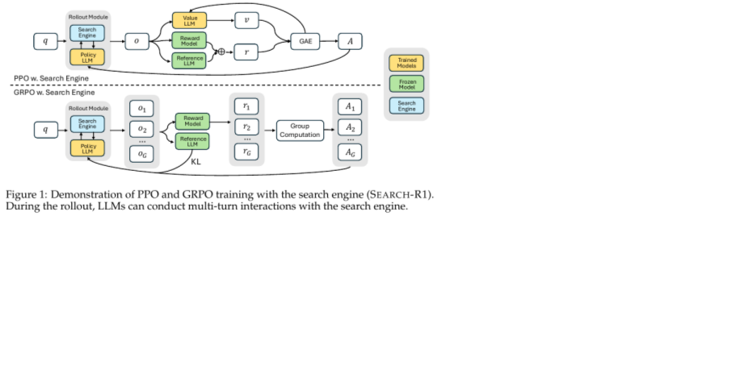
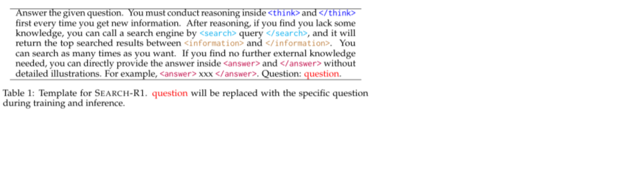
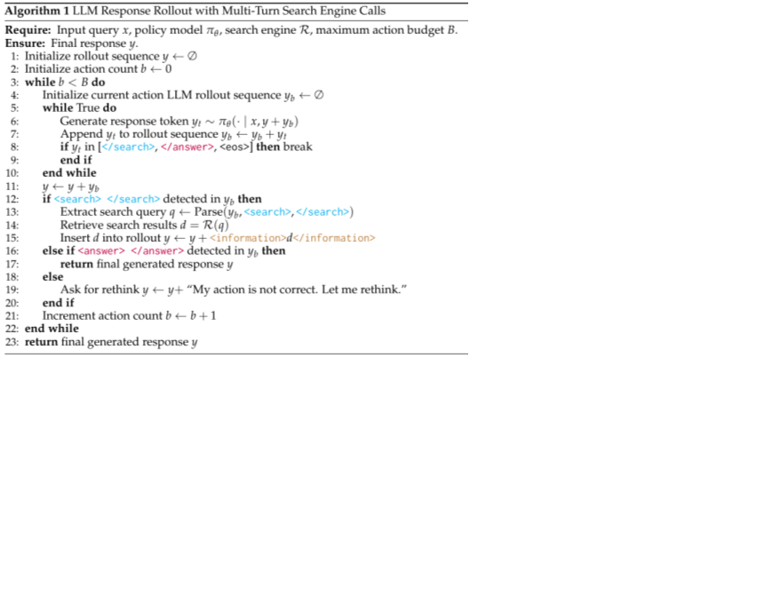
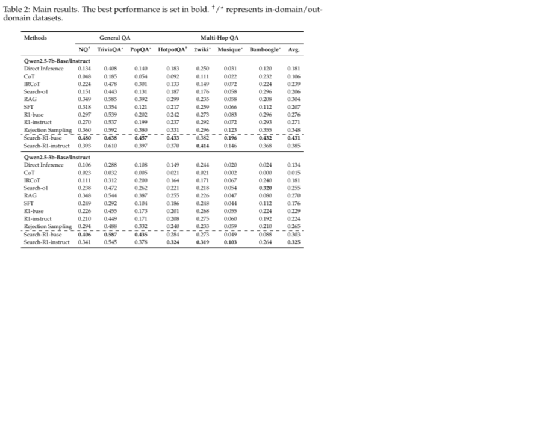
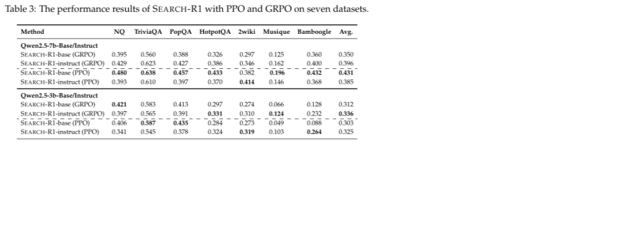
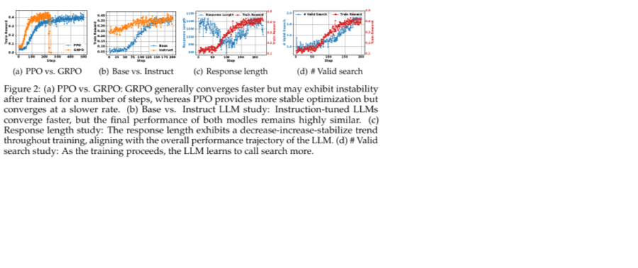
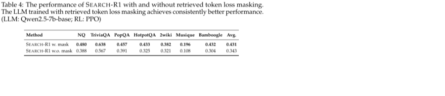
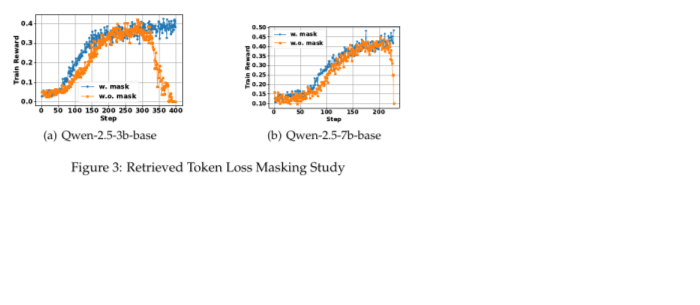

# Search-R1: Training LLMs to Reason and Leverage Search Engines with Reinforcement Learning

## 一句话结论

Search-R1 把搜索引擎从固定 RAG 前处理，改成多轮 RL rollout 里的外部环境动作：模型在 `<think>` 里推理，在 `<search>...</search>` 里主动发 query，系统返回 `<information>...</information>`，最后用 `<answer>...</answer>` 给答案；训练上最关键的是 retrieved token loss masking，只对模型自己生成的 token 做 PPO/GRPO 更新，不把搜索返回文本当成 policy 要学习生成的内容。

它适合作为 agentic RL 入门复现实验，因为动作空间很窄，环境是 search engine，奖励是 exact match，核心 agent 问题却已经具备“何时查、查什么、读完后怎么继续推理”的多轮决策结构。

## 阅读定位

这篇不是通用 web agent，也不是新的检索器论文。它回答的是：如果任务需要外部知识，能不能让 LLM 通过 RL 学会在推理过程中自己调用搜索，而不是依赖人工写好的 RAG prompt 或一次性检索结果。

和前面几篇的关系：

- 相比 Agent Lightning / AgentRL，Search-R1 的环境更简单，只暴露 search action，但公式和 rollout 边界非常清楚。
- 相比 RAGEN，它没有重点研究 Echo Trap 这类训练病灶，但 Table 3 和 Figure 2 也显示 GRPO 会更快但更容易不稳定。
- 相比 MUA-RL，它没有动态用户，只把 search engine 作为环境的一部分。
- 相比普通 RAG，它训练的是“检索策略 + 读检索结果后的推理策略”，不是把 top-k 文档直接塞给模型。

## 解决什么问题

普通 RAG 的决策链通常是固定的：先检索，再生成。Search-R1 认为这不适合需要多跳事实推理的问题，因为模型经常要先想一下缺什么信息，再发第一条 query，读完后再决定是否继续查第二条 query。

论文把问题拆成三个训练难点：

1. 如何把 search engine 接进 RL objective，而不是只在 inference prompt 里接。
2. 如何支持 interleaved reasoning and retrieval，也就是推理、搜索、读结果、再推理的多轮轨迹。
3. 只用 final outcome reward，例如 exact match，能否学出有效搜索行为。

## 方法 / 系统怎么做

### 1. Search engine 是 rollout 环境的一部分

普通 RLHF/R1 形式的目标可以写成：

$$
\max_{\pi_\theta} \mathbb{E}_{x \sim D, y \sim \pi_\theta(\cdot|x)}
\left[r_\phi(x,y) - \beta D_{KL}(\pi_\theta(y|x) \| \pi_{ref}(y|x))\right]
$$

Search-R1 把条件从 `x` 扩展成 `x; R`：

$$
\max_{\pi_\theta} \mathbb{E}_{x \sim D, y \sim \pi_\theta(\cdot|x;R)}
\left[r_\phi(x,y) - \beta D_{KL}(\pi_\theta(y|x;R) \| \pi_{ref}(y|x;R))\right]
$$

这里 `R` 是 search engine。关键差别是，轨迹 `y` 不再全是模型生成文本，而是混合了两类 token：

- LLM-generated tokens: `<think>`、query、answer 等模型自己生成的内容。
- Retrieved tokens: search engine 返回并插入 `<information>...</information>` 的 passages。

所以这篇的核心建模不是“多给模型一些上下文”，而是“把检索调用放进可采样、可奖励、可优化的轨迹里”。

### 2. 用模板定义 action boundary

模板只约束格式，不强塞具体解题策略：每次获得新信息后先在 `<think>` 里推理，如果缺知识，就用 `<search> query </search>` 调搜索；搜索结果由系统包成 `<information>...</information>`；如果不需要再查，就在 `<answer>...</answer>` 里输出最终答案。

这个模板的工程价值很高：它把 action parsing 做成简单字符串边界。对 agent harness 来说，这就是一个最小工具调用协议，不需要复杂 function calling schema 也能训练。

### 3. 多轮搜索 rollout

rollout 过程如下：

1. 模型继续生成 token，直到遇到 `</search>`、`</answer>` 或 `<eos>`。
2. 如果这一步生成了 `<search>...</search>`，系统解析 query，调用搜索引擎 `R(q)`。
3. 搜索结果被写回轨迹：`<information>d</information>`。
4. 模型基于新轨迹继续生成。
5. 如果生成 `<answer>...</answer>`，轨迹结束。
6. 如果动作格式不对，系统插入 `My action is not correct. Let me rethink.` 让模型重新尝试。
7. 超过 action budget `B` 后停止。论文默认 `B=4`，每次检索 top 3 passages。

注意这里的“动作”不是环境里所有可能操作，只是 search query。它已经足够体现 agentic RL 的几个基本部件：policy、environment response、trajectory、terminal answer、verifiable reward。

### 4. Retrieved token loss masking 是稳定训练关键

Search-R1 的轨迹里包含搜索结果。如果直接对整条 token 序列算 policy-gradient loss，就等于要求模型去提高“生成检索文档原文”的概率，这会污染训练目标。

论文用 token mask 解决：

$$
I(y_t)=
\begin{cases}
1, & y_t \text{ 是 LLM 生成 token} \\
0, & y_t \text{ 是检索返回 token}
\end{cases}
$$

PPO 和 GRPO 的 token-level objective 只在 `I(y_t)=1` 的位置计算。直觉是：模型要学会什么时候发 query、query 怎么写、读完信息后怎么回答；不应该学会背诵 search engine 返回的 passage。

### 5. PPO / GRPO 都可用，但稳定性不同

PPO 版本使用 actor-critic 和 GAE，GRPO 版本用同一 prompt 下多条 sampled responses 的 group relative reward 做 baseline，不需要额外 value model。

论文的解释是：GRPO 收敛更快，因为少了 critic warm-up；PPO 更稳，因为 GRPO 训练久了可能 reward collapse。这个观察和 RAGEN 里“多轮 agent RL 很容易先涨后塌”的主题一致。

### 6. Reward 很简单：最终答案 exact match

奖励函数是 rule-based outcome reward：

$$
r_\phi(x,y)=EM(a_{pred},a_{gold})
$$

其中 `a_pred` 从 `<answer>...</answer>` 里抽取，`a_gold` 是标准答案。论文没有用 format reward，也没有训练 neural reward model。重要的是，它证明在搜索工具调用这个较窄环境里，单纯 final answer reward 已经能让模型学出更好的 search behavior。

## 输入、输出、数据类型、模态

- 输入：自然语言 QA 问题 `x`。
- 输出：带结构 token 的文本轨迹，包括 `<think>`、`<search>`、`<information>`、`<answer>`。
- 环境输入：模型生成的 search query。
- 环境输出：E5 retriever 从 2018 Wikipedia dump 取回的 top 3 passages。
- 训练信号：最终答案的 EM reward，以及 PPO/GRPO 的 policy optimization loss。
- 模态：纯文本，没有视觉、语音、GUI 或真实网页浏览。
- 中间表示：interleaved reasoning-retrieval trajectory，而不是独立的 RAG context block。

## 关键结果

### 主结果：Search-R1 明显强于固定 RAG 和普通 R1

Table 2 最该看的不是每个数据集的单点数字，而是平均 EM：

- Qwen2.5-7B：RAG 平均 0.304，Rejection Sampling 0.348，Search-R1-base 0.431，Search-R1-instruct 0.385。
- Qwen2.5-3B：RAG 平均 0.270，Search-R1-base 0.303，Search-R1-instruct 0.325。
- 7B 的提升更明显，说明更大的模型更容易学会“如何搜索”。
- R1-base / R1-instruct 没有 search action，只做 reasoning RL，平均分别是 0.276 / 0.271，说明外部知识环境确实重要。

所以这篇的结论不是“RL 比 RAG 永远强”，而是在相同 retriever、相同 corpus、相同 top-k 条件下，训练模型主动决定搜索时机和 query，比固定 RAG pipeline 更强。

### PPO vs GRPO：不是谁绝对赢，而是速度和稳定性的取舍

Table 3 给了更细的对比：

- 7B-base 上 PPO 最强，平均 0.431，高于 GRPO 的 0.350。
- 7B-instruct 上 GRPO 平均 0.396，略高于 PPO 的 0.385。
- 3B-base / 3B-instruct 上 GRPO 平均 0.312 / 0.336，略高于 PPO 的 0.303 / 0.325。

结合 Figure 2，论文的判断是：GRPO 更快，PPO 更稳。对复现实验来说，如果资源紧、想快速看到搜索行为出现，GRPO 有吸引力；如果要长一点的稳定训练，PPO 更保守。

### 训练动态：模型会逐渐学会多查，而不是只变会写长答案

Figure 2 有四个信息：

- PPO vs GRPO：GRPO 前期上升快，但后面可能不稳定；PPO 慢一些但更平滑。
- Base vs Instruct：instruct model 起点高、收敛快，但最终 base model 能追上接近水平。
- Response length：前期长度下降，说明模型先学会去掉废话；后期长度上升，主要因为开始调用搜索、轨迹里插入了 passages。
- Valid search count：训练推进后，模型有效搜索次数增加，说明 reward 不只是让模型短答，而是推动它使用 search action。

这一点很重要：如果只看答案 EM，会漏掉中间行为是否真的变成“会搜索”。Search-R1 至少用 valid search count 和 response length 给了行为层面的旁证。

### Loss masking：不 mask 检索 token 会明显掉点

Table 4 是这篇最有工程价值的 ablation。Qwen2.5-7B-base + PPO：

- with mask: 平均 0.431。
- without mask: 平均 0.343。

附录 Figure 3 也显示，mask 后训练曲线更稳、reward 更高。这个结果可以直接迁移到其他 agentic RL：只优化 agent 可控的 action/message token，不要把环境返回、工具输出、用户消息、数据库内容误当成 policy action 去优化。

## STAR 分析

- Situation：知识密集 QA 和 multi-hop QA 需要外部信息，固定 RAG 不能动态决定何时继续查。
- Task：训练 LLM 在推理过程中主动发搜索 query、读取结果、继续推理，并用最终答案正确性优化整条轨迹。
- Action：定义 `<think>/<search>/<information>/<answer>` 协议，把 search engine 纳入 rollout；用 PPO/GRPO 训练；对 retrieved tokens 做 loss mask；用 EM outcome reward。
- Result：在 7 个 QA 数据集上，Search-R1 对 Qwen2.5-7B 平均 EM 达 0.431，明显超过 RAG 0.304 和 R1 0.276；masking ablation 从 0.343 提升到 0.431。

## 和我的研究方向的关系

对 agent harness：这篇给了一个最小可复现的 tool-use RL harness。只要能把工具调用边界、环境返回、final verifier reward 定义清楚，就能训练多轮 agent 行为。

对 interaction model：它没有人机交互，但有一个清楚的“新信息进入后先重新 think”的循环。这个模式可以迁移到用户澄清、机器人感知更新、多模态 evidence 更新。

对长期记忆：`<information>` 可以类比 memory retrieval 结果。Search-R1 的 masking 结论提醒我们：训练 memory agent 时，memory content 不应被当成模型生成 token 优化，应该只优化查询、读后推理和最终动作。

对机器人/具身 agent：这篇本身没有物理动作，但 search action 可以替换成 perception query、map lookup、skill call 或 simulator call。真正可复用的是“环境返回 token mask + trajectory-level final reward”的训练接口。

## 局限和不要误读

1. 它不是开放网页浏览 agent。检索源是 2018 Wikipedia dump，retriever 是 E5，默认 top 3 passages。
2. 它不是复杂工具调用框架。工具只有搜索，action schema 也只是字符串 token。
3. 它的 reward 是 QA exact match，适合有标准答案的数据集，不直接覆盖开放任务、偏好任务或长程业务 workflow。
4. 它没有解决 reward hacking 或 verifier 错误问题。EM reward 简单可靠，但任务范围也因此很窄。
5. 它没有证明复杂 prompt/RAG 系统都不如 RL。论文控制了 retriever、corpus、top-k 和训练数据，结论应限于这些设置。
6. PPO/GRPO 对比不能简化成“PPO 一定更好”。表格上 GRPO 在部分模型更高，作者更强调 PPO 稳定、GRPO 快但可能 collapse。

## 可复用点

- 用特殊 token 做工具调用边界，先把 action parsing 做稳，再谈复杂工具协议。
- 把环境返回显式插入 trajectory，但训练 loss 只覆盖 agent 自己生成的 token。
- 用 final outcome reward 先验证闭环是否有效，再考虑 dense reward 或 neural reward model。
- 记录 valid tool call count、response length、reward curve，不只看最终成功率。
- 对每类 token 建 mask：assistant/action token、tool output token、user token、system hint token 应该有不同训练语义。

## 下一步问题

1. 如果 search query 奖励不是最终 EM，而是 evidence recall / citation correctness，会不会更稳？
2. 如果把 search 换成真实 web browser，retrieved token masking 是否仍然足够？
3. 这套方法在多工具场景下如何避免模型为了 reward 过度调用工具？
4. 能不能和 RAGEN 的 uncertainty filtering 结合，只训练有 outcome variance 的问题？
5. 对 memory agent 来说，`<search>` 能否替换成 `<retrieve_memory>`，并沿用同样的 token mask 和 final reward？

## 记忆钩子

Search-R1 = RAG 动态化 + search action RL 化 + retrieved token masking。它最值得记住的不是“搜索提升 QA”，而是“工具/环境返回不是 policy action，训练时必须 mask 掉”。