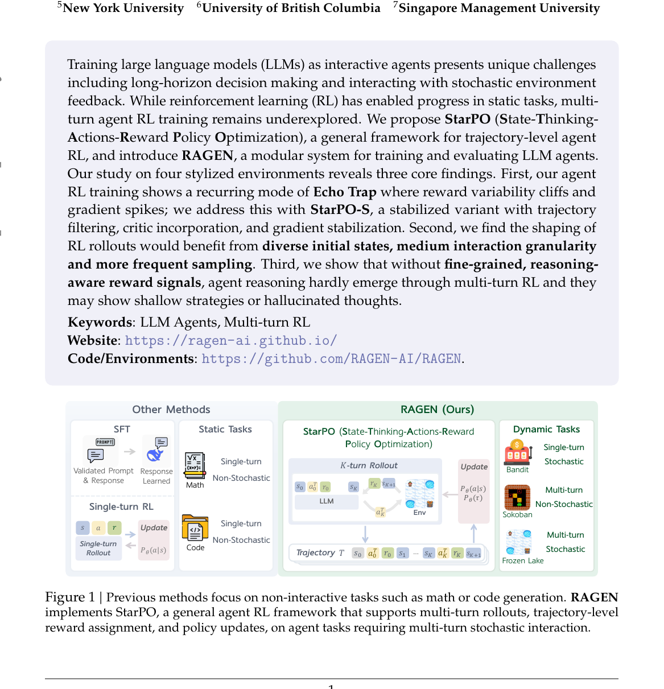
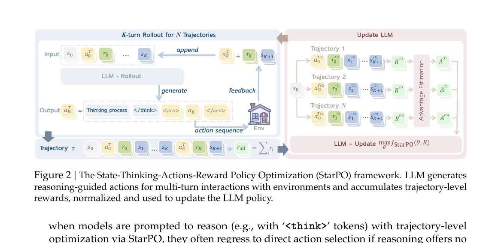
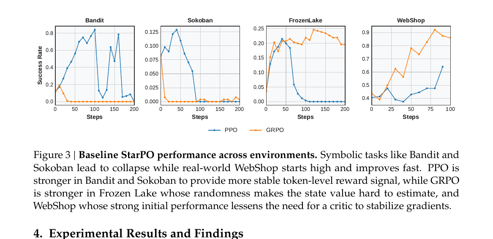
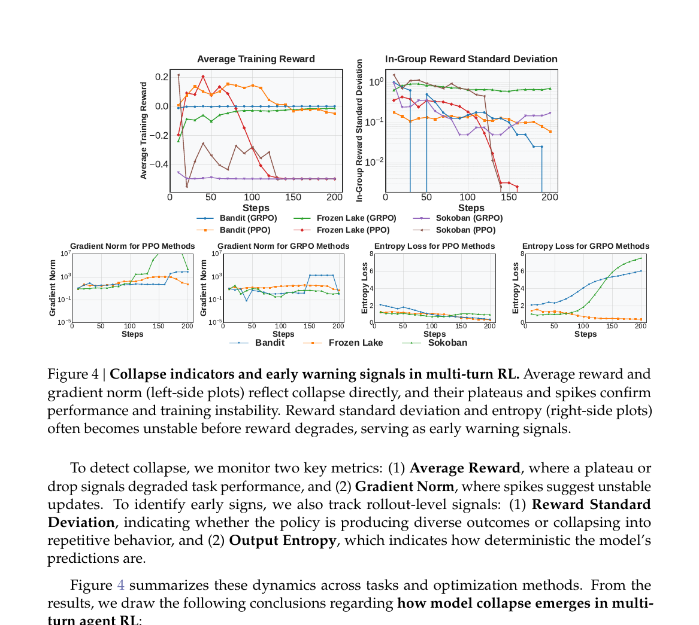
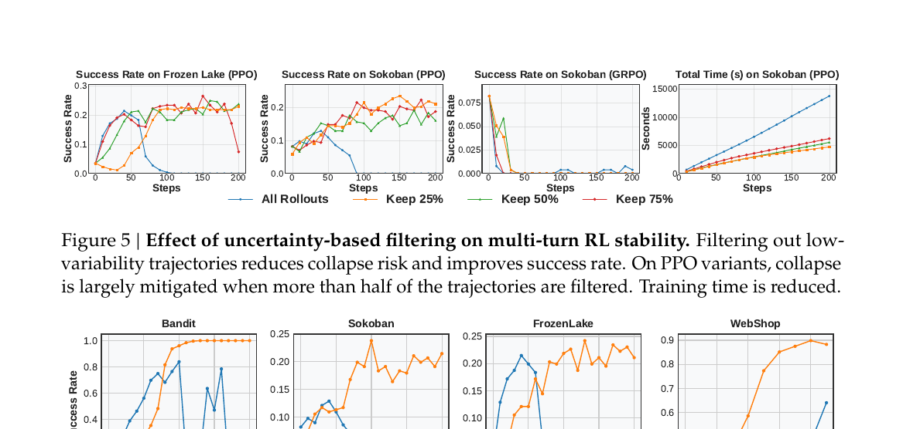
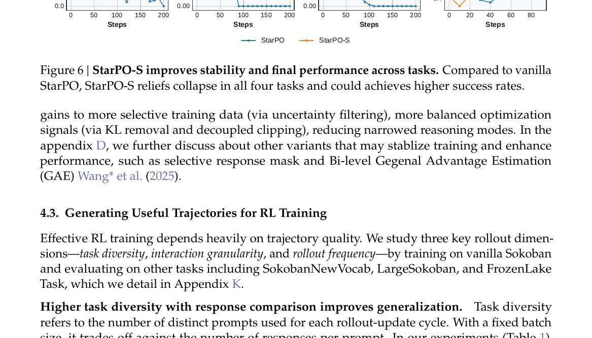
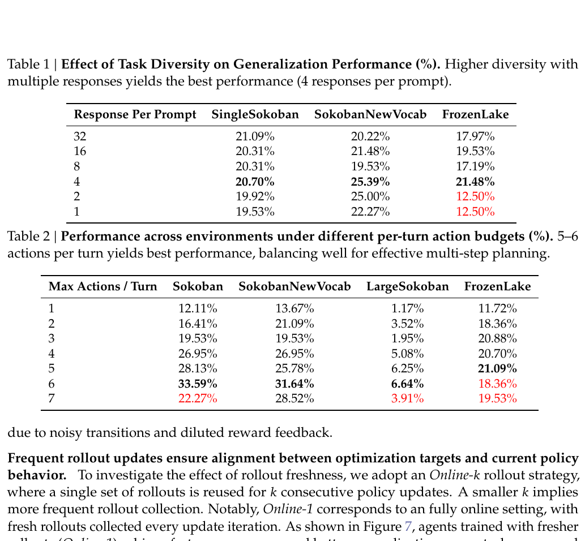
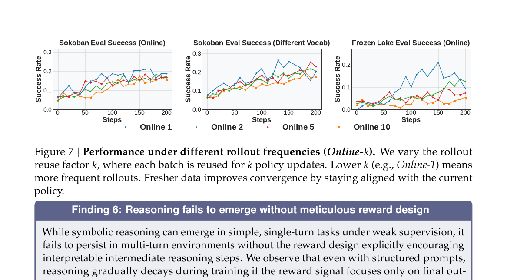
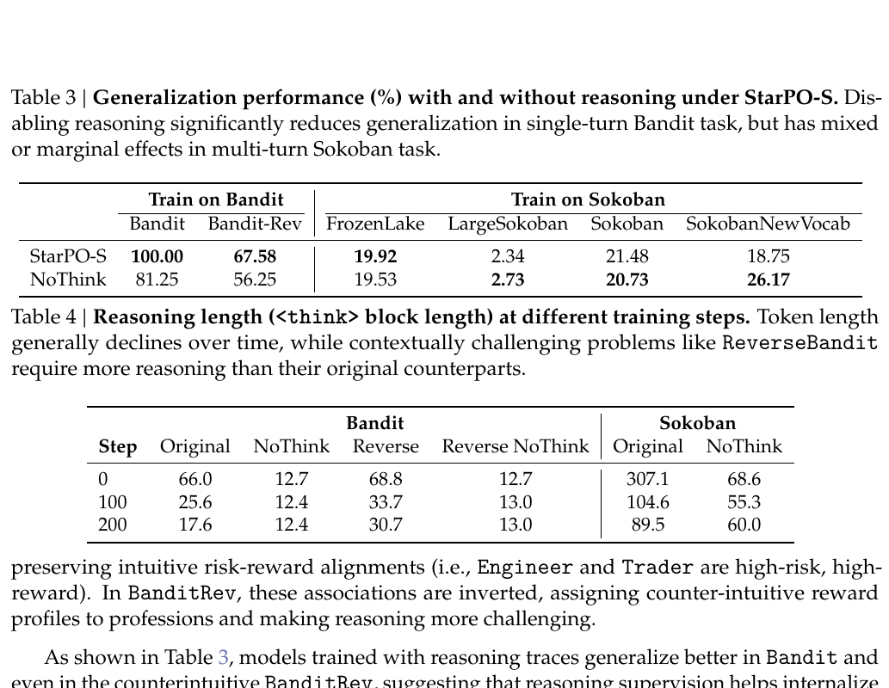

# RAGEN

## 一句话结论

RAGEN 不是一篇追求 SOTA 的 agent benchmark 论文，而是一篇 **agentic RL 训练诊断论文**。它提出 StarPO，把 LLM agent 的多轮交互轨迹作为整体优化对象，并用 Bandit、Sokoban、FrozenLake、WebShop 四类环境系统分析多轮 RL 为什么会崩：reward variance cliff、gradient spike、entropy 异常和 reasoning collapse。

最值得记住的是：**单轮 RL 方法直接搬到多轮 agent 上，常常会先涨后崩；多轮 agent RL 的核心难点是训练稳定性、rollout 质量和细粒度 reward，而不是只把 PPO/GRPO 套上去。**



## 这篇放在阅读路线里的位置

RAGEN 在这条线里应该放在 AgentRL / ARPO / MUA-RL 之前理解也可以，因为它解释了后面很多方法为什么要处理 rollout、advantage、failure、context 和 reward：

| 论文 | 关注点 |
|---|---|
| RAGEN | 多轮 agent RL 为什么不稳定，以及哪些信号能提前预警。 |
| Agent Lightning | 怎样把已有 agent 轨迹接成 transition。 |
| AgentRL / AgentJet | 多环境、多任务训练系统怎么扩展。 |
| ARPO | 多轮工具调用里哪里该局部探索，怎么分配 advantage。 |
| MUA-RL | 把动态用户加入 RL rollout。 |

RAGEN 的价值在于给你建立“训练病理学直觉”：看到 reward variance 掉、entropy 乱跳、gradient norm spike，就要警惕模型可能进入 Echo Trap，而不是盲目继续训。

## 解决什么问题

单轮 RL 常见设定是：给 prompt `s`，模型输出 answer `a`，拿 reward `R(s,a)`。目标是：

```text
J_step(theta) = E_{s ~ D, a ~ pi_theta(.|s)} [ R(s, a) ]
```

但 agent 不一样。agent 在环境里多轮行动：

```text
s_0 -> a_0 -> r_0 -> s_1 -> a_1 -> r_1 -> ... -> s_K
```

这里有几个额外困难：

- reward 延迟，最后成功/失败可能由前面很多 action 共同造成。
- 环境有随机性，同样策略可能得到不同反馈。
- 轨迹长，模型容易过拟合某些局部成功模板。
- 如果只看最终 reward，模型可能学到 shallow strategy，而不是有用 reasoning。
- 自己生成的 rollout 又拿来训练自己，容易出现 self-generated data collapse。

RAGEN 想回答：**LLM agent 在多轮环境里能否通过 RL 自我进化？如果会崩，崩在哪里？怎么稳定？**

## StarPO：把整条 trajectory 当作优化对象

StarPO 全称 State-Thinking-Actions-Reward Policy Optimization。它把 agent 任务形式化为 MDP：

```text
M = {S, A, P}
```

含义：

- `S`：state，环境状态或 interaction history。
- `A`：action，通常是 LLM 生成的一段 token 序列。
- `P`：环境转移和 reward 生成过程。

每一步：

```text
a_t ~ pi_theta(. | s_t, tau_<t)
(r_t, s_{t+1}) ~ P(. | s_t, a_t)
```

其中 `tau_<t` 是之前的交互历史。

StarPO 的总体目标是最大化整条轨迹的 reward：

```text
J_StarPO(theta) = E_{M, tau ~ pi_theta} [ R(tau) ]
```

这和单轮 `J_step` 的区别很关键：StarPO 优化的不是单个 response，而是整条多轮 trajectory。



### Thinking-action 格式

每一步模型输出是：

```text
a_t^T = <think>...</think><answer>a_t</answer>
```

其中：

- `<think>` 是 reasoning trace。
- `<answer>` 里是环境可执行 action。

论文关心一个问题：如果我们给了 `<think>` 格式，多轮 RL 会不会自动让 reasoning 变好？后面结果显示：不一定，甚至经常会变短、变浅、变幻觉。

## StarPO 可接 PPO / GRPO

RAGEN 把 StarPO 当成 trajectory-level abstraction，底层 token update 可以用 PPO 或 GRPO。

### PPO 版本

PPO 用 token-level advantage `A_{i,t}`，并通过 probability ratio clipping 稳定更新：

```text
ratio = pi_theta(token_t | prefix) / pi_old(token_t | prefix)
J_PPO = mean_t min(ratio * A, clip(ratio, 1-epsilon, 1+epsilon) * A)
```

它有 critic/value function 来估计 advantage，优点是 reward 信号更平滑；缺点是多轮随机环境里 value 估计可能很难。

### GRPO 版本

GRPO 不训练 critic，而是对一组 trajectories 的 reward 做组内标准化：

```text
A_i = (R(tau_i) - mean({R(tau_1), ..., R(tau_G)})) / std({R(tau_1), ..., R(tau_G)})
```

然后把这个 trajectory-level advantage 分配给该轨迹里的 token update。

直观理解：同一批 rollout 里，结果比组平均好的轨迹被强化，结果差的被压低。优点是简单；缺点是如果组内 reward 方差很低，advantage 信号会变差，训练容易不稳定。

## 实验环境

RAGEN 使用四类环境：

| 环境 | 类型 | 作用 |
|---|---|---|
| Bandit | 单轮、随机 | 测 risk-sensitive reasoning 和 reward variance。 |
| Sokoban | 多轮、确定性 | 测不可逆 symbolic planning。 |
| FrozenLake | 多轮、随机 | 测长程决策 + stochastic transition。 |
| WebShop | 多轮、开放域语言任务 | 测真实语言 grounding 和 web shopping action。 |

主实验用 Qwen2.5-Instruct 0.5B 跑三个 symbolic tasks，WebShop 用 3B。每批 `P=8` 个初始状态，每个初始状态 `N=16` 条 rollout，最多 5 turns 和 10 actions。

## 关键结果 1：vanilla StarPO 会先涨后崩



图 3 显示：

- Bandit / Sokoban 这类 symbolic task 会 early improve，然后 collapse。
- PPO 在 Bandit / Sokoban 上比 GRPO 稳一些，因为 critic 提供更平滑的 token-level reward signal。
- FrozenLake 上 GRPO 反而更稳，因为 stochastic transition 让 state value 很难估，PPO critic 可能不可靠。
- WebShop 起点高并且能提升，可能因为语言模型已有强 language prior。

结论：**单轮 PPO/GRPO 直接搬到多轮 agent RL，不一定稳定。**

## Echo Trap：多轮 RL 的模式坍缩

RAGEN 提出一个很有用的概念：Echo Trap。

它指模型在训练早期可能产生多样 reasoning，但 RL 会不断强化某些局部拿分模板，最后模型变成重复、确定、浅层的固定话术或固定 action 模式。看起来 reward 可能短期上升，但泛化会变差，后面甚至崩掉。

这和 self-generated data collapse 类似：模型用自己生成的数据训练自己，如果没有足够多样性和稳定约束，就会把自己的偏差越放越大。

## 关键结果 2：collapse 有早期预警信号



RAGEN 监控四个指标：

| 指标 | 说明 | 怎么解读 |
|---|---|---|
| Average reward | 平均训练 reward。 | plateau 或下降说明性能开始崩。 |
| Gradient norm | 梯度范数。 | spike 往往是不可逆 collapse 的标志。 |
| In-group reward std | 同组 rollout reward 方差。 | 太早掉到很低，说明行为/结果多样性消失。 |
| Entropy | 输出分布熵。 | 有效学习通常平稳下降；乱跳或急变常伴随 collapse。 |

重要结论：

- reward std 和 entropy 往往比 reward 均值更早暴露问题。
- gradient norm spike 通常意味着已经进入难恢复的崩溃点。
- 如果 reward std 先掉、entropy 异常、gradient norm 后面 spike，这是一条典型训练崩坏链路。

## StarPO-S：稳定化版本

StarPO-S 用三类手段稳定多轮 RL：

1. **uncertainty-based trajectory filtering**：保留 reward 方差高的 prompt/rollout，过滤低信息样本。
2. **critic incorporation**：在合适任务里利用 critic 平滑 advantage。
3. **gradient shaping**：借鉴 DAPO，包括 KL term removal、Clip-Higher / asymmetric clipping 等。

### 为什么过滤低方差样本

RAGEN 定义 trajectory-level outcome uncertainty：

```text
U(pi_theta, M, s_0) = Std_{tau ~ pi_theta(.|s_0)} [ R(tau) ]
```

也就是：同一个初始状态下，多次 rollout 的最终 reward 标准差。

如果标准差很低，通常有两种可能：

- 太简单：每次都对，没什么可学。
- 太难：每次都错，也没什么有效梯度。

最有价值的是中间状态：模型有时对、有时错，说明它正处在可学习边界上。



图 5 显示过滤低 variability 的轨迹能延迟或避免 collapse，还能减少训练时间。论文默认采用保留 top `25%` 高不确定样本，但也提醒这个比例不一定适合所有场景。

### StarPO-S 整体效果



StarPO-S 相比 vanilla StarPO，在 Bandit、Sokoban、FrozenLake、WebShop 上都能缓解 collapse，并提高最终 success rate。

这说明稳定多轮 RL 不只是调学习率，还要改变样本选择、advantage 稳定性和 gradient clipping 方式。

## 关键结果 3：rollout 质量决定训练质量

RAGEN 分析三个 rollout 设计因素。



### 1. Task diversity

固定 batch size 下，有一个 trade-off：

```text
更多 prompts x 更少 responses per prompt
vs.
更少 prompts x 更多 responses per prompt
```

结果显示：每个 prompt 4 条 responses 时泛化最好。原因是：

- 需要多个 responses 才能做同题对比。
- 但 prompt 也要足够多样，不能只围绕少数初始状态过拟合。

### 2. Action budget

每 turn 允许多少 action 也很重要。

- 1-2 个 action：规划空间不足。
- 5-6 个 action：最好，足够做多步计划。
- 7 个 action：反而下降，因为长 rollout 引入噪声，reward 更稀释。

直觉是：agentic RL 不是 horizon 越长越好，动作预算太长会让 credit assignment 更难。

### 3. Rollout frequency



Online-k 表示一批 rollout 被重复用于 `k` 次 policy update。`k` 越小，rollout 越新。

结果：Online-1 最好，也就是每次 update 都用最新 policy 采样新轨迹。

原因是多轮 agent 的 policy 变化会改变整条轨迹分布，旧 rollout 很快过时。复用太久会造成 policy-data mismatch。

## 关键结果 4：reasoning 不会自动长出来

RAGEN 特别重要的一个结论是：**只给 `<think>` 格式，不代表 RL 会学出真正 reasoning。**



表 3 显示：

- 在单轮 Bandit 上，带 reasoning 的 StarPO-S 比 NoThink 泛化更好，尤其 Bandit-Rev 这种语义和 reward 反转的任务。
- 在多轮 Sokoban 上，reasoning 的收益很混合，甚至 NoThink 在 SokobanNewVocab 上更好。

表 4 显示：reasoning length 随训练下降。

例如：

- Bandit original 从 `66.0` 降到 `17.6`。
- Sokoban original 从 `307.1` 降到 `89.5`。

解释：如果 reward 只看最终成功，模型发现浅层 action 策略也能拿分，就会压缩 reasoning。更糟的是，它可能生成看似合理但和环境状态不一致的 hallucinated reasoning。

所以 RAGEN 的结论是：**emergent reasoning 需要 fine-grained, reasoning-aware reward。** 仅靠最终任务 reward，不足以稳定强化真实 reasoning。

## 和前面论文的区别

### 和 AgentRL / AgentJet

AgentRL、AgentJet 更关心训练系统怎么高效运行。RAGEN 更关心训练信号和训练动态为什么会崩。可以理解为：

```text
RAGEN: 诊断 agentic RL 的训练病灶
AgentRL/AgentJet: 扩展 agentic RL 的训练基础设施
```

### 和 ARPO

ARPO 做 partial rollout 和 advantage attribution，试图更精细地探索工具返回后的关键步骤。RAGEN 解释了为什么这种细粒度 credit/rollout 重要：否则多轮 RL 容易 collapse 或学到 shallow strategies。

### 和 MUA-RL

MUA-RL 把动态用户加入 rollout。RAGEN 提醒我们：加入用户后轨迹更长、更随机，reward 更稀疏，因此更需要监控 reward variance、entropy、gradient norm 和 rollout freshness。

## 输入、输出、数据类型、模态

| 维度 | RAGEN 里的定义 |
|---|---|
| 输入 | MDP 环境、初始 states/prompts、LLM policy、reward function、rollout 参数。 |
| 中间数据 | 多轮 trajectories、states、actions、rewards、reasoning traces、trajectory reward、advantage、entropy、gradient norm。 |
| 输出 | 训练后的 LLM agent，以及训练动态诊断结论。 |
| 模态 | 文本 + symbolic/web environment action；没有视觉、音频、机器人连续控制。 |
| 模型吃什么 | 当前 state + 历史 trajectory，上下文里包含 observation、previous action/reward。 |
| 模型输出什么 | `<think>...</think><answer>action</answer>`，其中 action 被环境执行。 |
| reward | 主要是环境任务成功/进展 reward；论文强调最终 reward 不足以训练 reasoning。 |

## STAR 分析

| 项 | 内容 |
|---|---|
| Situation | 单轮 RL 在数学/代码上有效，但 agent 要在多轮、随机环境中决策，训练更容易不稳定。 |
| Task | 搭建统一多轮 agent RL 框架，分析自我生成 rollout 训练为何会 collapse，并提出稳定化原则。 |
| Action | 提出 StarPO trajectory-level objective；构建 RAGEN 系统；在四类环境中分析 PPO/GRPO；提出 StarPO-S，包括 uncertainty filtering、critic/gradient shaping 和 rollout 设计建议。 |
| Result | 发现 Echo Trap、reward variance cliff、gradient spike、reasoning collapse；StarPO-S 能缓解 collapse；高 diversity、适中 action budget、fresh rollout 更利于稳定训练。 |

## 和我的研究方向的关系

### 对 agent harness

RAGEN 提醒我们，agent harness 不应该只记录 success rate，还要记录训练动态诊断信号：

```text
reward mean
reward std / in-group variance
entropy
gradient norm
response length
reasoning length
rollout freshness
```

这些指标能在最终性能崩之前提前报警。

### 对 interaction model / HCI

RAGEN 没有研究用户交互，但它的结论对 interaction model 很关键：如果只给最终任务成功 reward，agent 可能学到“短平快”的浅层策略，而不是用户可理解、可验证的推理过程。交互型 agent 需要 reward 用户理解、确认、安全和解释质量，否则模型可能完成任务但交互质量变差。

### 对机器人 / embodied agent

机器人任务是更典型的多轮、随机、长程环境。RAGEN 的诊断指标很适合迁移：rollout 方差、entropy、gradient spike、action budget、rollout freshness 都是机器人 RL 里会遇到的问题。但 RAGEN 没有处理连续动作、传感器噪声或安全约束，所以只能提供训练原则，不能直接当机器人方法。

### 对 memory

RAGEN 的 trajectory 视角自然需要短期 memory：state、action、reward、observation history 都进入下一步决策。它没有提出长期记忆模块，但可以把完整 trajectory 存为 experience replay 或 failure analysis 数据。

## 局限和不要误读

- 不要把 StarPO 当成一个全新的底层 RL 算法。它更像 trajectory-level agent RL 框架，底层仍可用 PPO/GRPO。
- 主要实验是 0.5B/3B 小模型和 stylized environments，真实大规模 agent 任务还需要验证。
- WebShop 能提升可能部分依赖已有语言先验，不代表所有真实环境都容易。
- StarPO-S 的 top 25% filtering 是经验设置，不一定普适。
- reasoning collapse 的结论很重要，但论文没有真正解决 reasoning-aware reward，只指出需要更细 reward。
- 没有覆盖多模态、真实用户、机器人或复杂企业 API 状态变化。
- 论文用 symbolic tasks 做干净分析，这有利于诊断，但和真实 tool-use workflow 仍有差距。

## 可复用点

1. agentic RL 实验必须监控 reward std、entropy、gradient norm，而不只是 success rate。
2. 用同一初始状态多 rollout 的 reward 方差衡量样本信息量。
3. 过滤低方差样本，优先训练“有时对有时错”的边界任务。
4. action budget 需要适中，过短学不到规划，过长会增加噪声和 credit assignment 难度。
5. rollout 要尽量 fresh，旧轨迹复用太久会造成 policy-data mismatch。
6. 仅靠 `<think>` 格式不会保证 reasoning，必须设计 reasoning-aware reward 或过程反馈。
7. 如果看到 gradient norm spike，通常已经晚了；更早应看 reward variance 和 entropy。

## 下一步问题

- RAGEN 的 uncertainty filtering 能否和 ARPO 的 entropy-based partial rollout 合并？
- 在 MUA-RL 这种动态用户 rollout 中，reward variance cliff 会不会更严重？
- 对 AgentJet 这种分布式系统，如何实时监控 RAGEN 提出的 collapse indicators？
- reasoning-aware reward 应该如何设计，才能不诱导模型写漂亮但虚假的 reasoning？
- 多模态/机器人任务中，action budget 和 rollout freshness 如何定义？
- 是否能把 Echo Trap 作为 failure mode，交给 SENTINEL 生成 targeted tasks？

## 记忆钩子

`RAGEN = StarPO trajectory-level agent RL + Echo Trap diagnosis + StarPO-S stabilization + rollout design principles`。

最重要的阅读结论是：**多轮 agent RL 不是单轮 GRPO/PPO 的简单放大版；稳定训练要看 reward variance、entropy、gradient norm、rollout freshness 和 reasoning-aware reward。**