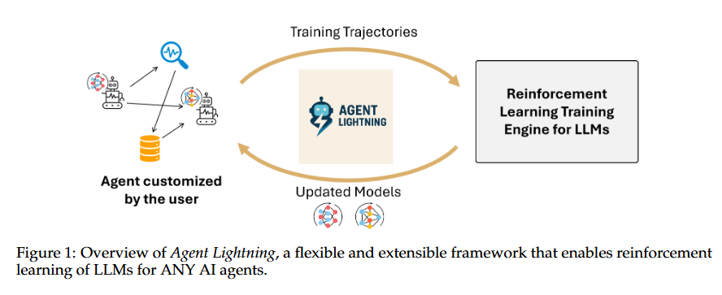
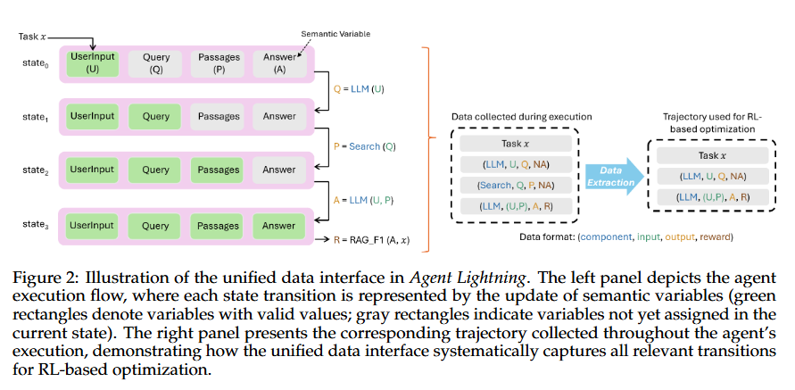
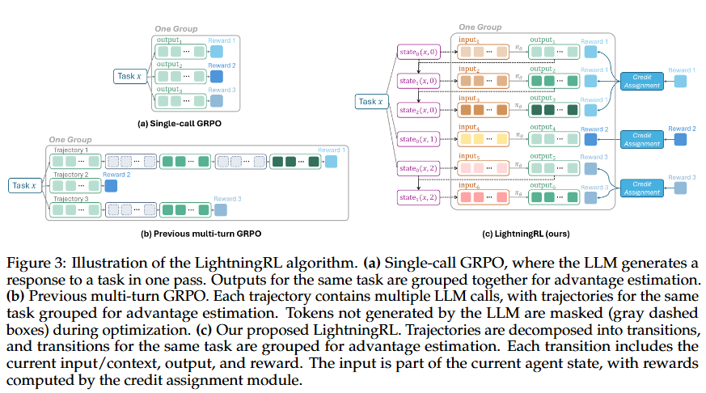
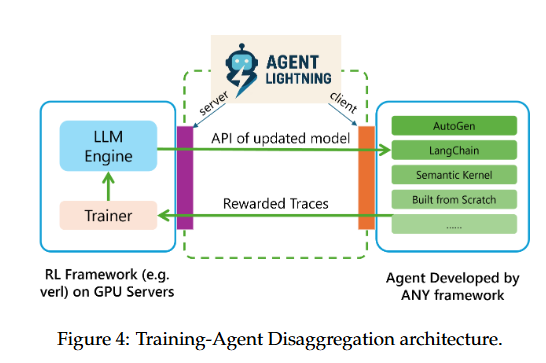
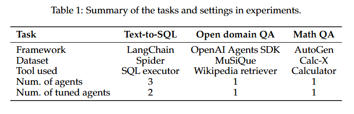
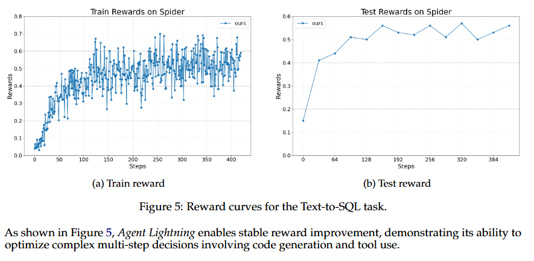
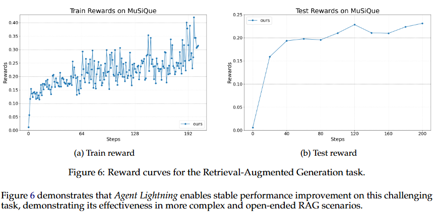
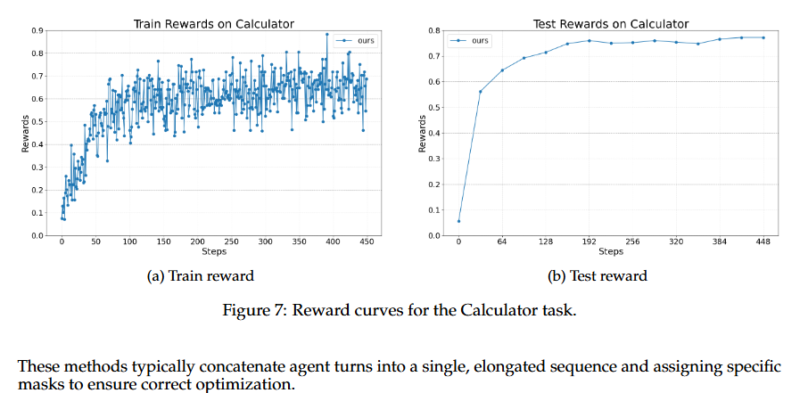

# Agent Lightning

## 一句话结论

Agent Lightning 的核心贡献不是又做一个 agent benchmark，而是提出一套把**任意现有 agent 的运行轨迹转成 RL 训练样本**的接口、算法和系统架构：agent 继续按原框架运行，训练系统只看每次 LLM 调用的 `input -> output -> reward` transition，从而避免把整个多轮轨迹拼成长序列再做复杂 masking。

换句话说，它试图回答：如果我已经有 LangChain / OpenAI Agents SDK / AutoGen / 自己写的 agent，怎么在不重写 agent 的情况下，把真实执行数据接入 RL fine-tuning？



## 这篇放在阅读路线里的位置

前两篇 Agent-Diff 和 tau-bench 主要回答“怎么构造可验证环境、怎么判定 agent 是否真的完成任务”。Agent Lightning 进入下一阶段：**有了可运行任务、reward/verifier 和 agent runtime 以后，怎么把这些交互轨迹喂给 RL 训练系统**。

因此它不是 environment paper，而是 algorithm + system paper。它默认你已经能跑 agent，也能算 reward；它解决的是中间层：轨迹采集、transition 表示、credit assignment、训练服务和 agent runtime 解耦。

精读时可以把它拆成三层看：

1. **Agent runtime 层**：LangChain、AutoGen、OpenAI Agents SDK 或自研 agent 继续照常跑，负责真实工具调用、环境交互、异常处理和最终任务执行。
2. **Trace / transition 层**：系统从 runtime 里抽取每次 LLM 调用的实际 `input -> output`，再挂上最终 reward 或中间 reward，变成 RL trainer 能吃的训练样本。
3. **RL update 层**：训练端不关心 agent 框架内部怎么调度，只把每条 transition 当作一次 policy action，用 PPO/GRPO/REINFORCE++ 这类 LLM RL 方法更新模型。

所以这篇的关键不是“提出了一个特别新的 reward function”，而是把真实 agent 的工程执行过程翻译成 RL 训练接口。它更像 agentic RL 的 adapter / instrumentation layer。

## 解决什么问题

现实 agent 不是单次 prompt completion。一次任务可能包含：

- 多次 LLM 调用，每次 prompt 和角色不同。
- 工具/API/数据库/检索器/环境调用穿插其中。
- 动态 workflow：LLM 可能根据中间结果决定是否继续查、改写、调用工具或结束。
- 多 agent 或多角色：同一个 LLM 可能在不同 prompt 下扮演 SQL writer、checker、rewriter。
- 运行框架分散：LangChain、AutoGen、OpenAI Agents SDK、自研框架各有自己的 trace 和 orchestration。

现有多轮 RL 常见做法是把整条轨迹拼成一个长 token 序列，再 mask 掉不该训练的部分。Agent Lightning 认为这在真实 agent 上很脆弱：

- 训练侧需要理解 agent 的执行逻辑，耦合太重。
- 工具输出、系统消息、协议文本、MCP 交互会导致上下文越来越长。
- mask 规则依赖具体应用，调试和 kernel 实现复杂。
- 拼接序列破坏了每次 LLM 调用本来的输入结构。

它的替代方案是：**不要把轨迹拼成长序列；把轨迹拆成多条 transition，每条 transition 对应一次需要优化的 LLM 调用。**

## 方法 / 系统怎么做

### 1. 把 agent 执行看成 state 和 call 的序列

论文先把 agent 当作一个普通软件系统。一次执行过程中会有很多变量变化，但不是所有变量都值得训练系统关心。它只抓所谓 semantic variables：会被 LLM/tool 读写、代表任务语义的关键变量，例如用户问题、生成的 SQL/query、检索结果、最终答案、错误反馈。

一次 component invocation 被写成：

```text
call_i = (meta_i, input_i, output_i), output_i = C_i(input_i)
```

其中 `C_i` 可以是 LLM，也可以是 tool。`meta_i` 记录 component 名称、类型、版本、endpoint、temperature 等运行信息。

这一步的重要性在于：训练系统不需要还原完整 execution DAG，也不需要理解框架内部每个分支；只要知道哪些调用产生了哪些关键输入输出。

### 2. Unified data interface：把执行轨迹转成可训练 transition

Agent Lightning 的统一接口把一次 agent execution 表示成一串带 reward 的调用：

```text
execution_R(x, k) = { (call_i, r_i) }_{i=1..N}
```

但真正拿去优化 LLM 时，只抽取 policy LLM 的调用：

```text
execution_RL(x, k) = { (input_t, output_t, r_t) }_{t=1..T}, output_t = pi_theta(input_t)
```

这里 `input_t` 就是当前这次 LLM 调用实际看到的 prompt/context，`output_t` 是这次 LLM 生成的完整响应。工具调用本身通常不训练，但工具输出会影响后续 state，因此会进入后续 LLM input。



图 2 的 RAG 例子很好理解：

1. 用户输入问题。
2. LLM 根据问题生成 search query。
3. Search tool 用 query 检索 passages。
4. LLM 根据 passages 和用户问题生成 final answer。
5. reward 通常只在 final answer 后出现。

在传统拼接做法里，这整条轨迹可能被拼成一个长序列；Agent Lightning 则把两次 LLM 调用拆成两条 transition：`问题 -> query` 和 `问题+passages -> answer`。如果后续有 credit assignment，就可以把最终 reward 分配给这两次 decision。

### 3. MDP / POMDP 建模：一次 LLM 调用的整段输出是一个 action

论文把待优化 LLM 建模成 policy。agent 当前快照是 state，LLM 实际看到的 prompt/context 是 observation，LLM 一次调用生成的完整 token sequence 是 action：

```text
state_t: agent 当前执行快照
observation_t/input_t: policy LLM 能看到的上下文
action_t/output_t: LLM 这一次生成的整段文本或工具调用
reward_t: 这次调用或最终任务得到的回报
```

这里的关键选择是：高层 RL 里，一个 action 不是单个 token，而是一次 LLM 调用的完整输出。这样才符合 agent 的实际决策粒度。底层 token-level loss 仍然可以交给 PPO/GRPO/REINFORCE++ 这类现有 LLM RL 方法。

### 4. LightningRL：两层 credit assignment

LightningRL 的思路是 hierarchical RL：

1. Episode/action 层：把一次完整 agent 任务的 return 分配到多次 LLM call / transition 上。
2. Token 层：对每条 transition 内部的 token generation 用现有单轮 LLM RL 算法优化。



图 3 对比了三种训练组织方式：

- Single-call GRPO：一个 task 只生成一个 response，按同一 prompt 下多次采样做 advantage。
- 旧式 multi-turn GRPO：整条多轮轨迹拼在一起，非 LLM 生成部分或不训练部分用 mask 处理。
- LightningRL：轨迹拆成 transition，同一 task 的 transition 组成 group，用 credit assignment 后的 reward 做优化。

当前论文实现里的 credit assignment 很简单：如果只有最终 reward，就把最终 return 等同分给 episode 内每个 action。作者也明确说这是可替换模块，未来可以接 learned value function、heuristic credit、tool-status reward 等更细的分配方式。

这点要谨慎理解：论文真正强的是接口和系统解耦，不是已经解决了长程 credit assignment。现在的 credit assignment 仍然偏粗。

### 5. Training-Agent Disaggregation：训练和 agent runtime 分离

Agent Lightning 的系统架构把训练服务和 agent 运行环境拆开：

- Lightning Server：管理 RL training、模型更新、任务分发，并暴露 OpenAI-like endpoint。
- Lightning Client：运行用户已有 agent，采集 trace/reward，把数据回传给 server。
- Agent runtime：负责并发执行 agent、错误处理、数据采集、环境/reward 服务连接。



这个设计的工程意义很大：

- 训练框架不用知道 LangChain/AutoGen/OpenAI Agents SDK 内部 workflow。
- agent 侧不用和 GPU trainer 部署在同一处。
- agent 仍然像调用 OpenAI API 一样调用模型，只是 endpoint 变成 Lightning Server。
- trace 采集可以复用 OpenTelemetry / AgentOps 这类 observability 工具。
- 多个 client/worker 可以并行 rollout，解决 RL 训练里的 rollout bottleneck。

它还提出 AIR（Automatic Intermediate Rewarding）：从系统监控信号里挖中间 reward，例如工具调用是否成功、是否超时、是否返回错误。这对真实 agent 很有价值，因为只靠最终 reward 时学习信号太稀疏。

### 6. 复读补充：这篇最容易卡住的三件事

第一，`transition` 不是普通日志。普通日志只是“发生了什么”，而 Agent Lightning 要的是“哪一次模型决策可以被训练”。所以一条 transition 至少要能回答：模型当时看到了什么 `input_t`，模型输出了什么 `output_t`，这个输出后来得到什么 reward 或 credit `r_t`。如果只保存完整聊天 transcript，后面很难知道某个 token、某次 tool call、某个 SQL query 应该承担多少责任。

第二，Agent Lightning 没有真正解决长程 credit assignment。它把 episode 拆成多条 transition，这只是让训练接口更干净；至于最终成功/失败到底应该归因给 query、tool call、checker 还是 final answer，论文当前实现仍然比较粗。可以把它理解成：它先把“能不能接 RL”这个工程障碍打通，精细归因还需要后续方法继续做。

第三，Training-Agent Disaggregation 的价值不只是架构漂亮，而是把两个生命周期不同的系统拆开。agent runtime 关心真实工具、外部 API、环境异常、任务并发；RL trainer 关心 GPU、policy update、采样批次、模型版本。如果两边强耦合，每换一个 agent 框架都要重写训练管线。Agent Lightning 用 OpenAI-like endpoint 和 trace instrumentation 把它们隔开。

## 输入、输出、数据类型、模态

| 维度 | 这篇论文里的定义 |
|---|---|
| 输入 | 任务集 `X`、已有 agent、待优化 LLM、工具/API/环境、reward function。 |
| 中间数据 | agent execution trace、semantic variables、LLM/tool calls、transition `(input, output, reward)`。 |
| 输出 | fine-tuned policy LLM，或更一般地说，是能被训练系统消费的 agent trajectory dataset。 |
| 模态 | 主要是文本和工具/API 调用；论文没有处理音频、视频、机器人连续控制。 |
| reward | 可以是最终任务成功 reward，也可以有中间 reward；实验里用 answer accuracy、F1、format score 等。 |
| 模型吃什么 | 每次 LLM 调用实际看到的 prompt/context，而不是整条 agent trace 拼接后的长序列。 |
| 模型输出什么 | 当前调用的完整 response：SQL/query/answer/tool-call text/checker decision 等。 |

## 实验设计和结果

实验不是在证明某个 benchmark SOTA，而是在证明这个框架可以接入不同 agent 框架和任务，并让 reward 稳定上升。



三组实验分别覆盖：

- Text-to-SQL：LangChain + Spider + SQL executor，3 个 agent 角色，只优化 SQL writer 和 rewriter。
- Open-domain QA / RAG：OpenAI Agents SDK + MuSiQue + Wikipedia retriever，优化一个 RAG agent。
- Math QA：AutoGen + Calc-X + calculator tool，优化工具调用和最终答案生成。

### Text-to-SQL / LangChain

任务流程是：SQL writer 生成 SQL，SQL executor 执行，checker 判断 SQL 和检索信息是否足够，rewriter 可能改写 SQL 或生成最终答案。三个角色用同一个 LLM 加不同 prompt 扮演，但训练时只选择性优化 SQL writer 和 rewriter。



这组说明 Agent Lightning 能在多角色 workflow 里只训练部分 transition，而不是把整条轨迹都硬塞进 loss。

### RAG / OpenAI Agents SDK

任务是多跳开放域 QA：LLM 先生成自然语言 query，用 retriever 检索 Wikipedia，再决定继续改 query 还是生成答案。reward 是：

```text
R = 0.9 * R_correctness + 0.1 * R_format
```

其中 correctness 用答案 word-level F1，format 要求输出满足 `<think>...</think>`、`<query>...</query>`、`<answer>...</answer>` 这样的格式。



这组说明 transition 方式可以训练 query formulation + answer generation，但它仍依赖可计算 reward；如果 verifier 很弱，训练信号也会弱。

### Math QA / AutoGen

任务是用 calculator tool 解决数学问题。LLM 要决定何时调用 calculator、如何解释工具输出、如何整合成最终答案。



这组说明它能接 AutoGen 风格工具调用 agent，并在工具增强推理任务里让 reward 上升。

## STAR 分析

| 项 | 内容 |
|---|---|
| Situation | 现有 LLM RL 框架主要适配单轮 prompt-response，而真实 agent 是多轮、多工具、多框架、动态 workflow。 |
| Task | 让已有 agent 在几乎不改代码的情况下接入 RL 训练，同时让训练系统不需要理解每个 agent 框架的内部逻辑。 |
| Action | 定义 unified data interface，把 agent trace 拆成 LLM call transition；提出 LightningRL 做 transition-level credit assignment + token-level RL；设计 Training-Agent Disaggregation 架构分离训练服务和 agent runtime。 |
| Result | 在 LangChain Text-to-SQL、OpenAI Agents SDK RAG、AutoGen calculator 三类任务上 reward 曲线稳定上升，证明框架可接不同 agent 生态。 |

## 和我的研究方向的关系

### 对 agent harness 的关系

这篇最值得复用的是 harness 层抽象：

```text
agent runtime -> trace/semantic variables -> transition dataset -> reward/credit assignment -> RL trainer
```

如果我们做自己的 agent/robot harness，可以把每次模型决策都记录成 transition，而不是只保存一整段聊天记录。这样后面无论做 RL、SFT、behavior cloning、failure replay、verifier training，数据都更干净。

### 对 interaction model 的关系

它没有直接研究人机交互界面，但它给 interaction event logging 一个训练导向的格式：

- 用户输入是什么。
- agent 当前可见上下文是什么。
- agent 输出了什么动作/话语/工具调用。
- 环境状态如何变化。
- 这个 step 或 episode 的 reward/feedback 是什么。

这和我们关心的 execution feedback、用户可打断 agent、结构化事件流是同一层问题。区别是 Agent Lightning 面向训练，HCI 方向还要面向用户理解和控制。

### 对 robot / embodied agent 的关系

论文目前主要是文本 agent + tool/API。要迁移到 robot/VLA，需要改造三点：

- `state` 不能只是 semantic variables，还要包含视觉观测、机器人状态、目标物、动作历史等。
- `action` 可能不是完整文本，而是离散 action token、连续控制 chunk、或语言到动作 policy 的中间命令。
- `reward` 不能只靠最终答案正确性，还要接 execution success、safety constraint、human correction、trajectory quality。

但它的“训练系统和 agent runtime 解耦”对机器人很有启发：真实 robot rollout 昂贵且和 GPU trainer 部署环境不同，分离 runtime/server 是必要的。

### 对 memory 的关系

这篇没有提出长期记忆机制，但 transition 数据天然可以成为 memory/experience replay 的输入。尤其是失败轨迹：如果每个 transition 都有 state/action/reward/error，就可以后续做失败归因、经验检索、反思总结，而不是只保存最终对话。

## 局限和不要误读

- 不要把它当成完整解决 agentic RL 的算法论文。LightningRL 当前 credit assignment 很简单，核心价值更多在接口和系统。
- 不要把 reward 曲线当作泛化能力已充分证明。实验任务数量有限，模型是 Llama-3.2-3B-Instruct，主要展示可训练性和框架兼容性。
- 不要忽略 verifier/reward 的质量。Agent Lightning 假设 reward function 存在；如果 reward 会被 hacking，训练会放大错误行为。
- 不要以为“任意 agent”真的零成本。论文强调 almost zero code modification，但实际仍需要 endpoint 替换、trace/reward 接入、环境稳定运行、错误处理和批量 rollout。
- 对多 LLM / 多 agent 协作，它承认更原则的做法应使用 MARL 或 game-theoretic formulation；当前主要支持选择性抽取 transition 分别优化。
- 对 multimodal / embodied / real-time interaction 没有直接实验。

## 可复用点

1. 记录每次 LLM call 的 raw input/output，而不是只记录最终 transcript。
2. 把工具调用、环境返回、用户反馈都挂到 state transition 上，形成可训练轨迹。
3. 训练样本的基本单位用 transition，不用整条 episode 拼接。
4. agent runtime 和 trainer 分离；runtime 负责真实工具/环境，trainer 负责模型更新。
5. 复用 observability infrastructure 做 trace collection，比如 OpenTelemetry。
6. reward 设计里区分 final reward 和 intermediate reward；能从系统信号自动挖的中间 reward 要尽量挖。
7. 对多角色 agent，显式标记 Component of Interest，只训练目标角色/目标 LLM call。

## 下一步问题

- 和 AgentRL 相比：Agent Lightning 更强调“任意 agent 接入训练”的系统解耦；AgentRL 是否更强调多任务、多轮 rollout-training 的算法和训练框架？
- 和 CacheRL 相比：Agent Lightning 没有解决 rollout 成本；CacheRL 的 cached rollout/hybrid reward 是否能接到这种 transition 接口？
- 和 SENTINEL 相比：Agent Lightning 没有专门利用失败轨迹；SENTINEL 的 failure-driven task generation 能不能直接消费这些 transition？
- 如果把 Agent-Diff/tau-bench/AppWorld 的 verifier 接到 Agent Lightning，reward 会不会足够稳定？哪里最容易 reward hacking？
- 对 robot/VLA，要如何定义 semantic variables，才能同时保留视觉 grounding 和连续控制信息？

## 记忆钩子

`Agent Lightning = existing agent runtime + OpenAI-like training endpoint + trace instrumentation + transition-level RL`。

它的关键不是“RL 算法很强”，而是“不要重写 agent；把真实 agent execution 拆成 transition，让 RL trainer 只吃每次 LLM call 的 input/output/reward”。