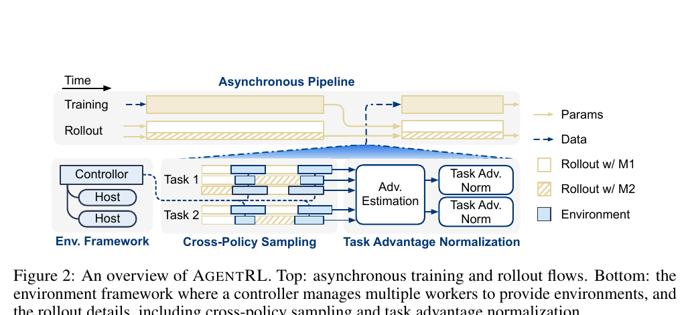
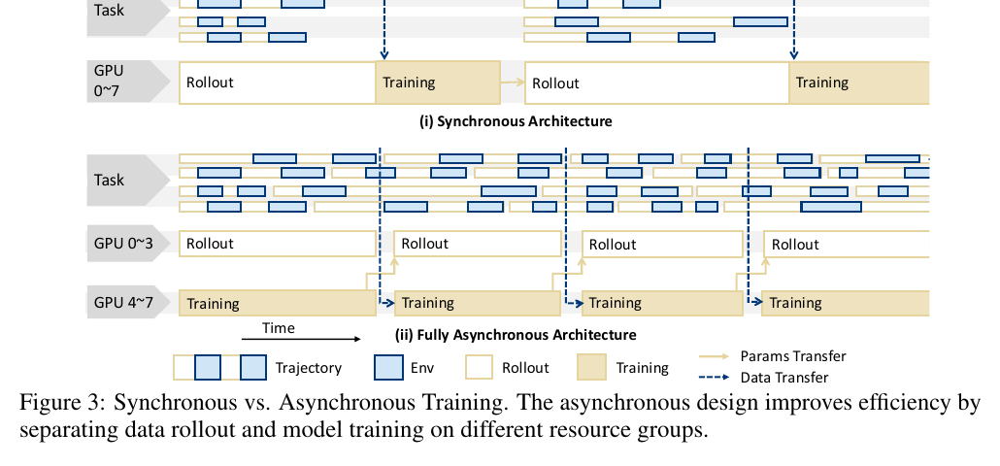
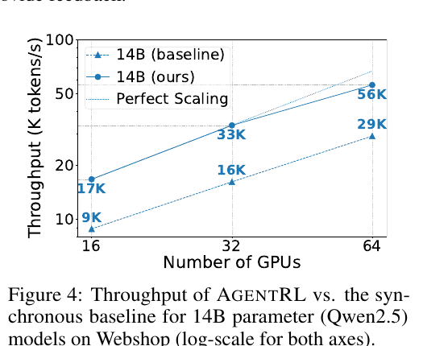
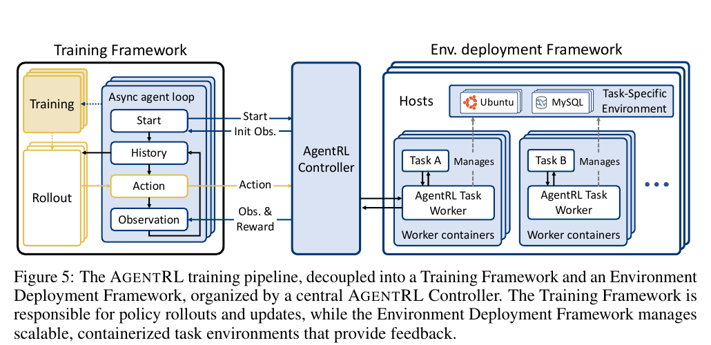
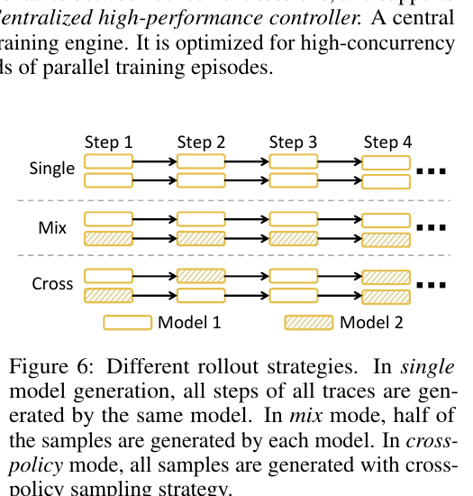
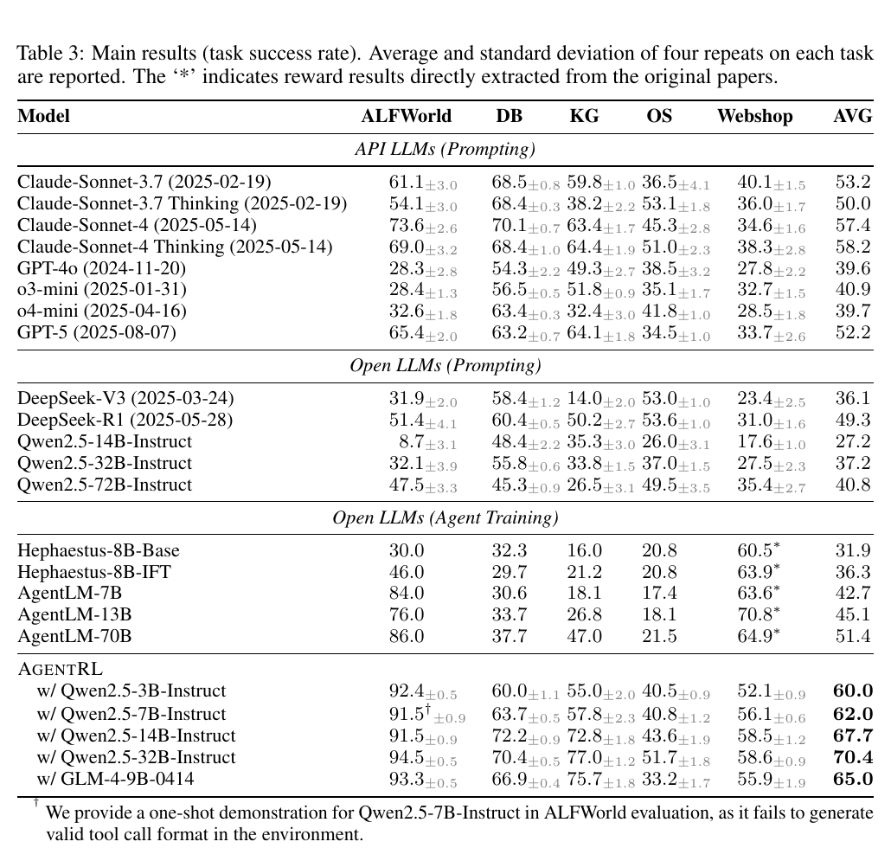
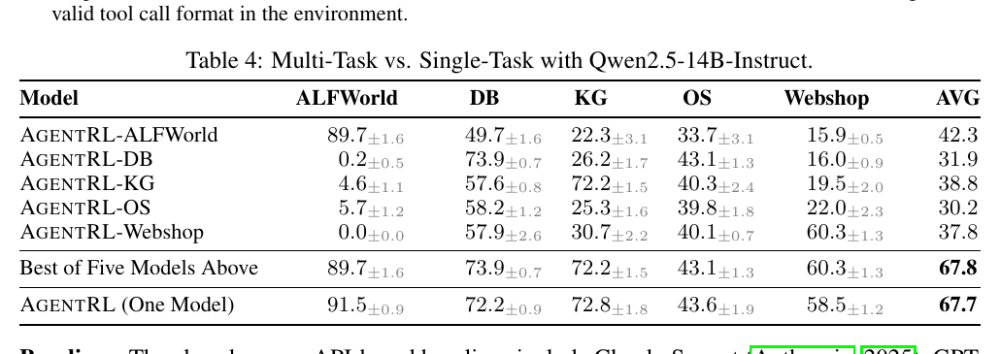
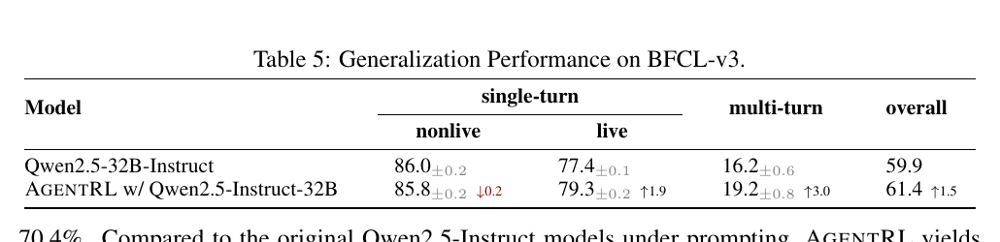
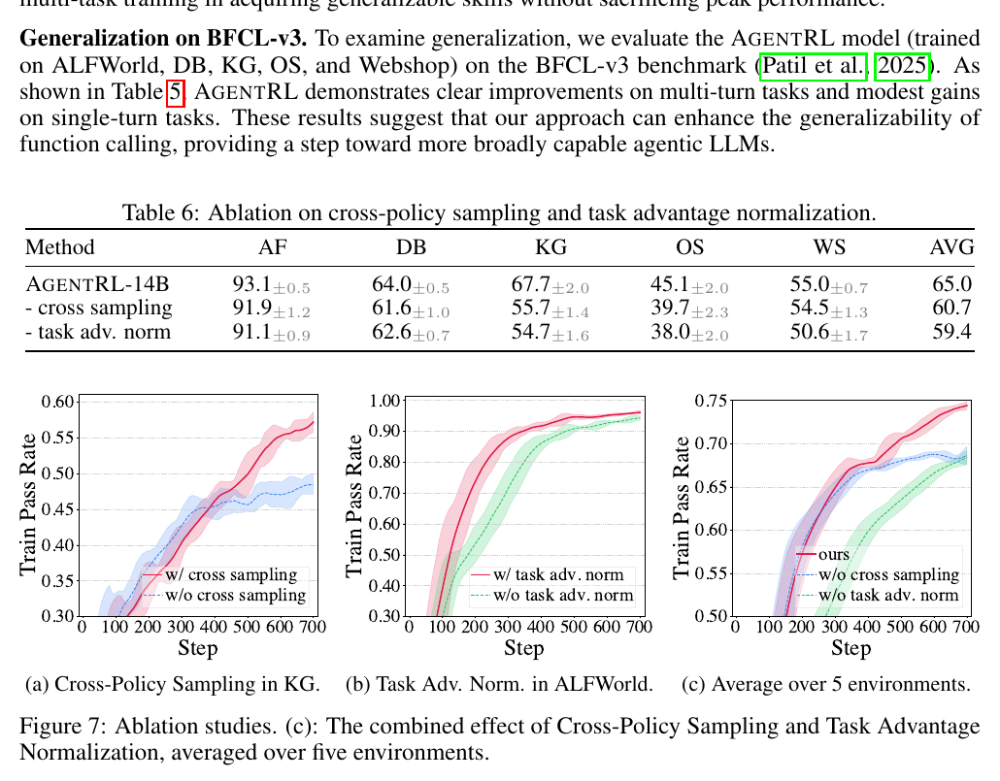
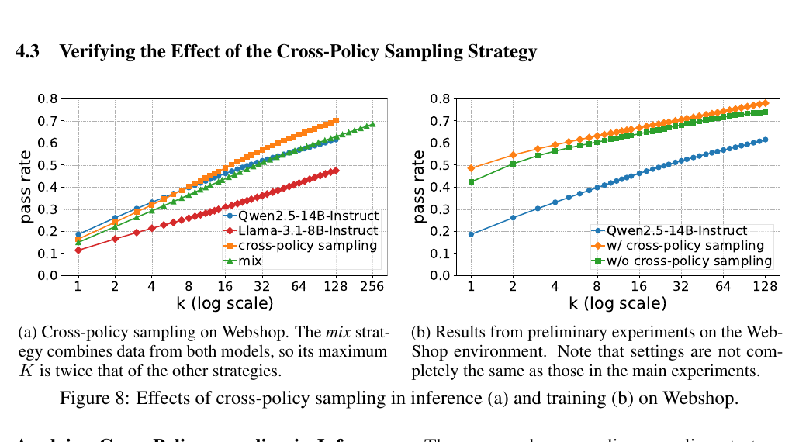

# AgentRL

## 一句话结论

AgentRL 的核心不是发明新的 RL objective，而是把**多轮、多任务 agent RL 的系统吞吐、环境部署和训练稳定性一起解决**：用完全异步的 rollout-training pipeline 提高硬件利用率，用统一 Function Call API 和容器化 worker 托管异构环境，再用 cross-policy sampling 扩大探索范围、用 task advantage normalization 减少不同任务学习速度不一致造成的干扰。

最值得记住的区别是：**Agent Lightning 解决“现有 agent 怎么接入 RL”，AgentRL 解决“接入以后，怎么把多环境训练跑得快、跑得稳，并训练出一个多任务模型”。**



## 这篇放在阅读路线里的位置

Agent-Diff 和 tau-bench 主要解决环境与 verifier；Agent Lightning 解决 agent runtime 与 RL trainer 的接口解耦；AgentRL 再往前走一步，关注实际训练集群中的四个问题：

- 多轮轨迹长度不一，同步 batch 会让快任务等待慢任务。
- 数据库、知识图谱、OS、网页和文本游戏等异构环境难以统一部署。
- 多轮决策空间大，单一 policy 在训练中探索性会下降。
- 多任务的 reward、序列长度和学习速度不同，直接混训会互相干扰。

因此，这是一篇 **algorithm + infrastructure + empirical system** 论文。原始阅读理由“多任务、多轮 agentic RL 框架，异步 rollout-training、function-call API、cross-policy sampling”是准确的，但还应补上第四个关键词：**task advantage normalization**。

## 解决什么问题

### 多轮 agent 为什么不能照搬同步 LLM RL

单轮 RL 可以一次生成 completion，再统一组成 batch 更新。多轮 agent 每一步 action 后都要等待外部环境返回 observation，轨迹还可能因成功、错误、超时或达到最大轮数而提前结束。

同步 rollout 会让短轨迹等待最长轨迹；rollout 结束后才训练，训练期间 rollout GPU 又可能闲置。任务越多、轨迹长度方差越大，pipeline bubble 越严重。

### 多任务为什么不等于把数据混在一起

五个任务的接口、状态、action space、运行成本和 episode 长度不同。即使统一成文本，优化信号也不同尺度：简单任务很快出现正 reward，困难任务可能长期失败；长轨迹贡献更多 token；advantage 方差大的任务可能主导梯度。因此多任务 agent RL 同时是**环境编排、数据调度和优化尺度**问题。

## 方法 / 系统怎么做

### 1. 完全异步 rollout-training

AgentRL 把 rollout engine 和 training engine 放在不同资源组中并发运行。训练端每完成一次更新，就拉取当前可用数据，不等待固定大 batch 的所有轨迹结束；batch size 可在范围内动态变化。



图 3 的重点不是简单并行，而是两类资源不再按阶段交替空闲：rollout GPU 持续与环境交互，training GPU 持续消费已完成 trajectory，coroutine scheduler 用可执行任务填补空槽。

异步会引入 off-policy 风险：rollout 可能由旧参数生成，而 trainer 已更新。论文限制 data queue 最大长度，并在每个训练 step 尽量消费已生成轨迹，使数据接近最新 policy。这只是限制 policy staleness，不是严格消除；论文也没有给出“陈旧多少步会失稳”的边界。

### 2. 吞吐量提升



在 Qwen2.5-14B、WebShop 上，异步方案相比同步 baseline 接近 2 倍 token throughput：16/32/64 GPUs 约从 `9K/16K/29K` 提升到 `17K/33K/56K tokens/s`，并更接近理想扩展线。

正确解读是“该 workload 中减少等待显著提高吞吐”，不是所有 agent RL 都固定加速 2 倍。增益取决于环境延迟、轨迹长度方差、资源比例和参数同步成本。

### 3. 异构环境基础设施



环境侧有三层设计：

1. **Function-call environment interface**：统一 action 协议。
2. **Containerized worker**：每个环境是隔离执行单元，便于资源分配和故障隔离。
3. **Central controller**：统一创建 session、分发交互、处理 timeout、回收环境，并管理数千并行 episode。

附录说明 worker 内部的 environment controller 负责 session 实例化、交互、超时和清理；全局 controller 使用 non-blocking dispatch、严格锁顺序、故障检测、自愈和 stale-data cleanup。

真正可复用的不是“把 action 转成 JSON”，而是把**环境生命周期**也抽象成统一 worker/controller API。

### 4. Cross-policy sampling：在一条轨迹内部切换 policy

- `single`：整条轨迹由同一个模型生成。
- `mix`：不同完整轨迹来自不同模型，但一条轨迹内部不切换。
- `cross`：同一条 trajectory 的每个环境 step 都可以从 policy pool 随机选择模型。



附录 C 定义：

$$
\tau^c = \left(s^{(0)}, a^{c,(0)}, r^{(1)}, s^{(1)}, a^{c,(1)}, r^{(2)}, \ldots, s^{(T)}\right),
\qquad
a^{c,(t)} \sim \operatorname{random}(\mathcal{M})(\cdot \mid s^{(t)})
$$

$\mathcal{M}$ 是 policy 集合。一个模型可能擅长规划但陷入不调用工具的循环，另一个规划较弱却倾向继续尝试工具；step-level 切换可能拼出单个模型不易发现的成功路径。

主训练并没有长期混合不同架构的大模型。实际做法是把部分 rollout engine 标成 **stale engine**，每隔多个 step 才同步参数。policy pool 实际是“当前模型 + 若干早期版本”，用版本差异近似多 policy 探索。跨架构模型主要出现在前期验证和案例中。

### 5. Task advantage normalization

AgentRL 基于 GRPO。对任务 $i$ 的当前 batch，收集所有 action token 的 advantage：

$$
\mathcal{A}^{\text{tok}}_i = \{\hat{A}_{i,s,g,t,k}\}
$$

$s$ 是 sample，$g$ 是同一 sample 的 rollout，$t$ 是环境 step，$k$ 是 action token 位置。然后只在同一任务内部标准化：

$$
\tilde{A}_{i,s,g,t,k}
=
\frac{\hat{A}_{i,s,g,t,k} - \mu_i}{\sigma_i},
\quad
\mu_i = \operatorname{mean}(\mathcal{A}^{\text{tok}}_i),
\quad
\sigma_i = \operatorname{std}(\mathcal{A}^{\text{tok}}_i)
$$

这样每个任务的 token-level advantage 在当前 batch 中变成零均值、单位方差，避免 reward 方差大、轨迹长或暂时学得快的任务压过其他任务。

它解决的是**任务间优化尺度对齐**，不是跨任务 credit assignment；也可能抹掉任务之间有意义的绝对难度差异。

## 输入、输出、数据与模态

### 输入与输出

每个 step 的模型输入由对话历史、当前环境 observation、函数 schema 和任务上下文组成，采用 OpenAI Function Call Format。模型输出结构化 function call 或最终文本答案；controller 执行调用并返回 observation/reward。

论文没有视觉、音频或连续传感器输入，也没有机器人连续 action。

### 中间表示

```text
task sample
  -> multi-turn trajectory
  -> state / action / observation / reward
  -> action-token advantages
  -> task-wise normalized advantages
  -> GRPO update
```

系统侧还维护 session、container、trajectory queue、policy version 和环境生命周期状态。

### 五类训练任务

- **ALFWorld**：文本家庭环境中的导航、物体操作和规划。
- **DB**：自然语言转 SQL、schema 理解、查询和数据库修改。
- **KG**：通过工具在知识图谱中逐步检索和组合关系。
- **OS**：Ubuntu 文件、目录和命令行操作。
- **WebShop**：搜索、筛选、比较商品并完成购物目标。

ALFWorld 和 WebShop 使用已有训练集；OS、KG、DB 的部分实例由 o3 和 Claude 4 Sonnet 通过 Self-Instruct 生成、筛选；DB 还加入 BIRD。较小数据集会重复采样，使五个任务近似均匀出现。

### 训练配置

- Verl 的 fully asynchronous 改造版。
- GRPO + cross-policy sampling + task advantage normalization。
- Qwen2.5-3B/7B/14B/32B-Instruct、GLM-4-9B。
- rollout temperature `0.8`，每个 sample 采样 `8` 条 trajectory。
- 整条轨迹 binary reward；超出最大轮数或长度罚 `-0.2`。
- SGLang inference、FSDP training。
- H800；14B 最低 16 GPUs；多任务训练超过 1000 steps。

Qwen 直接从 instruct model 做 RL；GLM-4-9B 先用少量 SFT 适配 Function Call Format。

## 关键实验怎么读

### 1. 主结果：任务内 RL 提升很大



Qwen2.5-32B 仅 prompting 平均 `37.2`，AgentRL 后达到 `70.4`。其他 AgentRL 模型为：3B `60.0`、7B `62.0`、14B `67.7`、GLM-4-9B `65.0`。

表中 Claude Sonnet 4 Thinking 为 `58.2`，GPT-5 `52.2`，DeepSeek-R1 `49.3`。但正确解读是：**在这五个训练环境上专门 RL 的模型，超过未针对这些环境训练的通用 API 模型。** 不能推出 AgentRL-32B 的通用 agent 能力超过 GPT-5 或 Claude。

另有评测例外：Qwen2.5-7B 在 ALFWorld 不能稳定生成合法 tool-call format，因此该项给了 one-shot demonstration。

### 2. 一个多任务模型接近五个 specialist 的上包络



五个单任务模型各取最擅长任务，`Best of Five` 平均 `67.8`；一个多任务 AgentRL-14B 为 `67.7`。单任务 agent 的跨环境迁移却很差，例如 DB specialist 在 ALFWorld 几乎归零。

这证明联合训练能共享一个 policy 且基本不牺牲整体峰值，不等于证明单任务 RL 会自然产生通用能力。

### 3. BFCL-v3：有泛化，但幅度有限



AgentRL-32B 未在 BFCL-v3 上训练。相比 base model：

- single-turn nonlive：`86.0 -> 85.8`，`-0.2`。
- single-turn live：`77.4 -> 79.3`，`+1.9`。
- multi-turn：`16.2 -> 19.2`，`+3.0`。
- overall：`59.9 -> 61.4`，`+1.5`。

所以有小幅 function-calling transfer，主要集中在 multi-turn；证据还不足以支持很强的 generalist 结论。

### 4. 两个组件都有独立贡献



14B 完整配置平均 `65.0`；去掉 cross-policy 为 `60.7`，下降 `4.3`；去掉 task advantage normalization 为 `59.4`，下降 `5.6`。曲线显示 cross-policy 对 KG 探索帮助明显，task normalization 减少 ALFWorld 波动并改善五任务平均曲线。

### 5. Cross-policy 不是简单增加样本量



WebShop preliminary experiment 中，小 $k$ 时 cross 可能不如最强单模型；随着 $k$ 增大，cross 的 `pass@k` 超过两个单模型和 mix。这支持“step-level policy 组合发现新成功路径”的解释。

不过图 8b 明确注明设置与主实验不完全相同。它是机制证据，不是主结果的严格复现。

## STAR 分析

### Situation

多轮环境交互带来同步等待、异构部署、探索下降和多任务干扰。

### Task

构建能同时训练多个多轮任务的框架，使 rollout/training 可扩展，并让一个模型共同学习五类工具环境。

### Action

异步资源池与动态 batch；统一 Function Call 和环境生命周期 API；容器化 worker 与中央 controller；stale policy cross sampling；task-wise token advantage normalization；在五环境上用 GRPO 训练多个模型尺寸。

### Result

14B WebShop 吞吐接近同步 baseline 的 2 倍；32B 五任务平均从 `37.2` 到 `70.4`；一个多任务 14B 以 `67.7` 接近五个 specialist 的 `67.8`；BFCL overall `+1.5`；两个算法组件消融分别下降 `4.3` 和 `5.6`。

## 和 Agent Lightning 的区别

| 问题 | Agent Lightning | AgentRL |
| --- | --- | --- |
| 首要目标 | 现有 agent runtime 接入 RL trainer | 多轮、多任务 RL 高吞吐稳定训练 |
| 核心抽象 | 每次 LLM call 是 transition | trajectory queue + worker/controller + task batch |
| 主要解耦 | agent execution 与 RL training | rollout、training 与 heterogeneous environments |
| 算法重点 | credit assignment | cross-policy exploration、task-wise normalization |
| 环境假设 | 已有 agent 和 reward 可黑盒运行 | 环境接入统一 Function Call / lifecycle API |

两者可组合：用 Agent Lightning 风格的 observability/transition 接口接入现有 agent，再用 AgentRL 风格的异步 rollout、环境调度和多任务优化扩展训练。

## 和我们的研究方向的关系

### Agent harness

高相关。最可复用的是统一生命周期：`create session -> observe -> function call -> step -> reward -> terminate/timeout -> cleanup`。

### Interaction model

中等相关。论文有 policy-environment loop，但 observation 仍是文本/function result，没有真实用户意图变化、打断、确认、控制权或 turn-taking。

### 机器人 / embodied agent

方法可迁移，证据不足。异步 rollout 和容器化 simulator 有用，但没有视觉输入、连续 action、真实机器人延迟、sim-to-real 或安全约束。Function Call API 不能替代高频连续控制。

### 多模态实时 agent

低到中相关。异步架构适合长短不一的 streaming episode，但没有音视频流、时间戳、并发模态或低延迟 action channel。

### Memory

低相关。history 只是 episode 内上下文，不是跨 episode 的可持久化、检索式长期记忆。

### Verifier / reward

论文依赖 binary trajectory reward，本身不解决 verifier。Agent-Diff 的 state-diff contract 或 tau-bench 的目标数据库状态可以作为 reward backend。

## 局限和不要误读

1. **超过 GPT-5/Claude 是任务内比较，不是通用能力排序。**
2. **训练数据使用强 API。** OS、KG、DB 的 Self-Instruct 数据由 o3 和 Claude 4 Sonnet 生成、筛选，需要更严格的数据泄漏和 teacher 比较审计。
3. **主训练的跨 policy 主要是跨版本。** stale engine 提供旧 policy，不是长期混合不同模型家族。
4. **off-policy 偏差只被工程性限制。** 没有 queue size、policy lag 与稳定性的系统消融。
5. **reward 仍然稀疏。** binary reward 没解决长程 credit assignment，也没讨论 reward hacking。
6. **均匀任务采样是人为平衡。** 复制小数据集可能带来重复和分布失真。
7. **task normalization 可能删除任务间有意义的绝对 advantage 信号。**
8. **BFCL 泛化增益只有 overall `+1.5`。** 是积极信号，不是广泛 OOD 证明。
9. **评测有 one-shot 例外。** 7B 的 ALFWorld 与其他设置不完全一致。
10. **没有安全、真实用户、真实机器人或长期故障评测。**

## 可复用点

### 工程上

- rollout 与 trainer 用独立资源池和有界 trajectory queue。
- batch size 可动态变化，不为最慢 episode 阻塞。
- 环境暴露统一 lifecycle API，不只统一 action schema。
- session 有 timeout、cleanup、fault isolation 和 telemetry。
- 记录每条 trajectory 的 policy version，监控 policy lag。
- 多任务按 task 分桶计算 advantage 统计量。

### 低成本算法实验

不必同时部署两个不同大模型。保留当前 policy 的若干 checkpoint，或让部分 rollout worker 低频同步，再按 step 随机选择 policy version，即可测试 cross-policy 是否优于“多采几条同 policy trajectory”。

### 必须监控

- task-wise success rate、episode length、timeout、invalid tool call。
- queue waiting time、GPU utilization、tokens/s、policy lag。
- task-wise advantage mean/std 和梯度范数。
- `pass@1` 与 `pass@k`。
- 真实环境状态 verifier，防止只生成看似正确的文本。

## 下一步问题

1. Cross-policy 增益来自 policy diversity，还是仅来自更旧、更随机的 policy？
2. stale engine 的同步间隔如何随 task horizon 和 reward sparsity 变化？
3. dense/continuous reward 下，task normalization 是否仍稳定？
4. 如何组合 Agent Lightning 的 transition credit assignment 与 AgentRL 的 task normalization？
5. 在 Agent-Diff / tau-bench 的严格 state verifier 下，收益是否仍成立？
6. 对真实机器人或实时音视频 agent，worker 如何处理持续流、异步 action 和安全中断？
7. 下一篇 CacheRL 能否从另一条路线降低 rollout / environment 成本？

## 记忆钩子

**AgentRL = 异步流水线跑得快 + 容器化环境扩得开 + stale policy 交叉采样探索得更远 + task-wise advantage normalization 混训得更稳。**