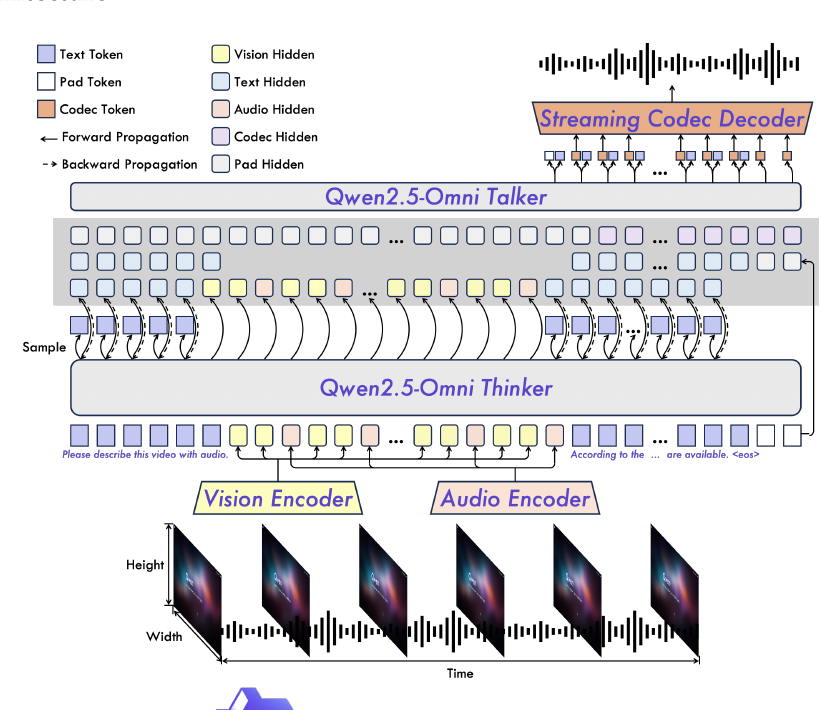
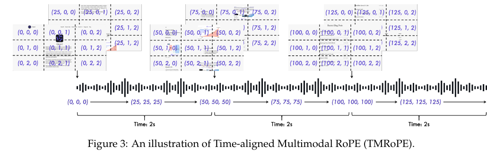
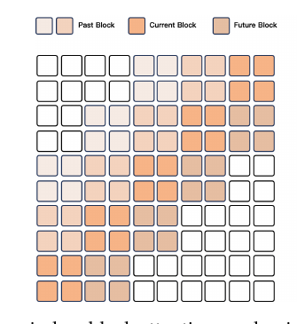
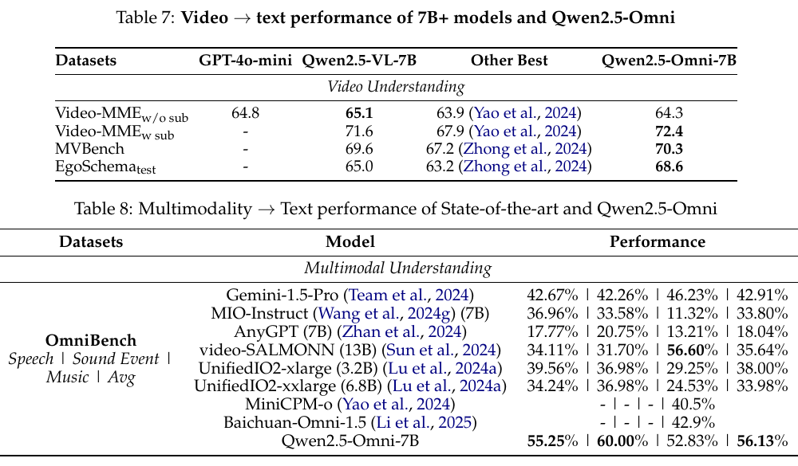

# Qwen2.5-Omni Technical Report

## 一句话结论

Qwen2.5-Omni 是一个实时 omni 交互底座：它把 text / image / video / audio 输入统一进 Thinker，再由 Talker 同步生成文本和自然语音；但它不输出 robot action，不是 VLA，也不是 agent harness，真正适合放在我们系统里的位置是“实时音视频理解 + 语音交互层”。



## 它在这条阅读路线里的位置

Moshi 主要让我们理解 realtime speech-text dialogue，也就是语音和文本如何低延迟双工生成。Qwen2.5-Omni 往前推进一步：输入不再只是 speech/text，而是 text、image、video、audio；输出也不只是文本，而是文本和自然语音。

所以它回答的是：

- 一个 omni 模型如何把音频、视频、图像、文本放进一个统一上下文？
- 视频和音频的时间如何对齐？
- 为什么同时生成 text 和 speech 会互相干扰，怎么拆成 Thinker 和 Talker？
- 怎么降低实时交互里的初始包延迟？

它没有回答的是：

- 机器人应该执行什么动作？
- 怎么把输出绑定到机械臂、底盘、屏幕 UI 或工具调用？
- 怎么做长期记忆？
- 怎么做执行反馈和可打断控制？

这些要靠后面的 VIMA、RT-2、OpenVLA、pi0 / pi0.5、AgentHands 和 What Are You Doing 补齐。

## 解决什么问题

论文认为 omni 模型有三个核心难点：

1. 多模态联合训练：text、image、video、audio 要能互相增强，尤其视频里的音画时间要对齐。
2. 多输出互相干扰：文本 token 和语音 token 同时生成时，如果用同一个输出头硬做，容易互相影响。
3. 实时流式交互：输入端要能边看边听，输出端要能尽快开始说话，不能等整段视频或整段回复处理完。

Qwen2.5-Omni 的对应方案是：

- 用 TMRoPE 对齐音频和视频的时间位置。
- 用 Thinker-Talker 架构分离文本生成和语音生成。
- 用 block-wise audio/vision encoder 支持 streaming prefill。
- 用 sliding-window DiT 把 codec token 流式解码成 waveform。

## 方法 / 系统怎么做

### 1. Thinker-Talker 架构

Thinker 是主 LLM。它接收 text、audio、image、video 的 encoder hidden representations，负责理解上下文并自回归生成 text token。

Talker 是语音生成模块。它不是独立 TTS，而是直接接收 Thinker 的 high-level representations，并且还接收 Thinker 采样出的 text token embedding，然后生成 speech codec tokens。

关键点：Talker 同时看语义表示和离散文本 token。论文解释说，高维语义表示能提前提供语气、态度、上下文，但语义相似的词在发音上可能完全不同，所以还需要 sampled discrete text tokens 来消除语音发音上的不确定性。

### 2. TMRoPE 和音画交错



TMRoPE 是 Time-aligned Multimodal RoPE。它把位置编码拆成 temporal、height、width 三个分量。

- Text：三个分量使用相同 position ID，等价于普通 1D RoPE。
- Audio：也用相同 position ID，并加入绝对时间位置；一个 temporal ID 对应约 40ms。
- Image：temporal ID 固定，height/width ID 按图像 token 的空间位置分配。
- Video with audio：video frame 按真实时间推进 temporal ID，audio 仍然约每 40ms 一个 temporal ID。

对带音频的视频，论文不是把整段视频 token 放完再放音频 token，而是按真实时间每 2 秒切 chunk。在每个 2 秒 chunk 内，先放 visual representation，再放 audio representation，然后按 chunk 顺序交错排列。

这就是这篇对“streaming interleaved multimodal context”的关键贡献：交错不是简单拼接，而是带时间位置编码的 video/audio representation 交错。

### 3. Streaming 设计

论文把初始包延迟拆成四类来源：

1. multimodal input processing delay
2. 从收到第一个 text input 到输出第一个 voice token 的延迟
3. 把第一段 speech 转成 audio 的延迟
4. 模型大小、FLOPs 等架构本身延迟

对应优化：

- Audio encoder 从 full attention 改成 2 秒一个 block 的 block-wise attention。
- Vision encoder 用 flash attention，并用 MLP 合并相邻 2x2 token。
- Codec-to-wav 用 Flow-Matching DiT，把 receptive field 限制在滑动窗口里。
- DiT 的窗口包括 2 个 lookback blocks、当前 block、1 个 lookahead block，总计 4 blocks。



## 输入、输出、数据类型、模态

### 输入是什么

论文里的模型输入不是“一个 JSON”，而是多模态 token / representation 序列：

| 输入模态 | 原始数据 | 进入模型前的表示 | 关键参数 |
|---|---|---|---|
| Text | 文本字符串 | Qwen tokenizer 的 text tokens | 151,643 regular tokens |
| Audio | raw waveform | 16kHz audio -> 128-channel mel-spectrogram -> audio hidden reps | 25ms window, 10ms hop, 每个 audio rep 约 40ms |
| Image | 图片 | Qwen2.5-VL vision encoder hidden reps | ViT 约 675M 参数 |
| Video without audio | 视频帧 | dynamic frame rate sampled frames -> vision hidden reps | 每张 image 被当作两帧处理 |
| Video with audio | 视频帧 + 音频 | vision hidden reps + audio hidden reps，按 2 秒 chunk 交错 | TMRoPE 对齐时间 |

### 模型实际吃到什么

严格讲，Thinker 吃到的是：

- text token embeddings
- vision encoder hidden representations
- audio encoder hidden representations
- TMRoPE position ids
- ChatML 格式组织的对话上下文

它不是直接吃 raw video 或 raw waveform。raw 数据先被 encoder 转成 hidden representations。

### 输出是什么

| 输出 | 由谁产生 | 数据类型 | 用途 |
|---|---|---|---|
| Text response | Thinker | autoregressive text tokens | 屏幕显示、日志、后续 agent 规划输入 |
| Speech codec tokens | Talker | discrete speech/code tokens | 给 codec decoder / DiT / BigVGAN 转 waveform |
| Waveform | streaming codec decoder | audio waveform | 直接 TTS 播放 |

没有直接输出：

- robot action
- tool call JSON
- function calling arguments
- motor command
- trajectory
- structured execution plan

所以它不是“一个模型直接控制机器人”。它最多是机器人 agent harness 里的 perception-dialogue layer。

## 训练路线

### 一张总览：从数据到训练到推理

可以把 Qwen2.5-Omni 的训练框架理解成“先接感官，再训练大脑，再训练嘴巴，最后做流式说话”。

```text
原始数据
  text corpus
  image-text
  audio-text
  video-text
  video-audio
  multimodal conversation
        |
        v
模态预处理
  text -> Qwen tokenizer
  audio -> 16kHz waveform -> mel-spectrogram -> audio encoder
  image/video -> vision encoder
  video+audio -> TMRoPE + 2s chunk interleaving
        |
        v
Pre-training Stage 1
  固定 Qwen2.5 LLM
  训练 vision/audio encoder 和 adapter
  目标：让“眼睛/耳朵”接入语言模型语义空间
        |
        v
Pre-training Stage 2
  解冻全模型
  用 image/video/audio/video-audio/text 混合数据训练
  目标：让 text/audio/image/video 在 shared attention 里融合
        |
        v
Pre-training Stage 3
  加入 long audio / long video
  扩展到 32,768 tokens
  目标：支持长序列多模态理解
        |
        v
Post-training
  Thinker: ChatML instruction tuning -> 生成 text response
  Talker: speech continuation + DPO + multi-speaker fine-tuning -> 生成 speech codec tokens
        |
        v
Streaming inference
  Thinker 输出文本和 hidden states
  Talker 基于 hidden states + sampled text token embeddings 生成 speech tokens
  DiT + BigVGAN 把 speech tokens 流式转成 waveform
```

最简化的心智模型：

```text
Encoder training = 接眼睛和耳朵
Omni pre-training = 训练统一多模态大脑
Thinker SFT = 让大脑按指令回答
Talker training = 训练嘴巴把语义流式说出来
Streaming codec = 把嘴巴输出的离散语音 token 变成声音
```

所以它不是一开始就端到端从 raw video/audio 直接训练一个完整全能模型，而是分层搭起来：先用已有强模型初始化，再逐步对齐、融合、长上下文扩展、指令微调、语音输出优化。

### 训练框架具体是什么

这篇论文的训练框架可以理解成两条主线并行汇合：

```text
Understanding path
  text / image / video / audio
  -> tokenizer / encoders
  -> Thinker
  -> text tokens

Speech generation path
  Thinker hidden states + sampled text token embeddings
  -> Talker
  -> speech codec tokens
  -> streaming codec decoder / DiT / BigVGAN
  -> waveform
```

它不是“一个 LLM 直接既输出文字又输出语音 waveform”。更准确地说，它是一个 end-to-end jointly trained 的 Thinker-Talker 系统：Thinker 做理解和文本生成，Talker 共享 Thinker 的历史上下文和 hidden representation，再生成 speech tokens。

### 0. 模块初始化

论文明确写了三个初始化来源：

| 模块 | 初始化来源 | 作用 |
|---|---|---|
| LLM / Thinker 主体 | Qwen2.5 | 保留语言、推理、指令跟随能力 |
| Vision encoder | Qwen2.5-VL vision encoder | 图像/视频理解 |
| Audio encoder | Whisper-large-v3 | 音频/语音理解初始化 |

Talker 是 dual-track autoregressive Transformer decoder，受 Mini-Omni 启发。论文没有说明 Talker 是否从某个已有模型初始化，也没有公开完整结构超参。

### 1. Pre-training Stage 1: 固定 LLM，训练 encoder / adapter

第一阶段的关键是 freeze Thinker/LLM。

训练对象：

- vision encoder adapter
- audio encoder adapter
- 后续再训练 vision/audio encoder 本体

冻结对象：

- Qwen2.5 LLM / Thinker 主体参数

训练数据：

- image-text pairs
- audio-text pairs

目标：

- 让视觉/音频 encoder 的输出能被固定的 LLM 理解。
- 建立 visual-textual alignment 和 audio-textual alignment。

工程上可以理解成：

```text
image/audio raw input
  -> encoder
  -> adapter
  -> LLM hidden space
  -> text prediction / instruction response
```

这一阶段不是训练 omni 能力，而是先把“眼睛”和“耳朵”接到已有语言脑子上。

### 2. Pre-training Stage 2: 解冻全模型，混合多模态训练

第二阶段 unfreeze all parameters。

训练对象：

- Thinker / LLM
- vision encoder
- audio encoder
- modality adapters
- 多模态融合相关参数

训练数据：

- image/video related data: 800B tokens
- audio related data: 300B tokens
- video-with-audio related data: 100B tokens
- text corpus 也继续保留，用来维持语言能力

目标：

- 不只是单独学 image-text 或 audio-text，而是让 auditory、visual、textual information 在同一个上下文里交互。
- 支持 mixed multimodal tasks。
- 让 shared attention 里能融合多模态 representation。

这一步才是真正训练 omni model。

### 3. Pre-training Stage 3: 长上下文扩展

第三阶段还是 pre-training，但重点换成长序列。

做法：

- 前面阶段最大 token length 是 8192。
- 这一阶段加入 long audio 和 long video data。
- 把 text、audio、image、video 训练长度扩展到 32,768 tokens。

目标：

- 支持长视频理解。
- 支持长音频/语音上下文。
- 支持更复杂的多模态长序列推理。

这对实时机器人很重要，因为真实交互不是单张图或一句话，而是一段持续上下文。

### 4. Thinker post-training: ChatML instruction tuning

Thinker 的 post-training 是 instruction-following fine-tuning。

数据格式：

- ChatML
- pure text dialogue
- visual-modality conversation
- audio-modality conversation
- mix-modality conversation

目标：

- 让模型从“预训练理解多模态”变成“能按用户指令回答”。
- 把图像、视频、音频上下文放进对话轮次里。

它的训练目标本质仍然是 text token autoregressive prediction，也就是预测 assistant response 的文本 token。

### 5. Talker training: 三阶段训练语音输出

Talker 的训练和 Thinker 不完全一样。论文明确说 Talker 有 three-stage training process。

#### 5.1 Stage 1: context continuation / ICL

输入：

- multimodal context
- Thinker high-level hidden representations
- Thinker sampled text token embeddings
- spoken response 数据

训练任务：

- speech continuation
- next-token prediction for speech tokens

目标：

- 学 semantic representation -> speech token 的 monotonic mapping。
- 学 prosody、emotion、accent 等上下文相关语音属性。
- 让 Talker 能在文本还没完全生成完时，根据 Thinker hidden states 提前预测语气和说法。

关键点：Talker 不只看文本 token，因为流式语音必须在完整文本生成前就开始说；但它也不能只看 hidden state，因为 hidden state 表示的是语义相似性，不保证发音唯一，所以还需要 sampled text token embeddings。

#### 5.2 Stage 2: DPO / RL 稳定语音

问题：

- 大规模 speech 数据有 label noise。
- 有 pronunciation errors。
- 可能导致 speech hallucination、读错、停顿不自然。

DPO 数据：

```text
(x, y_w, y_l)
```

- `x`: 包含输入文本的输入序列
- `y_w`: 优质的生成语音序列
- `y_l`: 异常的生成语音序列

排序依据：

- WER
- punctuation pause error rate

DPO 目标：

$$
\begin{aligned}
L_{DPO}(P_\theta; P_{ref})
= -\mathbb{E}_{(x,y_w,y_l)\sim D}
\Bigg[
\log \sigma
\Bigg(
\beta \log \frac{P_\theta(y_w|x)}{P_{ref}(y_w|x)}
-
\beta \log \frac{P_\theta(y_l|x)}{P_{ref}(y_l|x)}
\Bigg)
\Bigg]
\end{aligned}
$$

目标：

- 降低读错词。
- 减少不合理停顿。
- 提升生成稳定性。

#### 5.3 Stage 3: multi-speaker instruction fine-tuning

目标：

- 让 Talker 能采用特定 speaker voice。
- 提升自然度。
- 提升语音可控性。

论文评测里有 Speaker A/B/C/D，但没有公开这些 speaker fine-tuning 数据的采集规模和细节。

### 6. Codec / waveform 生成链路怎么训练和推理

Talker 输出的不是 waveform，而是 speech codec tokens。

之后的生成链路是：

```text
speech codec tokens
  -> Flow-Matching DiT
  -> mel-spectrogram
  -> modified BigVGAN
  -> waveform
```

为了支持 streaming，DiT 用 sliding-window block attention：

- 当前 token 只能看有限上下文。
- receptive field 是 4 blocks。
- 包括 2 个 lookback blocks、当前 block、1 个 lookahead block。
- BigVGAN 也用 chunk-by-chunk 的方式适配流式 waveform generation。

注意：这部分更像语音解码/声码器链路，不是机器人动作输出。

### 7. 论文没有公开的训练实现细节

这些内容论文没有披露：

- optimizer 类型
- learning rate / warmup / decay
- batch size
- GPU/TPU 数量
- 训练步数
- 各类数据采样比例
- loss 权重
- encoder/Thinker/Talker 的完整参数量拆分
- Talker 具体 dual-track 细节超参
- qwen-tts-tokenizer 训练数据和训练细节
- DPO reward 的具体计算公式和阈值

所以这篇能学的是高层训练框架，不是可复现训练配方。

## 数据是怎么收集、构建的

先说结论：这篇技术报告没有公开完整数据来源清单，也没有公开具体采集渠道、过滤规则、去重规则、标注团队、数据比例调度表或隐私处理流程。它公开的是数据类型、训练阶段、部分 token 规模、数据格式和 Talker 的偏好数据构建方式。所以不能把它理解成“可完全复现的数据 recipe”。

### 1. Pre-training 数据大类

论文说 Qwen2.5-Omni 的预训练数据是一个 diverse dataset，包含：

| 数据类型 | 作用 | 训练目标大致是什么 |
|---|---|---|
| text corpus | 保持和增强语言能力 | 纯文本 next-token / language modeling |
| image-text | 学图像和文本语义对齐 | image understanding、caption/VQA/OCR/视觉问答类任务 |
| video-text | 学视频到文本理解 | video caption、video QA、事件/动作/场景理解 |
| audio-text | 学音频到文本理解 | ASR、S2TT、声音理解、语音指令理解 |
| video-audio | 学音画联合理解 | 视频帧与声音时间对齐、多模态联合推理 |

论文还说他们把 Qwen2-Audio 里类似 hierarchical tags 的东西替换成 natural language prompts。我的理解是：训练样本不是只写机器标签，例如 `task=asr`、`lang=zh`、`audio_type=speech`，而是改成更像真实用户指令的自然语言 prompt。这样做的目的，论文明确说是提升泛化能力和 instruction following。

### 2. 三阶段 pre-training 是怎么组织数据的

第一阶段：固定 LLM，只训练 vision encoder 和 audio encoder。

- LLM 初始化自 Qwen2.5。
- Vision encoder 使用 Qwen2.5-VL 的视觉编码器。
- Audio encoder 初始化自 Whisper-large-v3。
- 训练数据主要是 audio-text pairs 和 image-text pairs。
- 目的不是让整个模型从零学语言，而是让音频/视觉 encoder 学会把自己的表示对齐到固定 LLM 能理解的语义空间。
- 训练方式上，论文说两个 encoder 是 separately trained on the fixed LLM，并且先训练 adapter，再训练 encoder。

第二阶段：解冻全部参数，加入大规模混合多模态数据。

论文明确给了新增规模：

- 800B image/video related tokens
- 300B audio related tokens
- 100B video-with-audio related tokens

这一阶段的目的，是让 auditory、visual、textual information 更深地交互，而不是只做单模态到文本的对齐。也就是说，第一阶段更像“把 encoder 接进 LLM”，第二阶段才更像“真正训练 omni 混合模态模型”。

第三阶段：长序列数据训练。

- 前面阶段出于效率限制，最大 token length 是 8192。
- 后面加入 long audio 和 long video data。
- 把 text、audio、image、video 数据扩展到 32,768 tokens。
- 目标是增强复杂长序列理解，也就是更接近真实长视频、长语音对话、长上下文交互。

### 3. 单条多模态样本进入模型前怎么变成数据

这部分论文讲得比较具体。

Text：

- 原始数据是文本。
- 用 Qwen tokenizer。
- tokenizer 是 byte-level BPE。
- vocabulary 是 151,643 regular tokens。

Audio：

- 原始数据是 raw waveform。
- 重采样到 16kHz。
- 转成 128-channel mel-spectrogram。
- window size 是 25ms。
- hop size 是 10ms。
- 经过 audio encoder 后，每个 audio representation 约对应原始音频 40ms。

Image / Video：

- 使用 Qwen2.5-VL 的 vision encoder。
- Vision encoder 是 ViT，约 675M 参数。
- 图像和视频混合训练。
- 视频使用 dynamic frame rate sampling，用来在保留视频信息和适配音频采样率之间折中。
- 为了统一处理，单张 image 被当作 two identical frames。

Video with audio：

- 不是简单把视频帧全放前面、音频全放后面。
- audio representation 和 video representation 通过 TMRoPE 做时间位置对齐。
- 一个 temporal ID 对应约 40ms。
- 带音频的视频按实际时间切成 2 秒 chunk。
- 每个 2 秒 chunk 内，visual representation 放前面，audio representation 放后面。
- chunk 和 chunk 之间按时间顺序 interleave。

所以它的数据构建最终会变成类似这样：

```text
ChatML conversation
  + text tokens
  + image/video hidden representations
  + audio hidden representations
  + TMRoPE temporal/height/width position ids
```

模型实际吃的不是 mp4/wav/jpeg 原文件，而是 tokenizer/encoder 处理后的 token 和 hidden representation 序列。

### 4. Post-training 数据格式

Thinker 的 post-training 用 instruction-following data，并组织成 ChatML 格式。论文给的例子类似：

```text
<|im_start|>user
<|vision_start|>Video.mp4 [Two people are talking in the video]<|vision_end|>
What are the people in the video saying?
<|im_end|>
<|im_start|>assistant
...
<|im_end|>
```

这里有个细节：`Video.mp4 [Two people are talking in the video]` 里的方括号文本，不是模型直接看视频后自动生成的输出，而是数据样本里提供的视觉/视频描述上下文。它用于把多模态材料放进 ChatML 对话格式里。

Thinker 的 instruction-finetuning 数据包括：

- pure text-based dialogue data
- visual-modality conversation data
- audio-modality conversation data
- mix-modality conversation data

论文没有公开每类数据多少条、来自哪里、人工标注还是模型生成、过滤标准是什么。

### 5. Talker 的数据构建

Talker 不是简单拿普通 TTS 数据训练。它有三阶段。

第一阶段：speech continuation / ICL。

- 使用包含 multimodal contexts 和 spoken responses 的对话数据。
- 训练任务是 speech continuation，通过 next-token prediction 预测语音 token。
- Talker 学的是从 Thinker 语义表示到 speech token 的单调映射。
- 同时学习 prosody、emotion、accent 等上下文相关的语音属性。
- 论文还提到 timbre disentanglement，用来防止模型把某些特定音色和低频文本模式错误绑定。

第二阶段：DPO / RL 稳定语音生成。

论文说预训练数据覆盖 speaker 和 scenario 时不可避免有 label noise 和 pronunciation errors，会导致 speech hallucination。于是他们构建 DPO 数据。

每条 DPO 数据是三元组：

```text
(x, y_w, y_l)
```

含义是：

- `x`: input sequence with input text
- `y_w`: good generated speech sequence
- `y_l`: bad generated speech sequence

good / bad 的排序依据包括：

- WER, word error rate
- punctuation pause error rate

所以这里的数据构建逻辑不是“人工随便偏好打分”，而是围绕内容一致性和停顿错误，把生成语音分成好样本/坏样本，再用 DPO 优化。

第三阶段：multi-speaker instruction fine-tuning。

- 在 base Talker 上做 speaker fine-tuning。
- 目标是让 Talker 能采用特定声音，并提升自然度。
- 论文评测里用了 Speaker A/B/C/D，但没有披露这些 speaker 数据怎么收、多少小时、是否真人录制授权、清洗标准等。

### 6. 对我们最有用的工程抽象

如果我们要做自己的 embodied interaction data，不应该只学它“大规模堆数据”，而要学它的数据分层：

```text
Level 1: 单模态-文本对齐
  image-text
  audio-text
  video-text

Level 2: 多模态联合上下文
  video-audio-text
  image-audio-text
  mixed-modality conversation

Level 3: 真实交互格式
  ChatML / dialogue turns
  multimodal context + user request + assistant response

Level 4: 输出通道训练
  text response
  speech response
  later for us: screen event / arm event / tool call / execution feedback
```

对我们机器人来说，还需要在 Qwen2.5-Omni 没有覆盖的地方额外构建数据：

| 我们需要的数据 | Qwen2.5-Omni 是否覆盖 | 为什么 |
|---|---|---|
| 双摄视频 + 用户语音 + 屏幕上下文 | 部分覆盖 | 它有 video/audio/text，但不一定有我们的设备视角和屏幕状态 |
| 用户意图 / gaze / posture / pointing | 基本没覆盖 | 它不是 HRI grounding 数据集 |
| 机器人单臂支架动作 | 没覆盖 | 它不输出 robot action |
| 屏幕 UI 高亮/提示/确认 | 没覆盖 | 它只输出 text/speech，不输出 UI event schema |
| 执行反馈与纠错 | 没覆盖 | 它没有 execution monitor 或可打断 harness |
| 长期陪伴记忆 | 没覆盖 | 它没有 memory 数据构建 |

所以我们未来的数据 schema 可能要长这样：

```json
{
  "timestamp": "2026-06-08T10:00:00.000+08:00",
  "inputs": {
    "front_camera": "video_chunk_ref",
    "side_camera": "video_chunk_ref",
    "microphone": "audio_chunk_ref",
    "asr_text": "你看这个地方是不是有问题？",
    "screen_state": {
      "app": "design_review",
      "visible_objects": ["button_1", "chart_2", "text_block_3"]
    }
  },
  "intermediate_state": {
    "user_intent": "ask_for_visual_check",
    "referenced_target": "chart_2",
    "confidence": 0.82
  },
  "outputs": {
    "speech": "你说的是这个图表右上角吗？",
    "screen_events": [
      {"type": "highlight", "target": "chart_2"}
    ],
    "arm_events": [
      {"type": "orient_display", "target": "user"}
    ],
    "feedback_policy": "ask_confirmation"
  }
}
```

这个 schema 不是论文里的 Qwen2.5-Omni 数据，而是基于论文分层后，对我们机器人产品需要补齐的数据结构。

### Pre-training

论文写了三阶段：

1. 固定 LLM，只训练 vision encoder 和 audio encoder。数据主要是 audio-text、image-text pair，让 encoder 学会把模态信息对齐进 LLM 语义空间。
2. 解冻全部参数，用更大规模多模态混合数据训练。论文给出的增量规模包括 800B image/video related tokens、300B audio related tokens、100B video-with-audio related tokens。
3. 加入长音频、长视频数据，把最大序列长度扩到 32,768 tokens，增强长序列理解。

### Post-training

Thinker 使用 ChatML 格式 instruction-following 数据，包含纯文本对话、视觉对话、音频对话、混合模态对话。

Talker 有三阶段：

1. ICL / context continuation：通过 spoken response 的 next-token prediction 学会从上下文继续说话。
2. DPO：提升语音稳定性，减少幻觉、发音错误、不合适停顿。
3. multi-speaker instruction fine-tuning：提升自然度和可控性。

论文给出的 DPO 目标是，下面是 Obsidian 兼容写法：

$$
\begin{aligned}
L_{DPO}(P_\theta; P_{ref})
= -\mathbb{E}_{(x,y_w,y_l)\sim D}
\Bigg[
\log \sigma
\Bigg(
\beta \log \frac{P_\theta(y_w|x)}{P_{ref}(y_w|x)}
-
\beta \log \frac{P_\theta(y_l|x)}{P_{ref}(y_l|x)}
\Bigg)
\Bigg]
\end{aligned}
$$

其中 `x` 是输入序列，`y_w` 是 good generated speech sequence，`y_l` 是 bad generated speech sequence。排序依据包括 WER 和 punctuation pause error rate。

## 关键图表

### Video 和 OmniBench 评测



几个对我们有用的结果：

- Video-MME with subtitles：Qwen2.5-Omni-7B 是 72.4，高于 Qwen2.5-VL-7B 的 71.6。
- MVBench：Qwen2.5-Omni-7B 是 70.3。
- EgoSchema：Qwen2.5-Omni-7B 是 68.6。
- OmniBench 平均：Qwen2.5-Omni-7B 是 56.13%，高于表中 Gemini-1.5-Pro 的 42.91% 和 Baichuan-Omni-1.5 的 42.9%。

但要注意：这些主要证明 audio/video/image/text 到 text 的理解能力，以及 text 到 speech 的生成能力。它没有评测真实机器人执行成功率。

## STAR 分析

### Situation

实时机器人/agent 需要边听、边看、边理解，还要能自然说话。传统 LLM 只吃 text，普通 VLM 主要处理 image/video 到 text，普通 TTS 又是后处理模块，三者拼起来会产生延迟和上下文断裂。

### Task

构建一个 end-to-end omni 模型，支持 text、image、audio、video 输入，并能同时流式输出 text 和 natural speech。

### Action

作者提出：

- Thinker-Talker：Thinker 负责理解和文本生成，Talker 基于 Thinker hidden states 和 sampled text tokens 生成 speech tokens。
- TMRoPE：把 video/audio 的时间位置对齐。
- Time-interleaving：每 2 秒组织 video/audio representation chunk。
- Block-wise encoder：让 audio/vision 输入支持 streaming prefill。
- Sliding-window DiT：把 codec token 流式转为 waveform。

### Result

Qwen2.5-Omni 在多个 audio/image/video/multimodality benchmark 上接近或超过同量级模型。Speech instruction following 明显缩小了和 text instruction 的差距，speech generation 在 SEED test-zh/test-en/test-hard 上也有强表现。

## 和我们方向的关系

### 对 interaction model 的价值

这篇给我们一个很重要的系统边界：

```text
双摄/麦克风/屏幕上下文
  -> real-time multimodal encoder
  -> interleaved audio-visual-text context
  -> Thinker generates semantic/text response
  -> Talker generates speech
```

这就是 realtime audio-visual interaction model 的底层形态。它适合做“看到用户在做什么、听到用户说什么、结合屏幕/环境上下文自然回应”。

### 对 embodied robot 的价值

对我们“显示器 + 单臂支架 + 双摄”的机器人，它能覆盖：

- 双摄视频理解
- 用户语音理解
- 环境声音或说话人情绪线索
- 屏幕文字/图像理解
- 低延迟语音回应

但它不能覆盖：

- 单臂支架怎么动
- 运动轨迹怎么生成
- 屏幕 UI 怎么和物理指向同步
- 工具调用怎么组织
- 执行失败怎么反馈

这些必须在模型外接 harness / policy：

```text
Qwen2.5-Omni-like interaction model
  -> structured intent / dialogue state / grounded object reference
  -> robot harness
  -> VLA or controller
  -> execution feedback
```

### 和 AgentHands 的关系

Qwen2.5-Omni 解决“实时看听说”。AgentHands 解决“说话和空间动作如何绑定”。两者互补。

一个关键差异：Qwen2.5-Omni 论文明确说语音生成不需要 word-level 和 timestamp-level alignment with text。这对 TTS 训练是好事，但对机器人动作同步不是充分条件。我们要做单臂动作或屏幕指向时，仍然需要类似 AgentHands 的 event anchor：

```json
{
  "speech": "你是说这个杯子吗？",
  "events": [
    {
      "trigger_text": "这个杯子",
      "target": "cup_01",
      "screen_action": "highlight_bbox",
      "arm_action": "orient_toward_target"
    }
  ]
}
```

也就是说，Qwen2.5-Omni 可以做 perception/dialogue backbone，但不能替代 embodied action event schema。

## 局限和不要误读

1. 不要把它当成 VLA。它没有直接输出机器人连续动作、离散动作 token 或轨迹。
2. 不要把它当成完整 agent harness。它没有 tool execution、confirmation、policy safety、memory write/read、execution monitor。
3. 不要以为它解决了 speech-action synchronization。它解决的是 speech streaming，而不是物理动作和语音关键词同步。
4. 不要以为“omni”就等于长期陪伴。论文没有长期记忆、用户画像、关系维护、长期评估。
5. 它是强技术报告，但评测主要是 benchmark，不是真实机器人 HRI 长期部署。

## 可复用点

- TMRoPE 思路：我们的双摄视频和麦克风音频也需要用时间戳对齐，不能只把最近几帧和 ASR 文本粗暴拼 prompt。
- 2 秒 chunk：可以作为实时上下文窗口设计的参考粒度，但实际产品还要根据延迟预算重调。
- Thinker-Talker 拆分：对我们来说可以扩展成 Thinker-Talker-Actor，其中 Actor 不一定是同一个模型，而是 harness + VLA/policy。
- Block-wise prefill：长视频/长音频不能每次全量重算，要有 streaming cache。
- 输出边界：语音输出和动作输出最好分开建模，但共享同一个上下文状态。

## 下一步精读问题

读 AURA / StreamBridge 时重点问：

1. Qwen2.5-Omni 是 omni 模型本体，AURA/StreamBridge 是不是更接近 always-on streaming assistant？
2. 它们如何判断“什么时候主动说话”？
3. 它们怎么维护长时间视频上下文？
4. 它们有没有比 Qwen2.5-Omni 更清楚的 interaction trigger / event policy？
5. 能否把 Qwen2.5-Omni 作为 backbone，把 AURA/StreamBridge 的 proactive trigger 接到 robot harness？

## 工程 takeaway

如果我们要做自己的 embodied interaction model，不要直接把目标定义成“训练一个机器人 ChatGPT”。更准确的拆法是：

```text
Realtime audio-visual backbone
  -> streaming multimodal state
  -> dialogue / intent / grounding output
  -> embodied action event schema
  -> VLA / robot policy / UI controller
  -> execution feedback and correction loop
```

Qwen2.5-Omni 对第一、第二、第三层有参考价值；对第四层以后只能提供上下文，不能直接落地。
