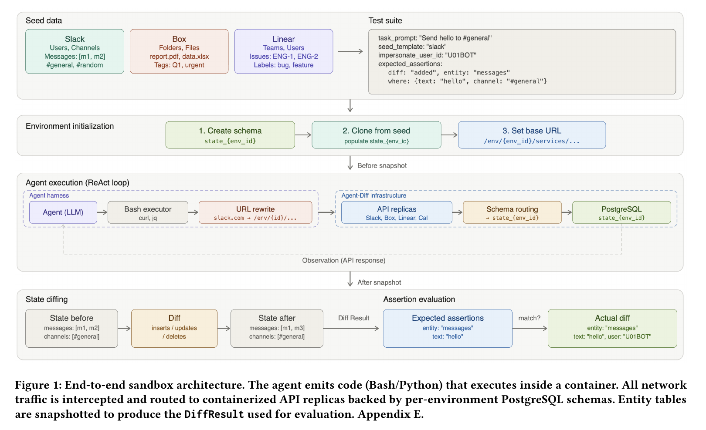
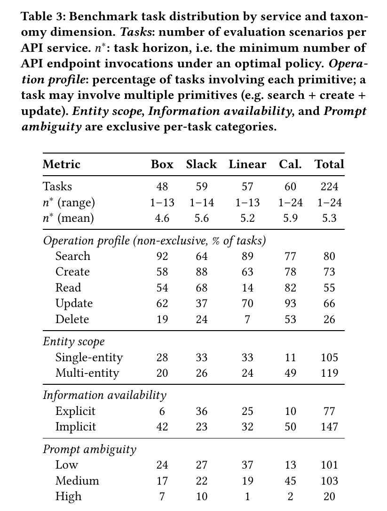
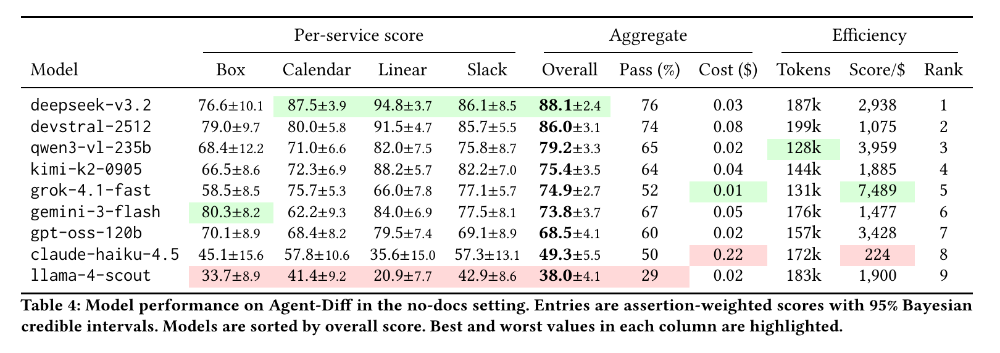
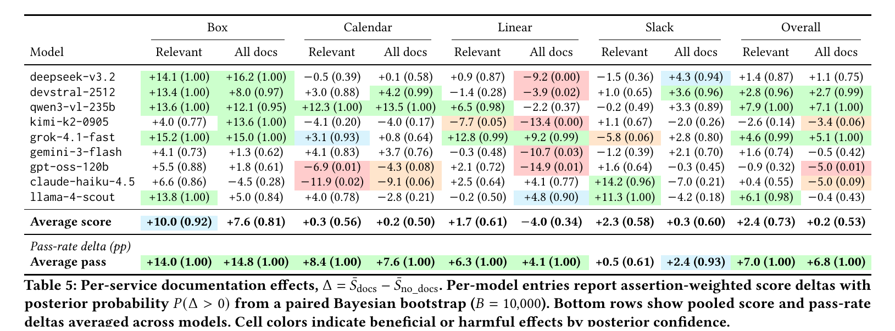
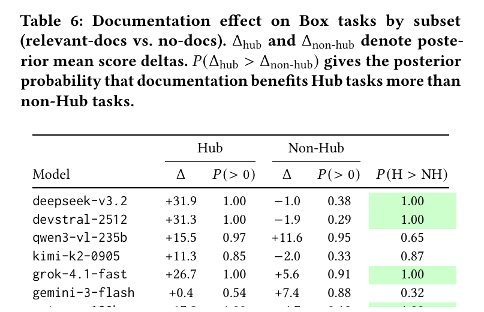
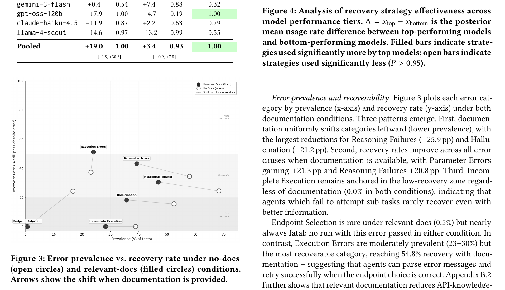

# Agent-Diff

## 一句话结论

Agent-Diff 的核心贡献不是新的 agent policy，而是一个更硬的企业 API agent 评测协议：让 agent 写代码调用真实形态的 SaaS API replica，然后用完整环境的 state diff 判断任务是否完成，并把无关副作用直接算失败。

## 解决什么问题

这篇针对的是 tool-use / enterprise workflow agent 的评测失真问题。现有 benchmark 往往在几个维度上取舍：

- trace matching 能控但太脆，只奖励“按预期调用工具”，不奖励等价的解决路径。
- mock tool 环境可复现，但容易低估真实 API 的 schema、错误、分页、权限、ID 查询和状态依赖复杂度。
- live service 更真实，但状态随时间变化，难以给不同模型完全相同的初始环境，也难以稳定复现实验。
- LLM judge 或响应 diff 只能看表面输出，不能可靠检查真实环境状态有没有被正确改变。

Agent-Diff 的回答是：把真实企业 API 的接口形态复制到容器化 sandbox 里，让所有 agent 在相同初始状态下执行代码，最后只看数据库前后差异是否匹配任务 contract。

## 方法 / 系统怎么做

系统由三层组成。

第一层是 code-execution agent interface。模型使用 ReAct 风格交互，输出 Bash 代码块；容器里有 `curl`、`jq`、`grep`、`sed` 等常见命令。agent 不是调用预定义 JSON tool schema，而是直接写代码访问 API endpoint。

第二层是 containerized API replicas。论文复制了 Slack、Box、Linear、Google Calendar 四类企业服务的 API 表面：REST 或 GraphQL endpoint、参数、返回格式、错误格式和核心 CRUD 语义。网络流量会被拦截并路由到本地 replica，而不是打到真实线上 SaaS。

第三层是 per-environment database state。每个任务运行在独立 PostgreSQL schema 里，初始状态由 seed template 固定。执行前后分别 snapshot entity tables，生成 `added / deleted / modified` 三类 state diff。

论文的关键假设是：对 agent 评测来说，不需要复刻 SaaS 的全部内部实现，只需要在 benchmark 覆盖的请求集合上做到行为等价。因为 agent 能观察到的是 request 和 response，而正确性主要体现在实体状态变化。

## 输入、输出、数据类型、模态

- 输入：自然语言任务指令、服务名称、base URL，以及在不同 ablation 里可选的 API 文档。
- agent 输出：Bash 代码块，代码中通常用 HTTP 请求调用 Slack / Box / Linear / Calendar replica。
- 环境输出：API JSON response、命令 stdout/stderr、错误信息。
- 评测输入：初始数据库状态 `S0`、最终数据库状态 `S1`、任务的 declarative assertions。
- 评测输出：state diff、assertion-weighted score、binary pass/fail、错误分类和恢复策略分析。
- 数据类型：企业 SaaS 中的结构化实体，例如 Slack channel/message、Box file/folder/hub、Linear issue/team/workflow state、Calendar event/calendar/permission。
- 模态：纯文本 + 结构化 API / database state，没有视觉、音频或机器人传感模态。

## State-Diff Contract

这是全文最重要的部分。

论文把 API 调用看成从旧状态到新状态的转换。评测时不关心 agent 用了哪条路径，而关心最终状态差异：

- `Delta_add`: 新增了哪些实体。
- `Delta_del`: 删除了哪些实体。
- `Delta_mod`: 哪些主键相同的实体字段被修改。

每个任务有一组 declarative assertions，描述预期 diff。例如“新增一个名字包含 X 的 calendar event”“把某个 Linear issue 状态改成 Done”“删除一个误放的 Box 文件”。每个 assertion 包含 diff type、entity/table、字段约束和期望数量。

更关键的是 closed-world invariant：所有环境变化必须被 assertion 解释，或者只涉及显式忽略的非确定性字段。任何额外 insert/delete/update 都是 side effect，任务直接失败。这比只看目标字段更严格，也更适合安全敏感的 agent。

对 RL 来说，这个 contract 可以直接变成 verifiable final reward，但它本身不是 dense process reward。它告诉我们“最终世界是否对”，不告诉我们“中间第 3 步是不是好动作”。如果要训练，需要额外把 diff assertion 拆成子目标、里程碑或 verifier feedback。

## Benchmark 设计

这里不要把它理解成“224 道函数调用题”。它更像 224 个小型企业工作流沙盒：每道题都有一份初始数据库状态、一个用户任务、一组允许 agent 调的 API endpoint，以及一组最后要检查的 state-diff assertions。

作者生成一题大致分三步：

1. 先选服务和目标调用长度。比如这题属于 Box / Slack / Linear / Calendar 之一，希望最优解大概需要 4 次、7 次或更多 API 调用。
2. 再从该服务的 endpoint 集合里抽一组“这题理论上会用到的 endpoint”。这组 endpoint 决定任务结构，例如 search + read + update，或者 search + create + update + delete。
3. 然后让 LLM 生成三样东西：自然语言用户请求、初始 sandbox state `S0`、期望 state diff 和禁止副作用。人工再检查任务能不能执行、ID 是否能被发现、API 权限和 endpoint 是否存在，并通过删掉显式 ID、加入 distractor 等方式调节歧义度。

所以 benchmark 的重点不是“模型会不会填一个 JSON 参数”，而是模型能不能在一个有状态企业系统里完成一串查询、判断和修改。

四个服务各自测的能力不一样：

- Box 有 48 题，偏文件管理。常见难点是文件夹层级、搜索、误放文件、权限、tag、Hub API。Box 任务里 92% 需要 search，因为 agent 经常得先找到目标文件或目录。
- Slack 有 59 题，偏消息系统。常见难点是 channel、thread、多方 DM、用户和消息定位。Slack 任务里 create 比例很高，因为很多任务要发消息、建对话或创建通信对象。
- Linear 有 57 题，偏项目管理。常见难点是 issue、label、workflow state、team、project、依赖关系。Linear 的 delete 比例很低，更多是找 issue、改状态、加 label、加 comment。
- Google Calendar 有 60 题，偏日程系统。常见难点是日期时间、free/busy、创建日程、移动日程、删除取消项、日历权限。Calendar 任务里 update 和 read 都很高，因为它经常要求先查空闲时间，再改已有日程。

五个标注维度可以这样理解：

- `task horizon`：最优解至少要调用多少次 API。不是模型实际调用次数，而是“聪明地做也至少要几步”。论文最终任务范围是 1 到 24 步，平均约 5.3 步。比如只给 issue 加 comment 可能是 1 步；先找日历、查参会人空闲时间、创建事件、更新地点、删除取消事件、授权协作者就会到 7 步以上。
- `operation profile`：这题包含哪些 CRUD 原语。它是多选，不是单选。例如 Box 示例任务同时包含 search、read、delete、update：先找两个文件，删掉误放副本，读正确文件，再给它加 tag。
- `entity scope`：最后改变一个实体，还是多个实体。单实体可能只是改一个 Linear issue；多实体可能是新建 calendar、创建 event、修改另一个 event、删除取消 event、给用户授权，涉及多张表。
- `information availability`：用户有没有直接给关键 ID。explicit 是“把 ENG-123 这个 issue 改成 High”；implicit 是“把 John 最近评论过的 login issue 加上 RL label”，agent 必须先查 John、查评论、定位 issue，再修改。
- `prompt ambiguity`：目标是否说得清楚。low ambiguity 是目标很明确；medium/high ambiguity 会故意删掉显式 ID、加拼写变化、放多个相似对象或 distractor，让 agent 必须确认自己找的是正确对象。

论文给了两个代表性例子。

Box 例子：用户要求搜索所有关于 Argentina 2001 economic crisis 的纯文本文件，应该找到两个副本：一个正确放在 history folder，一个误放在 root。agent 要删掉误放副本，读取正确文件；如果里面提到 Argentina，就给正确文件加 `Latin_America` tag。这个任务最优至少 4 次 API 调用。难点不是“delete file”本身，而是先区分两个相似文件，判断哪个是误放副本，避免删错。

Calendar 例子：用户要求创建 `Cosmic Voyagers HQ` 日历，给 Yuki 写权限；为 Perseid meteor shower 创建 watch party；再查 Oleksandra 周六晚什么时候有空，在那个时间创建 telescope ceremony；更新 watch party 地点；最后删除主日历里的 cancelled event。这个任务最优约 7 次 API 调用。它同时测时间理解、free/busy 查询、创建、更新、删除和权限修改。

Table 3 的几个数字说明了任务确实偏真实工作流：

- 224 题里 147 题是 implicit information，约 66%。也就是多数任务不会直接给 ID，必须先查。
- 119 题是 multi-entity，约 53%。也就是多数任务不是只改一个字段，而是协调多个对象。
- 总体上 80% 任务包含 search，73% 包含 create，66% 包含 update，55% 包含 read，26% 包含 delete。search 这么高，说明 benchmark 重视“先定位正确对象”，不是只测执行动作。

这就是为什么 Agent-Diff 更接近 workflow agent：它要求 agent 先查系统状态，再决定目标对象，再执行修改，最后还不能误改其他对象。
## 实验设置和结果

论文评估了 9 个模型，在 no-docs、relevant-docs、all-docs 三种文档条件下运行。每个任务每个文档条件跑 3 次，最多 40 turns 或 8 分钟。

no-docs baseline 下，DeepSeek-v3.2 和 Devstral-2512 形成第一梯队，整体 assertion-weighted score 分别约 88.1 和 86.0。Qwen3-VL、Kimi、Grok、Gemini、GPT-OSS 位于中间。Claude-Haiku-4.5 和 Llama-4-Scout 明显较弱。

文档 ablation 的结论比模型排名更重要：

- relevant docs 显著提升 pass rate，大约 +7 个百分点。
- assertion-weighted score 的平均提升较小且不稳定，说明文档能帮模型把一些简单任务做完，但对复杂多 assertion 任务不总是够。
- all-docs 不稳定，甚至会伤害 Linear 任务，说明无关文档会造成 context dilution。
- Box Hub API 是很好的“新 API”自然实验。Hub API 在训练 cutoff 后引入，模型不能只靠预训练记忆；相关文档对 Hub 任务帮助明显大于非 Hub 任务。

错误分析里，最有价值的结论是：高分模型更常用 `lookup_correct_value`、`break_into_steps`、`verify_prerequisites`，低分模型更常原地重复 `retry_same`。也就是说，差距不只是 API 知识，而是能不能在失败后查询、分解、验证和修正。

## 关键图表

### Figure 1：端到端 sandbox architecture



这张图是全篇最核心的系统图。读法是从左到右：agent 生成 Bash/Python 代码，代码在容器里执行；所有网络请求被代理层截获；请求被路由到 Slack、Box、Linear、Calendar 的本地 API replica；每个环境背后有独立 PostgreSQL schema；最后由执行前后的状态快照生成 `DiffResult`。也就是说，Agent-Diff 评的是“代码执行后环境状态怎么变”，不是“工具调用格式对不对”。

### Table 3：Benchmark task distribution



这张表回答“224 个任务到底怎么分布”。重点看三项：`Implicit` 有 147/224，说明多数任务不会直接给关键 ID；`Multi-entity` 有 119/224，说明很多任务要同时改多个对象；`Search` 覆盖 80% 的任务，说明 benchmark 很重视先查询状态、定位对象，再执行动作。

### Table 4：No-docs 条件下的模型表现



这张表可以粗看模型差异，但不要把它当通用排行榜。它是在 no-docs 条件下测的，也就是模型没有 API 文档，只知道服务名和 base URL。真正有价值的是：不同服务的难点不同，Linear 对多数模型相对容易，Calendar 和 Box 更容易暴露时间推理、层级搜索和 API 先验问题。

### Table 5：Documentation effects



这张表比较 relevant docs 和 all docs 对表现的影响。关键结论是：相关文档通常能提高 pass rate，但 assertion-weighted score 不一定稳定提升；all-docs 有时反而会伤害表现，因为无关文档会挤占上下文和注意力。这对 agent harness 很重要：文档不是越多越好，需要检索和裁剪。

### Table 6：Box Hub documentation novelty test



这张表是很关键的 ablation。Box Hub API 是较新的 API，模型不太可能只靠预训练记忆掌握。相关文档对 Hub tasks 的提升显著大于 non-Hub tasks，说明这个 benchmark 能区分“模型靠记忆调用老 API”和“模型真的读文档学习新 API”。

### Figure 3/4：错误发生、恢复率与恢复策略



Figure 3 看各类错误的发生率和可恢复率；Figure 4 比较强模型与弱模型的恢复策略。最值得记的是：强模型更常使用 `lookup_correct_value`、`break_into_steps`、`verify_prerequisites`，弱模型更容易 `retry_same`。这提示我们可以把“查证、分解、验证前置条件”转化为 process supervision 或 trace filtering 信号。
## STAR 分析

Situation：企业工作流 agent 越来越常见，但真实 SaaS API 环境难复现，mock 环境又太假，trace matching 和 LLM judge 不能可靠验证真实状态变化。

Task：构建一个可复现、接近真实 API、能检测目标完成和副作用的 agent benchmark。

Action：作者实现四类企业 API replica，把每个任务放进独立容器和数据库 schema；agent 写代码调用 API；系统 snapshot 执行前后状态，用 declarative state-diff assertions 判分。

Result：得到 224 个任务和一套可运行评测框架；实验显示模型差异明显，文档对新 API 和部分服务有帮助，但无关文档可能伤害表现；错误恢复能力是区分强弱模型的重要因素。

## 和我的研究方向的关系

这篇对 “低算力 agentic RL / tool-use agents / process reward” 很相关，但相关点要放准。

最可复用的是 verifier，不是 policy。Agent-Diff 给了一个干净的 final-state reward 形式：任务完成等价于环境 state diff 满足 contract，且没有非法副作用。这比 LLM-as-judge 更适合作为 RL 或 rejection sampling 的最终判分器。

它也适合作为 process reward 的数据来源，但不能直接等同于 process reward。原因是 state diff 主要发生在 episode 结束后，中间动作的好坏需要额外标注或推断。可行做法是把每个 assertion 拆成子目标，对中间状态做 incremental diff；或者用执行 trace + final diff 训练 verifier / critic 判断“这一步是否朝 contract 前进”。

对 agent harness 设计，它提示我们要把“工具调用是否成功”提升为“世界状态是否正确改变”。一个好的 harness 不应该只暴露工具 schema，还要定义：

- 可 snapshot 的环境状态。
- 可声明的目标 diff。
- 副作用边界。
- failure recovery 记录。
- 完成声明和真实状态之间的对齐检查。

对机器人 / embodied agent 的类比也清楚：机器人任务里的 state diff 可以对应物体位置、抓取状态、任务板状态、用户确认状态、环境安全约束。Agent-Diff 是企业 API 版的 world-state verifier。

## 局限和不要误读

- 它不是训练算法论文，没有提出新的 RL objective、rollout 算法或 agent memory。
- 它不是 MCP benchmark；agent interface 是代码执行 + API 调用，而不是预定义 JSON tool call。
- replica fidelity 有边界。它复刻的是 benchmark 覆盖请求集合上的外部行为，不是完整 SaaS 内部系统。
- 任务主要是结构化 CRUD workflow，不覆盖开放网页、GUI、多模态感知、真实用户对话、长期记忆。
- state-diff 适合有明确可观测状态的任务；对主观质量、解释质量、用户满意度、沟通策略，它不能单独判分。
- closed-world invariant 很严格，适合安全和可验证任务；但在真实产品里有些副作用是正常的，需要 carefully whitelist。
- 模型排名会受 prompt、OpenRouter provider、默认 temperature、文档条件和任务分布影响，不应当把表格直接当成通用能力排行榜。

## 可复用点

- State-diff verifier：用 `before snapshot + after snapshot + declarative assertions` 替代 trace matching。
- Closed-world side-effect check：把“没有乱改别的东西”纳入 pass/fail。
- API replica + isolated schema：让每次 rollout 可复现，适合训练数据采样和 ablation。
- Documentation ablation：区分模型 API 先验、上下文学习和无关文档干扰。
- Failure taxonomy：endpoint selection、parameter errors、execution errors、hallucination、reasoning failures、incomplete execution。
- Recovery strategy taxonomy：lookup value、break into steps、verify prerequisites、retry same、fallback 等，可以用于 trace annotation。
- 新 API novelty test：选择训练 cutoff 后的 endpoint，测试模型是否真的能读文档而不是背 API。

## 可以怎么接到 RL / Verifier

最直接的 reward 设计：

```text
reward = 1 if all required diff assertions pass and no unexpected side effects
reward = partial assertion score if clean but incomplete
reward = 0 if any unexpected side effect
```

更适合训练的版本：

```text
final_reward = assertion_weighted_state_diff_score
side_effect_penalty = -1 if unexpected diff exists
progress_reward = newly_satisfied_assertions_since_previous_checkpoint
recovery_bonus = correct lookup / verification after failed call
```

注意 partial reward 要谨慎。论文的正式 score 里，如果有 unexpected side effect，即使完成了一部分目标也会归零。训练时如果给 partial reward，必须同时保留强 side-effect penalty，否则容易训练出 reward hacking：先乱改很多东西，再碰巧满足某些 assertion。

## 下一步问题

- tau-bench 的数据库状态判分和 Agent-Diff 的 state-diff contract 有什么差异？
- AppWorld 的 unit-test-style state checks 和 Agent-Diff 的 declarative diff assertions 哪个更适合训练？
- Agent Lightning / AgentRL 这类训练框架能否直接接 Agent-Diff 作为 environment + reward？
- 对低算力训练，应该优先做 final-state RL、trajectory filtering，还是 verifier-guided SFT？
- 如果搬到机器人任务，哪些状态能 snapshot，哪些只能通过 perception estimate？

## 工程 Takeaway

如果要做可训练、可评估的 agent harness，先不要急着设计复杂 agent 架构。先把环境状态、目标 diff、副作用边界和复现机制定义清楚。Agent-Diff 的价值就在这里：它把“agent 做了什么”降级为实现细节，把“世界最后变成什么样”作为评测中心。