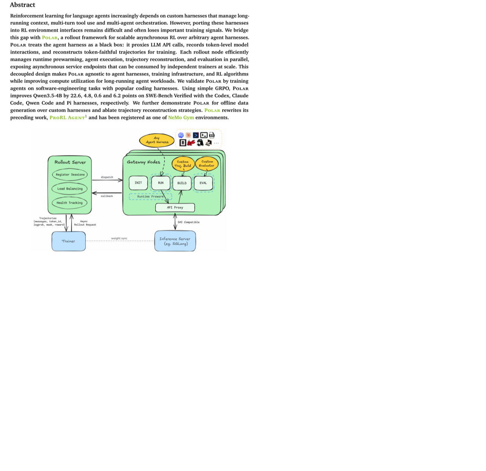
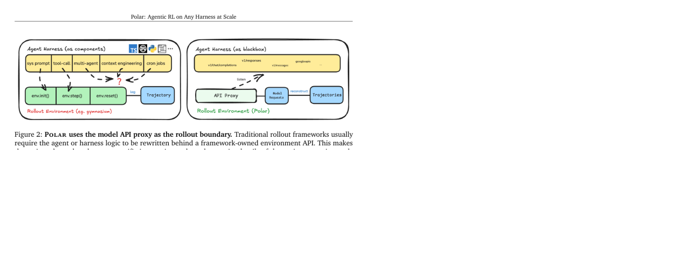
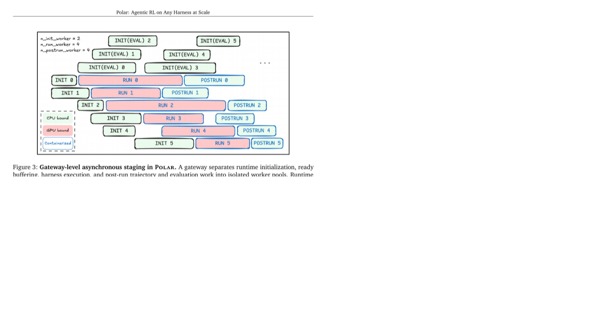
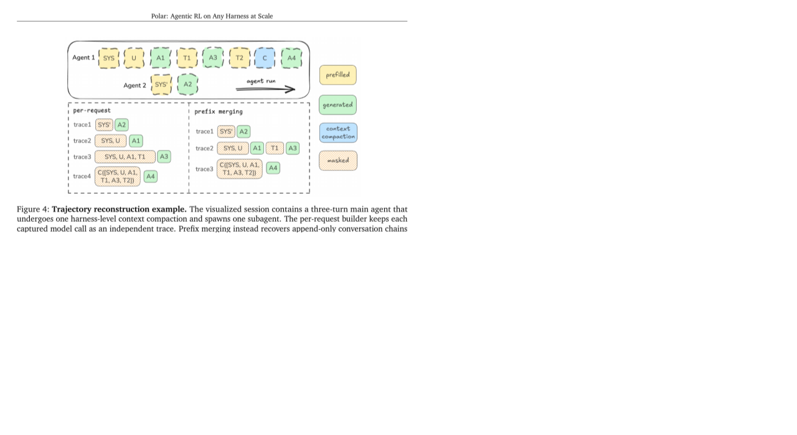
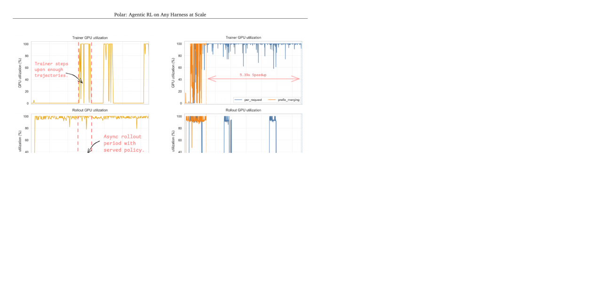
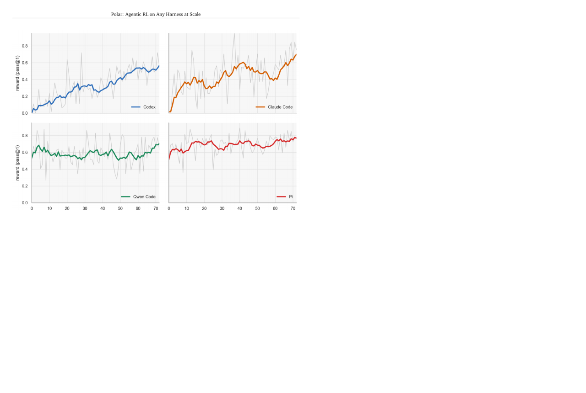
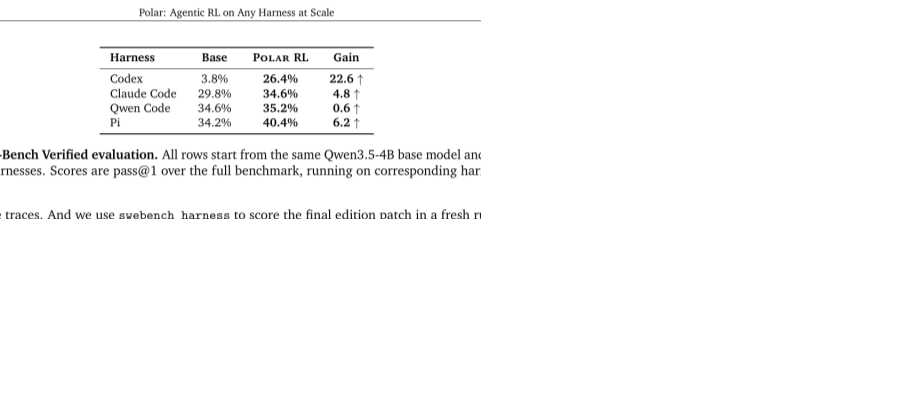
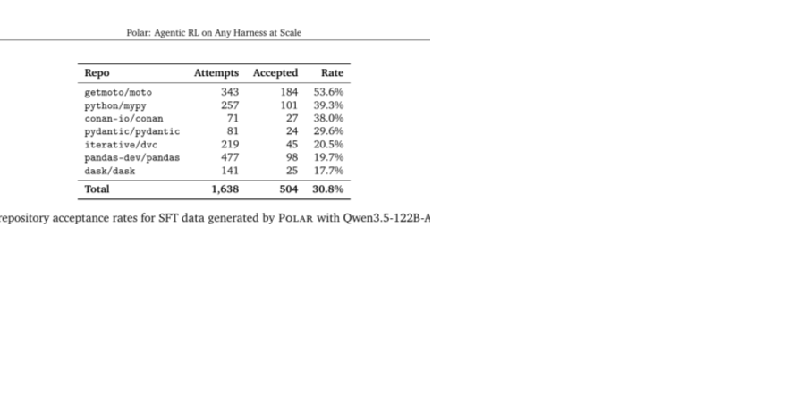

# Polar

## 一句话结论

Polar 的核心贡献不是新的 RL 算法，而是一套**把任意已有 agent harness 当黑盒接入 agentic RL 的 rollout infrastructure**：不要求改写 Codex/Claude Code/Qwen Code/Pi 这类 harness，而是在模型 API 边界放一个 proxy，捕获 prompt、sampled tokens、logprobs、response 和 loss mask，再重建 token-faithful trajectories 给 trainer 用。

换句话说，Polar 回答的是：**如果我的 agent 已经是一个复杂 CLI / SDK / 二进制 harness，怎么不打开内部实现也能做 RL？**



## 这篇放在阅读路线里的位置

前面几篇大多在讲 agentic RL 的算法和数据：

- Agent Lightning：已有 agent runtime 怎么抽 transition。
- AgentRL：多任务多轮训练怎么规模化。
- CacheRL：怎么用缓存降低 rollout 成本。
- SENTINEL：怎么从失败生成 targeted tasks。
- ContextRL：怎么训练 context grounding。

Polar 补的是**系统接入层**：真实 agent 往往已经存在于 test-time harness 里，比如 coding agent CLI、浏览器 agent、OS agent、内部 workflow runner。你不一定能把它改成 Gym env，也不一定能插 SDK decorator。Polar 的答案是：不要改 harness，改模型 endpoint。

## 解决什么问题

传统 RL 假设环境接口简单：

```text
obs = env.reset()
action = policy(obs)
obs, reward = env.step(action)
```

但真实 agent harness 很复杂：

- 可能是 CLI，不是 Python 函数。
- 可能内部有 context compaction。
- 可能会 spawn subagent。
- 可能管理工具、文件、MCP server、sandbox、浏览器。
- 可能是闭源或半闭源。
- 可能用 Anthropic/OpenAI/Google provider schema。
- 可能一次任务有几十次 LLM call、上万 tokens。

如果为了 RL 重写 harness，会丢失 test-time 真实行为。Polar 的目标是：**训练时也跑原生 harness，让模型在实际部署路径上被优化。**

## 核心设计：Model API Proxy 作为 Rollout Boundary

Polar 的关键观察是：不管 harness 内部多复杂，它总要调用模型。因此模型 API 边界是一个共同切入点。



Polar 在 harness 和 inference server 中间放 gateway proxy：

```text
native harness -> provider-compatible proxy -> local inference server
```

proxy 做四件事：

1. **Detect provider API**
   - 判断请求是 Anthropic Messages、OpenAI Chat、OpenAI Responses 还是 Google generateContent。

2. **Normalize request**
   - 把 roles、content parts、tool definitions、tool choices、stop controls、generation params 转成 local inference server 能吃的格式。
   - 同时加上训练需要的字段，例如 `logprobs=true`。

3. **Capture token-level data**
   - 记录 request messages、response messages、prompt token IDs、sampled response token IDs、finish reason、log probabilities。

4. **Return provider shape**
   - 再转回 harness 期望的 provider schema。
   - 如果 harness 要 streaming，Polar 会拿 non-streaming upstream response 再合成 provider-shaped stream。

这意味着 Polar 不需要理解 harness 如何规划、如何调工具、何时停止。它只需要保持 API 兼容，并捕获足够训练数据。

## 架构：Rollout Server + Gateway Nodes

Polar 有两个核心组件：

| 组件 | 作用 |
|---|---|
| Rollout server | 接收 TaskRequest，展开成多个 sessions，调度 gateway，保存结果，提供状态查询。 |
| Gateway node | 管理单个 session 生命周期：启动 runtime、配置 harness、运行 harness、捕获 LLM calls、重建 trajectory、执行 evaluator、回调 trainer。 |

一个 session 包含：

- session ID / task ID。
- timeout budget。
- runtime spec。
- agent spec / harness adapter。
- trajectory builder。
- evaluator。
- callback URL。

这个结构让 Polar 变成 rollout-as-a-service：trainer 不需要自己管理一堆慢速 agent 进程，只要提交任务、等 callback、消费 trajectory。

## Gateway Staging：为什么要异步分阶段

长程 agent rollout 很慢，而且慢在不同地方：

- runtime 启动。
- 依赖准备。
- harness 执行。
- evaluator 准备。
- 测试执行。
- patch 应用。
- teardown。

Polar 把这些拆成阶段：



Gateway 内部有 worker pools：

- `INIT`：启动 runtime，执行 prepare actions。
- `READY`：准备好的 runtime buffer，等运行 slot。
- `RUNNING`：运行 harness。
- `POSTRUN`：重建 trajectory、跑 evaluator、post-run hooks、回调、清理资源。

这样 CPU-heavy 的 runtime setup 可以在后台做，不阻塞 GPU-bound 的 model inference；evaluator 也可以提前 prewarm。

如果 harness timeout，但已经捕获了一些模型调用，Polar 仍进入 post-run，尽量恢复 partial traces，并标记 terminal timeout status。

## Harness Adapter

Polar 的 harness adapter 设计得很小：

- 写环境变量或 config。
- 注册 MCP servers / skills。
- 设置 provider endpoint。
- 返回运行 agent 的 shell command。

它支持 generic shell command，也集成了常见 coding harness 快捷方式：

- `claude_code`
- `codex`
- `gemini_cli`
- `qwen_code`
- `opencode`
- `pi`

重点：adapter 不负责改写 agent 逻辑，只负责把原生 harness 跑起来并让它打到 proxy endpoint。

## Token-faithful Trajectory Reconstruction

这是 Polar 最重要的训练正确性问题。

RL loss 必须作用在 behavior policy 实际采样出的 tokens 上。如果你只保存文本，再重新 tokenize，可能出现 retokenization drift：重编码后的 token IDs 和原始生成 token 不一致，logprobs 对不上，loss mask 也错。

Polar 的原则是：

```text
Every trainable token matches the behavior policy during rollout,
and any non-generated tokens are masked out.
```

也就是说：

- 模型实际 sampled assistant tokens：可训练，mask=1。
- harness 插入的 canonical interstitial context：不可训练，mask=0。
- 工具结果、系统插入、compaction 后上下文：不能当成模型输出训练。

## 两种 Trajectory Builder



### 1. per_request

最保守：每次模型 completion 变成一条 trace。

优点：

- 简单。
- 不会错误合并。
- 保留每个 call 的原始 token 数据。

缺点：

- 一个复杂 coding task 可能产生几百条短 trace。
- trainer 负担大。
- session-level reward 广播到每个 request 会造成 credit assignment 噪声。

### 2. prefix_merging

更实用：如果多个 completion 的 prompt 是 append-only conversation history，就合并成更长 trace。

合并条件：

```text
p_{m+1}[1 : |p_m|] = p_m
```

意思是：下一次 prompt 的前缀必须严格等于上一次 prompt。只有满足 strict token-prefix relation，才认为它是同一条 conversation chain 的延续。

如果出现 context compaction、subagent、parallel branch、prompt rewrite，就自然形成新的 chain，不强行合并。

合并时，Polar 不从 canonical rendering 里复制前一次 assistant turn，而是复制原始 sampled tokens `a_m`，并把 harness 插入的 interstitial tokens `u_m` 设为 mask=0。

最终 token 序列大概是：

```text
z = p1 || a1 || u1 || a2 || u2 || ... || aK
```

其中：

- `p1` 是第一个 prompt。
- `a_i` 是模型真实采样的 assistant tokens，mask=1。
- `u_i` 是 harness 插入的上下文，mask=0。

这和 CacheRL 的 token mask 思想很像：模型生成的才训练，环境/系统注入的不要训练。

## Polar 和 GPU 利用率



Polar 的异步设计让 rollout 和 trainer 解耦：rollout server 持续用当前 policy 生成 trajectories，trainer 只在收到足够 evaluated trajectory groups 时 step。

trajectory builder ablation 里：

- `per_request`：3 个 training steps 产生 1,185 个 request-level updates，耗时 189.5 分钟。
- `prefix_merging`：合并成 218 个 merged-trace updates，耗时 35.2 分钟。
- 加速 5.39x。
- rollout GPU utilization：prefix_merging 87.7%，per_request 20.4%。

这说明在真实 long-horizon agent 里，trajectory reconstruction 策略不是小细节，会直接决定训练吞吐。

## 实验：SWE-Gym GRPO on Coding Harnesses



实验设置：

- Base checkpoint：Qwen3.5-4B。
- Dataset：SkyRL-v0-293-data SWE-Gym training split。
- RL：standard GRPO。
- Trainer：Slime。
- Harness：Codex、Claude Code、Qwen Code、Pi。
- 评测：SWE-Bench Verified pass@1。
- Trajectory builder：prefix_merging。
- Evaluator：fresh runtime 中的 SWE-Bench harness evaluator。

主结果：



| Harness | Base | Polar RL | Gain |
|---|---:|---:|---:|
| Codex | 3.8% | 26.4% | +22.6 |
| Claude Code | 29.8% | 34.6% | +4.8 |
| Qwen Code | 34.6% | 35.2% | +0.6 |
| Pi | 34.2% | 40.4% | +6.2 |

结果解释：

- Codex gain 最大，因为 Qwen3.5-4B 原本不熟悉 Codex 的 action protocol、context policy 和 patch submission style。
- Qwen Code gain 小，因为 base model already aligned with Qwen Code harness。
- Pi 和 Claude Code 也有稳定提升。

关键结论不是“Polar 的 RL 算法强”，而是：**在真实 evaluation harness 路径上训练，可以学到 harness-specific behavior。**

## Offline SFT Data Generation

Polar 还能当离线数据生成服务。



Case study：

- Teacher/model：Qwen3.5-122B-A10B。
- Harness：pi-coding-agent v0.67.68。
- 任务：1,638 个 SWE-Gym instances。
- 每个任务一个 Apptainer runtime。
- 工具：bash/read/edit/write。
- timeout：3,600 秒。
- 接受标准：SWE-Bench evaluator 中 FAIL_TO_PASS 全过，PASS_TO_PASS 保持绿。

结果：

- 504 / 1,638 accepted trajectories。
- acceptance rate 30.8%。
- 约 64 GPU-hours。
- 平均每条 accepted trajectory 104 messages、51 assistant turns，长尾超过 200 turns。

这说明 Polar 不只是在线 RL rollout，也能做：

- rejection sampling。
- SFT trajectory collection。
- verifier training data。
- accepted/rejected preference pairs。

## STAR 分析

| 项 | 内容 |
|---|---|
| Situation | agentic RL 需要在真实 agent harness 上训练，但 harness 往往复杂、闭源、CLI 化、含工具和上下文管理，难以改成标准 RL env。 |
| Task | 不改写 harness 的前提下，捕获可训练的 token-level rollout trajectories，并能异步扩展到大规模 trainer。 |
| Action | 在 LLM API 边界放 provider-compatible proxy，捕获 token/logprob/request/response；用 rollout server + gateway node 管理 runtime/harness/evaluator；用 prefix_merging 重建 token-faithful traces。 |
| Result | 在 Codex/Claude Code/Qwen Code/Pi 四个 coding harness 上用 Qwen3.5-4B + GRPO 训练，SWE-Bench Verified 均提升；Codex 从 3.8% 到 26.4%。 |

## 和前面论文的关系

### 和 Agent Lightning

两者都想让已有 agent 接入 RL，但边界不同：

- Agent Lightning：强调 trace/transition abstraction 和 training-agent disaggregation。
- Polar：把模型 API proxy 当最小侵入边界，适合 CLI/binary/native harness。

可以理解为：Agent Lightning 更像标准化 instrumentation；Polar 更像“我不管你内部怎么跑，我只监听模型 endpoint”。

### 和 AgentRL

AgentRL 解决多环境多任务训练系统；Polar 解决已有 harness 怎么变成 rollout provider。

组合方式：

```text
Polar: black-box harness -> token-faithful trajectories
AgentRL/Slime: consume trajectories -> RL update
```

### 和 CacheRL

CacheRL 用缓存 tool result 降低 rollout 成本。Polar 更偏真实 harness 执行，不缓存工具结果。

两者权衡：

- CacheRL 便宜，但环境 fidelity 有 cache noise。
- Polar 真实，但 rollout 慢、资源重。

### 和 SENTINEL

SENTINEL 需要 failed rollouts 来诊断 failure modes。Polar 能提供真实 harness 下的 failed rollouts，并保留 token-level trace 和 evaluator reward。

这对 coding harness 很合适：Polar 收集失败轨迹，SENTINEL-style Controller 生成 targeted coding tasks。

## 和我的研究方向的关系

### 对 agent harness

Polar 是目前最直接回答“怎么把已有 harness 接 RL”的论文之一。

如果我们做自己的 agent/robot harness，应该提前设计这些边界：

- 模型调用必须能被 proxy 或 logger 捕获。
- 每次 LLM call 要保存 token IDs、logprobs、messages、tool definitions。
- 环境/工具返回要和模型 tokens 分开，并能做 loss mask。
- evaluator 要能在 clean runtime 里复现最终状态检查。
- session 要有 ID、timeout、runtime spec、callback、artifacts。

### 对 coding / software agent

这篇非常贴近 coding agent：它展示了同一个模型在不同 harness 里表现差异很大。Codex harness 下 base 只有 3.8%，训练后到 26.4%。这说明 coding agent 不是只有模型能力，还强依赖 harness 协议、工具风格、上下文策略、patch 提交格式。

因此如果你要做 coding agentic RL，不能只在抽象环境训练，必须在最终 test-time harness 上训练或至少对齐。

### 对 robot / embodied agent

机器人 harness 也可能是黑盒系统：ROS nodes、Unity/Isaac simulator、控制器、视觉 pipeline、LLM planner。Polar 的思想可迁移：把模型决策边界作为 capture point，而不是强行把整个机器人系统改成 Gym env。

但机器人里有连续动作和传感器流，单纯 LLM API proxy 不够。需要额外捕获：

- observation frames。
- robot state。
- action chunks。
- safety interrupts。
- human feedback。

Polar 的 rollout-as-a-service 和 session/runtime/evaluator 分层仍然可复用。

## 局限和不要误读

- Polar 不是 RL 算法论文；它主要是 rollout infrastructure。
- 实验集中在 coding harness，不证明对 web/OS/robot harness 已经同样有效。
- 依赖模型 API 边界。如果 agent 有非 LLM policy、内部模型调用绕过 proxy，就捕不到完整轨迹。
- Streaming 通过 non-streaming upstream response 合成，可能和真实 streaming latency/turn-taking 有差异。
- prefix_merging 只在 strict token-prefix 成立时合并；复杂 context rewriting 会形成多个 chains。
- session-level reward 广播到 per-request traces 会 reward hacking，论文也承认需要更好的 credit assignment / PRM。
- 它解决的是“如何捕获训练样本”，不解决 reward 设计、任务生成、长程 credit assignment 本身。

## 可复用点

1. 把模型 API endpoint 作为最小侵入 rollout boundary。
2. harness adapter 只负责配置和启动，不改内部逻辑。
3. rollout server 和 gateway node 分离，trainer 通过 service API 消费结果。
4. runtime setup、harness execution、evaluation、postrun 分阶段异步执行。
5. 保存 token IDs/logprobs/loss mask，而不是只保存文本 transcript。
6. 对长程 agent 使用 prefix_merging，避免每个 LLM call 都变成短样本。
7. 对非模型生成的 interstitial/tool/context tokens 设置 mask=0。
8. 同一套 rollout infrastructure 可同时用于 RL、SFT、rejection sampling、preference data。

## 下一步问题

- Polar 的 proxy capture 能不能接 Agent Lightning 的 transition interface？
- 对 tau-bench / Agent-Diff 这种 API benchmark，是否需要完整 harness proxy，还是普通 env wrapper 就够？
- 如果用 SENTINEL 生成 targeted tasks，Polar 如何把 failure traces 和 task metadata 暴露给 Controller？
- 对我们自己的 harness，最小要实现哪些字段才能支持 token-faithful RL？
- 如果 agent 是实时语音/多模态 streaming，Polar 的 non-streaming proxy capture 是否需要改造？

## 记忆钩子

`Polar = black-box harness + model API proxy + token-faithful trajectory reconstruction + rollout-as-a-service`。

这篇最重要的启发是：**agentic RL 的环境不是一个抽象 env.step，而是完整 test-time harness。训练系统必须尊重 harness 的真实执行路径，否则学到的行为可能无法迁移到部署时。**