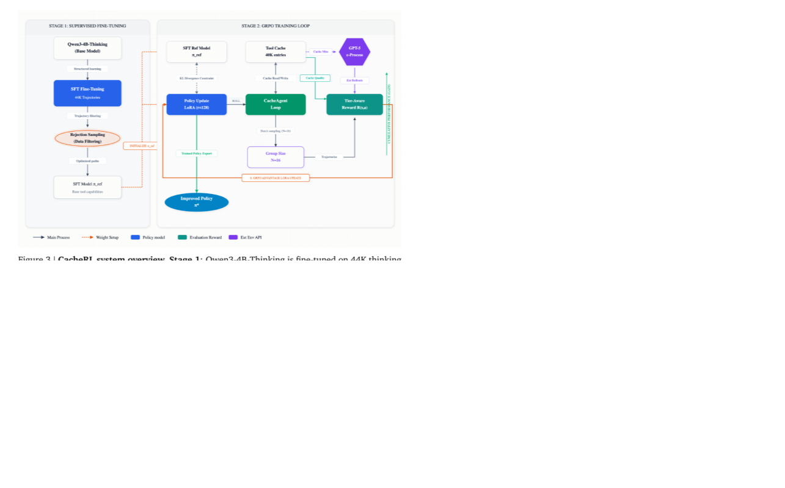
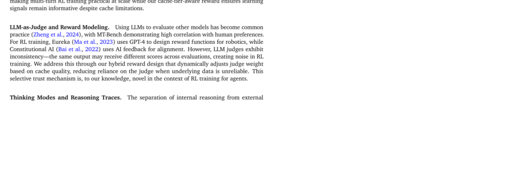
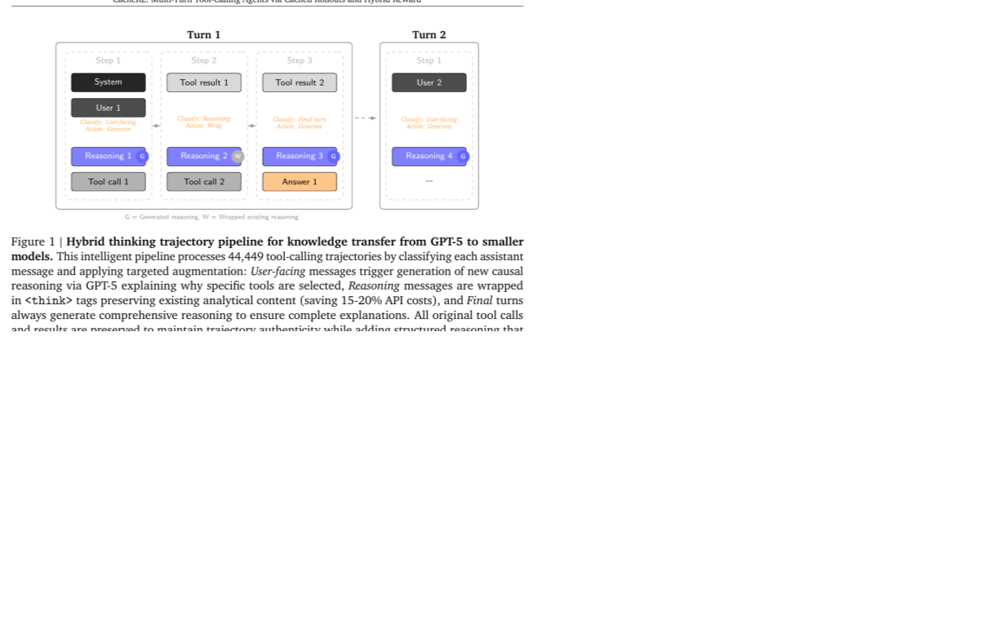
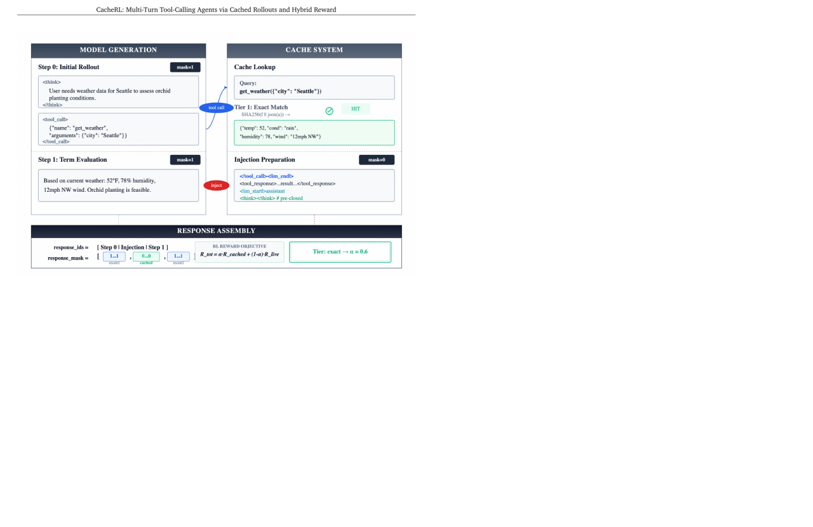
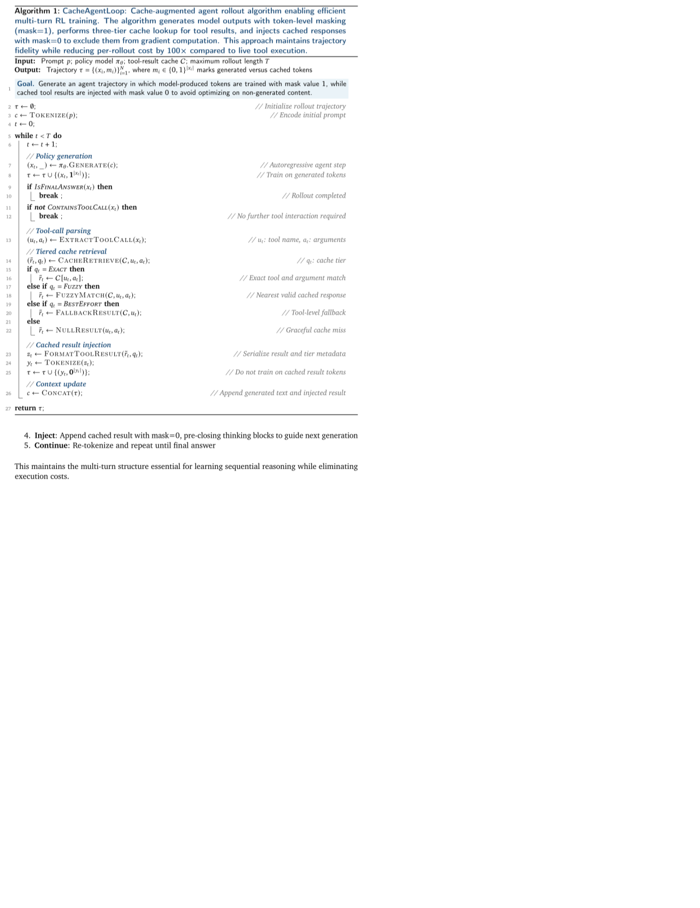
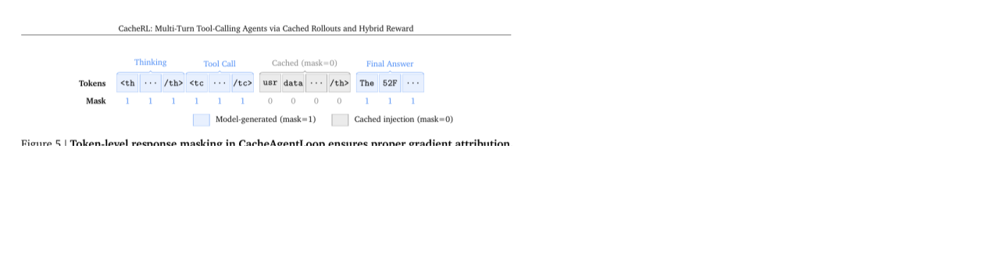
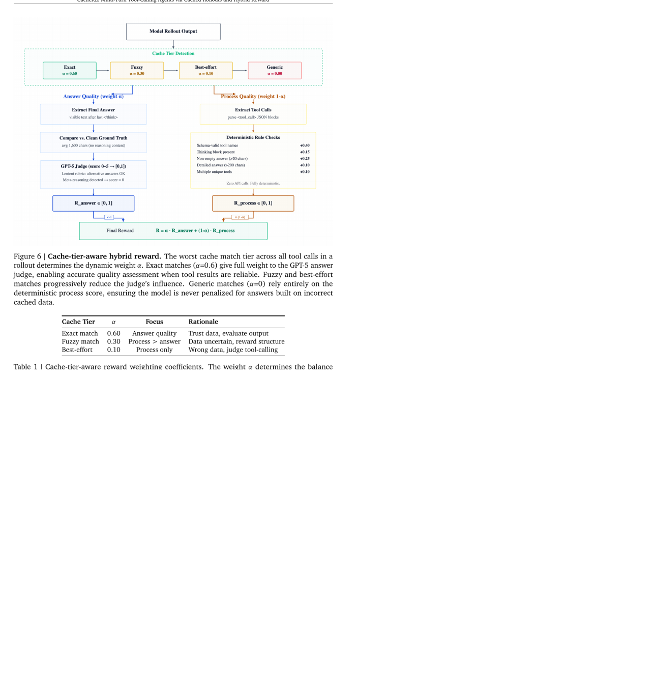
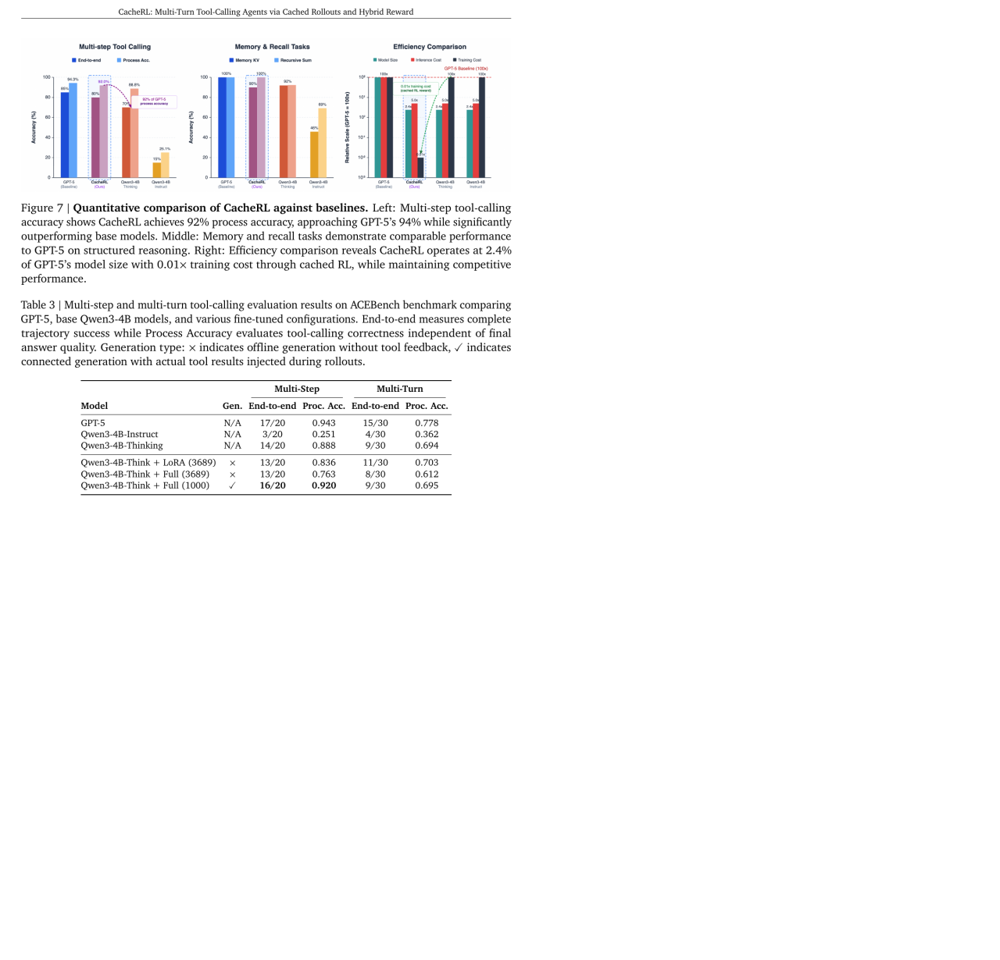
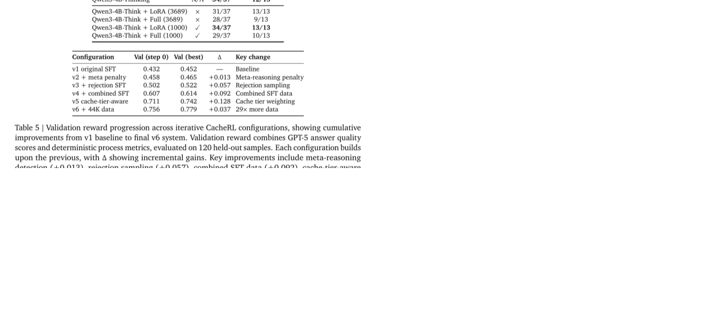
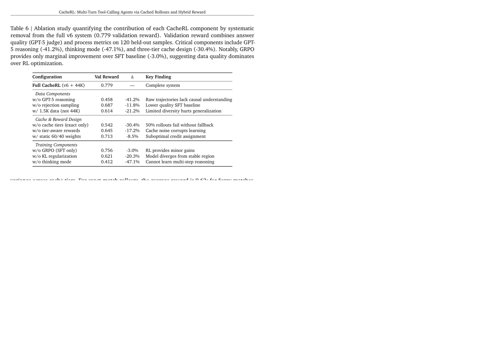

# CacheRL

## 一句话结论

CacheRL 的核心不是发明一个更复杂的 RL 算法，而是提出一套**低成本训练小型 multi-turn tool-calling agent**的工程路线：先用 GPT-5 给已有工具调用轨迹补上 `<think>` 推理，做强 SFT；再用缓存的 tool result 代替真实工具执行做 GRPO rollout；最后用 cache-tier-aware hybrid reward 避免模型因为缓存不准而被错误惩罚。

更直白地说：它想解决“我没有钱在 RL 训练时反复真实调用工具/API，但又想训练一个 4B 小模型学会多轮工具调用”这个问题。

## 这篇放在阅读路线里的位置

前面几篇的分工可以这样记：

- Agent Lightning：怎么把已有 agent runtime 的轨迹转成 RL transition。
- AgentRL：怎么把多环境、多任务、多轮 rollout-training 做到可扩展。
- ARPO：怎么在固定预算下更聪明地做 partial rollout 和局部 credit assignment。
- CacheRL：怎么在**低算力 / 低 API 成本**下训练多轮工具调用 agent，尤其是用 cached rollout 降低环境交互成本。

所以 CacheRL 很适合放在“低成本可复现 agentic RL”主线里。它的启发不是“照抄就能训练出 SOTA agent”，而是把真实训练成本拆成三个瓶颈：数据质量、环境执行成本、reward 噪声。

## 解决什么问题

训练 tool-calling agent 的难点不只是让模型输出一个 JSON 工具调用。真正的问题是：

- 多轮任务里，模型要先理解用户目标，再选择工具，再读工具结果，再决定下一步。
- RL 需要 rollout。一次 rollout 可能包含多次 API/tool 调用，真实执行会慢、贵，而且可能有副作用。
- 如果不用真实工具、改用缓存结果，缓存又不一定完全匹配当前模型生成的 tool arguments。
- reward 可能把“缓存返回错了”误判成“模型错了”，导致错误梯度。
- 小模型缺少大模型已经学到的工具选择经验，需要知识蒸馏。

CacheRL 把这些问题整理成三个挑战：

1. **Knowledge transfer at scale**：小模型不只是要模仿工具调用格式，还要学会为什么选这个工具、为什么用这些参数、如何根据工具结果继续推理。
2. **RL without live execution**：RL 训练时不能每个 rollout 都真实调用工具，否则 API 成本和延迟会爆炸。
3. **Learning from imperfect cached environments**：缓存环境不是完美环境。exact cache 很可靠，fuzzy/best-effort cache 会引入错误，需要 reward 设计把这种噪声考虑进去。

## 方法总览

CacheRL 是一个两阶段系统：

1. **Stage 1: SFT / knowledge transfer**
   - 收集 44,449 条多轮工具调用轨迹，覆盖 1,185 个工具。
   - 用 GPT-5 给轨迹补充结构化 `<think>` 推理。
   - 用这些 thinking trajectories fine-tune Qwen3-4B-Thinking。

2. **Stage 2: cached GRPO training**
   - 模型生成 reasoning 和 tool call。
   - 不真实执行工具，而是从 ToolResultCache 里查预先缓存的 tool result。
   - 把缓存结果注入上下文，但用 token mask 标记为 `mask=0`，不让模型在这些环境 token 上反向传播。
   - 按 cache tier 调整 reward 里 answer quality 和 process quality 的权重。



这张图是全篇主图：左边是 GPT-5 生成/补全 reasoning 的数据增强，右边是 cached rollout + hybrid reward + GRPO。

## 关键模块 1：Hybrid Thinking Trajectories

论文认为，小模型做不好多轮工具调用，根本原因之一是训练数据里通常只有“调用了什么工具”，没有“为什么这么调用”。所以它用 GPT-5 给已有轨迹补 `<think>`。



处理逻辑是 turn-by-turn 的：

- 如果 assistant message 已经包含计算、分析、步骤推理，就直接包进 `<think>`，不用重新生成。
- 如果只是用户可见回复、寒暄、状态说明，就让 GPT-5 生成 causal reasoning。
- 如果是 final turn，总是生成完整 reasoning，确保最终答案有解释链。
- 原始 tool call 和 tool result 都保留，不重写工具执行轨迹。



这里的专业词解释：

- **thinking trajectory**：每轮 assistant 输出里既有 `<think>...</think>` 内部推理，也有 tool call 或最终回答。
- **causal reasoning**：不是说“我要调用天气工具”，而是解释“用户要比较旅行适宜性，所以必须分别查两个城市天气，再根据温度、降雨、湿度综合比较”。
- **knowledge transfer**：把大模型的工具选择经验、推理风格、错误规避方式，通过生成的 reasoning 蒸馏给小模型。

它的数据规模：44,449 条轨迹，平均每条 5 个 tool calls、487 个 thinking tokens；覆盖 1,185 个工具。论文声称 GPT-5 增强成本约 110-220 美元。

## 关键模块 2：CacheAgentLoop

RL 训练最贵的是 rollout 时真实执行工具。CacheRL 的核心工程设计是 CacheAgentLoop：模型生成 tool call 后，不打真实 API，而是查缓存。



它的流程是：

1. 模型生成 reasoning 和 tool call。
2. 系统解析 tool name 和 arguments。
3. 去 ToolResultCache 查对应的 tool result。
4. 把查到的 result 注入上下文。
5. 模型继续下一轮生成，直到 final answer。

缓存有三层：

| Tier | 含义 | 训练意义 |
|---|---|---|
| Exact | tool name 和 arguments 完全匹配缓存 | 最可信，可以比较放心地用最终答案质量做 reward。 |
| Fuzzy | arguments 不完全一样，但找到相似调用 | 可以保持轨迹继续，但答案可能基于不完全正确的数据。 |
| Best-effort | 只找到同名工具的某个结果 | 只能提供弱环境反馈，主要训练结构和工具调用流程。 |

论文报告训练中大约 50% 是 exact match，17% 是 fuzzy，33% 是 best-effort。



这张算法图里最重要的不是代码细节，而是一个原则：**模型生成的 token 才训练，环境注入的 token 不训练。**

## 关键模块 3：Token-level Masking

在多轮 tool-use 轨迹里，一段文本既包含模型生成的内容，也包含环境返回的内容。比如：

```text
<think>...</think>              # 模型生成
<tool_call>{...}</tool_call>    # 模型生成
<tool_result>{...}</tool_result># 缓存/环境注入
最终答案                         # 模型生成
```

如果不做 mask，训练会把 tool result 也当成模型应该生成的文本，这显然不对。CacheRL 用二值 mask：

- `mask=1`：模型生成的 token，参与 policy gradient。
- `mask=0`：缓存注入的 tool result，不参与 loss。



这个细节很重要，因为它把“agent 环境反馈”和“模型 action”分开了。对我们做 agent harness 也很有价值：日志里必须知道哪些 token 是模型说的，哪些是环境/API返回的。

## 关键模块 4：Cache-tier-aware Hybrid Reward

CacheRL 的 reward 是这篇最值得仔细理解的地方。

普通 reward 会问：“最终答案对不对？”但在 cached rollout 里，最终答案可能错，不是因为模型工具选错，而是因为缓存给了不匹配的工具结果。于是论文设计了 hybrid reward：

```text
R = alpha(tau) * R_answer + (1 - alpha(tau)) * R_process
```

解释一下：

- `R_answer`：答案质量，由 GPT-5 judge 根据 ground truth 打分。
- `R_process`：过程质量，由规则打分，比如工具名是否合法、是否有 thinking block、答案是否为空、工具调用是否多样。
- `alpha(tau)`：根据这条 rollout 里最差的 cache tier 动态调整。



具体权重：

| Cache tier | alpha | 直觉 |
|---|---:|---|
| Exact match | 0.60 | 缓存可信，可以更看重最终答案。 |
| Fuzzy match | 0.30 | 数据不太确定，更看重流程是否合理。 |
| Best-effort | 0.10 | 工具结果很可能不准，主要看工具选择和格式。 |

这解决的是 attribution problem：不要把“缓存系统返回了近似/错误结果”归因成“模型能力差”。

## 公式怎么理解

### 1. 总目标

论文把目标写成：

```text
max_theta E_{tau ~ pi_theta}[R(tau)] - beta * KL(pi_theta || pi_ref)
```

意思是：

- 第一项：希望当前模型 `pi_theta` 生成的轨迹 `tau` reward 更高。
- 第二项：不要让当前模型偏离参考模型 `pi_ref` 太远。
- `beta=0.15`：KL 正则强度。值越大，模型越保守，越不容易 RL 崩掉。

这和很多 LLM RL 方法类似：一边追求高 reward，一边防止模型为了 reward 乱跑。

### 2. GRPO 的相对优势

CacheRL 用 GRPO。直觉是：同一个 prompt 采样 16 条 rollout，不直接问“绝对分数高不高”，而是问“这条 rollout 在同组里相对好不好”。

```text
A_i = (R_i - mean(R_group)) / (std(R_group) + epsilon)
```

解释：

- `R_i`：第 i 条 rollout 的 reward。
- `mean(R_group)`：同一个问题下 16 条 rollout 的平均 reward。
- `std(R_group)`：同组 reward 标准差。
- `A_i`：相对优势。高于平均就鼓励，低于平均就压低。

这比直接用绝对 reward 稳定一些，尤其适合不同任务 reward 尺度不完全一致的情况。

### 3. Mask 在 GRPO 里的作用

GRPO loss 里每个 token 都乘上 `m_i,t`：

```text
m_i,t = 1  -> 模型生成 token，更新
m_i,t = 0  -> 缓存注入 token，不更新
```

这避免了一个常见错误：训练模型去“生成环境返回”。对 tool agent 来说，tool result 应该是环境给的 observation，不是 policy action。

## 实验设计和主要结果

### 数据与训练设置

训练数据：

- 44,449 条多轮工具调用对话。
- 来源：Toucan 84%，agent data 9%，Toolathlon 3%，specialized collections 4%。
- 1,185 个 unique tools。
- cache 中有 40,850 个 exact tool-result entries。
- held-out validation set 120 条。

训练设置：

- Base model：Qwen3-4B-Thinking。
- SFT：完整 fine-tuning。
- RL：GRPO + LoRA rank 128。
- 每个 prompt 16 条 rollouts。
- KL coefficient `beta=0.15`。
- 8 H100，单个 optimization step 约 15-20 分钟。

### 主结果



论文强调的主结果是：

- 在 multi-step tool-calling 上，CacheRL / fine-tuned 4B 模型 process accuracy 达到约 0.92，接近论文中 GPT-5 的 0.943。
- Qwen3-4B-Instruct 很弱，multi-step process accuracy 只有 0.251。
- Qwen3-4B-Thinking 本身已经很强，multi-step process accuracy 0.888。
- connected generation 比 offline generation 好，说明训练时接入 tool feedback 很关键。

这里要区分两个指标：

- **End-to-end**：整条任务最终是否完成。更严格，受最终答案、工具结果、格式等影响。
- **Process accuracy**：工具调用流程是否正确。它更关注工具选择和调用过程，不完全等于最终任务成功。

所以“92% 接近 GPT-5”主要说的是 process accuracy，不要误读成所有真实任务都接近 GPT-5。

### 训练进展



Table 5 说明每个组件带来的累计提升：

- 原始 SFT baseline：0.432 -> 0.452。
- 加 meta-reasoning penalty：小幅提升。
- 加 rejection sampling：明显提升。
- 合并 SFT 数据：到 0.614。
- 加 cache-tier-aware reward：到 0.742。
- 扩展到 44K 数据：最好到 0.779。

这说明真正的大头不是“GRPO 本身突然让模型开窍”，而是：数据质量、缓存 reward 设计、数据规模。

### 消融实验



Table 6 是这篇最重要的结果表。它告诉我们哪些组件真的有用：

- 去掉 GPT-5 reasoning：0.779 -> 0.458，下降 41.2%。
- 去掉 thinking mode：0.779 -> 0.412，下降 47.1%。
- 只用 exact cache：0.779 -> 0.542，下降 30.4%。
- 去掉 tier-aware reward：0.779 -> 0.645，下降 17.2%。
- 去掉 GRPO，只做 SFT：0.779 -> 0.756，只下降 3.0%。

这个结果非常关键：**在 CacheRL 的设置里，强 SFT 已经吃掉了大部分收益，RL 主要提供稳定性和微调，不是能力跃迁的主要来源。**

## 失败案例和工程细节

论文里有几个很实用的失败案例：

1. **Premature termination**
   - 模型想了一点就结束，不调用工具。
   - 不设 `min_tokens` 时 42% rollout 没有 tool call。
   - 只在 step 0 设 `min_tokens=150` 后降到 13%。

2. **Cache mismatch cascading**
   - 用户问 San Francisco，fuzzy cache 返回 San Jose 天气。
   - 模型正确处理了错误数据，最终答案仍错。
   - 这就是为什么需要 cache-tier-aware reward。

3. **Tool over-chaining**
   - 如果 tool result 注入后不预先关闭 `</think>`，模型可能不断验证、不断调用工具。
   - pre-closing thinking block 能给模型一个“该收束了”的信号。

4. **Meta-reasoning instead of task solving**
   - 模型只是在想“我要如何回答得漂亮”，但没有真正执行搜索/工具调用。
   - 论文把这种答案分数 clamp 到 0，明确惩罚。

5. **Unseen tool schemas**
   - 遇到没见过的新工具 schema，模型会按相似工具猜参数，而不是认真读 schema。
   - 对完全新工具性能下降 15-20%。

这些细节很有工程价值，因为它们不是抽象理论问题，而是你真的训练 tool agent 时会遇到的问题。

## 和前面几篇的关系

### 和 Agent Lightning

Agent Lightning 关心的是“怎么从已有 agent runtime 中抽 transition”。CacheRL 关心的是“transition/rollout 里的工具执行太贵怎么办”。

可以组合：

```text
Agent Lightning: runtime trace -> transition dataset
CacheRL: cached tool result -> cheap rollout -> cache-aware reward
```

### 和 AgentRL

AgentRL 更像大规模训练系统：异步 rollout、容器环境、多任务优势归一化。CacheRL 更像低成本训练技巧：用缓存替代 live tool execution。

如果资源少，CacheRL 的路线更现实；如果资源足够、环境可容器化，AgentRL 的路线更完整。

### 和 ARPO

ARPO 是在工具返回后高不确定位置做 partial rollout，解决探索预算怎么用。CacheRL 是把整个工具环境缓存化，解决 rollout 成本怎么降。

两者可以互补：ARPO 决定“在哪些步骤多分支探索”，CacheRL 决定“这些分支怎么低成本执行”。

## 和我的研究方向的关系

### 对 agent harness

最可复用的是三件事：

1. 每次 tool call 都要记录 `(tool name, arguments, result)`，以后才能建 ToolResultCache。
2. 每段轨迹要区分 model-generated token 和 environment-injected token。
3. reward 不能只看最终答案，要知道环境反馈质量是否可靠。

如果我们做自己的 agent/robot harness，可以把 execution log 设计成：

```text
user request
model reasoning/action/tool call  -> mask=1
environment/tool observation      -> mask=0, quality=tier
model next action/final answer    -> mask=1
reward = outcome reward + process reward + environment-quality adjustment
```

### 对 low-compute agentic RL

这篇是目前最贴近“低算力可做”的路线之一。它甚至承认 RL 提升有限，这反而重要：

- 先把 SFT 数据做好。
- 再把可验证 reward 做好。
- 最后才上 RL。

对个人或小团队来说，这比一开始搭大规模在线 RL 更现实。

### 对机器人 / embodied agent

CacheRL 的 cached rollout 思路可以迁移，但不能直接照搬：

- 工具结果缓存比较容易，机器人物理执行缓存很难。
- 机器人状态连续、视觉变化大，fuzzy cache 可能更危险。
- 可以缓存高层 symbolic observations 或 simulator results，但不能假装它等同真实世界。

它对 embodied agent 的启发是：如果真实执行昂贵，可以先做“分层缓存”：高层计划/工具/API 用缓存，低层控制再用仿真或少量真实 rollout 校正。

## 局限和不要误读

- 不要把“92% 接近 GPT-5”理解成整体 agent 能力接近 GPT-5；主要是特定 benchmark 的 process accuracy。
- 它依赖 GPT-5 做 reasoning augmentation 和 answer judge。学生模型的上限、偏差和成本都受 teacher 影响。
- cached rollout 不是真实环境。50% 非 exact cache 意味着 reward 信号有系统噪声。
- RL 的边际收益很小：SFT-only 已经达到 full system 97% 的性能。
- 评测主要是确定性工具调用，不能代表开放式、模糊意图、真实生产 API 变化。
- `<think>` 带来 2-3 倍推理延迟，不一定适合实时 agent。
- 对完全新工具 schema，模型仍会退化 15-20%。

## 可复用点

1. 先做 high-quality SFT，再做 RL，不要迷信 RL 能从烂数据里自动学出来。
2. 把 tool result 缓存成 `(tool, args) -> result`，用于低成本 rollout。
3. cache 必须分 tier：exact / fuzzy / best-effort。
4. reward 要知道 cache tier，不能对所有 rollout 一视同仁。
5. token mask 是 tool agent RL 的硬需求：模型 token 和环境 token 必须分开。
6. 对 thinking-mode agent，要防止 premature EOS、endless thinking、tool over-chaining。
7. 用 process reward 打破全 0 reward 组，否则 GRPO 没有有效相对优势。
8. 训练日志里要记录 cache hit rate、fuzzy rate、best-effort rate，否则 reward 变化无法解释。

## 下一步问题

- CacheRL 的 cached rollout 能不能接到 Agent Lightning 的 transition 接口？
- 如果用 Agent-Diff / tau-bench 的真实 state-diff verifier 替代 GPT-5 judge，reward 会不会更稳？
- 能否用少量 live rollout 动态刷新 cache，解决 cache staleness？
- CacheRL + ARPO 是否可以只在高不确定步骤做 cached branch rollout，进一步省预算？
- 对机器人任务，哪些 observation 可以安全缓存，哪些必须真实执行或仿真？

## 记忆钩子

`CacheRL = GPT-5 reasoning distillation + cached tool rollout + token mask + cache-tier-aware reward`。

这篇最重要的教训是：**agentic RL 的瓶颈经常不是 RL 算法，而是数据质量、环境成本和 reward 噪声。**在 CacheRL 里，RL 只带来小幅增益；真正决定效果的是 thinking trajectory、cache 设计和 reward attribution。