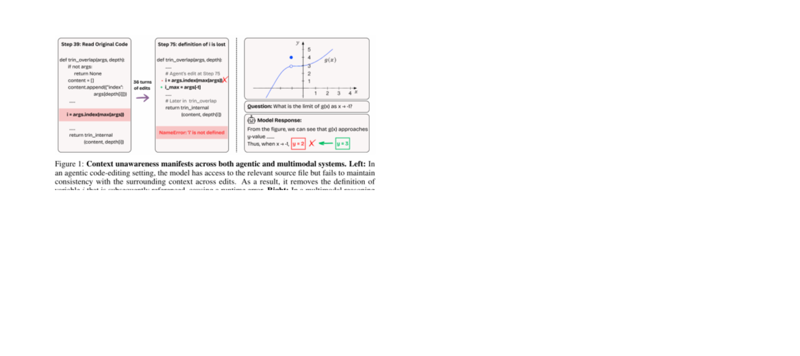
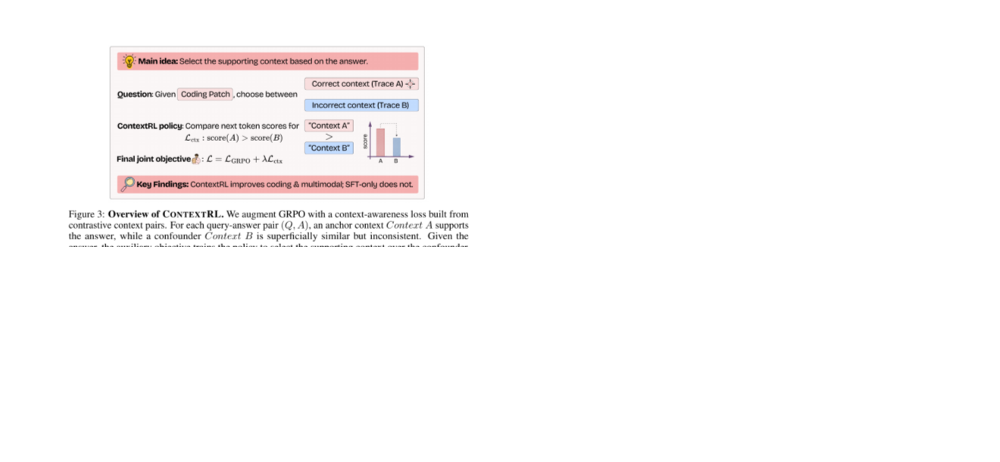
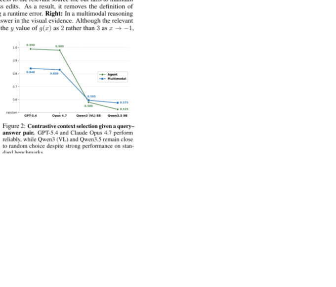
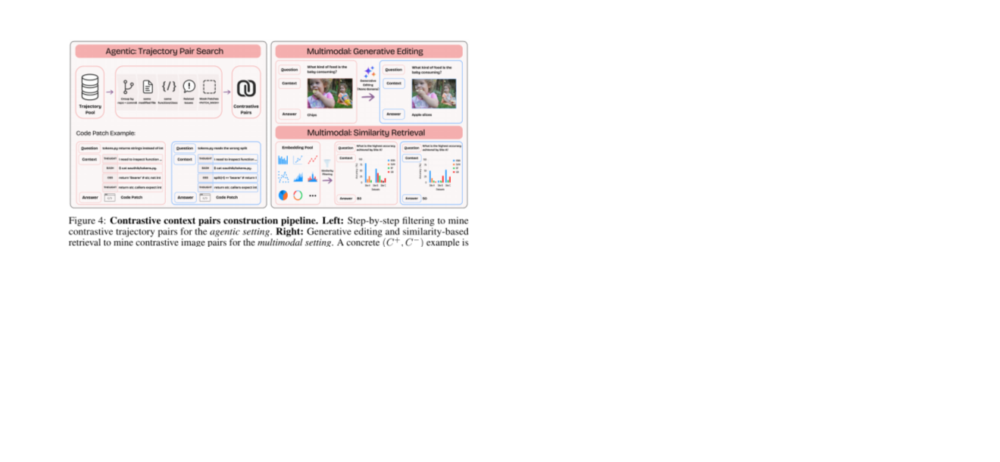
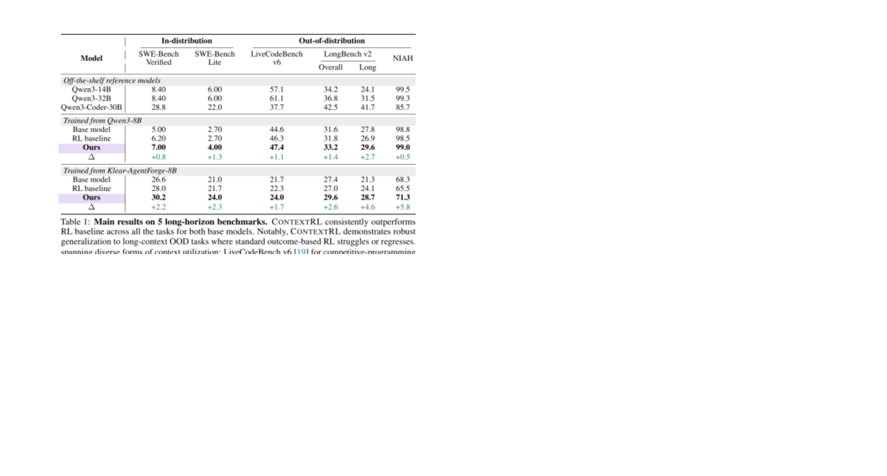
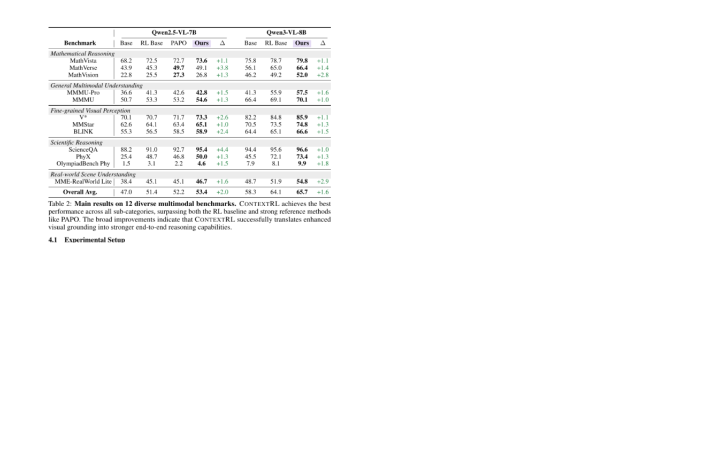
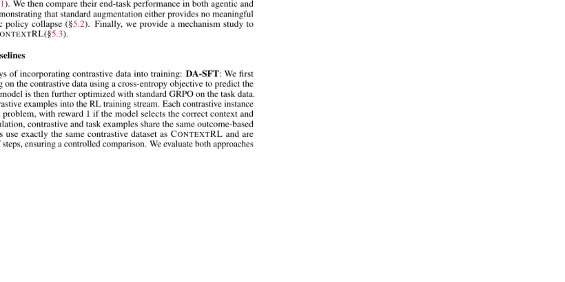
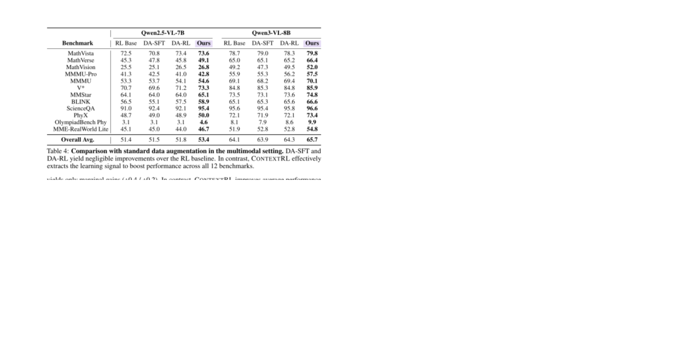
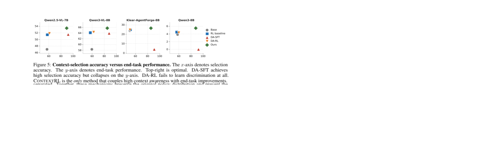

# ContextRL

## 一句话结论

ContextRL 的核心是给 GRPO 加一个**上下文选择辅助目标**：模型不只要答对，还要能在两个非常相似的 context 里选出“哪个 context 支持这个 query-answer pair”。在 agentic coding 里 context 是 agent trajectory；在多模态任务里 context 是 image。这个辅助目标逼模型把答案 grounded 到稀疏但关键的证据上，而不是只靠表面模式或最终 reward。

换句话说，这篇解决的是：**模型明明看到了关键上下文，却没有真正用它。**



## 这篇放在阅读路线里的位置

前面几篇主要关注 agentic RL 的 rollout、任务、reward 和训练成本：

- CacheRL：怎么低成本 rollout。
- SENTINEL：怎么根据失败动态生成训练任务。
- ARPO：怎么在关键步骤做 partial rollout。
- AgentRL：怎么大规模训练多任务 agent。

ContextRL 补的是另一个维度：**context grounding**。它不专门解决工具执行成本，也不生成新任务，而是问：模型在长轨迹、长上下文、图片里，是否能抓住那一小块决定性证据？

这对 agent 很关键，因为 tool-use agent 的错误经常不是“不会调用工具”，而是：

- 轨迹里早就有某条 observation，但模型忘了。
- 代码上下文里某个变量不能删，但模型改 patch 时忽略了。
- 工具结果里有一个约束，但模型最后答复没用上。
- 图片里有一个很小的视觉细节，但模型看错了。

## 解决什么问题

论文把这个失败叫 **context unawareness**：相关信息就在 context 里，但模型的预测没有 grounded 在这些信息上。

它不是普通“不会推理”，而是更具体：

- 输入里有证据。
- 模型也能读到这个证据。
- 但最终决策没有用这个证据。
- 结果看起来局部合理，却和上下文冲突。

论文给两个例子：

- Agentic coding：模型修改代码时删除了后面还会用到的变量定义，导致 runtime error。
- Multimodal reasoning：图里关键 y 值是 3，但模型看成 2。

这类错误在长程 agent 里很常见：信息不是不存在，而是模型没有把它当成 decisive evidence。

## 方法总览

ContextRL 的训练信号是 contrastive context selection。

给模型一个三元组：

```text
Query Q
Answer A
Context C+  # 支持这个答案
Context C-  # 看起来很像，但不支持这个答案
```

模型要判断哪个 context 支持 `Q -> A`。



注意它不是让模型重新回答问题，而是固定 `Q` 和 `A`，只问：**这个答案到底是由哪个上下文支持的？**

这等于把“答案正确性”和“证据 grounding”拆开训练：

- GRPO 负责让模型答对。
- Context-awareness loss 负责让模型知道为什么这个答案由某个 context 支持。

## Contrastive Context Probe

论文先做了一个诊断 probe：给模型 query、candidate answer、两个相似 context，让模型选 supporting context。



结果很有意思：GPT-5.4 和 Claude Opus 4.7 表现很强，开源 Qwen3 / Qwen3-VL 接近随机。也就是说，模型在标准 benchmark 上可能看起来不错，但在“两个相似上下文里找证据”时会暴露明显短板。

这也解释了为什么只看最终答对率不够：模型可能答对了一些题，但不是稳定地基于正确证据答对。

## Agentic Contrastive Context 怎么构造

在 agentic coding 场景里，一个样本是：

```text
Q = GitHub issue
A = reference patch
C = agent trajectory
```

这里的 context 不是一段普通文本，而是一整条 agent trajectory，包括：

- reasoning trace。
- tool interactions。
- sandbox observations。
- submitted patch。



构造 `C+ / C-` 的方法很严格：

- 从 66k SWE-smith / Klear-AgentForge trajectories 里挖。
- 两条 trajectory 必须来自同一 repo、同一 commit。
- 修改同一个 file。
- 目标是同一个 function/class。
- issue 语义相关但不同。
- patch 内容用 `<PATCH_MASKED>` 遮掉，防止模型直接看答案。
- 再用 GPT-5.4 自动验证，剔除有表面捷径或标签不明确的样本。

最后只留下 1k 对，高质量但非常稀疏，约占 66k 的 1.5%。

这说明作者非常在意一个问题：contrastive pair 必须足够像，不能让模型靠 repo 名、文件名、长度、格式这类浅层特征选答案。

## Multimodal Contrastive Context 怎么构造

在多模态场景里：

```text
Q = 图像问题
A = 答案
C = image
```

`C+` 是支持答案的图片，`C-` 是看起来很像但答案不同的图片。

论文用了两种方法：

1. **自然图像：generative editing**
   - 用 GPT-5.4 生成编辑指令。
   - 用 Nano Banana 2 修改图片，让答案变成 `A'`。
   - 再用 GPT-5.4 检查有没有明显编辑痕迹、全局风格变化、边界异常。
   - 约 2k candidates 里留下 700 对。

2. **结构化图片：similarity retrieval**
   - 对 chart、geometry、science diagram 这类图，不直接编辑，因为容易破坏结构约束。
   - 用 Qwen3-VL-Embedding 找视觉相似但答案不同的图片。
   - 阈值 `cos(f_I(I), f_I(I')) >= 0.85`。
   - 从 200k candidates 中得到 6,300 对。

最终多模态 contrastive set 有 7k 对。

## 公式怎么理解

### 1. Context-awareness loss

一个 contrastive 样本：

```text
z = (Q, A, C+, C-)
```

模型看到 `Q`、`A`、两个 context 选项。假设 `C+` 对应选项 token 是 `t+`，`C-` 对应选项 token 是 `t-`。

模型在答案位置会给两个选项 token 计算 logits：

```text
l_theta^+(z) = 正确 context 选项的 logit
l_theta^-(z) = 错误 context 选项的 logit
```

margin 是：

```text
Delta_theta(z) = l_theta^+(z) - l_theta^-(z)
```

如果 `Delta` 大于 0，说明模型更偏向正确 context；越大越好。

损失函数：

```text
L_CA(z; theta) = - log sigma(clip(Delta_theta(z), -c, c))
```

解释：

- `sigma` 是 sigmoid，把 margin 转成概率式分数。
- `-log sigma(...)` 表示：如果正确 context 的 logit 没有高过错误 context，就惩罚。
- `clip(Delta, -c, c)` 防止 margin 太大时梯度支配训练。

这个 loss 是 logit-level 的，不需要完整 rollout；它用 teacher forcing 直接看模型对 A/B 选项的 logits。

### 2. Joint objective

总训练目标：

```text
L(theta) = E_{x in D_RL}[L_GRPO(x; theta)] + lambda * E_{z in D_CA}[L_CA(z; theta)]
```

解释：

- `D_RL`：原始任务数据，用 GRPO 优化最终任务表现。
- `D_CA`：contrastive context 数据，用 `L_CA` 训练 context grounding。
- `lambda`：平衡系数。太小没效果，太大会压过主任务。

论文里 agentic 长程实验发现 `lambda=0.005` 最好；多模态里最优通常是 `0.001` 或 `0.005`。这说明它只是辅助目标，不应主导整个训练。

## 为什么不是普通数据增强

这篇最重要的对照实验是：同样的 contrastive data，用普通方式喂进去会怎样？

它比较了：

- **DA-SFT**：直接 SFT，让模型预测正确 context。
- **DA-RL**：把 context selection 当二分类 RL 任务，选对 reward=1，选错 reward=0。
- **ContextRL**：不直接改主任务格式，而是把 context selection 作为 bounded auxiliary loss 加进 GRPO。

结果：普通数据增强不行。

原因：

- DA-SFT 确实学会 context selection，但会破坏 agent 的长程交互 policy，尤其在 coding agent 上直接 collapse。
- DA-RL 的 0/1 reward 太稀疏，和普通 outcome reward 一样，无法稳定教会 grounding。
- ContextRL 的辅助 loss 是 dense logit-level signal，而且被 clipping/KL/GRPO 约束住，不容易把原 policy 冲坏。

## Long-horizon / Agentic 实验结果



训练设置：

- Base models：Qwen3-8B、Klear-AgentForge-8B。
- Agentic training set：8k instances。
- 其中 7k 是 SWE-Gym / SWE-Smith coding tasks，用 GRPO。
- 1k 是 contrastive trajectory pairs，用 `L_CA`。
- 评测：SWE-Bench Verified、SWE-Bench Lite、LiveCodeBench v6、LongBench v2、Needle-in-a-Haystack。

结果：ContextRL 在两个 base model、所有 benchmark 上都超过 standard RL baseline。

关键数字：

- Qwen3-8B：SWE-Bench Verified 6.2 -> 7.0，Lite 2.7 -> 4.0。
- Klear-AgentForge-8B：SWE-Bench Verified 28.0 -> 30.2，Lite 21.7 -> 24.0。
- LongBench v2 Long subset：Klear 24.1 -> 28.7。
- NIAH：Klear 65.5 -> 71.3。

不要把这个结果夸大成“解决 SWE-Bench”。绝对值仍然有限，尤其 Qwen3-8B 的 coding 成功率还低。但它说明 context-selection auxiliary loss 对长上下文泛化有稳定帮助。

## Multimodal 实验结果



训练设置：

- Base models：Qwen2.5-VL-7B、Qwen3-VL-8B。
- 多模态训练集：45k examples。
- 38k 标准 single-image QA 用 GRPO。
- 7k contrastive image pairs 用 `L_CA`。
- 评测 12 个 benchmark，覆盖数学推理、通用多模态理解、细粒度视觉感知、科学推理、真实场景理解。

结果：

- Qwen2.5-VL-7B：overall avg 51.4 -> 53.4，相比 RL baseline +2.0。
- Qwen3-VL-8B：overall avg 64.1 -> 65.7，相比 RL baseline +1.6。
- 每个 benchmark 都有提升。

这说明 ContextRL 不只是 coding agent 技巧，也能迁移到视觉 grounding。

## Data Augmentation 对照结果

### Agentic 对照



这张表很关键：

- Klear-AgentForge-8B 上，RL baseline 是 28.0 / 21.7。
- DA-SFT 掉到 6.4 / 1.3。
- Qwen3-8B 上，DA-SFT 直接变成 0.00 / 0.00。
- DA-RL 几乎没提升。
- ContextRL 最高：30.2 / 24.0，7.0 / 4.0。

解释：agentic coding 需要长程交互格式、工具调用节奏、patch 提交流程。直接拿短选择题做 SFT 会把模型分布拉偏，破坏原来的 agent scaffold 行为。

### Multimodal 对照



多模态里 DA-SFT 没有像 agent 那样崩，但也几乎没用：

- Qwen2.5-VL：RL baseline 51.4，DA-SFT 51.5，DA-RL 51.8，ContextRL 53.4。
- Qwen3-VL：RL baseline 64.1，DA-SFT 63.9，DA-RL 64.3，ContextRL 65.7。

结论：不是“contrastive data 本身”带来提升，而是 `L_CA` 这种训练方式带来提升。

## 机制分析



Figure 5 横轴是 context-selection accuracy，纵轴是 end-task performance。理想位置是右上角。

三点结论：

1. **Outcome-only RL 学不会 context selection**
   - RL baseline 接近 base cluster。
   - 最终 reward 对“到底用了哪个证据”信号太弱。

2. **DA-SFT 学会 selection，但伤害主任务 policy**
   - selection accuracy 高，但 agentic task 表现崩。
   - 它学了短选择题格式，却破坏了长程 agent 行为。

3. **ContextRL 同时保持主任务和 context selection**
   - 它把 context selection 作为辅助 loss，而不是替换主任务。
   - clipping、KL regularization、margin clipping 共同限制更新幅度。

所以这里的核心不是“会选 context 就一定有用”，而是：**必须在不破坏原有 policy 的前提下学会 context selection。**

## 输入、输出、数据类型、模态

| 维度 | ContextRL 里的定义 |
|---|---|
| 输入 | 原始 RL 任务数据 `D_RL` + contrastive context 数据 `D_CA`。 |
| Agentic context | agent trajectory：reasoning、tool calls、sandbox output、patch。 |
| Multimodal context | image：自然图像、chart、geometry、science diagram 等。 |
| Query | GitHub issue / VQA question。 |
| Answer | reference patch / VQA answer。 |
| 输出 | 更 context-aware 的 policy model，不是新的 agent framework。 |
| Reward | 主任务仍用 GRPO outcome reward；额外加 context-awareness loss。 |
| 模态 | 文本轨迹 + 图像；不是音频/机器人连续控制。 |

## STAR 分析

| 项 | 内容 |
|---|---|
| Situation | 长程 agent 和多模态模型经常看得到关键证据，但答案没有 grounded 在证据上。最终 reward 不足以区分“真用上下文”和“靠捷径猜对”。 |
| Task | 给 RL post-training 加一个轻量目标，让模型学会识别哪个 context 支持某个 query-answer pair。 |
| Action | 构造 agent trajectory / image 的 contrastive context pairs，并在 GRPO 外加 logit-level context-awareness loss `L_CA`。 |
| Result | 在 5 个 long-horizon benchmark 上平均超过 GRPO 约 2.2%，在 12 个 VQA benchmark 上平均超过 GRPO 约 1.8%；普通 DA-SFT/DA-RL 不能复现收益。 |

## 和前面论文的关系

### 和 CacheRL

CacheRL 解决“rollout 太贵”和“cached result 噪声”。ContextRL 解决“模型有没有真的用 context”。

如果组合，CacheRL 的 tool trace 可以成为 ContextRL 的 `C+ / C-`。但要小心：cached rollout 的错误可能来自缓存不准，不一定来自模型 context unawareness。

### 和 SENTINEL

SENTINEL 从失败轨迹生成 targeted tasks。ContextRL 可以进一步问：失败是否因为模型没用上某个关键 context？

组合方式：

```text
failed rollout -> Controller 标注 failure mode
if failure = context grounding -> 构造 C+ / C- trajectory pairs -> L_CA training
```

### 和 Agent Lightning

Agent Lightning 把 agent execution 拆成 transition；ContextRL 则可以把整段 execution trace 作为 context，训练模型判断某个 action/answer 是否被这段 trace 支持。

### 和 ARPO

ARPO 关注 rollout 分支探索。ContextRL 关注证据选择。一个是在“行动空间”里探索，一个是在“上下文证据空间”里 grounding。

## 和我的研究方向的关系

### 对 agent harness

这篇要求我们在 harness 日志里保留完整 context：

- 不只保存最终答案。
- 不只保存最后一轮 tool call。
- 要保存足够的 trajectory、observation、patch/action、环境返回。

否则无法构造 `C+ / C-`。

对我们来说，可以把失败轨迹配对成：

```text
Q = 用户任务 / issue / robot instruction
A = 正确动作或最终状态
C+ = 支持 A 的轨迹/观察/记忆
C- = 表面相似但支持另一个动作的轨迹/观察/记忆
```

然后训练模型学会区分“哪个上下文真的支持这个决策”。

### 对 memory / long-context

ContextRL 很像 memory retrieval 的监督信号：不是只问最终答案，而是问“哪段记忆/上下文支持这个答案”。

这对长期记忆 agent 很有用，因为长期记忆失败常常是：

- 检索到了相关记忆，但模型没用。
- 用了错误相似记忆。
- 把不同用户/不同时间的记录混淆。

Contrastive context selection 可以直接训练这种能力。

### 对 multimodal / robot grounding

多模态结果对机器人方向也有启发：机器人视觉里常常有多个相似物体，模型必须根据 instruction 选对视觉 evidence。

可以构造：

- `C+`：正确物体/场景图。
- `C-`：非常相似但目标属性不同的图。
- `A`：正确 action 或 grounded target。

这比只训练最终 action success 更明确地训练视觉 grounding。

## 局限和不要误读

- ContextRL 不是一个完整 agent training framework；它只是给 GRPO 加辅助目标。
- Agentic 实验主要是 coding/long-context，不是企业 API tool-use、web agent 或 robot agent。
- 收益稳定但幅度不大，通常是 1-3 个百分点，不是能力跃迁。
- Contrastive pair 构造成本高：agentic 里 66k 轨迹只筛出 1k 高质量对。
- 多模态对比图像依赖 GPT-5.4、Nano Banana 2、Qwen3-VL embedding 等强工具。
- `L_CA` 的 lambda 很敏感，太大可能压过主任务目标。
- 论文没有展示真实部署中的长程 agent 交互改善，只是 benchmark 评估。
- 如果 contrastive pairs 有隐藏 artifact，模型可能学到捷径；作者用验证和 DA-SFT 对照缓解这个疑虑，但不能完全消除。

## 可复用点

1. 对 agent 轨迹做 contrastive pair，不只做正样本 SFT。
2. 把“答案是否正确”和“哪个 context 支持答案”拆开训练。
3. 用 logit-level dense auxiliary loss，比 0/1 outcome reward 更直接。
4. auxiliary objective 必须 bounded，避免破坏原有 agent policy。
5. 对长期记忆、多用户、多记录场景，构造相似但不同的 context pair 很有价值。
6. 对视觉/机器人 grounding，用相似图像或相似物体构造 hard negatives。
7. 评估时要单独测 context-selection accuracy，不要只看最终任务成功率。

## 下一步问题

- 能不能把 SENTINEL 发现的 failure mode 自动转成 ContextRL 的 `C+ / C-`？
- 对 tau-bench / Agent-Diff，能不能用相似但状态不同的 API trace 构造 contrastive contexts？
- 对长期记忆 agent，`C-` 应该是相似用户、相似时间，还是相似事件？
- 对 robot/VLA，contrastive context 是两张图、两段轨迹，还是两段 observation-action history？
- 如果用 ContextRL 训练 tool-use agent，context selection objective 会不会和工具调用格式能力冲突？

## 记忆钩子

`ContextRL = GRPO + contrastive context-selection auxiliary loss`。

它的关键不是“多加 contrastive data”，而是**用 bounded logit-level loss 训练模型知道哪个 context 支持答案，同时不破坏原来的长程 agent policy**。