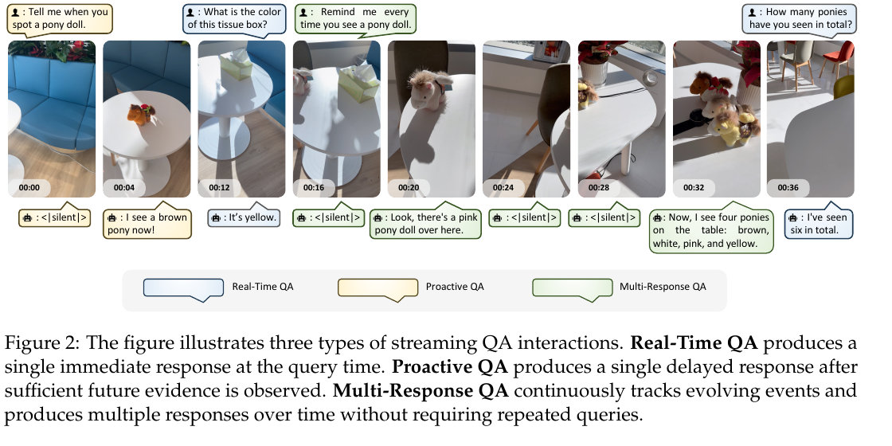
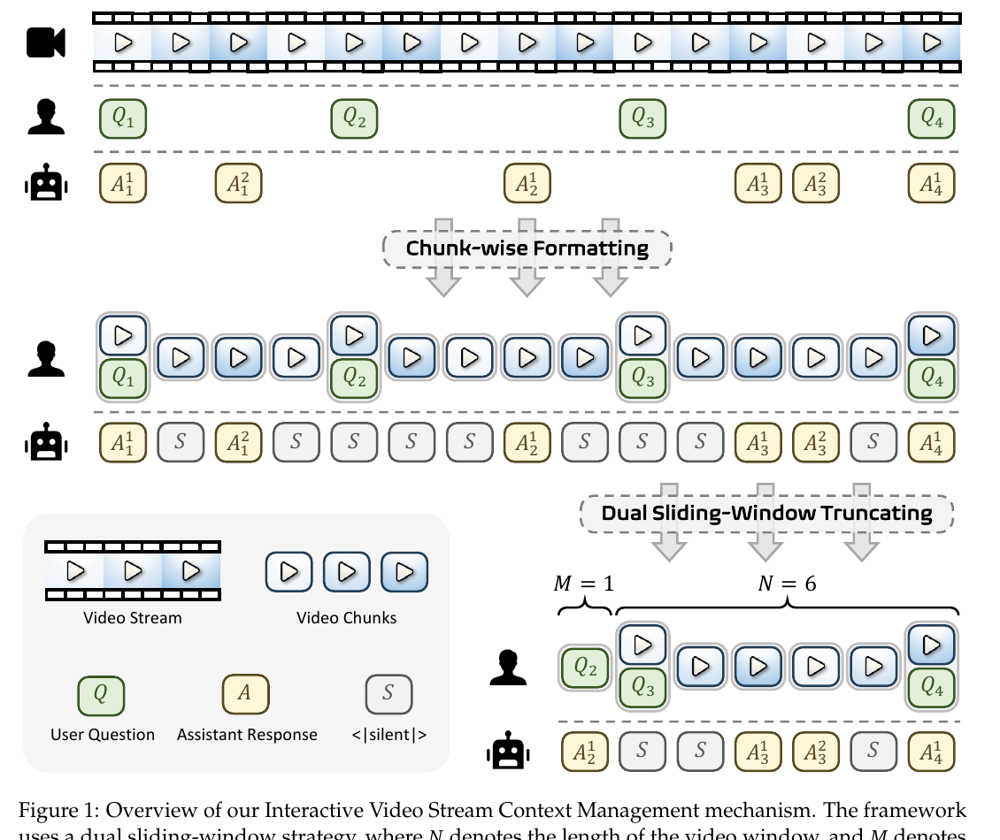
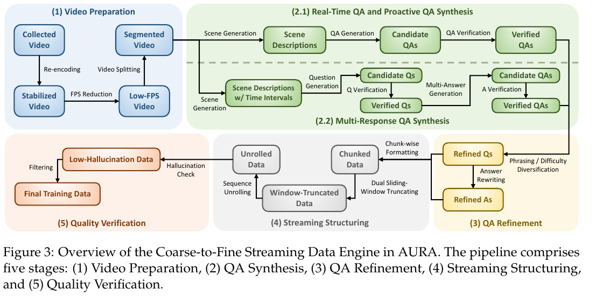
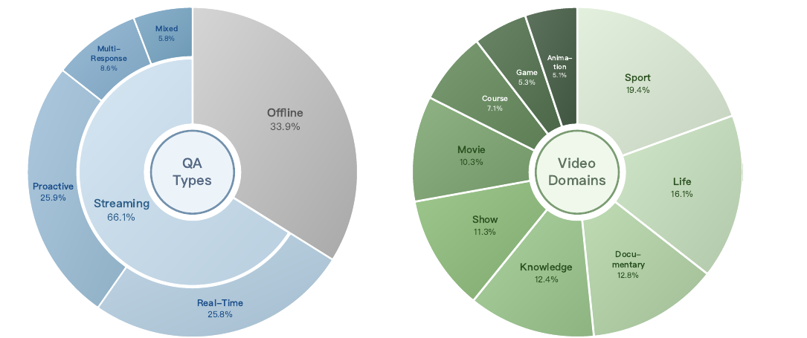
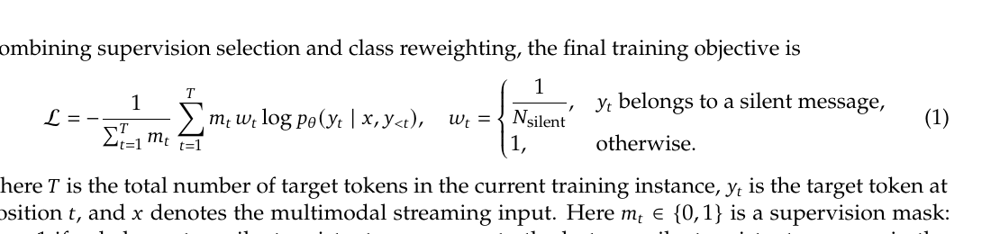
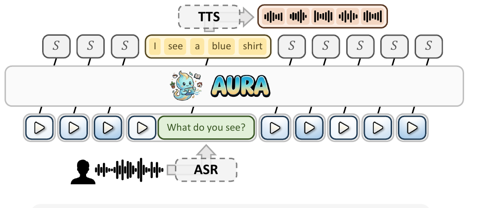
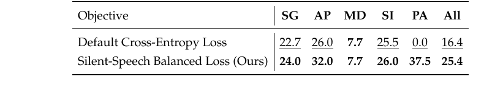

# AURA: Always-On Understanding and Real-Time Assistance via Video Streams

## 一句话结论

AURA 是一篇很适合接在 Qwen2.5-Omni 后面读的论文：它不是机器人 VLA，也不是 agent tool-call harness，而是把 VideoLLM 改造成一个 always-on streaming visual assistant，让模型在连续视频流里学会三件事：什么时候沉默，什么时候立刻回答，什么时候等未来画面证据出现后主动回答。

对我们最有价值的是它的 interaction model 设计：把交互时机本身变成模型输出的一部分，用 `<|silent|>` 表示“此刻不该说话”，再通过数据构建和 loss 让模型学习 real-time QA、proactive QA、multi-response QA。它没有输出机械臂动作，但可以作为我们机器人“持续观察 + 主动提醒 + 多轮视觉上下文”的上层交互策略参考。

## 它在阅读路线里的位置

这篇在路线里承担的是：

```text
Qwen2.5-Omni: 实时多模态底座，text/audio/image/video -> text/speech
AURA: always-on 视频流交互，video/text history -> text or <|silent|>
StreamBridge: 下一篇，看如何把 offline VideoLLM 改造成 proactive streaming assistant
VLA / pi0 / OpenVLA: 后面才进入 robot action policy
```

所以 AURA 的关键词不是“动作控制”，而是“流式视觉上下文 + 选择性沉默 + 主动响应”。如果放到我们公司的机器人里，它更像是感知交互层或 intent timing layer：什么时候看见了足够证据，什么时候应该开口/显示/提醒，什么时候继续观察。

## 解决什么问题

传统 VideoLLM 多数是 offline/post-hoc：视频结束后问问题，模型回答。真实机器人或屏幕助理面对的是连续现场：摄像头一直进来，用户可能随时说话，也可能不说话，模型不能每秒都废话，也不能等用户重复问。

AURA 认为 streaming visual interaction 有两个核心挑战：

- 上下文无限增长：视频帧、用户问题、历史回答都会持续变长，但 LLM context window 有上限。
- 交互时机不是固定 turn-taking：有的问题马上能回答，有的问题需要等未来画面出现，有的问题需要随着事件发展多次更新。

论文把问题拆成三类 QA：

- Real-Time QA：用户问完，当前或之前画面已经足够，模型立刻回答一次。
- Proactive QA：用户先提出观察目标，模型先沉默，等后面证据出现再回答一次。
- Multi-Response QA：用户提出持续观察任务，模型在后续事件变化时多次回答。



## 方法 / 系统怎么做

### 1. Chunk-wise conversational format

AURA 把连续视频切成小时间块，论文实验里 chunk size 是 1 秒。每个 video chunk 都会进入对话格式：

- 如果这个时间点用户有问题，就把 question + video chunk 一起作为 user message。
- 如果没有用户问题，就只有 video chunk，没有文字。
- 每个 user message 后面都接一个 assistant message。
- assistant 如果要回答，就输出文本。
- assistant 如果不该回答，就输出特殊 token：`<|silent|>`。

这点很关键：`<|silent|>` 不是后处理规则，而是模型训练和推理时真实要生成的输出 token。也就是说 AURA 把“保持沉默”变成了模型行为的一类 label。

### 2. Dual sliding-window context

视频 token 很重，文本历史比较轻，所以 AURA 用双滑窗：

- video window：保留最近 `N` 秒视频，论文设 `N = 30`。
- QA history window：在视频窗口外额外保留最近 `M` 个 QA group，论文设 `M = 10`。

QA group 指的是一个 user question 和它后续所有 non-silent assistant responses。窗口外的旧视频 chunk 和 `<|silent|>` 会被丢掉，只保留有效文本问答。这能让模型既看最近画面，又不完全丢失用户的长期意图。



### 3. Coarse-to-Fine Streaming Data Engine

论文没有只靠人工标注，而是设计了一个五阶段数据构建流水线，把普通视频变成流式交互训练数据：

1. Video Preparation：从公开互联网来源收集视频，覆盖 sports、vlogs、documentaries、encyclopedic content、TV shows、movies、courses、games、animation 等；统一采样到 2 FPS，并重新编码为 H.264。
2. QA Synthesis：用 MLLM 做 scene segmentation 和 scene-level descriptions，再生成带时间戳的 QA；Real-Time/Proactive 一条问题对应一次回答，Multi-Response 一条问题对应多个时间点回答。
3. QA Refinement：Real-Time 主要增加问题难度多样性；Proactive/Multi-Response 主要改写问题表达，增加 phrasing diversity。
4. Streaming Structuring：把时间戳 QA 转成 chunk-wise 对话格式，并按双滑窗截断；训练样本以目标回答时间为 anchor，只监督目标回答。
5. Quality Verification：检查窗口截断后，剩下的视频和历史文本是否仍足够支持目标答案，避免答案依赖已被截掉的画面。



## 输入、输出、数据类型、模态

### 训练/推理时模型吃的是什么

AURA 主模型基于 `Qwen3-VL-8B-Instruct`。论文明确说训练时只 fine-tune LLM component，vision encoder 和 connector 冻结。

模型输入不是原始音频，也不是 robot state，而是经过上下文管理后的 video-text conversation：

```text
[
  user:    video_chunk_t0
  assistant: <|silent|>
  user:    video_chunk_t1 + "What is the color of this tissue box?"
  assistant: "It's yellow."
  user:    video_chunk_t2
  assistant: <|silent|>
  ...
]
```

数据类型可以理解为：

- 视觉模态：连续视频流，被切成 video chunks，论文实验 2 FPS，chunk size 1 second。
- 文本模态：用户问题、历史回答、特殊沉默 token `<|silent|>`。
- 音频模态：只在 demo/inference system 外围出现；用户语音先经过 ASR 变成文本，模型输出文本后再经过 TTS 变成语音。

### 模型输出是什么

主模型输出只有两类：

- 文本回答：例如 `"I see a blue shirt."`
- `<|silent|>`：表示当前时间步保持沉默

它不输出：

- robot action token
- mechanical arm trajectory
- tool call JSON
- screen UI command
- memory write schema

所以如果我们要迁移到自己的屏幕 + 单臂支架机器人，AURA 本身只能启发“何时响应”和“说什么”，不能直接解决“屏幕转向哪里、机械臂怎么动、UI 显示什么卡片”。那需要我们在 AURA 式输出上再加 harness 或 schema。

一个更贴近我们机器人的扩展输出可以长这样，但这是我们的工程设计，不是论文原文：

```json
{
  "mode": "silent | answer | proactive_alert | multi_response_update",
  "speech": "我看到你要找的物体出现在桌面右侧了。",
  "screen_events": [
    {"type": "highlight", "target": "right_table_region"}
  ],
  "arm_events": [
    {"type": "orient_screen", "target": "user_face"}
  ],
  "confidence": 0.82
}
```

## 数据是怎么收集和构建的

这篇的数据构建比 Qwen2.5-Omni 更直接服务 interaction model，因为它不是只学“看懂视频”，而是在学“什么时刻回应”。

### 原始视频来源

论文说视频来自公开互联网来源，覆盖多个内容域。它们先被标准化：

- 固定到 2 FPS。
- H.264 重新编码，减少 codec 不一致和坏帧问题。
- 视频域分布见 Figure 5：Sport 19.4%、Life 16.1%、Documentary 12.8%、Knowledge 12.4%、Show 11.3%、Movie 10.3%、Course 7.1%、Game 5.3%、Animation 5.1%。



### QA 合成的逻辑

Real-Time / Proactive QA 用一条流水线：

- 先让 MLLM 做 scene segmentation 和 scene descriptions。
- 再生成 candidate QA，并附 question timestamp 和 answer timestamp。
- Real-Time QA：question timestamp 和 answer timestamp 相同或近似同一时刻。
- Proactive QA：question timestamp 早于 answer timestamp，模型要等后面视觉证据出现。
- 再用 MLLM 验证这个 QA 是否合理、答案是否被对应时间点的视频支持。

Multi-Response QA 另一条流水线：

- 先生成 scene descriptions with time intervals。
- 再生成能触发多次回答的问题。
- 为同一个 question 生成多个 answer timestamps 和多个 answers。
- 每个 answer 都要验证：当时的视频证据是否足够、回答是否适合那个时间点。

### 从 QA 到训练样本

生成的 QA 不是直接扔给模型，而是转成 streaming conversation。论文说会把连续 QA sequence unroll 成多个 training samples，每个 sample 包含直到某个 non-silent target answer 为止的历史。

关键点：

- 每个训练样本以 target answer timestamp 为 anchor。
- 双滑窗截断上下文。
- 只监督这个 sample 里的目标回答和沉默行为。
- 如果截断后目标答案没有足够视觉证据，就在 Quality Verification 阶段丢掉。

这就是 AURA 的“interaction data”核心：同一个视频不是变成普通问答，而是变成带时间戳、带沉默、带延迟响应的序列监督。

## 训练框架和目标

### 总体训练配置

论文给出的训练配置：

- base model：`Qwen3-VL-8B-Instruct`
- 训练硬件：4 nodes x 8 accelerators = 32 accelerators，每张 80 GB HBM3
- fine-tune 范围：只训练 LLM component，vision encoder 和 connector 冻结
- 数据量：约 115k streaming video QA samples，约 1.04B tokens
- 额外离线视频 QA：约 59k samples，约 0.16B tokens
- 总计：约 174k samples，约 1.2B tokens
- 训练：1 epoch，global batch size 128，learning rate `1e-5`
- context：video chunk 1 second，`N = 30`，`N' = 15`，`M = 10`

### 为什么不能普通 CE 训练所有 assistant 消息

因为 sliding window 会截断历史，不是每个旧的 non-silent answer 在当前 sample 里都还有完整视觉证据。如果强行监督所有 assistant messages，模型可能学到没有证据支撑的回答，增加 hallucination。

所以 AURA 只监督：

- 所有 silent assistant messages：也就是 `<|silent|>`。
- 当前 sample 的最后一个 non-silent assistant message：也就是目标回答。
- 不监督更早的 non-silent assistant messages。

### Silent-Speech Balanced Loss

另一个问题是沉默太多。连续视频里，大多数时间模型应该不说话。如果普通 CE 直接训练，模型很容易过度生成 `<|silent|>`，变成“啥都不说”。

论文的做法是给 silent message 降权：



Obsidian 可读版：

$$
\begin{aligned}
\mathcal{L}
&= - \frac{1}{\sum_{t=1}^{T} m_t}
\sum_{t=1}^{T} m_t w_t
\log p_{\theta}(y_t \mid x, y_{<t}) \\
w_t
&=
\begin{cases}
\frac{1}{N_{\text{silent}}}, & y_t \text{ belongs to a silent message} \\
1, & \text{otherwise}
\end{cases}
\end{aligned}
$$

其中：

- `x`：multimodal streaming input，也就是视频流 chunk + 文本历史。
- `y_t`：第 `t` 个目标 token。
- `m_t`：监督 mask；只有 silent assistant message 和最后一个 non-silent target answer 会被监督。
- `N_silent`：当前样本里的 silent message 数量，用来降低 silence 的总权重。

直观理解：AURA 不是简单告诉模型“多沉默”，而是让模型在大量沉默时间步中仍然保留主动开口能力。

## 实时推理和部署

论文的 demo 是一个视频 + 语音输入、文本 + 语音输出的实时系统：

- 摄像头视频持续进入，按固定 chunk 切分。
- 用户语音进入 ASR，转成文字。
- AURA 模型接收 video chunks + ASR text + history。
- 如果输出 `<|silent|>`，系统不说话。
- 如果输出文本，文本进入 streaming TTS，并同时把文本回答写回上下文。



为了降低延迟，AURA 不是每个 chunk 都把所有历史重算一遍。论文使用：

- sliding-window attention：限制活跃上下文长度。
- prefix KV cache reuse：复用前缀 KV，避免每次重复算长历史。
- `N' = 15` 的延迟截断策略：不是每秒都 FIFO 丢最老 chunk，而是允许窗口临时扩到 `N + N'`，然后批量丢掉 `N'` 个旧 chunk，这样在接下来的 `N'` 个 chunk 里 prefix cache 更稳定。

性能数字：

- real-time demo：2 FPS，两个 80G accelerators。
- ASR：9.41 秒中文语音命令，延迟 84.2 ms。
- AURA TTFT：平均 75.0 ms，p50 74.6 ms，p90 87.8 ms，5 分钟连续流式测试。
- decoding：7.3 ms/token，约 137 token/s，平均 12.6 tokens/response。
- TTS first chunk：93.0 ms，RTF 0.42。
- 估计端到端首句语音响应：约 312.2 ms。

这些数字说明它不是只提概念，它有可跑的实时 demo 和 benchmark。但注意硬件很重：两个 80G accelerator，不是端侧小模型。

## 实验结果怎么看

论文在 StreamingBench、OVO-Bench、OmniMMI 上做了评估，整体结论是 AURA 在 streaming video benchmarks 上拿到最好 overall。

最值得我们看的是 ablation：把 Silent-Speech Balanced Loss 换成普通 CE，会严重损害 proactive alerting。



表里最关键的变化：

- Overall：16.4 -> 25.4
- Proactive Alerting：0.0 -> 37.5
- Action Prediction：26.0 -> 32.0
- State Grounding：22.7 -> 24.0

这说明 AURA 的核心并不只是“换一个 prompt”，而是训练目标确实影响模型是否能在该沉默时沉默、该主动提醒时开口。论文还指出 default loss 的模型倾向于过度生成 `<|silent|>`，在 PA 上直接掉到 0.0。

## STAR 分析

- Situation：已有 VideoLLM 多数处理离线视频，或者用 trigger model + main VideoLLM 的解耦结构；真实 always-on 场景需要持续观察、选择性沉默、延迟响应和长期上下文管理。
- Task：构建一个统一 streaming VideoLLM，让它在连续视频流中既能回答实时问题，也能在未来证据出现时主动回应，还能多次更新。
- Action：提出 chunk-wise conversational format、dual sliding-window context、三类 streaming QA 数据、五阶段数据构建、Silent-Speech Balanced Loss，以及带 ASR/TTS 和 KV-cache reuse 的实时推理框架。
- Result：在三个 streaming benchmark 上整体最好；Ablation 显示 balanced loss 把 OmniMMI overall 从 16.4 提到 25.4，并把 proactive alerting 从 0.0 提到 37.5；demo 在 2 FPS、两个 80G accelerator 上跑通。

## 和我们方向的关系

### 直接相关的部分

对我们这种“屏幕机器人 + 单臂支架 + 双摄像头”的产品，AURA 最相关的是 interaction timing：

- 用户不一定每次都明确下命令，机器人要持续观察。
- 机器人不能一直讲话，需要学会沉默。
- 用户可能说“看到 XX 的时候提醒我”，这就是 Proactive QA。
- 用户可能说“帮我持续看一下这个过程”，这就是 Multi-Response QA。
- 屏幕机器人可以把回答换成语音、屏幕提示、界面高亮、支架转向等多种执行形式。

### 不直接解决的部分

AURA 不解决：

- 机械臂控制策略。
- VLA 动作 token。
- diffusion/flow robot policy。
- 工具调用 schema。
- 长期用户记忆。
- 情感陪伴关系建模。
- 多摄像头标定、空间定位、三维 grounding。

所以它应该放在我们架构里的上层 interaction policy / perception-to-response layer，而不是底层 robot policy。

### 对我们可迁移的最小模块

可以借鉴的最小设计是：

```text
camera stream + user speech/text + short interaction history
  -> streaming context manager
  -> model outputs:
       silent
       immediate answer
       proactive alert
       multi-response update
  -> robot/display/voice harness maps response to speech, UI, arm orientation
```

如果做得更工程化，我们不能只输出自然语言，需要在 AURA 的 `text | <|silent|>` 外面加结构化 envelope：

```json
{
  "response_timing": "silent | immediate | delayed | update",
  "evidence_time": "00:32",
  "natural_language": "现在桌面上有四个小马玩具。",
  "grounding": {
    "source": "front_camera",
    "objects": ["pony_doll"],
    "region": "table_right"
  },
  "robot_affordance": {
    "speech": true,
    "screen": true,
    "arm_motion": "orient_display_to_user"
  }
}
```

这不是论文做的东西，但这是把 AURA 迁移到机器人产品时需要补的 harness 层。

## 局限和不要误读

- 不要把 AURA 理解成 omni model。它主模型是 VideoLLM，音频在 demo 里主要通过 ASR/TTS 接入，不是像 Qwen2.5-Omni 那样原生处理 audio tokens 并生成 speech codec tokens。
- 不要把它理解成 VLA。AURA 没有把视觉语言条件转成 robot action。
- 不要把 `<|silent|>` 理解成简单规则。它是训练数据和 loss 里明确监督的模型输出。
- 不要以为它已经解决长期陪伴。双滑窗保留的是短期视频和最近 QA group，不是长期用户画像或长期 episodic memory。
- 不要忽略硬件成本。论文 demo 是两个 80G accelerator，离机器人端侧部署还很远。
- 数据构建大量依赖 MLLM 合成和验证，质量依赖教师模型；论文没有给出人类大规模人工标注细节。

## 可复用点

- 用 `<|silent|>` 作为“不要响应”的显式训练标签。
- 把 proactive interaction 分成 Real-Time、Proactive、Multi-Response 三类，而不是只做普通问答。
- 对视觉流和文本交互历史使用不同窗口，视频短、文本长。
- 数据构建时保留 question timestamp 和 answer timestamp。
- 训练时只监督最后一个 non-silent target answer，避免窗口截断导致的无证据监督。
- 用 class balancing 防止模型在 always-on 场景中过度沉默。
- 推理时用滑窗 + prefix KV cache reuse，避免长流式上下文延迟越来越高。

## 下一步精读问题

- StreamBridge 和 AURA 的区别是什么：是外接桥接器更强，还是 end-to-end 统一模型更强？
- AURA 的 `<|silent|>` 能否扩展成更细的 robot action/event token？
- 我们的双摄像头输入应该是 multi-view video chunks，还是先融合成 scene state 再喂模型？
- 如果机器人有屏幕和支架动作，应该让模型直接输出动作 schema，还是让 harness 根据文本/grounding 再规划？
- 长期陪伴需要的 memory 是否应该放进 QA history window，还是独立做 retrieval memory？

## 工程 takeaway

如果我们要做机器人 interaction model，AURA 给的最核心启发是：交互不是“用户问一句，模型答一句”，而是一个持续流。模型必须学习 silence、trigger timing、delayed response、multi-response update。对我们的产品来说，第一版可以不急着直接训练 VLA，而是先做一个 AURA-like interaction layer：双摄像头持续看，ASR 进文本，模型输出 `silent/answer/proactive/update`，再由 robot harness 决定说话、屏幕显示、支架转向和是否调用更底层策略。
