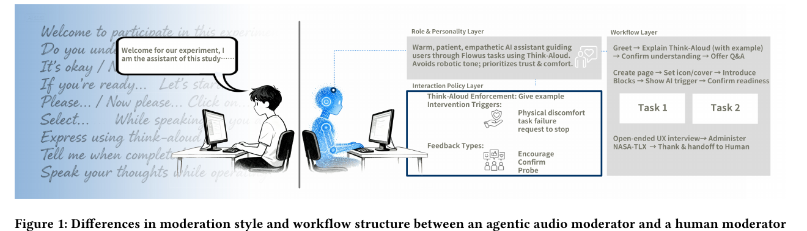
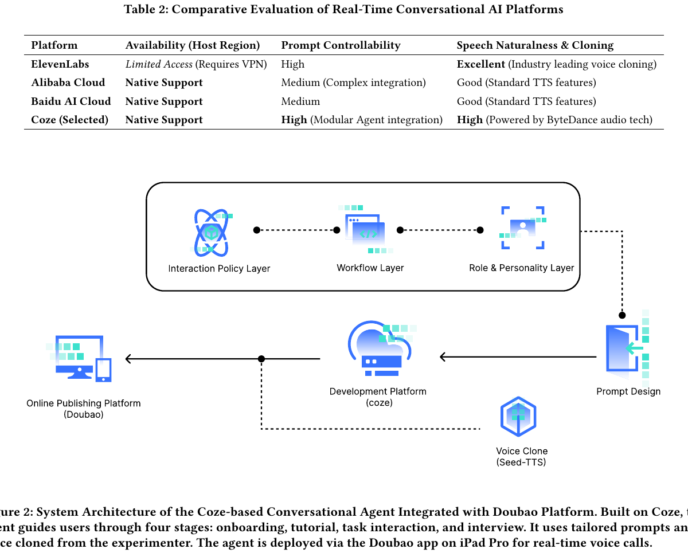
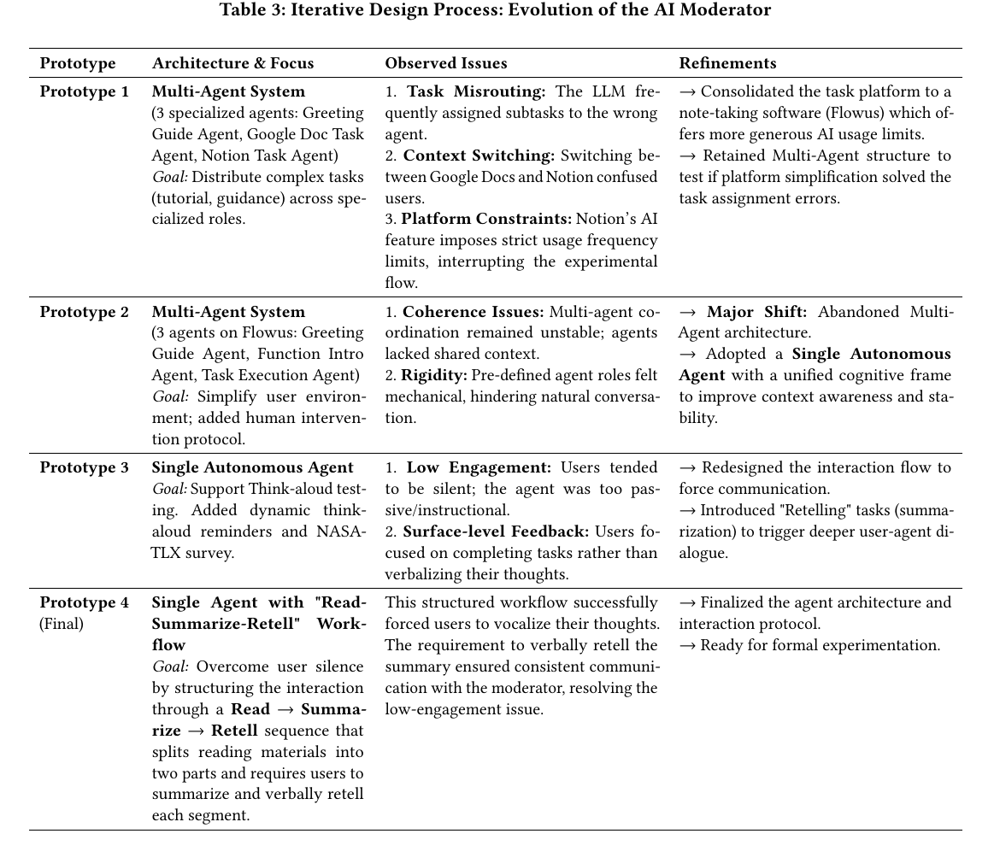
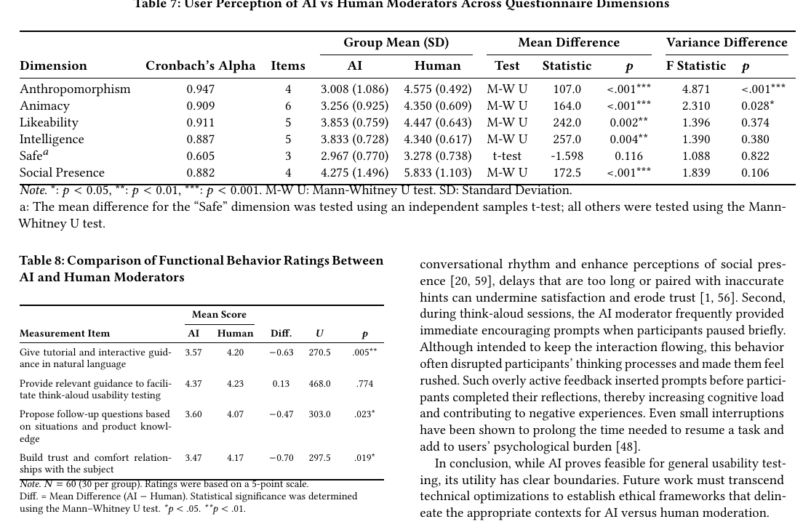

# Agentic Audio Moderator vs Human Moderator in Think-Aloud Usability Testing

原文 PDF：[[2026_CHI_Agentic_Audio_Moderator_Usability_Testing.pdf]]

一句话结论：这篇不是 Thinking Machines 那种“原生 interaction model”论文，而是一个比较具体的**实时语音 agent harness + prompt/workflow 架构 + RCT 用户研究**。它很值得读，因为它暴露了当前 LLM/audio agent 在真实交互里的关键问题：能跑流程，但插话时机、社交存在感、上下文敏感度和信任关系明显弱于人。

## 0. 先给我们的判断

这篇比 SocraBot 更“自动化”，因为它不是主要靠 wizard 人工按按钮触发，而是让一个部署在 Doubao app 里的语音 agent 直接主持 think-aloud usability testing。但它仍然不是一个训练出来的底层 interaction model。

更准确地说，它做的是：

- 用 Coze 搭了一个语音对话 agent。
- 用 Doubao-1.5-pro-32k-250115 做核心 LLM。
- 用 Seed-TTS 做克隆语音输出。
- 用 prompt 分层、workflow、低温度、12-turn rolling context 和长期记忆来控制主持流程。
- 用 60 人随机对照实验比较 AI moderator 和 human moderator。

论文真实证明的是：在结构化、低风险、流程明确的可用性测试里，AI moderator 可以让用户完成任务，用户 verbalization 行为和任务表现没有显著差异；但在人类感、社交存在、跟进问题、信任舒适感上，人类 moderator 明显更强。

对我们做机器人/具身 agent 的启发：它不是最终答案，但它是一个很好的工程负例和参考实现。它说明“LLM + prompt + voice”可以把流程跑起来，但想做真正的 interaction model，必须额外解决 turn-taking、用户状态识别、主动/打断时机、情绪/困惑检测、多模态 grounding 和长期关系。

## 1. 论文到底做了什么

研究问题：

- RQ1：agentic audio moderator 需要哪些设计考虑？
- RQ2a：AI moderator 和 human moderator 在主持行为上有什么差别？
- RQ2b：用户在任务表现、语言表达、体验上是否有差别？
- RQ3：用户对 AI/human moderator 的社会感知、人类感、拟人感是否不同？

方法：

- 先访谈 9 位 UX 专家，提炼 AI moderator 应该具备的功能。
- 迭代开发一个 agentic audio moderator。
- 做一个 N=60 的随机对照实验：30 人 AI moderator，30 人 human moderator。
- 任务平台是 Flowus，一个类似 Notion 的笔记应用。
- 任务是阅读材料、做笔记、总结并口头复述，同时进行 think-aloud。

五个设计功能：

1. 用自然语言提供 tutorial 和交互式指导。
2. 提供和 think-aloud usability testing 相关的指导。
3. 根据情境和产品知识提出 follow-up questions。
4. 在紧急情况下允许人类介入。
5. 与被试建立信任和舒适关系。

### 1.1 AI moderator 具体在实验里干什么？

这里的 AI moderator 不是“替用户操作 Flowus 的 agent”，也不是“自动分析可用性问题的 evaluator”。它更像一个**语音版实验主持人 / 访谈主持人**，替代 human moderator 去带用户完成一套 think-aloud usability testing 流程。

具体任务可以按时间线理解：

```text
用户进入实验
  -> AI moderator 打招呼，说明自己是实验主持助手
  -> 解释 think-aloud 是什么，让用户边操作边说出想法
  -> 介绍 Flowus 的基本功能
  -> 引导用户练习使用 Flowus
  -> 让用户阅读一段文本
  -> 让用户在 Flowus 里创建阅读笔记
  -> 让用户总结内容
  -> 让用户口头复述刚才读到/总结的东西
  -> 如果用户沉默，提醒用户继续 think aloud
  -> 如果用户卡住，给提示或确认
  -> 任务结束后做开放式 UX 访谈
  -> 引导填写 NASA-TLX 等问卷
  -> 最后结束并交接给人类实验人员
```

所以 AI moderator 的核心工作是**主持流程、维持用户出声、追问体验、推进任务阶段**。它自己不负责读懂屏幕上的 UI 状态，也不负责直接控制 Flowus，更不负责替用户完成任务。

一个更具体的例子：

- 用户在 Flowus 里读 Hemingway 的文章片段。
- 用户需要一边读、一边说出自己的想法。
- 用户接着在 Flowus 里做笔记和总结。
- AI moderator 会说类似“请继续把你的想法说出来”“你现在可以总结一下这部分内容”“你刚才觉得这个功能哪里不顺畅？”这样的主持话术。
- 如果用户短时间沉默，AI moderator 会提示用户继续 think aloud。
- 如果用户说自己不懂或操作卡住，AI moderator 会尝试解释或把流程拉回任务。

它衡量的不是“AI 有没有成功完成一个软件任务”，而是“AI 作为主持人，能不能让用户像在人类主持的 usability test 里一样完成任务并表达想法”。

### 1.2 它和普通豆包语音对话有什么区别？

底层能力上，它很可能就是借用了豆包/Coze 的实时语音对话能力：用户说话，平台做语音交互，LLM 生成回复，再用 TTS 播出来。论文没有说作者自己实现了 ASR、VAD、端点检测、barge-in 或底层语音双工协议。

它和“直接打开豆包语音聊天”的区别主要在 harness 层：

| 普通豆包语音聊天 | 这篇的 AI moderator |
|---|---|
| 开放式聊天 | 被 Coze agent 包成一个实验主持人 |
| 用户想聊什么都可以 | 固定围绕 Flowus usability testing |
| 没有固定实验阶段 | 有 onboarding、tutorial、task interaction、interview 四阶段 |
| prompt 通常是通用助手 | 三层 prompt：Role & Personality、Workflow、Interaction Policy |
| 不一定有特定研究脚本 | 有完整 moderator script 和 Read-Summarize-Retell workflow |
| 普通 TTS/音色 | 使用 Seed-TTS 克隆实验者声音 |
| 不一定严格控温/上下文 | 使用 Doubao-1.5-pro-32k、temperature 0.3、12-turn rolling context 和 long-term memory |
| 无研究人员实时监控 | 实验中两个 assistant 实时监控，必要时人类介入 |

所以这篇的创新不在“豆包语音能力本身”，而在把语音聊天能力套进一个可控的 usability-testing harness 里，并用 RCT 比较它和人类主持人的效果。

更直接地说，这篇的本质更接近：

```text
豆包/ChatGPT 这类语音对话模型
+ Coze agent workflow
+ prompt policy
+ TTS voice clone
+ 实验主持脚本
+ 人类研究员兜底
```

而不是：

```text
一个专门学习/建模人机交互过程的 interaction model
```

因此它和我们真正关心的 interaction model 有本质差距。真正的 interaction model 需要建模“人在交互中处于什么状态、系统何时该等/说/插话/行动、打断后如何 repair、多模态线索如何合成 interaction state、长期关系如何影响当前行为”。这篇主要还是把已有语音对话模型包进实验流程，不是在底层解决这些问题。

## 2. 输入输出和数据类型

### 2.1 在线运行时的系统输入

真实运行时，用户面对的是一个语音 agent，不是一个网页 chatbot。输入大体是：

| 层 | 输入 | 数据类型/模态 | 说明 |
|---|---|---|---|
| 用户交互 | 用户说话 | audio stream | 用户在 Zoom/实验过程中对 moderator 说话、think aloud、回答问题 |
| 平台内部 | 语音识别后的对话内容 | text / conversation turns | 论文没有展开 ASR 细节，应理解为 Coze/Doubao 语音平台内部把语音转成可被 LLM 消化的文本轮次 |
| agent 状态 | 当前实验阶段 | structured workflow state | onboarding、tutorial、task interaction、interview 等阶段 |
| prompt 约束 | Role & Personality、Workflow、Interaction Policy | prompt text / policy text | 不是训练参数，是人工写好的 prompt 层 |
| 短期上下文 | 最近 12 轮对话 | text buffer | 论文明确提到 12-turn rolling context buffer |
| 长期状态 | long-term memory | memory/context store | 论文提到用于 state persistence，但没有给具体 schema |

注意：论文没有证明模型直接吃视频、图像、姿态、GSR 或屏幕截图。GSR、Zoom transcript、问卷主要是研究分析数据，不是 agent live decision 的主要输入。

### 2.2 在线运行时的系统输出

| 输出 | 数据类型/模态 | 用途 |
|---|---|---|
| 语音主持话术 | TTS audio | 通过 Doubao/Seed-TTS 以克隆语音播出 |
| 对话内容 | text before TTS | LLM 生成的指导、确认、追问、鼓励 |
| 工作流推进 | implicit/structured state transition | 例如从教程进入任务，从任务进入访谈 |
| 人类介入信号 | procedural handoff | 出现紧急/失败情况时，实验人员可介入 |

所以它不是像 function calling 那样输出一个纯工具调用 JSON。它更像是：LLM 在一个平台 harness 里输出“要说的话”，平台把它转成语音；同时 workflow/prompt 决定阶段推进。

### 2.3 实验分析数据

| 数据 | 数据类型 | 用途 |
|---|---|---|
| Zoom transcripts | text transcript | 算用户和 moderator 的 word count、character count、speech duration、WPM、lexical diversity |
| Godspeed questionnaire | Likert scale | 测 Anthropomorphism、Animacy、Likeability、Intelligence、Safety |
| Social Presence Scale | 7-point scale | 测 social presence |
| Functional Behavior Ratings | 5-point scale | 测 tutorial、think-aloud guidance、follow-up、trust/comfort |
| Shimmer 3 GSR | physiological time series | 测电皮肤反应，辅助判断生理唤醒/压力 |

GSR 不是 agent 的实时输入。论文用它做事后统计，而且 8 个样本丢失，结果也没有显著差异。

## 3. 它的 harness 怎么判断什么时候说话/推进？

这点要讲清楚：论文没有给出一个底层 turn-taking 模型、VAD 算法、silence threshold、ASR endpointing 规则或打断检测公式。

它真正给出的控制机制是三层 prompt 和流程化 agent：



核心结构：

- Role & Personality Layer：设定 AI moderator 的身份、语气、耐心、共情和信任导向。
- Workflow Layer：定义实验阶段和任务转移逻辑。
- Interaction Policy Layer：定义主持策略，比如提醒 think-aloud、鼓励、确认、追问，以及遇到身体不适、任务失败、请求停止时的 intervention triggers。

部署结构如下：



可以这样理解：

```text
User speech/audio
  -> Coze/Doubao speech interaction platform
  -> ASR / conversation turn handling (paper does not detail)
  -> Doubao-1.5-pro-32k LLM with prompt layers + workflow + context
  -> text response
  -> Seed-TTS cloned voice
  -> spoken moderator response
```

它比 SocraBot 自动，因为 SocraBot 的 counterfactual replay 很依赖人选时间点、人工干预和回放；这篇的 AI moderator 会实时主持。但它也没有真正解决“什么时候应该打断用户、什么时候应该继续沉默、什么时候用户是在思考而不是卡住”这个 interaction model 问题。

论文反而在结果里暴露了这个问题：AI moderator 经常在用户短暂停顿时马上鼓励或提示，导致用户觉得被打断、被催促，增加认知负担。这说明目前的判断仍然偏 prompt/workflow 层，缺少更细的用户状态建模。

### 3.1 它能不能像人一样打断用户说话？

按论文文本，不能得出“它支持真正的 barge-in / mid-utterance interruption”这个结论。

论文说了这些事实：

- Interaction Policy Layer 管 turn-taking，但没有给 turn-taking 的底层算法。
- 系统是 Doubao App 上的 real-time voice calls。
- pipeline 有 prompt management、model inference、voice synthesis 和 asynchronous streaming。
- prompt 里明确要求：如果用户正在 think aloud，不要打断；如果出现 prolonged silence，再轻柔鼓励用户继续说。
- 结果讨论里说 AI 会在用户 brief pause 时频繁给 encouraging prompts，让用户觉得 rushed。

所以这里的“打断”更可能是**用户短暂停顿时，AI 误判为该轮到自己说话**，而不是 AI 在用户连续讲话中间强行插话。论文没有证明它能可靠支持：

- 用户说话中实时插话。
- 用户说话时 AI 边听边生成并抢占音频输出。
- barge-in 检测。
- interruption repair。
- 基于用户语速、停顿、语调、眼神或动作的 turn-taking 模型。

对我们来说，正确结论是：这篇展示的是“语音平台自带 turn-taking + prompt 规则”的主持 agent，不是一个真正解决自然对话打断/抢话/让话的 interaction model。

## 4. 系统迭代过程

最值得我们看的是它从 multi-agent 退回 single-agent 的过程：



四版原型：

| 原型          | 做法                                                       | 暴露的问题                                         | 调整                                  |
| ----------- | -------------------------------------------------------- | --------------------------------------------- | ----------------------------------- |
| Prototype 1 | 三个专门 agent：Greeting Guide、Google Doc Task、Notion Task    | task misrouting、context switching、Notion 平台限制 | 换成 Flowus，保留多 agent 测试              |
| Prototype 2 | Flowus 上继续多 agent：Greeting、Function Intro、Task Execution | 多 agent 协调不稳定，缺共享上下文，角色太僵硬                    | 放弃多 agent，改 single autonomous agent |
| Prototype 3 | 单 agent + dynamic think-aloud reminders + NASA-TLX       | 用户太沉默，反馈停留在表层                                 | 加入强制 verbalization 的任务结构            |
| Prototype 4 | single agent + Read-Summarize-Retell workflow            | 让用户必须总结和复述，解决沉默问题                             | 定稿进入正式实验                            |

对我们很重要的判断：不是 agent 越多越好。这里 multi-agent 失败的原因很具体：任务分配错误、上下文切换混乱、agent 之间缺共享状态、用户觉得机械。对于机器人公司，如果没有稳定共享 world state、user state 和 task state，多 agent 只会把交互问题放大。

## 5. STAR 精读

### Situation

Think-aloud usability testing 需要 moderator 持续引导用户说出想法。传统上由人类主持，但人类主持成本高、扩展难、不同主持人风格不一致。随着 LLM 和实时语音能力变强，问题变成：AI 能不能像 moderator 一样完成这种结构化交互？

### Task

作者要构建一个 agentic audio moderator，并验证它是否能在真实可用性测试里替代或接近 human moderator。重点不是做一个新模型，而是验证一个基于当前 LLM/语音平台的 agent harness 能否在标准 UX 流程中工作。

### Action

作者做了三件事：

1. 访谈 9 位 UX 专家，抽出 AI moderator 的设计要求。
2. 基于 Coze + Doubao + Seed-TTS 迭代开发系统，从 multi-agent 改成 single-agent。
3. 做 N=60 RCT，比较 AI moderator 和 human moderator，在任务表现、语言行为、用户体验、社交感知和 GSR 上做统计分析。

关键工程参数：

- LLM：Doubao-1.5-pro-32k-250115。
- Context：32k context window。
- Temperature：0.3，强调稳定和流程一致性。
- Context/memory：12-turn rolling context buffer with long-term memory。
- TTS：Doubao Seed-TTS voice clone。
- 部署：2022 iPad Pro 上运行 Doubao App，通过云端 agent 做实时语音会话。

### Result

主要结果：

- 用户任务表现和 verbalization behavior：AI 组和 human 组没有显著差异。
- GSR 生理唤醒：没有显著差异。
- 社会感知：human moderator 显著更高。
- 功能评分：human 在 tutorial、follow-up、trust/comfort 上更高；AI 在“提供 think-aloud 相关指导”上略高但不显著。
- AI 的问题：有 task fixation 和 flow disruption；并且可能过早提示、打断用户思考。

关键结果表：



表 7 里 human moderator 在 Anthropomorphism、Animacy、Likeability、Intelligence、Social Presence 上都显著高于 AI，Safety 不显著。表 8 里 AI 只在“relevant guidance to facilitate think-aloud”上略高但不显著，其他多项 human 更高。

## 6. 和 Thinking Machines interaction models 的关系

如果按照 Thinking Machines 那篇 blog 的口径，interaction model 关注的是模型和人如何在真实交互中共同组织行为，而不是只把模型当作一次性问答 API。

这篇和它的关系是：

- 有关：它处理的是 realtime spoken interaction，不是离线 prompt；它需要 turn-taking、任务阶段、语音输出、追问、用户沉默处理。
- 不完全有关：它没有提出或训练一个新的 interaction model；主要是把现有 LLM 放进 Coze/Doubao 这种 agent platform，再用 prompt/workflow 管住行为。
- 对我们有价值：它清楚展示了当前 harness 型系统的边界。流程能跑，体验不一定好；能说话，不代表懂得何时说；能追问，不代表有深层用户状态模型。

所以这篇可以放在“interaction model 的前置工程参考”里，不应被当作真正的底层 interaction model 论文。

我们当前对它的最终定位：

```text
相关性：中等偏低
价值：作为 harness 边界案例
不是：核心 interaction model 论文
```

它有助于理解“只靠 LLM 语音助手 + workflow prompt 能做到哪里”，也有助于证明这种路线的上限：流程可以跑，但用户状态、自然 turn-taking、多模态 grounding、长期关系和具身行动都没有真正被建模。

## 7. 对机器人/具身 agent 的启发

### 7.1 输入不够多模态

这篇 agent live input 主要是语音/文本对话和 workflow state。它没有使用视频、人体姿态、眼神、手势、空间位置、机器人感知状态。对具身机器人来说，这还远远不够。

机器人场景里更合理的输入应该是：

```text
speech transcript
+ audio prosody / silence / interruption timing
+ gaze / head pose / body posture
+ hand gesture / pointing
+ object state / scene graph
+ robot internal state
+ task state
+ interaction history / user preference / relationship memory
```

然后输出也不应该只有 TTS，而应该包括：

```text
spoken response
+ gesture/action plan
+ navigation/manipulation command
+ attention direction
+ facial/display expression
+ handoff/escalation policy
+ memory update
```

### 7.2 不能只靠 LLM 判断交互时机

论文结果已经说明，AI moderator 会在用户短暂停顿时过早提示，打断思考。这对机器人更危险，因为机器人动作有物理成本和安全风险。

实际系统应该至少拆成：

- turn-taking / endpointing 模型：判断用户是否说完。
- user state 模型：判断用户是在思考、困惑、疲劳、求助还是拒绝。
- task state tracker：判断任务是否完成、卡在哪一步。
- policy layer：决定说话、等待、追问、演示、让用户操作、自己操作或转人工。
- LLM/VLM：负责语义整合、解释、规划和自然语言生成。

这篇只覆盖了后半段的 prompt/workflow/LLM/TTS，前半段没有真正展开。

### 7.3 single agent 不等于单模型

作者放弃 multi-agent，改成 single autonomous agent，不代表底层只需要一个模型。更准确的工程理解是：**对用户呈现为一个统一 agent，但内部可以有多个感知/状态/策略模块**。

对于我们来说，可以采用：

```text
Perception modules
  -> user state + scene state + task state
  -> unified interaction state
  -> one visible agent policy
  -> LLM/VLM generation + robot action execution
```

这样既避免多 agent 对用户造成割裂，又保留专门模型处理姿态、语音、视觉和状态识别。

### 7.4 语音克隆不能解决关系感

作者刻意用 human moderator 的声音做 voice clone，试图控制声音差异。但结果里 human moderator 的 social presence 和 anthropomorphism 仍然显著更高。

这说明长期陪伴关系不是靠“声音像人”解决的。更重要的是：

- 何时回应。
- 是否记得用户偏好。
- 是否知道用户当前状态。
- 是否能少打扰。
- 是否能在关键时刻给到真正有用的帮助。
- 是否能跨 session 稳定积累关系。

## 8. 不要过度解读

这篇不能证明：

- AI moderator 已经可以完全替代 human moderator。
- 纯 LLM 就能解决实时交互。
- 语音 agent 已经有可靠的 turn-taking 模型。
- 这个系统适合复杂、情绪敏感、高风险的访谈或机器人陪伴场景。
- 它训练出了某种新的 interaction model。

它能证明的是：

- 在结构化、低风险、流程明确的任务里，当前 LLM 语音 agent 可以承担一部分主持流程。
- prompt/workflow 层能带来可用的 procedural control。
- 但 social presence、context-sensitive probing、trust/comfort、打断时机仍然明显不足。

## 9. 公式、算法和图表

论文没有提出新的模型公式或算法公式。统计上使用 Shapiro-Wilk、Levene、t-test、Mann-Whitney U 等常规检验，但这些不是本文的方法创新。

值得保留的图表：

- Figure 1：AI moderator 和 human moderator 的主持风格差异，以及 prompt/workflow 分层。
- Figure 2：Coze/Doubao/Seed-TTS 系统架构。
- Table 3：四轮原型迭代，从 multi-agent 退回 single-agent。
- Table 7/8：用户感知和功能评分，证明 AI 可以完成流程但社会感知明显弱。

## 10. 最后一页速记

如果只记住一句话：

> 这篇是一个真实的实时语音 agent harness 和 RCT，不是底层 interaction model；它证明“LLM + prompt/workflow + TTS”能主持结构化任务，但也证明真正的交互模型还必须处理用户状态、插话时机、多模态感知、社会存在和长期关系。

下一步读法：这篇适合作为“当前 audio agent harness 的上限/边界”来看。读完后，下一篇应该转向更接近具身机器人多模态 grounding 或 human-robot collaboration 的论文，而不是继续读纯 UX moderator。
