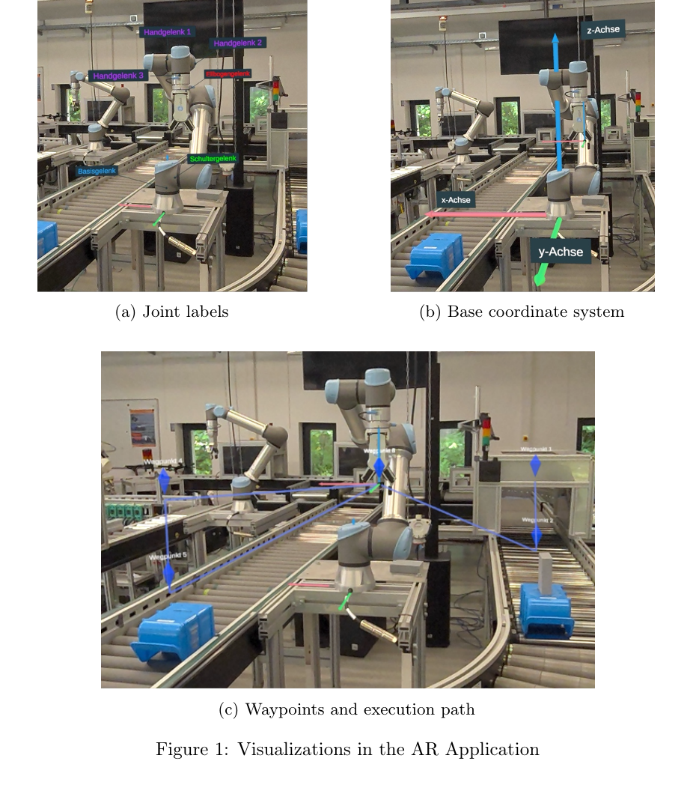
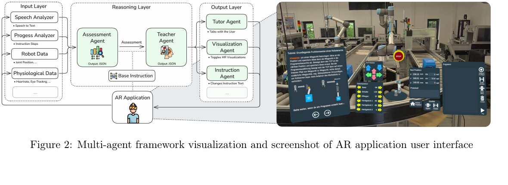

# Beyond Static Instruction

原文 PDF：[[2026_CHI_Beyond_Static_Instruction_AR_Robot_Training.pdf]]

一句话定位：这篇不是已经跑通的“LLM 机器人老师系统”，而是一个真实实现过的 AR 机器人训练界面，加上一个计划未来接入的多 agent 自适应教学 harness 架构。

## 0. 先给结论

这篇对我们有价值，但要分清楚“实”和“虚”。

实的部分：作者实现了一个基于 Meta Quest 3 + Unity + ROS2 + UR5e 的 AR 机器人训练应用。用户可以通过裸手交互操作虚拟 teach pendant，学习控制机械臂、设置 waypoint、完成 pick-and-place 任务。这个系统做了 36 人用户研究，结果显示整体可用性高，但不同用户的任务耗时、认知负荷、技术亲和度、空间能力差异明显。

虚的部分：多 agent AI framework 还没有真正集成和实验验证。论文明确说 AR application 是 fully implemented，multi-agent AI integration framework 是 proposed architecture / conceptual design for future implementation。所以它不能证明“LLM agent 可以稳定做机器人教学”，只能提供一个比较清楚的架构草图。

对我们最有用的一点：它把机器人交互 harness 拆成了一个闭环：

```text
raw multimodal signals
  -> deterministic analyzers
  -> structured semantic events / JSON
  -> LLM assessment
  -> LLM teaching decision
  -> constrained JSON intervention
  -> AR app local functions / robot training UI
```

这正好对应我们之前讨论的判断：底层不能只靠一个 LLM 吃所有原始视频/姿态/机器人状态。更合理的是用专门模块先把多模态信号变成结构化状态，再让 LLM 做高层评估和教学决策。

## 1. 这篇到底做了什么

论文的问题是：工业机器人训练中的 AR 指导通常是静态的，同一套提示给所有用户。但新手之间差异很大：有人空间想象弱，有人技术亲和低，有人机器人经验少。这种差异会影响学习速度、认知负荷和可用性感受。

作者先做了一个静态 AR 机器人训练应用，验证它作为 baseline 是否可用。然后基于用户研究中暴露的差异，提出一个未来的多 agent AI framework，让 AR 训练系统能根据用户状态动态调整指导内容、可视化提示和虚拟 tutor 反馈。

所以论文的贡献可以拆成三层：

1. 一个真实的 AR robot training prototype。
2. 一个 N=36 的 baseline usability study。
3. 一个还未落地验证的 multi-agent adaptive tutoring architecture。

## 2. 输入、输出、数据类型、模态

### 2.1 已实现 AR 系统的输入输出

已实现系统不是 LLM 系统，它主要是 AR/机器人控制系统。

输入：

- Meta Quest 3 的 video see-through 视野，用来把真实机器人和虚拟内容叠在一起。
- 裸手 tracking 事件，用户用食指按虚拟按钮，不用手柄。
- Unity 里的虚拟 teach pendant 按钮事件。
- ROS2 传来的 UR5e joint states，用于实时镜像真实机械臂姿态。
- 用户创建的 waypoint、程序步骤、gripper 操作等训练任务状态。
- 空间锚点 spatial anchor，用于把虚拟内容对齐到真实机器人基座。

输出：

- Unity AR overlay：TCP 坐标系、关节标签、waypoint marker、轨迹线、动态 tooltip。
- URScript command：通过 ROS2 / Unity-ROS-TCP connector 发给 UR5e，在 external control mode 下控制真实机械臂。
- 应用状态更新：当前步骤、已创建 waypoint、程序执行路径、碰撞/调试反馈。

数据类型可以粗略理解为：

```text
HandTrackingEvent / UIButtonEvent
RobotJointState
Unity Transform / SpatialAnchor
Waypoint / ProgramStep
URScript command
AR visual object parameters
```

这里的模态主要是视觉 AR、手势/手部交互、机器人状态数据和空间状态，不是“LLM 直接看视频然后控制机器人”。

### 2.2 用户研究的输入输出

实验输入是一个标准化机器人学习任务：

- joint control 到目标姿态；
- Cartesian TCP linear movement 到相同目标；
- 编程 pick-and-place：移动到起点、夹取工件、放到目标 carrier、设置 waypoint/support position、避障并执行程序。

被测指标：

- SUS：System Usability Scale，可用性。
- ECL：extraneous cognitive load，外在认知负荷。
- MRT：Mental Rotation Test，空间旋转能力。
- ATI：Affinity for Technology Interaction，技术交互亲和度。
- ER：Experience in Robotics，机器人经验。
- task duration：任务完成时间。

输出结果：

- N = 36，27 男 9 女，平均年龄 27，SD = 6.7。
- SUS 平均 82.6，SD = 14.1，整体很高。
- ECL 平均 1.70，SD = 0.7，整体较低。
- 完成时间 14 到 33 分钟，平均 23.1，SD = 4.8。
- 低经验、低 MRT、低 ATI 用户通常 ECL 更高、SUS 更低。

这组结果支撑的是“静态 AR 界面对平均用户可用，但对不同能力/经验用户不够个性化”，不是证明 multi-agent 框架有效。

### 2.3 proposed multi-agent framework 的输入输出

这一部分是概念架构，还没真正实现。

作者提出三层：

```text
Input Layer -> Reasoning Layer -> Output Layer
```

Input Layer 是确定性传感处理层。它不让 LLM 直接吃所有高频原始数据，而是先用专门模块做 grounding：

- Voice Analyzer：speech-to-text，把用户语音转文本。
- Progress Analyzer：根据 AR app 状态转移判断当前教学步骤。
- Robot Data Analyzer：读取 joint states，推导 velocity、acceleration 等运动指标。
- Physiological Analyzer：用 HRV 等 wearable 数据推断 stress / attention。
- 可能扩展 gaze / eye tracking，把原始 gaze 转成“user is fixating on the gripper”这种语义事件。

Input Layer 的输出是结构化数据，论文明确举例是 predefined structured output format，例如 JSON schema。也就是说喂给 Reasoning Layer 的不是一坨视频流，而是经过分析器处理后的语义状态。

Reasoning Layer 由两个 LLM agents 组成：

- Assessment Agent：输入结构化状态，输出对用户当前状态的摘要。例如“用户说不理解、心率升高、当前在 step 4，因此可能对 step 4 感到困惑或沮丧”。它还维护最近 30 秒左右的 temporal context，避免状态判断来回抖动。
- Teacher Agent：输入 Assessment summary + shared knowledge base，输出教学策略决策。例如应该安慰鼓励，还是做技术纠错，还是增加空间提示。

Output Layer 是执行干预的 agent 层：

- Tutor Agent：生成要由虚拟 avatar 说出的文本。
- Visualization Agent：生成 AR 可视化干预，例如额外箭头的位置、缩放、颜色。
- Instruction Agent：把复杂说明改写成更简单的文本。

Output Layer 的输出被约束为 JSON schema，然后 AR app 解析这些 JSON，调用本地函数执行对应变化。

一个工程化的简化结构可以写成：

```json
{
  "assessment": {
    "step": 4,
    "user_state": "frustrated",
    "evidence": ["speech_confusion", "elevated_hrv_signal", "slow_progress"]
  },
  "teacher_decision": {
    "intervention_type": "visual_guidance",
    "reason": "low spatial confidence during TCP alignment"
  },
  "intervention": {
    "agent": "VisualizationAgent",
    "asset": "direction_arrow",
    "position": [0.12, 0.48, -0.31],
    "scale": 0.8,
    "color": "yellow",
    "duration_seconds": 8
  }
}
```

注意：上面这个 JSON 是我按论文描述抽象出来的工程化示意，不是论文原文给出的 schema。论文只说明会用 predefined JSON schema，没有给完整字段定义。

## 3. 关键图：AR 系统具体长什么样



Figure 1 展示了已实现系统的几个核心 AR overlay：

- 机器人关节标签，帮助新手理解机械臂结构。
- TCP / base 坐标系，降低空间旋转负担。
- waypoint 和执行路径可视化，帮助用户调试 pick-and-place 程序。

这部分是这篇最“落地”的内容。它不是在讲 agent，而是在讲怎样把机器人控制、坐标、路径、步骤这些状态可视化给新手。

## 4. 关键图：多 agent adaptive framework



Figure 2 是论文真正和 agent harness 相关的地方。它把 AR app 放在传感平台和执行界面的角色上，中间通过 Input / Reasoning / Output 三层来做动态适配。

这个图里最值得记的不是“用了很多 agent”，而是边界划分：

- Input Layer 负责把原始多模态数据变成可信结构化状态。
- Reasoning Layer 负责用户状态评估和教学策略。
- Output Layer 负责把策略变成机器可执行 JSON。
- AR app 只执行可控的本地函数，不直接让 LLM 任意控制应用。

这比“一个 LLM 直接调用工具”更适合机器人公司，因为机器人和 AR 系统都需要强约束、可解释、可回滚的执行边界。

## 5. STAR 法则精读

### Situation

工业机器人训练越来越需要低门槛，新手通常不会熟悉 teach pendant、机器人坐标系、TCP、waypoint、gripper programming。AR 可以把空间信息直接叠到真实机器人上，但很多 AR training interface 仍然是静态提示：每个人看到同一套内容。

问题是用户差异很大。低空间能力用户可能看不懂坐标变换，低技术亲和用户可能对界面更焦虑，低机器人经验用户可能需要更细粒度的指导。

### Task

作者要做两件事：

1. 做一个可用的 AR robot training baseline，让用户能完成真实 UR5e pick-and-place 训练。
2. 基于 baseline 研究结果，提出一个未来可以动态适配用户状态的 multi-agent AI framework。

### Action

已执行的 action：

- 用 Unity 2022.3 + Meta Quest 3 实现 AR 应用。
- 用 ROS2 + Unity-ROS-TCP connector 连接 UR5e。
- 订阅 joint states 来实时镜像机器人姿态。
- 发布 URScript commands 控制机器人。
- 加入 TCP 坐标系、waypoint marker、路径线、tooltip 等 AR visualization。
- 做 N=36 用户研究，用 SUS、ECL、MRT、ATI、ER 和任务时长评估静态系统。

提出但未真正验证的 action：

- 设计 Input Layer，用确定性模块处理 voice、gaze、physiology、robot data。
- 设计 Assessment Agent 和 Teacher Agent 做用户状态理解和教学决策。
- 设计 Tutor / Visualization / Instruction agents，输出受 JSON schema 约束的干预。

### Result

baseline AR 系统整体表现好：

- SUS = 82.6，说明用户主观可用性高。
- ECL = 1.70，说明外在认知负荷较低。
- 但任务耗时差异大：14-33 分钟。
- 低经验、低空间能力、低技术亲和用户表现出更高负担和更低可用性感受。

因此论文的实际结果是：静态 AR 训练系统可用，但用户差异证明“动态适配”有必要。multi-agent framework 是作者对下一步系统的设计提案，不是已经实验验证的结果。

## 6. 和前两篇的关系

和 Interaction-Augmented Instruction 相比：

- IAI 更抽象，讲 H/T/I/A/Aug/G 这些概念关系。
- 这篇更工程化一点，明确说输入层要把 raw sensor data 转成 JSON-like structured semantic events。
- 但它的 adaptive agent 部分仍然没有落地实现。

和 AgentHands 相比：

- AgentHands 已经具体到 inline tag / DSL / scheduler / Unity gesture runtime，是“输出控制 harness”更实。
- 这篇更关注“感知状态 -> 教学评估 -> 干预决策 -> AR 执行”的闭环架构。
- AgentHands 的强项是 speech-action alignment；这篇的强项是 adaptive tutoring pipeline。

把三篇连起来看：

```text
IAI: 给了抽象交互增强框架
AgentHands: 给了具身输出动作如何绑定到语言
Beyond Static Instruction: 给了多模态状态如何进入教学 agent harness
```

## 7. 对我们做 interaction models 的启发

这篇可以直接转成一个产品/研究架构假设：

```text
robot / AR / wearable / user input
  -> specialist perception modules
  -> typed user-state events
  -> interaction state memory
  -> assessment model
  -> policy / teacher model
  -> constrained intervention schema
  -> speech / AR / robot behavior executor
```

关键不是“多 agent”这个词，而是四个工程边界：

1. 原始感知不要全部丢给 LLM。先用 deterministic 或 specialist modules 做语义提取。
2. LLM 输入应该是结构化状态，而不是无边界上下文。
3. LLM 输出应该是受 schema 限制的干预对象，而不是自由文本。
4. 真正执行机器人/AR 动作的是本地 runtime，不是 LLM 本身。

如果我们要做具身机器人长期陪伴，这个结构可以扩展为：

- short-term context：最近几十秒的交互状态，类似论文里的 temporal window。
- session memory：本次训练/陪伴任务中的用户偏好、困难点、成功/失败记录。
- long-term memory：用户能力画像、交互风格、常见误解、信任边界。
- intervention policy：什么时候说话、什么时候展示、什么时候沉默、什么时候接管或提醒。

## 8. 这篇的局限，不要误读

- 多 agent framework 没有实现和评估，不能当作有效性证据。
- 没有给出具体 JSON schema、prompt、模型类型、延迟、失败处理、回滚机制。
- 没有说明 gaze / physiology / voice 模块实际模型怎么做，只是提出会有这些 analyzer。
- 没有证明高 temperature reasoning layer 在机器人训练中可靠。
- 没有给出长期记忆机制，只有短时 temporal context 的概念。
- 没有真正处理长期陪伴关系，只是适应性教学的早期框架。

所以这篇更适合作为 architecture reference，不适合作为“系统已经跑通”的强证据。

## 9. 我们读这篇时应该抓什么

最值得细读的点：

- Section 2.1：AR application 的真实实现，包括 Unity、Meta Quest 3、ROS2、UR5e、URScript。
- Section 2.2：用户研究为什么能推出“静态界面不够适应不同用户”。
- Section 2.3：Input / Reasoning / Output 三层如何拆分。

不用在这篇里期待的东西：

- 具体模型选择。
- 多模态模型训练细节。
- 机器人行为策略学习。
- 长期记忆。
- 真实线上自适应效果。

## 10. 没有公式/算法

这篇没有值得截取的数学公式或算法伪代码。核心图就是 Figure 1 的 AR visualization 和 Figure 2 的 multi-agent framework。后续如果要做内部架构图，可以基于 Figure 2 重新画我们自己的工程版，但不要把它误写成论文已实现系统。

## 11. 一句话带走

这篇的价值不是证明 LLM agent 已经能做机器人老师，而是给了一个比较清楚的具身交互 harness 分层：多模态传感先变成结构化状态，LLM 只做高层评估和教学决策，最终通过受约束 JSON 调用 AR/机器人本地执行函数。
