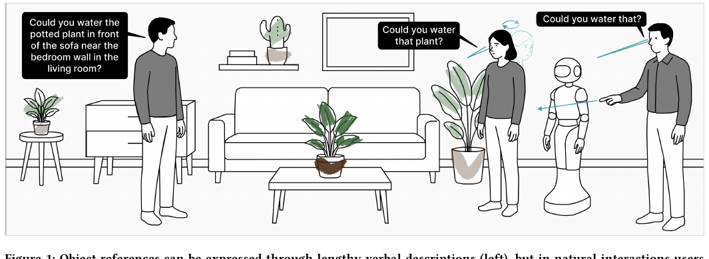
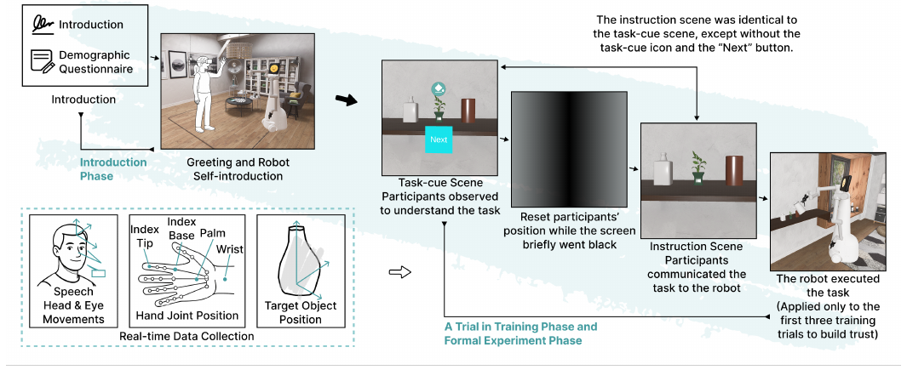
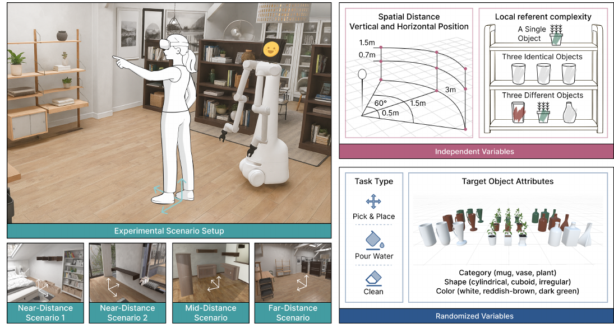
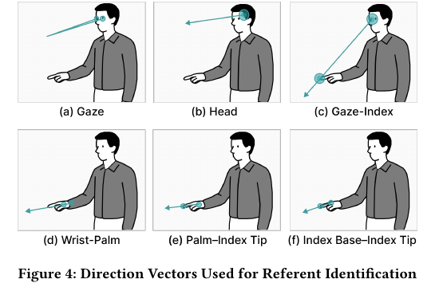
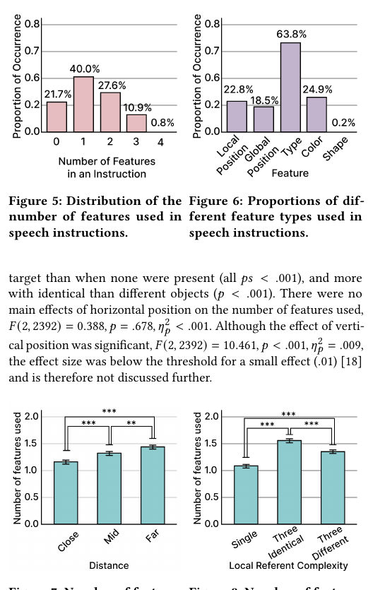
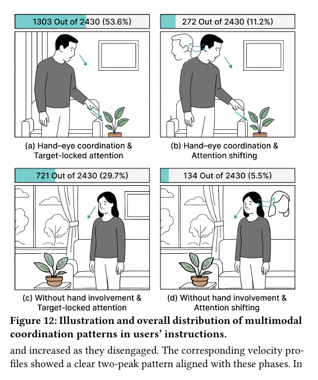
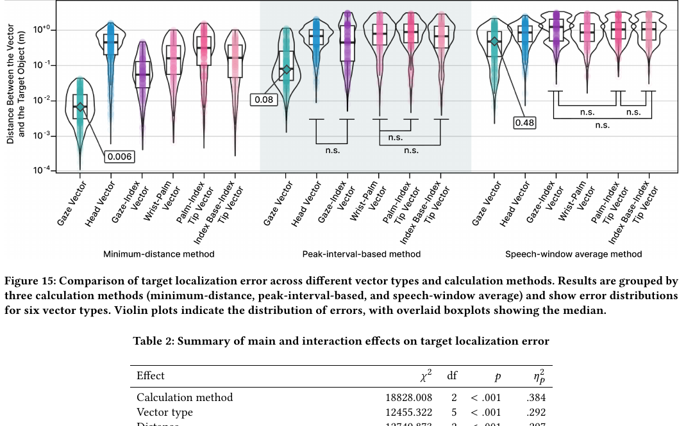

# How Humans Naturally Refer to Targets

原文 PDF：[[2026_CHI_How_Humans_Naturally_Refer_To_Targets_HRI.pdf]]

一句话结论：这篇比前面 audio moderator 更接近我们真正关心的 embodied interaction model。它不讲 LLM，也不讲 ChatGPT 式对话，而是研究人在自然给机器人下指令时，如何用 `speech + gaze + pointing + head movement + timing` 指代目标对象。

## 0. 先给我们的判断

这篇是 P0。原因很直接：机器人听到“拿那个”“倒那个”“清理那个杯子”时，第一步不是 planning，而是先知道**那个到底是哪一个对象**。

这篇论文证明了三件关键事实：

1. 用户语言经常不完整。21.7% 的指令没有对象属性，只说 this/that 之类的指代词。
2. 目标 grounding 不能只靠 ASR 文本。用户会用 gaze、pointing、head pose 和 speech onset 的时序补齐语言里缺失的信息。
3. gaze 是最强的目标定位信号，但 gaze 本身不稳定，需要 hand/head/speech timing 帮忙找“哪一段 gaze 才真的在看目标”。

这篇和 Thinking Machines interaction models 的关系更近：它不是在训练一个原生模型，但它明确告诉我们 interaction model 里应该有什么 typed state。对机器人来说，输入不应该是一句 prompt，而应该是一个连续多模态交互片段。

## 1. 论文到底做了什么

论文的问题是：人在自然给机器人下指令时，到底怎么指代目标对象？



左边是 voice-only 的笨办法：用户要说很长的描述，比如“沙发前面、卧室墙左边那个盆栽”。右边是真实交互更常见的方式：用户说“water that plant”，同时看向、指向、转头或用动作暗示目标。

研究问题：

- RQ1：用户的 verbal instruction 会如何随空间和环境复杂度变化？
- RQ2：用户会自然形成哪些 gaze、pointing、head movement 的多模态协调模式？
- RQ3：机器人如何利用这些多模态线索提高 referent identification accuracy？

实验方法：

- 30 名参与者。
- VR-based HRI 实验。
- 收集 2,430 条自然多模态指令。
- 任务包括 Pick & Place、Pour Water、Clean。
- 系统变化目标距离、水平位置、垂直位置、局部参照复杂度。
- 记录 speech audio、eye gaze、head pose、hand joints、target position。

## 2. AI/模型在哪里？

这篇不是 LLM agent 论文。它没有做一个完整的机器人 agent，也没有训练一个端到端模型。

它做的是：

```text
收集自然 HRI 多模态指令数据
-> 分析用户如何自然指代目标
-> 比较不同多模态 vector 的 target localization accuracy
-> 提出一个 gaze-centered、由 hand/head/speech timing 辅助的 heuristic
```

所以它不是：

- LLM function calling。
- 语音聊天 agent。
- 机器人全栈控制系统。
- 端到端 interaction model。

但它很适合变成我们系统里的一个底层模块：

```text
MultimodalInstructionSegment
  -> TargetReferenceResolver
  -> GroundedTargetCandidate
  -> robot planner / LLM / behavior policy
```

### 2.1 结构化意图到底是直接喂给 LLM，还是给专门模型？

论文没有说“把这些结构化信息直接喂给市面上的 LLM，然后让 LLM 完成下一步执行”。这一点要明确，不能替作者补。

论文真实做的是：

```text
speech audio + gaze + head pose + hand joints + target position
  -> transcript / word timestamps / direction vectors
  -> speech feature annotation + multimodal coordination analysis
  -> target localization error comparison
  -> peak-interval-based rule/heuristic
```

也就是说，这篇主要研究的是**多模态 target grounding 前端**，不是 LLM reasoning 后端。

从工程角度看，比较稳的系统不应该是：

```text
raw audio/video/gaze/gesture
  -> 全部直接塞给 LLM
  -> 让 LLM 自己判断目标和动作
```

更合理的是分层：

```text
ASR / gaze / hand / head / scene perception
  -> TargetReferenceResolver / IntentRecognizer / UserStateTracker
  -> structured InteractionState
  -> LLM/VLM/planner 做高层语义推理、澄清话术、任务分解
  -> policy / validator / robot controller 执行
```

这篇论文只覆盖前半段中的 target grounding 逻辑。它可以帮助我们设计 `TargetReferenceResolver`，但没有证明一个 LLM 可以直接吃所有原始多模态数据并可靠输出机器人动作。

### 2.2 哪些东西适合给 LLM，哪些不适合？

基于这篇论文的证据，可以这样划分：

| 层 | 更适合谁处理 | 原因 |
|---|---|---|
| ASR、逐词时间戳 | ASR/forced alignment 模型，如论文里的 WhisperX | 需要音频到文字和时间对齐，论文实际用了 WhisperX |
| gaze/head/hand 轨迹 | 专门感知和时序分析模块 | 需要低延迟、连续信号处理和速度峰值检测 |
| target localization | grounding 模块 / rule-based 或专门多模态模型 | 论文比较的是 gaze/head/hand vectors 和 timing window，不是 LLM |
| ambiguity risk | grounding + scene graph + confidence estimator | 需要知道候选目标、相似物、空间关系和置信度 |
| 澄清问题怎么说 | LLM 可以参与 | 需要自然语言生成，例如“你是说左边那个白色杯子吗？” |
| 高层任务分解 | LLM/planner 可以参与 | 需要把“拿那个杯子”转成可执行任务步骤 |
| 物理执行 | robot policy/controller | 需要安全、运动规划和实时控制，不能直接交给 LLM |

所以 LLM 更像是消费整理后的 `InteractionState`：

```json
{
  "speech": "拿那个杯子",
  "intent": "pick_up",
  "candidateTargets": [
    {
      "id": "cup_1",
      "type": "cup",
      "color": "white",
      "gazeAlignment": 0.91,
      "pointingAlignment": 0.72,
      "estimatedDistanceErrorM": 0.08
    },
    {
      "id": "cup_2",
      "type": "cup",
      "color": "white",
      "gazeAlignment": 0.31,
      "pointingAlignment": 0.18,
      "estimatedDistanceErrorM": 0.42
    }
  ],
  "groundingConfidence": 0.86,
  "riskLevel": "low"
}
```

这个 JSON 是我们的工程化表达，不是论文原文。论文提供的是把 gaze/head/hand/speech timing 转成 grounding evidence 的依据。

## 3. 输入输出和数据类型

### 3.1 研究采集的真实输入



| 输入 | 数据类型/模态 | 说明 |
|---|---|---|
| speech audio | audio stream | 用户对机器人说任务指令 |
| transcript | text | 用 WhisperX 转写 |
| word timestamps | aligned text timing | WhisperX forced alignment 得到逐词时间戳 |
| eye gaze | vector stream | Meta Quest Pro 眼动数据 |
| head pose | 6DoF pose / direction vector | 头部朝向和位置 |
| hand joints | 3D joint trajectories | 手腕、手掌、食指等关节点 |
| target position | 3D coordinate | VR 里目标物体的 ground truth 位置 |
| scene factors | structured variables | 距离、水平角、垂直高度、周围相似物复杂度 |

实验设备和环境：

- Unity 2022.3.59f1。
- Meta Quest Pro。
- 工作站：Intel Core i9 + RTX 4090。
- 机器人模型参考 Elephant Robotics Mercury X1。

### 3.2 输出是什么？

论文里的输出不是机器人动作，而是分析和定位结果：

| 输出 | 类型 | 说明 |
|---|---|---|
| speech feature annotation | categorical labels | type、color、shape、local position、global position |
| multimodal coordination pattern | categorical pattern | 四类 gaze/hand/attention 模式 |
| direction vector | 3D ray/vector | gaze/head/hand 相关六种向量 |
| target localization error | distance in meters | 向量估计目标与真实目标的距离误差 |
| peak-interval heuristic | rule-based method | 用 hand/head/speech timing 找 gaze 有效窗口 |

### 3.3 对机器人系统的工程输入输出

如果我们把这篇变成机器人模块，输入不该是：

```text
utterance = "拿那个杯子"
```

而应该是：

```ts
type MultimodalInstructionSegment = {
  speechText: string;
  wordTimestamps: Array<{ word: string; startMs: number; endMs: number }>;
  speechOnsetMs: number;
  gazeVectorStream: Vector3D[];
  headPoseStream: Pose6D[];
  handJointStream: HandJoints3D[];
  sceneObjects: SceneObject[];
  targetCandidates: ObjectId[];
  userPose: Pose6D;
  robotPose: Pose6D;
  taskContext: "pick_place" | "pour_water" | "clean" | string;
};
```

输出应该是：

```ts
type GroundedTargetReference = {
  targetObjectId: string;
  confidence: number;
  evidence: {
    speechFeatures: string[];
    gazeWindowMs?: [number, number];
    gazeAlignmentScore?: number;
    pointingAlignmentScore?: number;
    headAlignmentScore?: number;
  };
  actionPolicy: "execute" | "confirm" | "clarify" | "reject";
};
```

## 4. 实验设计



实验是一个 `3 x 3 x 3 x 3` within-subject factorial design：

| 因子 | 水平 |
|---|---|
| spatial distance | close 0.5m, mid 1.5m, far 3.0m |
| vertical position | bottom 0m, mid 0.7m, top 1.5m |
| horizontal position | left -60 deg, center 0 deg, right +60 deg |
| local referent complexity | single object, three identical objects, three different objects |

任务和物体属性：

- Task type：Pick & Place、Pour Water、Clean。
- Object category：mug、vase、plant。
- Shape：cylindrical、cuboid、irregular。
- Color：white、reddish-brown、dark green。

参与者可以用任何自然方式给机器人下指令，不被要求必须指、必须看、必须按某个脚本说话。这一点非常重要，因为它研究的是自然 interaction pattern，而不是 scripted multimodal input。

## 5. 六种方向向量

论文从 gaze、head 和 hand tracking 里构造了六种方向向量：



| 向量 | 含义 |
|---|---|
| Gaze Vector | 眼睛看的方向 |
| Head Vector | 头朝向 |
| Gaze-Index Vector | gaze 与食指方向结合 |
| Wrist-Palm Vector | 手腕到手掌方向 |
| Palm-Index Tip Vector | 手掌到食指尖方向 |
| Index Base-Index Tip Vector | 食指根部到食指尖方向 |

直觉上我们可能以为 pointing 最可靠，但论文结果相反：自然交互里 gaze vector 明显最好。原因是自然 pointing 很随意，不像 scripted 实验里那么精确。

## 6. STAR 精读

### Situation

家庭/服务机器人要执行 pick、place、clean、pour water 这类任务，必须知道用户说的是哪个目标物体。但真实用户不会总是说完整名称和空间位置，他们更常说“那个”“这个杯子”“帮我清理那个”。

Voice-only 会迫使用户说很长的描述，交互负担高，也不自然。因此机器人必须理解自然多模态指令。

### Task

作者要回答：自然状态下，用户到底如何用语言、视线、指向和头部动作指代目标？这些多模态线索怎么帮助机器人做 referent grounding？

### Action

作者做了 VR HRI 实验，采集 30 人、2,430 条自然多模态指令。每条指令包含：

- 用户说了什么。
- 什么时候开始说、每个词什么时候出现。
- 用户眼睛看哪里。
- 用户头朝哪里。
- 用户手/食指/手掌怎么动。
- 真实目标物体的 3D 位置。

然后做三类分析：

1. speech instruction patterns：语言里用了哪些对象属性。
2. multimodal coordination patterns：用户是否同时看和指、是否持续看目标。
3. target localization：不同向量和不同时间窗口对目标定位有多准。

### Result

核心结果：

- 21.7% 的 speech instructions 没有对象属性，只用 this/that。
- 最常见的语言特征是 object type，占 63.8%。
- local position 只有 22.8%，global position 只有 18.5%，shape 几乎不用，只有 0.2%。
- 距离越远，用户会说更多特征。
- 周围有相似物时，用户会说更多 local/global position。
- gaze vector 的 target localization accuracy 比其他向量高至少一个数量级。
- peak-interval-based method 比整段 speech-window average 好很多：median gaze-target distance 从 0.48m 降到 0.08m。

## 7. 语言特征：为什么 ASR 不够



论文把语言特征分成五类：

| 特征 | 例子 | 比例/作用 |
|---|---|---|
| Type | mug, vase, plant | 63.8%，最常用 |
| Color | white, green, brown | 24.9% |
| Shape | round, square, cylindrical | 0.2%，几乎不用 |
| Local position | on the left, in the middle | 22.8% |
| Global position | on the table near the kitchen | 18.5% |

这说明一个机器人如果只拿 ASR 文本做 grounding，经常会缺少目标信息。用户不说，不代表用户没表达；他们可能已经用 gaze、pointing、head movement 表达了。

对 interaction model 的意义：

```text
user_intent != ASR_text
user_intent = ASR_text + gaze + pointing + head pose + scene context + timing
```

## 8. 多模态协调模式

论文把用户行为分成四类：



| 模式 | 数量 | 比例 | 含义 |
|---|---:|---:|---|
| Hand-eye coordination + target-locked attention | 1303/2430 | 53.6% | 用户指向目标，同时持续看目标 |
| No hand + target-locked attention | 721/2430 | 29.7% | 用户不指，但持续看目标 |
| Hand-eye coordination + attention shifting | 272/2430 | 11.2% | 用户指向目标，但视线会在目标/机器人/周围物体间切换 |
| No hand + attention shifting | 134/2430 | 5.5% | 用户不指，视线也会切换 |

这很重要：自然用户不是稳定脚本。有些人会指，有些不指；有些人持续看目标，有些人会看机器人或扫周围物体。

所以系统不能写死：

```text
用户说话时一定会看目标
用户说 that 时一定会指目标
用户说出名词时一定正在看目标
```

论文甚至明确发现：speech keywords 和动作轨迹之间没有稳定时间对齐。也就是说，用户不一定在说 “mug” 或 “that object” 的那一刻看向/指向目标。

## 9. Target localization：真正有用的技术点

论文比较了三种方法：

1. minimum-distance method  
   在整个指令窗口里找 vector 到真实目标最近的时刻。这是 oracle/理想上限，因为真实系统不知道 ground truth。

2. speech-window average  
   把整个语音指令窗口里的向量平均。很多多模态 pipeline 会这么做，但这篇证明它很差。

3. peak-interval-based method  
   先找用户最可能指向/看向目标的时间窗口，再在这个窗口里平均 gaze。



核心数字：

- Gaze + minimum-distance：median error = 0.006m。
- Gaze + peak-interval：median error = 0.08m。
- Gaze + full speech-window average：median error = 0.48m。

所以关键不是“有没有 gaze”，而是“取哪一段 gaze”。整段平均会把用户看机器人、扫环境、眨眼和扫视都混进去。

论文的 peak-interval heuristic 可以写成：

```text
if hand pointing occurred:
  use interval between the first two peaks of hand movement velocity
else if head movement cue available:
  use interval between the first two peaks of head movement velocity
else:
  use 0.5s window after speech onset

target_direction = average(gaze_vector within selected interval)
```

这不是最终模型，但非常像一个可落地的 robot grounding harness。

## 10. 公式和统计

论文没有提出新的深度模型公式，但用了常规统计和一个效应量公式。

语言特征分析：

- LMM：分析 feature occurrence frequency。
- G-test：分析 feature co-occurrence pattern。
- Cramer's V：作为类别分布效应量。

目标定位误差：

- GLMM：因为 localization error 不满足正态假设。
- 关键自变量包括 vector type、calculation method、distance、local referent complexity、horizontal/vertical position。

效应量公式：

```text
partial eta squared = (F * df_effect) / (F * df_effect + df_error)
```

对我们工程上更有用的不是统计公式，而是下面这个结构：

```text
target localization quality
  = function(vector_type, timing_window, distance, scene_complexity)
```

其中 `timing_window` 是真正的关键变量。

## 11. 和 Thinking Machines interaction models 的关系

这篇不是 Thinking Machines 所说的原生交互模型，但它比 audio moderator 更靠近 interaction model 的底层问题。

区别：

- audio moderator 主要是 conversation harness。
- 这篇是 embodied target grounding。
- audio moderator 处理“系统什么时候说话”。
- 这篇处理“用户自然表达的意图到底指向哪个真实对象”。

这篇给 interaction model 的基础 schema：

```text
InteractionState {
  speechIntent;
  referentCandidates;
  gazeEvidence;
  pointingEvidence;
  headPoseEvidence;
  timingWindow;
  sceneComplexity;
  ambiguityRisk;
}
```

这比一句 prompt 更接近机器人需要的真实输入。

### 11.1 和我们前面几篇的模型链路对比

这里要区分三种论文层级：

| 论文 | 论文真实做法 | 结构化信息给谁用 |
|---|---|---|
| Interaction-Augmented Instruction | 提出 `T/I/A -> Aug -> G` 的概念框架 | 没有给具体 schema 或工程链路，只说增强后的 instruction 给 GenAI |
| AgentHands | 让 LLM 输出 speech + inline `GestureEvent`，本地 parser/scheduler/animation 执行 | LLM 生成符号级动作事件，本地 runtime 执行，不是 LLM 直接控制连续动作 |
| How Humans Naturally Refer to Targets | 分析自然 HRI 指令，比较 gaze/head/hand vectors，提出 peak-interval heuristic | 没有用 LLM；结构化结果更适合先进入 grounding 模块，再交给 planner/LLM/policy |

所以我们现在的结论不是“所有结构化信息都直接喂给 LLM”。更准确是：

```text
结构化信息先形成可验证的 interaction state；
LLM 可以消费这个 state 做高层语义和对话；
grounding、时序、低层控制、安全执行需要专门模块兜住。
```

这也是这篇论文的价值：它把“用户说那个时真正指的是谁”这个问题从泛泛的 LLM reasoning 里拆出来，落到了可测量的 gaze/head/hand/speech timing 证据上。

## 12. 对机器人公司的直接启发

### 12.1 不要把 ASR 当完整指令

用户说“拿那个”不是低质量输入，而是自然交互。机器人需要把语言缺失的部分从多模态线索里补出来。

### 12.2 Grounding 的核心是时序，不只是模态堆叠

不要简单把整段语音期间的 gaze 平均。要找关键窗口：

```text
hand velocity peaks
head velocity peaks
speech onset
gaze stabilization interval
```

### 12.3 机器人应该做 confidence-based policy

```text
high confidence + low risk -> execute
medium confidence -> confirm
low confidence -> clarify
high-risk action -> confirm regardless of confidence
```

### 12.4 Clarification 要用用户自然语言习惯

论文发现用户常用 type、color、local/global position。机器人澄清时也应该这样问：

```text
"你是说左边那个白色杯子吗？"
"是桌子上的绿色植物，还是架子上的那个？"
```

不要问成系统内部对象 ID：

```text
"你是指 object_34_candidate_B 吗？"
```

### 12.5 Feedforward 需要谨慎

机器人/AR/屏幕可以提前展示对象名称、可执行动作、目标候选，帮助用户说得更清楚。但论文提醒：过早展示太多信息会破坏自然性、增加认知负担。

更合理的是：

```text
if ambiguity_risk_high:
  show/selectively speak object names or candidate actions
else:
  stay quiet and let user act naturally
```

## 13. 局限

这篇也不能过度解读：

- 实验在 VR 里，不是真实机器人实物环境。
- 机器人动作多是 prerecorded animation，正式实验里后续 trial 不执行动作。
- peak-interval 是 rule-based proof of concept，不是可直接部署的模型。
- 没有处理嘈杂环境、多人、真实遮挡、真实机械臂延迟、安全约束。
- 没有训练 foundation model，但作者认为未来可基于这些结构构建更强模型。

## 14. 最后一页速记

如果只记住一句话：

> 具身机器人理解用户指令的第一步不是 LLM planning，而是 multimodal target grounding；自然用户的语言经常省略目标细节，机器人必须用 gaze 为主、hand/head/speech timing 为辅，找到用户真正指向的对象。

和上一篇 audio moderator 的差别：

```text
Audio moderator:
  voice dialogue + workflow harness
  相关性：中等偏低

How Humans Refer to Targets:
  embodied multimodal grounding
  相关性：高
```

下一步可以接着读 `HiSync_Long_Range_HRI_Command_Source_Identification`，因为它补的是另一个基础问题：不只是“指的是哪个对象”，还包括“是谁在对机器人发命令”。
