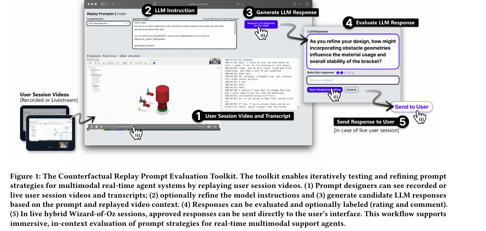
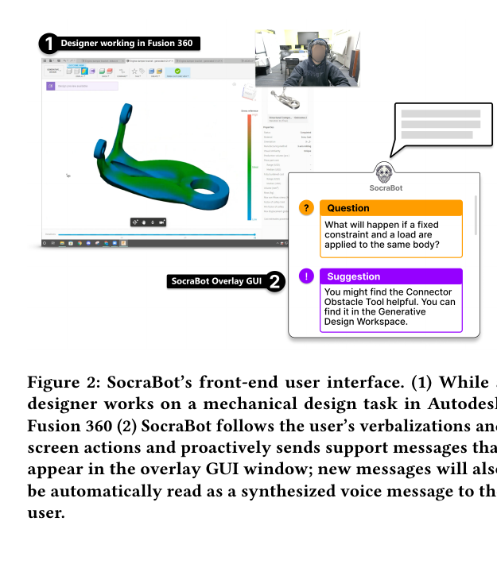
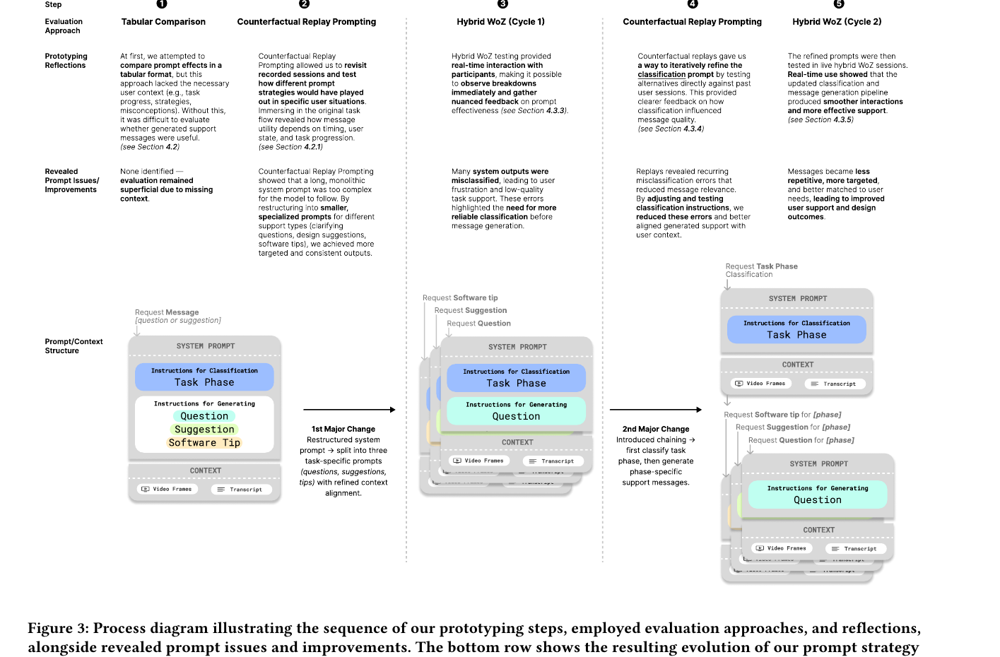
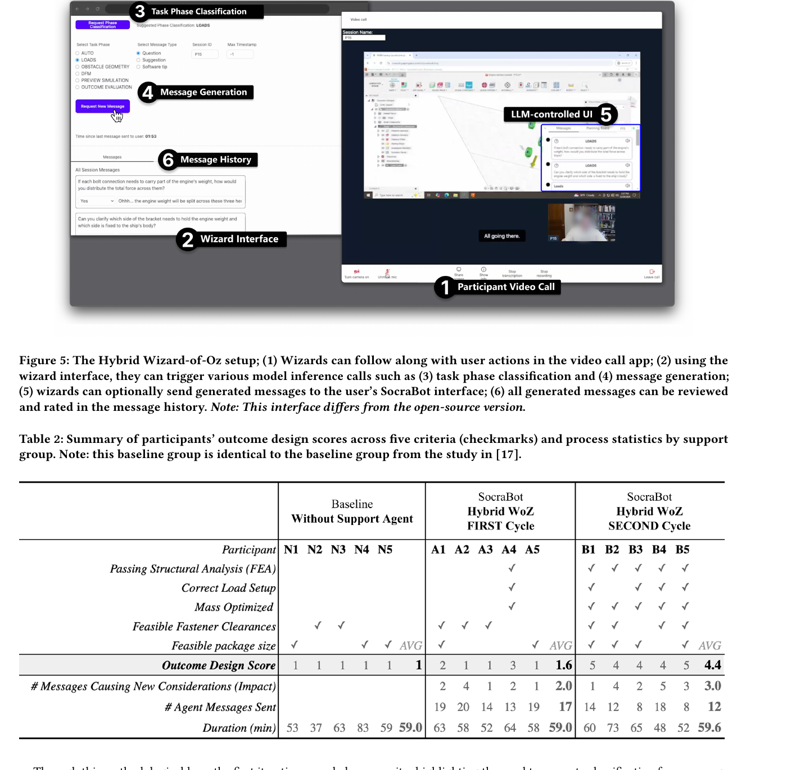

# Prototyping Multimodal GenAI Real-Time Agents

原文 PDF：[[2026_CHI_Prototyping_Multimodal_GenAI_RealTime_Agents.pdf]]

一句话定位：这篇不是训练一个 Thinking Machines 那种原生 interaction model，而是在讲当我们用 GPT-4o / VLM + prompt + harness 做实时多模态 agent 时，怎样通过回放、人工接管、标注和迭代，把 agent 的交互行为调出来。

## 0. 先给结论

这篇比上一篇 AR robot training 更贴近你问的 interaction models，但它仍然不是“模型层”的论文。

它的核心是一个 HCI / UX prototyping 方法：

```text
recorded or live multimodal user session
  -> replay or live wizard interface
  -> prompt / context assembly
  -> GPT-4o VLM inference
  -> generated support message
  -> human rating / override / send-to-user
  -> prompt pipeline refinement
```

它和 Thinking Machines 的关系可以这样放：

```text
Thinking Machines Interaction Models:
  模型原生支持实时 audio/video/text 交互、打断、连续输入输出。

这篇 SocraBot:
  用现有 GPT-4o/VLM + 外部工具链/harness，原型化和评估实时多模态 agent 行为。
```

所以这篇不是“未来模型应该怎么训练”，而是“在现在的模型能力下，怎么设计、测试、调试一个实时多模态 agent 的交互体验”。对机器人公司很有用，因为我们短期内大概率也是走 harness 路线，而不是自己训练原生 interaction model。

## 1. 论文到底做了什么

作者做了一个案例系统 SocraBot。它是一个 proactive real-time support agent，用于辅助用户在 Autodesk Fusion 360 里做机械设计任务。SocraBot 会跟随用户的屏幕操作和 verbalization，然后主动发一些支持信息，例如：

- reflective question：反思性问题；
- design suggestion：设计策略建议；
- software tip：软件操作提示。

论文真正的贡献不是 SocraBot 本身有多强，而是两种原型化/评估方法：

1. Counterfactual Video Replay Prompting：用录制好的用户视频和转写文本，在任意时间点重新触发模型，测试“如果这里 agent 说另一句话会怎样”。
2. Hybrid Wizard-of-Oz：真人 wizard 在直播用户任务时观察、触发模型、审核/覆盖模型输出，再决定是否把消息发给用户。

作者还把内部工具整理成了一个 open-source Counterfactual Replay Prompt Evaluation Toolkit。

## 2. 输入、输出、数据类型、模态

### 2.1 SocraBot agent 的输入

SocraBot 用的是 GPT-4o 这类 multimodal VLM。论文说模型同时处理：

- text：用户连续语音的 speech transcript；
- image：用户屏幕截图 / screen captures；
- prompt：system prompt 负责行为和约束，user prompt 动态提供文本和图像上下文；
- message history：之前发过的支持消息；
- requested message type：要生成 question、suggestion 还是 software tip；
- task phase：后期 pipeline 中先分类用户当前任务阶段，再生成对应消息。

它不是直接吃“完整视频流后端到端控制软件”。更准确地说，系统会从用户 session 里抽取 transcript + video frames / screen context，再把这些组装成 VLM prompt context。

数据类型可以这样理解：

```text
screen recording / live screen stream
webcam or video-call view
audio stream
speech transcript
video frames / screenshots
system prompt
user prompt context
message history
task phase label
generated support message
rating / comment labels
JSON database records
timestamped logs
```

### 2.2 SocraBot agent 的输出

输出主要是给用户看的/听的支持消息：

- overlay GUI window 里的文字消息；
- synthesized voice 自动朗读；
- wizard interface 里的 candidate message；
- message history / logs；
- 研究中还会输出 rating、comment、accept/reject 标注。

所以它的 output 不是机器人动作，也不是工具调用 JSON，而是面向用户的实时辅助话语。它更像“实时认知辅助 agent”，不是 embodied robot controller。

### 2.3 Counterfactual Replay Toolkit 的输入输出

Toolkit 的输入：

- recorded user session video，通常是 MP4；
- synchronized transcript，论文里提到 SRT；
- 当前 system prompt；
- 当前时间点的 video frame / transcript context；
- 可选 previous agent messages；
- prompt designer 选择的 message type。

Toolkit 的输出：

- LLM-generated response；
- evaluator 的 5-point rating；
- free-text comment；
- accept/reject annotation；
- 存在后端 JSON database 里的评价记录。

这对我们很重要：它本质上是一个“多模态交互数据回放 + prompt 行为评估 + 人工标注”工具，而不是一个最终产品。

### 2.4 Hybrid Wizard-of-Oz 的输入输出

Hybrid WoZ 的 live setup 里，用户远程使用云端电脑做 Fusion 360 任务，wizard 通过视频会议观察用户屏幕和 verbalization。

输入：

- 用户 live screen activity；
- 用户 verbalization / transcript；
- wizard 观察到的上下文；
- 当前 task phase；
- message type；
- VLM 生成的候选消息。

输出：

- task phase classification；
- generated message；
- wizard override / denial reason；
- 是否 send to user；
- 用户界面上的 SocraBot message；
- 后续日志和标注。

这说明这篇很重视 human-in-the-loop。作者明确说，自动判断 proactive intervention 的正确时机仍然是未解决问题，所以他们选择真人 wizard 保持控制。

### 2.5 harness 什么时候截断并把信息交给 VLM/LLM？

这篇没有实现一个全自动的“什么时候该截断/什么时候该介入”的判断器。它的触发主要有两种：

1. Counterfactual Replay：设计者在回放视频里手动选择或暂停到某个时间点，然后点击生成消息。这个时间点就是上下文截断点。
2. Hybrid Wizard-of-Oz：真人 wizard 在 live session 里观察用户屏幕和 verbalization，手动决定什么时候触发模型调用，或者什么时候拒绝/覆盖模型输出。

也就是说，这篇的 harness 不会像 Thinking Machines 那种原生 interaction model 一样自动持续判断“现在该不该说话”。论文反而明确说，自动推断 proactive intervention 的正确时机仍然是未解决问题，所以他们用 wizard 保持人工控制。

后端怎么组装输入：

```text
selected session
+ selected / current timestamp
+ transcript up to that point
+ video frames / screen context around or up to that point
+ previous SocraBot messages
+ requested message type
+ current prompt / system instruction
-> VLM call
```

后期 pipeline 又把一次模型调用拆成两步：

```text
step 1: task phase classification
  input: 当前视频帧 + transcript + session context
  output: 用户当前任务阶段，例如 loads / obstacle geometry / DFM / preview simulation / outcome evaluation

step 2: message generation
  input: task phase + message type + transcript + video frames + message history
  output: question / suggestion / software tip
```

Figure 5 的 wizard interface 里能看到 `Session ID`、`Max Timestamp`、`Select Task Phase`、`Select Message Type` 这些控件。工程上可以理解为：`Max Timestamp` 控制“只看这个时间点之前/截至这个时间点的上下文”，wizard 或 replay 操作者决定什么时候触发，后端再按这个时间戳组装 transcript、video frames 和历史消息。

论文没有给出更细的自动截断策略，例如固定几秒窗口、抽几帧、token budget 怎么裁剪、是否用 sliding window、是否自动检测用户停顿。这些都不是它的贡献。它的贡献是把“时间点选择、上下文组装、模型输出、人工评价/覆盖”做成一个可回放、可标注、可迭代的原型化 harness。

## 3. 关键图 1：Counterfactual Replay Toolkit



这个图说明了最核心的工具链：

1. 设计者看 recorded / live user session video 和 transcript。
2. 修改 LLM instruction。
3. 在某个时间点生成 candidate LLM response。
4. 对 response 做评价和标注。
5. live WoZ 时可以把审核过的 response 直接发给用户。

这就是“调试实时 agent 行为”的关键：不是只看模型输出一句话是否自然，而是把输出放回具体时间点、用户状态、任务进度里判断。

## 4. 关键图 2：SocraBot 用户界面



SocraBot 的用户侧不是复杂机器人，而是一个 overlay GUI。用户在 Fusion 360 里做机械设计任务时，SocraBot 在旁边弹出 question / suggestion，并且用语音读出来。

这对机器人产品的启发是：早期可以先把 embodied agent 的“主动帮助”降级成可审核的消息层，不要一开始就让 agent 直接执行动作。先验证“何时介入、说什么、是否打扰”，再逐步接入动作。

## 5. 关键图 3：prompt / context pipeline 如何演化



这张图是整篇最重要的架构图。作者一开始尝试 tabular comparison，发现只看表格里的回复很肤浅，因为缺少具体时间上下文。然后改成 counterfactual replay，把 prompt 放回 recorded user session 里测试。

第一次发现的问题：一个很长的 monolithic system prompt 太复杂，模型很难稳定遵循。于是他们把 prompt 拆成三个专门类型：

- question；
- suggestion；
- software tip。

第二次发现的问题：模型经常误判用户当前 task phase，导致生成的消息不相关。于是他们进一步拆成两阶段 chain：

```text
stage 1: classify task phase
stage 2: generate phase-specific support message
```

这和我们做机器人 agent 很像：不要让一个大 prompt 同时做“识别用户状态 + 判断时机 + 生成话术 + 选择动作”。应该把判断链路拆开，让每一步可见、可测、可覆盖。

## 6. 关键图 4：Hybrid WoZ 和结果表



Hybrid WoZ 界面里，wizard 可以：

- 看用户 video call / screen；
- 请求 task phase classification；
- 请求 message generation；
- 决定是否把消息发给用户；
- 查看 message history；
- 对生成结果做评价。

Table 2 里比较了 baseline、Hybrid WoZ first cycle、Hybrid WoZ second cycle。关键数字：

- baseline outcome design score 平均 1；
- first cycle 平均 1.6；
- second cycle 平均 4.4；
- second cycle 中所有参与者的 bracket 都通过 structural analysis；
- first cycle 发现模型经常 task phase misclassification；
- second cycle 把 classification 和 generation 分开后，支持消息更少重复、更贴合用户状态，设计结果明显更好。

要注意：这不是一个完全自动 agent 的结果。wizard 仍然在环，尤其可以覆盖 task phase 分类。论文提到 wizard 大约覆盖了将近一半的分类，这说明模型的上下文识别仍不可靠，但也说明“暴露可控中间状态”很有价值。

## 7. STAR 法则精读

### Situation

实时多模态 agent 很难设计。它要处理连续语音、屏幕动作、视频帧、用户任务进度，还要在几秒内判断是否主动介入。传统 benchmark、text-only prompt eval、静态 Figma 原型都不够，因为它们无法评估“某句话在某个具体时刻是否真的有帮助”。

这和 Thinking Machines 那篇的核心问题相通：真正的 interaction model 不是一问一答，而是跟随用户连续活动并及时响应。

### Task

作者要解决的是原型化和评估问题：

- 怎样在没有大规模 benchmark 的情况下测试实时多模态 agent？
- 怎样判断 agent 的 proactive support 是否及时、相关、不打扰？
- 怎样把 prompt 从不可控的大系统提示，拆成更可诊断的模块？
- 怎样在真实用户任务里验证 agent 行为，而不是只看离线输出？

### Action

作者做了几个动作：

- 实现 SocraBot：一个基于 GPT-4o 的 proactive support agent。
- 收集/使用 15 个 recorded user sessions 作为 replay 数据。
- 做 Counterfactual Video Replay Prompting：在录制视频的任意时间点重新生成模型消息。
- 做 Hybrid Wizard-of-Oz：真人 wizard 观察 live 用户，触发/审核/覆盖模型输出。
- 记录 49 个 Git commits，包括 code 和 prompt 修改，用作设计过程分析材料。
- 招募 10 名有机械工程背景的设计者做 live study。
- 把 monolithic prompt 拆成 specialized prompts，再拆成 task phase classification + message generation chain。

### Result

主要结果不是“模型能力突破”，而是“原型方法有效暴露问题并指导修正”：

- tabular prompt comparison 太浅，缺少 situated context。
- replay 发现长 prompt 太复杂，模型不能稳定遵循。
- live Hybrid WoZ 发现 task phase misclassification 会级联导致无效消息。
- 拆分 classification 和 generation 后，message 更 targeted，结果更好。
- outcome design score 从 baseline 1、first cycle 1.6，提升到 second cycle 4.4。

但这个提升是在 human-in-the-loop 条件下得到的，不能解读为全自动 SocraBot 已经可靠。

## 8. 和 Thinking Machines 的关系

Thinking Machines 想做的是“模型原生 interaction model”：

```text
continuous audio/video/text
-> model-native realtime understanding / response / interruption
```

这篇做的是“外部 harness 下的 interaction prototyping”：

```text
screen + speech + transcript + replay
-> prompt/context assembly
-> VLM response
-> human review / override
-> user-facing message
```

两者不是同一层，但这篇更适合我们短期落地。因为我们现在做机器人交互，很可能还没有一个足够成熟的 native interaction model。那就需要这篇这种工具链：

- 把真实用户 session 录下来；
- 在关键时刻回放；
- 测试 agent 是否该说话、说什么；
- 标注什么时候误判；
- 把误判变成分类器/prompt/policy 的改进数据。

更直接地说：这篇和 Thinking Machines 那个 interaction model **不是一类东西**。Thinking Machines 讲的是模型自身原生支持连续音频/视频/文本、实时响应、打断、前后台协作推理；SocraBot 讲的是在没有这种模型时，怎么用 GPT-4o/VLM + prompt + replay + wizard + 标注，把一个“看起来像实时 agent”的交互先 scaffold 出来。

所以它的价值不是证明模型已经会实时交互，而是提供一个 data collection / behavior debugging harness：

```text
human decides when to trigger
human reviews or overrides output
system logs timestamped context
system stores model output + human rating/comment/denial reason
these records become prompt refinement data, eval data, or future training data
```

如果我们未来要训练自己的 interaction policy / intervention model，这类数据可以转成：

- `when_to_intervene`：多模态上下文 -> 该不该介入；
- `task_phase / user_state`：屏幕/语音/姿态/机器人状态 -> 用户当前状态；
- `message_quality`：上下文 + 候选话术 -> 好/坏/原因；
- `human_override`：模型输出 -> 人类修正后的更优输出。

对机器人来说同理，可以沉淀成“什么时候说话、什么时候沉默、什么时候确认、什么时候拒绝执行、什么时候做动作”的 supervised / preference / eval 数据。

## 9. 对机器人公司的直接启发

这篇最值得我们借鉴的是“先可回放，再自动化”。

对机器人/具身 agent，可以对应成：

```text
recorded interaction session:
  camera video
  microphone transcript
  robot state
  user pose / gaze / gesture
  tool/app state
  agent message/action log

replay eval:
  pause at any timestamp
  ask model: what is user state?
  ask model: should agent intervene?
  ask model: what should agent say/do?
  human labels: correct / wrong / too early / too late / unsafe / annoying

pipeline refinement:
  split user-state classification from response generation
  expose intermediate labels
  allow human override
  save overrides as training/eval data
```

如果迁移到机器人，不应该只标“回复好不好”，还要标：

- timing：此时该不该介入；
- grounding：是否正确理解用户正在看的/做的/指的对象；
- intent：是否正确判断用户意图；
- interruption cost：是否打断用户；
- safety：是否可能引导危险动作；
- actionability：机器人能不能执行；
- embodiment fit：话语、表情、动作是否一致。

## 10. 这篇对 Interaction Model 的具体贡献

它没有提出一个新的 model architecture，但提出了一个很重要的工程原则：

```text
不要只评估 output。
要评估 output 在实时上下文里的作用。
```

在普通 LLM 任务里，一个回答可以离线评分；但实时交互里，同一句话在不同时间点可能完全不同：

- 早说：打断用户；
- 晚说：错过帮助窗口；
- 说对但阶段错：变成干扰；
- 内容正确但模态不对：用户看不到/听不进去；
- 语气正确但 grounding 错：信任下降。

这就是它和 Thinking Machines 概念的连接点：真正的 interaction model 需要理解时间、上下文、用户状态和介入时机。这篇没有训练出这样的模型，但给了一个把这些问题显性化的方法。

## 11. 局限和不要误读

- 这是单一案例研究，领域是机械设计/CAD，不是机器人陪伴或真实 embodied robot。
- SocraBot 不是全自动系统，human wizard 仍然负责触发、审核、覆盖。
- 模型主要是 GPT-4o VLM + prompt，不是专门训练的 realtime interaction model。
- 论文没有给出完整 prompt、延迟指标、模型调用成本、自动 timing 策略。
- 结果提升不能完全归因于模型本身，因为 wizard bias 和人工干预都存在。
- Counterfactual replay 依赖已有录制数据，可能过拟合到已有 session。
- 没有长期记忆和长期关系建模。

所以这篇应该归类为：

```text
real-time multimodal agent prototyping / evaluation harness
```

而不是：

```text
native interaction model / robot behavior system / long-term companion model
```

## 12. 一句话带走

这篇告诉我们：做实时多模态 agent 时，最难的不是让模型生成一句漂亮的话，而是判断它在具体时间、具体用户状态、具体任务阶段下是否该介入、如何介入；解决这个问题的第一步不是直接全自动，而是建立可回放、可标注、可人工接管、可迭代的 interaction harness。
