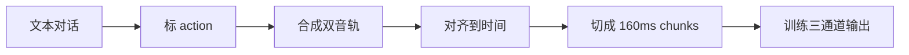

---
title: "DuplexSLA: A Full-Duplex Spoken Language Model with Synchronized Speech, Language, and Action"
slug: "2026_DuplexSLA_Full_Duplex_Speech_Language_Action"
year: 2026
venue: "arXiv"
status: "deep_read"
pdf: "2026_DuplexSLA_Full_Duplex_Speech_Language_Action.pdf"
doi: ""
arxiv: "2605.20755"
url: "https://arxiv.org/abs/2605.20755"
tags: ["full-duplex", "spoken-language-model", "action-channel", "tool-use", "turn-taking", "real-time-interaction"]
primary_area: "02_Perception_and_CV"
secondary_areas: ["03_Agents", "04_Human_AI_Interaction", "05_Robotics_and_HRI"]
added_date: "2026-06-08"
last_reviewed: "2026-06-08"
---

# DuplexSLA: A Full-Duplex Spoken Language Model with Synchronized Speech, Language, and Action

## 一句话结论

这篇比 Full-Duplex-Bench-v3 更接近我们要找的 interaction model：它不是只评测工具调用，而是提出一个原生 full-duplex 的 speech-language-action 模型，把助手语音输出和 action 输出放在同一个 160 ms 时间轴上，让模型可以边听、边说、边发出 planning / turn-taking label / JSON tool call。

但要注意：这里的 `action` 主要还是文本化的工具调用和对话控制标签，不是机器人连续运动控制。它对机器人公司的价值在于“动作通道怎样和实时语音交互对齐”，不是直接给机械臂或移动底盘的底层控制算法。

## 解决什么问题

传统语音 agent 常见流程是：

```text
用户语音 -> VAD/ASR endpoint -> LLM -> tool call -> TTS
```

这个流程的问题是必须等一个 turn 边界，或者依赖外部 VAD/semantic VAD 决定用户是不是说完。结果是：

- 用户只是短反馈，比如“对”“嗯”，系统可能误以为用户要抢话。
- 用户真正打断时，系统可能还在继续说。
- 工具调用通常要等听完一句话、ASR 出文本、LLM 再决定，延迟偏高。
- 如果说话时要调用工具，传统 tool calling 容易打断 speech generation，或者要把 speech 和 tool call 分开两次处理。

DuplexSLA 的问题定义是：能不能让一个模型在持续语音对话中，同时输出助手语音和结构化动作，并且动作有明确时间戳。

## 方法 / 系统怎么做

核心设计叫 dual-stream three-channel：

- `User Channel`: 连续用户音频特征。
- `Assistant Channel`: 助手语音输出，离散化成 TA4 格式。
- `Action Channel`: 文本 action stream，承载 delayed transcript、planning text、turn-taking labels、structured tool calls。


每个 chunk 是 160 ms。模型在每个 chunk 上看用户当前音频和历史上下文，然后自回归地预测下一段助手语音和 action text。

论文里的关键时间离散化是：

```text
Delta = 160 ms
c = floor(t / Delta)
```

也就是把连续时间 `t` 映射到第 `c` 个 160 ms 对话 chunk。这个设计很关键，因为 tool call 不只是“最后输出一个 JSON”，而是能被挂到具体 chunk 上。

这里的 chunk 不等于“一轮完整对话”。一个完整的用户输入、助手回复和 action 调用，通常是由很多个 160 ms chunk 串起来形成的。可以把 chunk 理解成视频里的 frame，或者音频流里的固定时间片：模型不是等用户一句话全部结束再处理，而是在每个很短的时间片上持续更新状态、持续预测下一小段助手语音和 action text。

例如用户说一句 2 秒的话，按 160 ms 切分大约是：

```text
2.0 s / 0.16 s = 12.5 chunks
```

实际会落到约 13 个 chunk。第 1 个 chunk 可能只听到“把”，第 3 个 chunk 听到“空调”，第 6 个 chunk 听到“调高”，第 10 个 chunk 语义已经足够明确，action channel 就可能开始输出 planning 或 tool call。也就是说，action 可以在完整句子结束前被触发，但不能早于语义证据出现太多。

用时间映射看：

```text
t = 0.00 s -> c = floor(0.00 / 0.16) = 0
t = 0.15 s -> c = floor(0.15 / 0.16) = 0
t = 0.16 s -> c = floor(0.16 / 0.16) = 1
t = 0.35 s -> c = floor(0.35 / 0.16) = 2
t = 1.00 s -> c = floor(1.00 / 0.16) = 6
```

所以 `c` 只是“当前处于第几个 160 ms 时间格子”。DuplexSLA 的关键是：用户音频、助手语音、action labels、tool calls 都对齐到这些格子上，模型就能知道某个 action 是在对话时间轴的哪个位置触发的。

### 上下文窗口是什么样的？

模型看到的上下文可以理解成很多 chunk 序列化之后接成的一长串 token。每个 chunk 里都有 user audio、assistant audio、action text 三个通道的内容；多个 chunk 串起来，就形成模型的 streaming context。

一个简化示意是：

```text
chunk 0:
  user audio tokens/features
  assistant TA4 tokens
  action text tokens

chunk 1:
  user audio tokens/features
  assistant TA4 tokens
  action text tokens

chunk 2:
  ...
```

论文评测算法里也写了类似过程：先可选地 `PREFILL(H)` 把历史对话放进系统，然后把当前用户音频切成 `K` 个 160 ms chunks，逐步调用 `S.STEP(u_k)` 得到每个 chunk 的输出。

所以它不是没有上下文限制。任何 Transformer / speech-LM 都会有 context window 或 streaming cache 的限制，只是这篇论文没有公开具体窗口长度、KV cache 保留策略、历史压缩策略。能确定的是：上下文不是无限的；系统要么保留最近一段 chunk/token，要么通过 prefill/cache/sliding window 等方式管理历史。

每个 chunk 的序列化格式是：

```text
<|user_audio_begin|> UU <|user_audio_end|>
<|assistant_audio_begin|> T AAAA <|assistant_audio_end|>
<action text> <|action_end|>
```

其中：

- `UU`: 用户音频特征，2 个 causal audio features，每个 80 ms。
- `T AAAA`: 助手语音 TA4，1 个 text anchor token + 4 个 discrete audio tokens，每个 audio token 40 ms。
- `action text`: 每个 chunk 最多 10 个文本 token，超出就 spill 到后续 chunk。

工具调用格式是文本 action stream 里的一段结构化内容：

```text
planning_text
<|toolcall_begin|>{"function": "function_name", "arguments": "arguments"}<|toolcall_end|>
```

这说明它不是传统“只输出一个纯 JSON tool call”的结构。它的 output 同时有：

- assistant speech/audio tokens: 后续可以解码成 TTS/语音；
- action text tokens: planning、控制标签、JSON tool call。

## 输入、输出、数据类型、模态

### 模型输入

论文描述的是一个 7B speech-LM，初始化自 Step-Audio 2 mini。它不是“底层一个普通文本 LLM + 外面堆一堆 intent detector”的系统。论文声称 pause / interrupt / backchannel 是模型基于内部 semantic state 原生学出来的，不依赖外部 semantic VAD。

但这也不等于没有前端音频编码。输入里有音频特征和离散 token，底层仍需要 speech tokenizer / acoustic feature extractor 之类模块，只是论文把它们纳入 speech-LM 流水线，而不是作为独立意图识别器来解释。

输入模态和数据类型：

| 项           | 数据类型                                | 模态               | 作用                                                                  |
| ----------- | ----------------------------------- | ---------------- | ------------------------------------------------------------------- |
| 用户音频        | continuous causal audio features    | audio            | 模型持续听用户                                                             |
| 历史助手语音      | discrete audio tokens + text anchor | audio/text token | 让模型知道自己正在说什么                                                        |
| 历史 action   | text tokens                         | text/action      | 让模型知道之前发过哪些 label/tool call                                         |
| task prompt | text token                          | text             | 指示 dialogue / ASR / interrupt / backchannel / pause / toolcall 等任务族 |

### 模型输出

输出有两个主分支，但在同一个 backbone、同一个 chunk 时钟里生成：

| 输出 | 数据类型 | 模态 | 例子 |
|---|---|---|---|
| Assistant Channel | `T AAAA` 离散语音 token | speech/audio | 助手继续说话、沉默、停止说 |
| Action Channel | text tokens | text/action | `interrupt`, `backchannel`, `response`, planning text, JSON tool call |

所以回答“它到底是 text 数据还是多模态数据”：训练样本和模型运行时都是多模态序列。用户侧是音频特征，助手侧是离散语音 token，action 侧是文本 token。tool call 本身是文本/JSON 结构，但它被放在和音频同步的多模态 token stream 里。

### 和传统 function calling 的区别

传统 function calling 更像：

```text
LLM decides -> {"name": "...", "arguments": {...}} -> tool executes -> LLM says result
```

DuplexSLA 更像：

```text
160 ms chunk clock:
  listen user audio
  continue / stop / pause assistant speech
  emit action label or tool-call tokens when semantic trigger appears
```

关键区别不是 JSON 本身，而是 JSON 被同步到 speech timeline。它能在助手继续说话时发工具调用，不一定等一个 turn 完整结束。

## 关键图表

### Figure 2: pause / interrupt / backchannel 的区别


这张图不是在给一个明确的手写算法，比如“停顿超过 300 ms 就算 pause”。它真正想表达的是：同样是用户在助手说话中发出声音，系统不能只靠“有没有人声”来判断，而要根据语义判断用户是在停顿、抢话，还是只是短反馈。

三种情况可以这样理解：

- `pause`: 用户自己正在说，但中间停了一下，还没有把话说完。助手应该继续等，不要抢答。输出表现是 assistant channel 继续 silence，action channel 类似保持 response / continue-listening 状态。
- `interrupt`: 助手正在说，用户突然开始说一个新的完整想法，比如“你说得对，但是项目排期太紧了...”。这时用户是在抢回话语权。模型应该在 action channel 输出 `interrupt`，同时让 assistant channel 停止继续说，也就是切到 silence。
- `backchannel`: 助手正在说，用户只插一句短反馈，比如“对”“嗯”“你说得对”。这不是要抢话，只是表示正在听或同意。模型应该在 action channel 输出 `backchannel`，但 assistant channel 继续原来的回复，不要停。

所谓“把不同交互行为监督到 action channel”，意思是训练数据里会告诉模型：在这个时间点，这段用户声音应该标成 `interrupt`，那段应该标成 `backchannel`，另一段应该继续等待。模型训练时不仅学“下一段该说什么”，也学“当前交互状态该输出什么 label”。

所以这张图回答的不是“判断公式是什么”，而是“系统输出层怎么表达判断结果”：判断结果不是外部 VAD 模块单独给出的，而是模型自己在 action channel 里输出 `interrupt` / `backchannel` / response-like label。论文没有公开足够细的内部 attention 或 hidden-state 判定边界，不能把它说成可复现的手写规则。

### Figure 3: action channel 中的 planning + tool call


这里最贴近 interaction model。图里有两种模式：

- Backchannel-triggered tool calling: 用户在助手说话中插一句“Play some Beatles songs”，系统不停止当前 speech thread，但 action channel 发出 music tool call。
- Multi-action tool calling: 用户一句话里有多个 intent，例如调空调、放音乐、导航，action channel 按语义触发点依次输出多个工具调用。

这比 FDB-v3 里的 benchmark 更进一步：FDB-v3 证明现有语音 agent 在 disfluency 和 tool use 上容易慢或错；DuplexSLA 试图把 tool call 做成原生同步输出。

### Table 1: 系统级摘要


几个关键数字：

- backbone: 7B speech-LM，initialized from Step-Audio 2 mini；
- streaming clock: 160 ms；
- assistant audio: 每 chunk 4 个 discrete audio tokens；
- action budget: 每 chunk 最多 10 个 token；
- tool schema: 50 个 cabin / smart-home function schemas + 3 个 interaction-control labels；
- native behaviours: pause、interrupt、backchannel without external semantic VAD。

### Figure 4: 数据构造流程


这张图很重要，因为它说明 DuplexSLA 并不是凭空从真实交互里学出来的。先把几个容易卡住的词讲清楚：

| 论文术语 | 人话解释 |
|---|---|
| raw dialogue | 原始对话文本，还没有工具调用标注 |
| tool schema | 系统有哪些工具、每个工具叫什么、参数大概是什么 |
| tool-call object | 一条“应该调用哪个工具、带什么参数、为什么调用、什么时候触发”的标注 |
| planning text | 给 action channel 的简短内部说明，不是展示给用户的回复 |
| semantic offset | “用户说到哪里时，语义已经足够触发这个 action”的时间点 |
| TTS / voice cloning | 把文本对话合成为语音；voice cloning 是用某个说话人的音色来合成 |
| force alignment | 把音频和文字对齐，知道每个字/词大概在音频里的哪个时间 |
| chunk grid | 每 160 ms 一个格子，把音频、文字和 action 都放到这些格子上 |
| FIFO queue | 先触发的 action 先输出；后触发的排队等，不插队 |

这张图的完整意思是：**把普通对话做成“语音 + action 时间轴”训练数据**。不要把它理解成运行时有九个模块；这是训练数据制作流程。



| 步骤 | 输入 | 产出 |
|---|---|---|
| 1. 标 action | 文本对话 + 工具 schema | function、arguments、planning、semantic offset |
| 2. 语音化 | 标注后的对话文本 | user audio track + assistant audio track |
| 3. 时间对齐 | 双音轨 + 文本 + action | 每个字/词/action 对应到真实时间 |
| 4. chunk 化 | 连续时间轴 | 160 ms 一个 chunk |
| 5. 训练目标 | chunk 序列 | 输入 user audio；监督 assistant TA4 和 action text |

关键步骤精简版：

1. 原始对话本身没有 action。普通 dialogue 只知道用户和助手说了什么，不知道“什么时候该调用工具”。所以先要结合 tool schema，把对话改造成带 action 的训练样本。

2. LLM 标注的不是一句简单 intent，而是一个 action object。里面至少包括 `function name`、`arguments`、`planning text` 和 `semantic offset`。其中 `semantic offset` 最重要：它告诉模型 action 应该挂到用户语义变明确的那个时间点，而不是全部丢到句末。

3. TTS / voice cloning 是为了得到双音轨。模型训练时需要 `user audio track` 和 `assistant audio track`，不是只要文本。Table 9 里的 `{·}` 是 speaker 占位符，会被替换成 18 个主要 voice-clone speakers 之一，意思是这条样本用某个助手音色合成。

4. Force alignment 负责把“字词”和“音频时间”对齐。比如知道“车里”“太冷”“空调调高”分别在音频里的哪个时间段，然后才能把它们 snap 到 160 ms chunk grid 上。

5. 最终训练样本是三通道 chunk 序列。`user audio` 是输入；`assistant TA4` 是模型要学会生成的语音目标；`action text` 是模型要学会生成的内部控制/工具调用目标。

6. Action channel 有 10 token/chunk 限制，所以 tool call 可能跨多个 chunk 输出。论文用 FIFO queue：先触发的 action 先输出，太长就 spill 到后续 chunk，后触发的 action 等前一个完整吐完。

7. ASR 辅助任务是为了教时间对齐。User-channel ASR 把用户转写延迟写到 action channel；assistant-channel ASR 让模型知道助手语音真正在哪个 chunk 被说出来。这个不是为了做普通 ASR 产品，而是为了训练 speech/action timing。

8. Pause / interrupt / backchannel 也是训练目标。数据里会标注这些控制 label，让模型学会在 action channel 输出 `interrupt` 或 `backchannel`，同时决定 assistant channel 是继续说还是切到 silence。

9. 两阶段训练的分工不同。CPT 主要学三通道格式和时间对齐；post-training 主要学 pause / interrupt / backchannel 和 tool-call。它不是靠 prompt 临时学会的。

最小例子：

```text
用户文本: 车里太冷了，把空调调高一点。

LLM 标注 action:
planning: 用户觉得车里冷，需要调高空调温度
function: increase_car_setting
arguments: air-conditioner: 28 degree
offset: 用户说到“空调调高”附近

合成/对齐/chunk 后:
chunk 0: user audio = “车里”        action = 空
chunk 1: user audio = “太冷”        action = 空
chunk 2: user audio = “空调调高”    action = planning 开始
chunk 3: assistant 开始说“好的...” action = toolcall JSON 继续输出
chunk 4: assistant 继续说话         action = toolcall 结束
```

这就是 DuplexSLA 数据构造的主线：**用户音频是输入；助手语音和 action text 是训练目标；action 被放到它应该触发的 chunk 上。**

三个关键例子压缩版：

| 场景 | 用户说了什么 | Action channel 学什么 | Assistant channel 怎么办 |
|---|---|---|---|
| 单工具 | “车里真冷啊” | 输出调空调 planning + `set_car_setting` | 同时说“我明白了...” |
| 多工具 | “调空调，放音乐，导航去餐厅” | 按顺序输出 3 个 tool calls | 可以同时总结执行情况 |
| 打断/附和 | “你说得对” vs “你说得对，但...” | 前者 `backchannel`，后者 `interrupt` | 前者继续说，后者切 silence |

论文里真正复杂的地方只有两个：

1. `semantic offset`: action 不是随便放在句末，而是放在语义足够明确的时间点。
2. `FIFO queue`: action text 每个 chunk 最多 10 tokens，太长就跨多个 chunk 输出，后面的 action 排队等。

#### 和 Moshi / Qwen2.5-Omni 的数据监督区别

不是所有实时语音模型都需要标 `semantic offset`。要不要标，取决于模型输出里有没有“显式 action/控制标签”，以及你是否要求模型在正确时间点触发 action。

| 模型/论文 | 训练数据主要监督什么 | 是否显式标注 pause/interrupt/backchannel/tool offset | 为什么 |
|---|---|---|---|
| Moshi | 用户音频流 + Moshi 音频流 + Moshi 自己的 Inner Monologue text stream | 没有像 DuplexSLA 这样标 `semantic offset` / `interrupt` action object | Moshi 的目标是生成连续 speech/text/audio token。它没有单独 action channel；turn-taking、overlap、backchannel 更多从双流对话和 PAD/EPAD/静音 token 里学出来 |
| Qwen2.5-Omni | 多模态输入到 Thinker 文本输出；Talker 根据 Thinker hidden states + text tokens 生成 speech codec tokens | 没有看到论文标注 tool/action semantic offset | Qwen2.5-Omni 目标是通用多模态理解 + 流式文本/语音生成，不是训练一个带 timestamp 的 action channel |
| DuplexSLA | user audio 输入；assistant TA4 + action text 作为监督目标 | 需要。tool-call object 有 `semantic trigger offset`，pause/interrupt/backchannel 也作为 action/control label 训练 | 因为它要输出“什么时候 action、什么时候停、什么时候继续说”，评测也看 trigger delay |

所以你的记忆是对的：Moshi/Qwen 这种论文不一定要求人工或 LLM 标“什么时候打断/什么时候停止”。它们更多是把真实或合成对话变成 token 序列，模型通过 next-token prediction 学“何时说、何时静音、怎么接话”。

DuplexSLA 不一样。它把 action 作为显式输出目标，所以训练数据必须告诉模型 action 应该落在哪个 chunk。否则模型只知道“这句话最后要调用工具”，不知道应该在用户说到哪个语义点开始调用，也没法做低延迟 tool-call delay 评测。

用一句话区分：

```text
Moshi/Qwen: 学连续语音/文本生成的时序。
DuplexSLA: 额外学显式 action/control label 的触发时机。
```

### Figure 5: 训练数据比例


论文给出的训练量：

- Continued pretraining: 约 500k 小时音频 + 1.92M text samples。
- 其中 duplex dialogue 约 320k h，user-channel ASR 约 90k h，assistant-channel ASR 约 90k h。
- Post-training: 约 50k h。
- 其中 interrupt / backchannel / pause 约 36k h，tool-call 约 14k h。

这解释了为什么它能学 turn-taking：不是单纯 prompt 出来的，而是有专门的后训练数据。

### Table 5: 工具调用结果


在 DuplexSLA-Bench 的 900 个 tool-call cases 上：

- ASR+LLM cascade 平均 accuracy 91.33%，delay 2.77 s。
- DuplexSLA 平均 accuracy 85.56%，delay 0.64 s。
- DuplexSLA 在 multi-action accuracy 上只有 75.00%，明显弱于 cascade 的 89.33%，但延迟低很多。

这点对我们很重要：原生 action channel 牺牲了一些复杂多动作准确率，换来了更低延迟。

### Table 6 / 7: turn-taking 结果


在 context-prefill 设置下，DuplexSLA 的 pause / interrupt / backchannel 都是高准确、低延迟，尤其 backchannel 98.33%，而 Gemini / GPT Realtime 在 backchannel 上显著弱。

在 no-context-prefill 设置下，只评 normal 和 pause。DuplexSLA 平均 94.34%，delay 0.30 s；GPT Realtime semantic-vad-high 准确率更高一点 96.50%，但 delay 1.57 s。论文想强调的是：它不是最高所有指标，而是在 sub-second 延迟下保持有竞争力准确率。

## STAR 分析

- Situation: 实时语音 agent 需要处理用户停顿、打断、短反馈和边说边调用工具；传统 ASR->LLM->TTS / VAD pipeline 容易慢，也容易把 backchannel 和 interruption 混淆。
- Task: 构建一个原生 full-duplex 模型，使 speech、language、action 在同一时间轴上同步生成。
- Action: 设计 160 ms chunk-level 的 user audio / assistant audio / action text 三通道格式；用 TA4 输出助手语音；用 action channel 输出 planning、turn-taking labels 和 JSON tool calls；构造 DuplexSLA-Bench 评估 turn-taking 与 tool-call delay。
- Result: DuplexSLA 在工具调用上比 ASR+LLM cascade 延迟低约 4 倍，平均 0.64 s vs 2.77 s；在 turn-taking 上能处理 pause / interrupt / backchannel，尤其 backchannel 优于被比较的商业 API。

## 和我的研究方向的关系

这篇和你的“机器人 embodied agent + interaction model”最相关的点是：它把交互判断和动作输出做成一个同步 action channel，而不是把 action 当成对话结束后的附属 JSON。

可以抽象成机器人版本：

```text
human multimodal stream
  -> interaction model internal state
  -> speech response stream
  -> action stream with timestamp / commitment level / interruptibility
```

DuplexSLA 的 action stream 是：

```text
planning text + interaction label + tool-call JSON
```

机器人里可以扩展成：

```text
planning text
interaction label
world-action proposal
commitment_level
interruptibility
rollback_or_stop_policy
target_object / target_person / spatial_reference
```

这里的启发是时间轴，而不是工具 JSON 本身。机器人可以先执行低风险、可中断动作，同时继续监听用户；如果用户改变命令，系统可以 stop / yield / replan。DuplexSLA 没有做到机器人控制，但给了一个“动作输出不要等完整 turn 结束”的结构。

## 局限和不要误读

- 不要误读成机器人 action model。论文里的 action 主要是 tool calls 和对话控制标签，不是连续控制、轨迹规划、视觉 grounding 或物理执行。
- 不要误读成完全可复现。模型初始化自 Step-Audio 2 mini，训练数据和具体实现细节不完全公开。
- 不要误读成不需要其它 perception。它处理 speech/audio；没有视觉、姿态、手势、物体指代、多摄像头感知。
- 不要误读成多动作已经解决。Table 5 里 DuplexSLA 的 multi-action accuracy 是 75.00%，低于 ASR+LLM cascade 的 89.33%。
- 不要误读成 action channel token budget 没代价。每 chunk 最多 10 个 action tokens，复杂 action 会 spill 到后续 chunk；这对机器人复杂计划也会是问题。
- 它的 turn-taking 结果依赖后训练数据。Figure 5 显示 post-training 中有 36k h interrupt / backchannel / pause 数据，不是简单 prompt 就能得到的能力。

## 对我们可复用的工程点

1. 把 action 和 speech 绑定到同一 streaming clock，而不是把 action 放在回合结束后。
2. 把 `interrupt`、`backchannel`、`pause/continue-listening` 作为显式 action labels 监督。
3. 对机器人动作增加 commitment 分层：可预处理、可中断移动、低风险预动作、需确认动作、不可逆动作。
4. 评测时不要只看 tool-call accuracy，还要看 action trigger time：不能早于语义触发点太多，也不能晚到对话结束后。
5. 数据构造可以先用 LLM 标注 semantic offset / intent / tool call，再用真实交互数据逐步替换合成数据。

## 这篇对前面问题的直接回答

### 它是几个模型？

论文主张是一个原生 full-duplex speech-LM backbone 同时生成 assistant audio 和 action text。它没有把系统写成“ASR 模型 + intent detector + LLM + TTS”的 pipeline。对比实验里才有 ASR+LLM cascade baseline。

但它底层仍需要音频特征/离散语音 token 的编码解码组件。不能理解成一个纯文本 LLM 直接吃 waveform。

更准确地说：核心交互决策是统一训练到一个 speech-LM backbone 里的，而不是先分模块训练一个 ASR、一个打断分类器、一个 backchannel 分类器、一个 tool intent classifier，然后再把这些结果拼给 LLM。音频 tokenizer / codec / vocoder / tool executor 这类工程组件仍然存在，但它们不是独立负责“理解用户意图”的模块。

### 喂给模型的是 JSON 吗？

不是只喂 JSON。模型输入/输出是 chunked multimodal token stream。JSON tool call 只是 action channel 里的一个片段。

### output 是什么？

同一个 chunk 输出两个东西：

```text
Assistant output: T AAAA speech tokens
Action output: planning / label / JSON tool call text tokens
```

如果机器人化，这个 action output 可以从 tool-call JSON 扩展成 world-action object，但论文没有实现这一步。

### 它怎么知道有哪些工具可以调用？

不是模型自己临时发现工具。论文里有预定义 tool schema：Table 1 写的是 50 个 cabin / smart-home function schemas，加上 3 个 interaction-control labels。Appendix C / Table 11 还列了这些工具族，比如 car-cabin control、navigation、media、search/query 等。

数据构造时，LLM annotation 会参考这些 tool schemas，把 raw dialogue 标成对应的 action object。训练时，DuplexSLA 看到的是这些 schema 里出现过的 function name 和 arguments，于是学会在 action channel 里输出类似：

```text
<|toolcall_begin|>{"function": "increase_car_setting", "arguments": "air-conditioner: 28 degree"}<|toolcall_end|>
```

所以它的 tool use 更像“在固定工具集合上训练出来的 action vocabulary”，不是像某些 LLM API 那样每次请求动态传入一套全新 tools 后立刻泛化。论文没有清楚说明 inference 时是否把完整 tool schema 动态塞进上下文；能确定的是训练和评测都围绕这 50 个固定工具 schema。

如果要接到机器人系统，不能假设它自动知道新工具。需要至少做一件事：把 robot tool schema 明确放进 prompt/context，或者用带这些工具的样本继续训练/后训练，让模型学会输出正确的 function name、参数格式和触发时机。

### tool schema 是怎么放进 prompt/context 的？是语音流吗？

不是语音流。tool schema 是文本/结构化条件，不是用户能听到的 audio。语音流是 `user audio track` 和 `assistant audio track`；tool schema 更像系统侧给模型或标注器看的“工具说明书”。

论文里能确定的部分是：

- Figure 4 的数据构造阶段把 `Tool Schemes` 给 LLM annotation 使用，让 LLM 知道有哪些函数可以标注。
- Table 9 有 task-conditioned system prompt，比如 `toolcall` 任务用的是“你是一个专注于与人互动的AI，既能聊天，也能使用工具来解决用户的问题。”
- Table 1 / Appendix C 说明训练和评测围绕 50 个 cabin / smart-home function schemas。

论文没有清楚写出 inference 时是否每次都把完整 50 个 tool schema 动态塞进 DuplexSLA 的上下文。因此稳妥理解是：这些工具名、参数形式和触发方式主要通过训练数据学进了 action vocabulary；运行时模型在 action channel 里输出它已经学过的 function name 和 arguments。

如果工程上要做“动态工具列表”，更像文本 LLM API 的做法：把可用工具作为 system/tool context 给模型，而不是合成成语音。概念上会是：

```text
System/tool context:
  available tools:
    - increase_car_setting(args)
    - search_music(args)
    - navigate(args)

User audio stream:
  用户真实说话音频

Model output:
  assistant speech tokens
  action text tokens with tool call
```

但这属于工程扩展；DuplexSLA 论文没有证明它能对任意新工具 schema 做强泛化。

### system prompt / tool schema 是不是都内置进模型参数？训练是 SFT 还是 RL？

分开看。

`system prompt` 不是“没有”。论文明确说每个 training sample 有 task-conditioned system prompt，Table 9 还列了不同任务的训练时 prompt。也就是说，system prompt 是文本 token 条件，作为样本上下文的一部分进入模型。它不只是参数里的隐知识。

`tool schema` 的情况不同。论文展示了 tool schema 用在数据构造和评测里：LLM annotation 根据这些 schema 给 raw dialogue 标出 function、arguments、planning、semantic offset。论文没有明确写 inference 时把完整 50 个 tool schema 动态塞进 DuplexSLA context。因此稳妥说法是：工具名、参数格式、触发方式主要通过训练样本进入模型参数/action vocabulary；是否支持像 LLM API 那样动态读任意新 schema，论文没有证明。

训练方式上，论文写的是两阶段训练，但不是 RL：

1. Continued pretraining (CPT): 让模型学会 chunked dual-stream three-channel 格式、user/assistant/action 的时间对齐、silence anchors。
2. Capability-oriented post-training: 用 pause、interrupt、backchannel、tool-call 数据强化这些能力。

第 4.3 节写明目标是 standard next-token cross-entropy，用在 assistant TA4 stream 和 action channel；text-only 数据还有 general text-modelling term。同时加了 full-duplex-aware loss masks 和 per-token weights，让 silence anchors、channel-boundary markers、task-conditioned segments 等位置不要被当普通内容 token 训练。

所以它更接近“继续预训练 + 监督式后训练 / SFT-style token prediction”，不是论文报告的 RLHF/RL。不要把这里的 post-training 自动理解成 RL。

### 这个模型的上下文到底怎么输入？

上下文不是一个普通纯文本 prompt，也不是一整段语音文件直接扔进去。论文里的上下文是一个按时间展开的混合 token/feature 序列：前面可以有文本 system prompt，后面是一串 160 ms chunks，每个 chunk 里有 user audio、assistant audio、action text 三个通道。

训练时，一条样本可以理解成：

```text
[system prompt text tokens]

chunk 0:
  <|user_audio_begin|> user audio features <|user_audio_end|>
  <|assistant_audio_begin|> assistant TA4 target <|assistant_audio_end|>
  action text target <|action_end|>

chunk 1:
  <|user_audio_begin|> user audio features <|user_audio_end|>
  <|assistant_audio_begin|> assistant TA4 target <|assistant_audio_end|>
  action text target <|action_end|>

...
```

其中 `system prompt` 是文本条件；`user audio features` 是输入；`assistant TA4` 和 `action text` 是模型要预测的目标。论文说三通道会 interleave 成 single token stream，被 LLM backbone 消费。

推理/评测时，论文给了一个更像流式接口的描述：

```text
S <- PREFILL(H)        # 可选：把历史对话 H 先放进模型状态
for each 160 ms user chunk u_k:
    o_k = S.STEP(u_k)  # 输入当前用户音频 chunk
    输出 assistant speech tokens + action text tokens
```

所以模型每一步不只看当前 160 ms 音频，也会通过已有上下文/缓存看到前面发生过的 user audio、assistant speech、action text。只是论文没有公开具体 context window 多长、KV cache 怎么管理、旧 chunk 怎么丢弃。

最稳的理解是：

```text
上下文输入 = system prompt 文本条件
         + 已经发生过的历史 chunks
         + 当前用户音频 chunk

模型输出 = 当前/下一步 assistant TA4
         + 当前/下一步 action text
```

这和普通 LLM 的区别是：普通 LLM context 大多是 text tokens；DuplexSLA 的 context 是带音频特征、语音 token、action token、特殊通道标记的多模态时间序列。

### 为什么 tool schema 不像普通 LLM API 那样动态加载？

论文没有说“不能动态加载 tool schema”，但它没有采用或证明这种方案。它做的是固定工具集合上的 speech-action 训练：50 个 cabin / smart-home function schemas 在数据构造和评测中固定出现，模型通过大量样本学会这些 function name、参数格式和触发时机。

主要原因可以从论文目标推出来：

1. 它追求实时 full-duplex。每 160 ms 要输出 assistant TA4 和 action text，action channel 每个 chunk 最多 10 个 token。如果每次还要动态塞一大段工具说明，会增加上下文和解码负担。

2. 它不只是学“调用哪个函数”，还要学“什么时候调用”。工具 schema 动态放进上下文只能告诉模型有哪些函数，但不能自动教会模型在用户说到哪个语义点就触发 action。论文真正训练的是 function + arguments + semantic offset + chunk timing。

3. 它的评测是固定域工具。Table 1 / Appendix C 的工具是 cabin、smart-home、navigation、media 等固定 schema。固定工具集合更容易评测 accuracy、argument match 和 trigger delay。

4. 它想让 action vocabulary 稳定。固定 schema 让模型输出的 function name 和 arguments 更可控；动态新工具可能导致格式漂移或错误调用。论文没有给出动态 schema 泛化实验。

所以更准确的说法是：DuplexSLA 把 tool schema 用在数据构造阶段，把工具能力通过监督样本“蒸进”模型的 action channel 行为里；不是像普通 LLM function calling 那样，把任意工具 schema 每次动态塞进上下文后立刻调用。

对机器人系统来说，动态 schema 仍然可以做，但那是扩展设计。更稳的路线通常是：核心高频动作通过训练/后训练学进去；临时工具或低频工具再通过 context/prompt 暴露给模型，并在执行层做校验。

### 创新点在哪？

不是 JSON tool call 本身，而是三件事组合：

1. full-duplex speech model 中加入独立 action channel；
2. action channel 和 assistant speech 共用 160 ms chunk timeline；
3. action channel 同时承载 turn-taking label、planning text、tool call，使模型能边说边发动作。

## 下一步精读问题

- 它的 `semantic offset` 标注是否足够可靠？如果 LLM 标注错，模型会学到错误触发时机。
- action channel 的 10 token/chunk budget 对复杂机器人 action schema 是否够？
- 如果 action 从 tool call 变成机器人 motion command，哪些 action 必须延迟确认，哪些可以先执行？
- 如何把视觉 grounding、对象指代、人体姿态和这个 speech-action clock 对齐？
- 如果用户中途改命令，模型应该只输出 `interrupt`，还是输出 `stop_current_action + new_action`？
