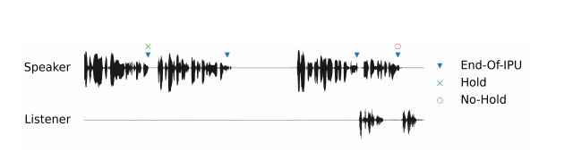
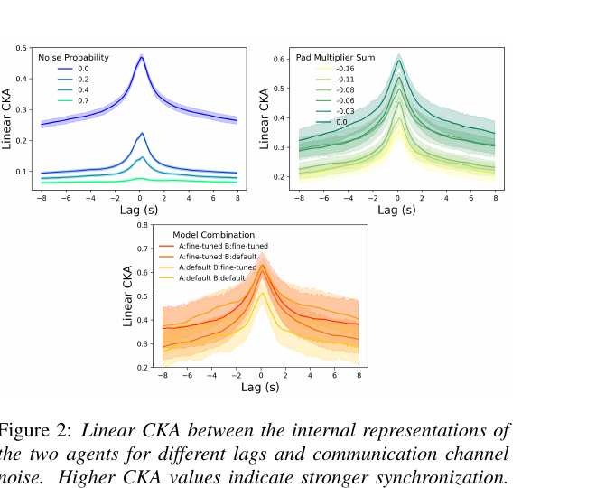
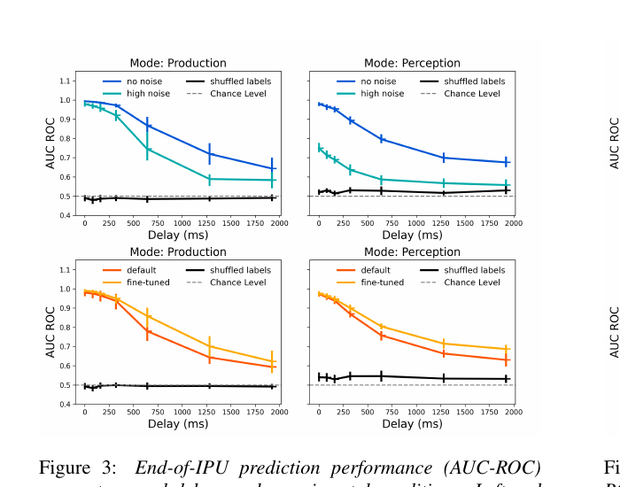
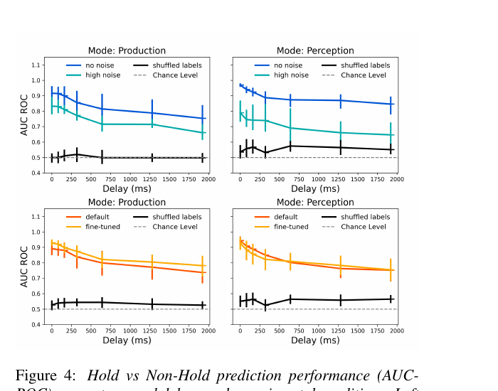

# Synchronization and Turn-Taking in Full-Duplex Speech Dialogue Models

## 0. 先说结论

这篇比前面几篇 CHI/HRI harness 文章更接近你要的“实时交互模型”问题，但它仍然不是一个完整的机器人 interaction model。

它做的事情是：拿一个已经训练好的全双工语音模型 Moshi，让两个 Moshi 实例彼此对话，然后分析它们的内部 hidden states 是否会同步，以及这些 hidden states 里能不能提前解码出 turn-taking 信息，比如“一个 interpausal unit 快结束了没有”“说话人是继续 hold 住话轮，还是把话轮交给对方”。

所以它的价值不是给你一个可直接落地的 agent harness，而是给你一个很重要的研究方向：

> 真正的实时交互模型不应该只看 ASR 文本和 LLM 指令，还应该在连续语音/音频 token/隐藏状态层面建模“同步、等待、抢话、让话、插话、backchannel”这些时间动态。

它的不足也很明显：实验是两个 Moshi 模型之间的模拟对话，不是人和系统，不是机器人，不涉及视觉、姿态、物体指代、长期记忆或具身动作。

## 0.5 从 Moshi 回来以后怎么读这篇

现在先不要把这篇理解成“又一个语音 agent 系统”。它更像是一个问题：

```text
Moshi 这种 full-duplex speech model 的 hidden state 里，
到底有没有已经学到对话节奏、同步、接话、让话的信号？
```

Moshi 原论文告诉我们：

```text
每 80ms:
  用户 audio stream
  Moshi 自己 audio/text stream
    -> Temporal Transformer
    -> hidden state h_t
    -> 下一步 Moshi text/audio tokens 或静音
```

这篇论文做的就是拿这个 `h_t` 做分析。

它不是这样：

```text
ASR text / JSON state -> LLM -> tool call
```

而是这样：

```text
两个 Moshi 实例互相说话
  -> 抽每一帧的 h_t
  -> 比较 A/B 的 h_t 是否同步
  -> 训练小 probe 看 h_t 能不能提前预测 turn-taking 事件
```

所以这篇的中心不是“如何生成回答”，而是“full-duplex 语音模型内部有没有可读出的交互状态”。

### 0.5.1 先把三个对象分清

| 对象 | 是什么 | 在这篇里干什么 |
|---|---|---|
| Moshi | 已训练好的 full-duplex speech model | 负责互相对话、产生 audio tokens 和 hidden states |
| hidden state `h_t` | Moshi Temporal Transformer 每个时间步的内部向量 | 被作者拿来分析，看看是否包含同步/话轮信号 |
| LSTM probe | 作者额外训练的小分类器 | 读取 `h_{t-\delta}`，预测 EOI 或 Hold/Non-Hold |

最容易误解的是第三个：LSTM probe 不是 Moshi 的原生决策器，也不是最终产品里的控制策略。它只是一个“检测工具”。

### 0.5.2 这篇真正的工程启发

如果你们做机器人陪伴，不要直接照抄这篇的两个 Moshi 互聊实验。更有价值的是它的思想：

```text
连续音频/多模态输入
  -> 模型内部状态
  -> probe / estimator / policy head
  -> 实时判断：
       用户是不是快说完
       用户是不是还想继续
       系统是否应该停嘴
       是否适合 backchannel
       是否可以插话
```

也就是说，它把 interaction model 的一部分从“规则看静音时间”推进到了“读连续模型状态”。

## 1. STAR 速读

### Situation

传统语音 agent 多是半双工或 turn-based：用户说完，系统再听 ASR，再推理，再 TTS。这样天然有延迟，也很难自然处理 backchannel、插话、打断、抢话、停顿和说话节奏同步。

全双工 speech dialogue model 可以一边听一边说，更像人类对话。但问题是：我们怎么知道模型内部是不是真的学到了对话同步和 turn-taking，而不是只是在表面上输出了声音？

### Task

论文想回答两个问题：

1. 两个全双工语音模型交互时，它们的内部表征是否会出现 synchronization？
2. 模型的内部表征里是否包含可以提前预测 turn-taking 的信息？

这里的 turn-taking 不是泛泛地说“该谁说话”，而是两个具体 probe task：

- `End-of-IPU prediction`：预测当前 interpausal unit 是否快结束。
- `Hold vs. Non-Hold prediction`：在 IPU 边界预测说话人是继续说，还是发生话轮转移。

### Action

作者用两个 Moshi 实例构造模拟全双工对话：

- Model A 的输出 audio tokens 直接路由给 Model B 当输入。
- Model B 的输出 audio tokens 直接路由给 Model A 当输入。
- 用预录音频 prompt 让模型进入 medical appointment request 场景，一个扮演 agent，一个扮演 customer。
- 改通信通道噪声、PAD token decoding bias、模型版本 default/fine-tuned，观察内部表征变化。

然后做两类分析：

- 用 linear CKA 度量两个模型 hidden state time series 的同步程度。
- 用 causal LSTM probe 从延迟后的 hidden states 预测 turn-taking 事件。

### Result

主要结果：

- 无噪声时，两个模型的内部表征在接近 0 lag 时有明显同步峰值。
- 通信通道噪声越大，CKA 同步越弱。
- 人为改变 PAD token bias，让模型更容易开口，会降低内部同步。
- 从 Moshi final temporal transformer 的 hidden states 中，可以提前预测 EOI 和 Hold/Non-Hold，且 production 和 perception 两个角度都高于 shuffled-label baseline。
- 但实验场景很窄，prompt 和任务单一，作者承认长延迟下的 probe 可能利用了模拟对话的全局时间规律，而不一定完全来自真实局部 turn-taking 表征。

## 2. 它到底是不是我们要的 interaction model？

部分是。

它跟你说的机器人具身 interaction model 的关系如下：

| 维度                         | 这篇论文做了吗 | 说明                                                             |
| -------------------------- | ------: | -------------------------------------------------------------- |
| 实时语音交互                     |       是 | 基于 Moshi，全双工，听和说可以同时发生。                                        |
| turn-taking / interruption |      部分 | 分析 hidden states 中是否有 turn-taking 信息，但没有实现完整 barge-in policy。  |
| 多模态感知                      |       否 | 只涉及语音/音频 token，没有视频、姿态、gaze、object grounding。                  |
| 机器人动作                      |       否 | 没有 motion/action planning。                                     |
| 长期记忆                       |       否 | 没有 memory module。                                              |
| agent harness              |       否 | 不是工具调用/流程编排系统。                                                 |
| 算法层贡献                      |       是 | 用 CKA 和 causal probe 评估 full-duplex speech model 的内部同步和话轮预测能力。 |

我的判断：

> 这篇应该放在“实时语音交互模型/turn-taking 算法基础”这条线上读，而不是放在“机器人完整 interaction architecture”线上。

它更像是你们未来系统里的一个底层模块思路：用连续音频模型或隐藏状态来判断“用户是否要继续说、是否允许打断、是否需要 backchannel、系统是否该停嘴/接话”。

## 3. 输入、输出和数据类型

### 3.1 Moshi 对话模拟的输入输出

论文用的是 Moshi，一个 pretrained full-duplex speech-text foundation model。

在实验里，两个 Moshi 实例通过 token-level audio routing 连接：

```text
Model A output audio tokens  ->  Model B input
Model B output audio tokens  ->  Model A input
```

也就是说，这里的核心数据不是普通文本 prompt，而是音频 token 流和模型内部 hidden state 序列。

论文明确说 Moshi 可以在 consuming audio 的同时 generate speech，因此这不是传统的“ASR -> LLM -> TTS”串行管线。

### 3.2 隐藏状态数据

作者从 Moshi final layer of the temporal transformer 提取每个 time frame 的内部激活：

$$
h_t \in \mathbb{R}^d
$$

论文说这些 activations 是高度上下文化的，并且会直接用于下一步生成 speech 和 text。

所以 probe 的输入不是原始音频，不是 ASR 文本，也不是 JSON 状态，而是：

```text
time-indexed hidden states: h_1, h_2, ..., h_T
```

并且为了保证因果性，probe 在时间 `t` 只能看更早的状态：

$$
h_{t-\delta}
$$

其中 `delta` 是预测提前量/延迟量。

### 3.3 输出是什么

作者没有让 probe 输出自然语言，也没有输出机器人动作。probe 输出的是分类 logits / probability。

有两个任务：

1. `End-of-IPU prediction`
   - 输入：延迟后的 hidden state 序列。
   - 输出：每一帧是不是 EOI frame 的概率。
   - 标签：只有真正 IPU-final frame 是 positive，其余帧是 negative。

2. `Hold vs. Non-Hold prediction`
   - 输入：IPU boundary 附近的 delayed hidden states。
   - 输出：这个边界是 Hold 还是 Non-Hold。
   - `Hold`：说话人继续说。
   - `Non-Hold`：话轮转移给对方，包括 smooth switch、interruption、butting-in。

## 4. 关键概念

### 4.1 Full-duplex

Full-duplex 指系统可以同时听和说。

它和普通语音助手的区别很关键：

- 普通 turn-based 系统：用户说完 -> 系统处理 -> 系统说。
- full-duplex 系统：用户和系统可以同时有音频流，系统可以边听边生成，也可以被打断、插入 backchannel。

这就是为什么它更接近真实对话，也更接近机器人长期陪伴里的自然交互。

### 4.2 IPU

IPU 是 `interpausal unit`，可以理解成被停顿切开的连续发声片段。

论文定义：

> voiced segments separated by at least 80 ms of silence

也就是两个 voiced segment 中间如果有至少 80 ms 的 silence，就切成不同 IPU。

### 4.3 EOI

EOI 是 `end-of-IPU`，即 IPU 的结束点。

论文对 EOI prediction 的正样本定义是：至少 80 ms silence 前的最后一个 voiced frame。

### 4.4 Hold vs. Non-Hold

这比 EOI 更接近真正的 turn-taking decision。

- `Hold`：当前说话人虽然到了一个 IPU boundary，但接下来还是自己继续说。
- `Non-Hold`：对方接过话轮。

论文还处理了 overlap：

- 如果两人 overlap 小于 240 ms，标成 Non-Hold，因为自然对话和 full-duplex 里短 overlap 很常见。
- 如果 overlap 超过 240 ms，就认为不清楚，排除。
- 如果到下一个 IPU 的 pause 超过 1 秒，也排除。



### 4.5 白话版：EOI 和 Hold/Non-Hold 到底差在哪？

这两个概念容易混。

`EOI prediction` 问的是：

```text
这一段连续发声是不是快结束了？
```

它偏底层，关注的是声音片段边界。

`Hold vs. Non-Hold prediction` 问的是：

```text
声音片段结束以后，是当前说话人继续说，还是换对方说？
```

它更接近真正的话轮管理。

举例：

```text
用户：我想预约一下，嗯……明天上午可以吗？
```

中间 `嗯……` 附近可能有 IPU boundary，也就是一个声音片段结束了。但用户没有把话轮交出去，用户还在继续组织句子，所以这是 `Hold`。

再比如：

```text
用户：明天上午可以吗？
系统：可以，我帮你看一下。
```

用户说完后系统接话，这就是 `Non-Hold`。

所以：

```text
EOI = 声音片段是不是结束
Hold/Non-Hold = 结束以后是不是换人说
```

这对机器人很关键。只看静音阈值很容易抢话，因为用户短暂停顿不等于用户已经说完。

这篇论文的价值在于：它不是只用静音规则判断，而是检查 Moshi 的 hidden state 里有没有更细的 turn-taking 线索。

## 5. 方法细节

### 5.1 模拟环境

实验生成的是两个 Moshi 实例之间的 100 秒对话。

初始化方式：

- 用 prerecorded audio prompt。
- 场景是 medical appointment request。
- 一个模型扮演 agent，一个模型扮演 customer。
- 官方 Moshi checkpoint 中，`Moshika` 用于 agent role，`Moshiko` 用于 client role。

实验条件包括：

- 通信通道噪声：图中出现 `0.0 / 0.2 / 0.4 / 0.7` noise probability；论文说 `0.7` 时 speech becomes unintelligible。
- 模型版本：default 和 fine-tuned。
- agent-client pairings：default/default、default/fine-tuned、fine-tuned/default、fine-tuned/fine-tuned。
- PAD token bias：通过减少 PAD token logits，让模型更不容易沉默、更容易开口。

论文报告总共生成：

```text
2880 conversations
approximately 80 hours of audio
```

这里要注意：论文没有把 2880 的组合计数完全展开解释清楚；从文字看至少包含 noise、model pairing、PAD bias 和 random seeds 的组合。

### 5.2 CKA 同步度量

作者用 linear CKA 比较两个模型 hidden representation time series 的相似度。

公式：

$$
\mathrm{CKA}(X, Y) =
\frac{\|Y^\top X\|_F^2}
{\|X^\top X\|_F \|Y^\top Y\|_F}
$$

其中：

- $X, Y \in \mathbb{R}^{d \times n}$。
- $d$ 是 hidden state 维度。
- $n$ 是 frame 数。
- $\|\cdot\|_F$ 是 Frobenius norm。

直觉：

- CKA 越高，两个模型在对应时间窗口的内部表征越像。
- 跨不同 temporal lag 算 CKA，就能看谁领先谁、同步峰值在哪里。
- negative lag 表示 B leading A。
- positive lag 表示 A leading B。



### 5.2.1 白话版：CKA 在测什么？

CKA 这块先别被公式吓到。它本质上是在问：

```text
两个 Moshi 在对话时，
它们脑子里的 hidden state 变化是不是同步？
```

实验里有两个 Moshi：

```text
Moshi A: h_A1, h_A2, h_A3, ...
Moshi B: h_B1, h_B2, h_B3, ...
```

CKA 用来比较这两串 hidden states 是否相似。

作者还会移动时间窗口，也就是算不同 `lag`：

```text
A 当前状态 vs B 当前状态
A 当前状态 vs B 提前 1 秒的状态
A 当前状态 vs B 滞后 1 秒的状态
```

如果最高相似度出现在接近 `0 lag` 的地方，说明两边内部状态在同一时间附近最同步。

直觉是：

```text
对话顺畅
  -> 两边节奏、等待、接话状态更同步

通信被噪声破坏
  -> 两边更像各说各的
  -> hidden states 同步下降
```

所以图 2 的主要意思是：

- 无噪声时，CKA 在接近 0 lag 处有明显峰值。
- 噪声越大，CKA 越低。
- 人为调 PAD bias 让模型更容易说话，也会降低同步。

CKA 和 probe 的区别：

```text
CKA:
  比较两个 Moshi 的 hidden states 是否同步

LSTM probe:
  读取一个 Moshi 的 hidden state，预测 EOI / Hold / Non-Hold
```

### 5.3 Causal LSTM probe

turn-taking probe 是一个小模型，不是 Moshi 本体。

结构：

```text
delayed hidden states -> causal LSTM(H=64) -> linear projection -> logits
```

论文公式：

$$
y_t = W \cdot \mathrm{LSTM}(h_{t-\delta}) + b
$$

训练：

- loss：binary cross entropy。
- EOI task：每一帧都计算 loss。
- Hold vs. Non-Hold task：只在 valid target frames 计算 loss。
- epochs：200。
- optimizer：Adam。
- learning rate：$10^{-3}$。
- batch size：16。
- primary metric：AUC-ROC。
- baseline：shuffled labels。

训练/测试切分：

- 每个 probe 有 40 dialogues。
- 32 train，8 test。
- 论文说没有做 hyperparameter tuning。

关键是因果性：

> 对任何潜在边界，probe 只能访问过去的 internal states，不能偷看未来。

这点对实时交互非常重要。

### 5.3.1 白话版：LSTM probe 到底在干嘛？

probe 可以理解成一个“读脑检测器”。

Moshi 每 80ms 有一个 hidden state：

```text
h_1, h_2, h_3, ...
```

这些向量人看不懂，所以作者训练一个小模型去读它：

```text
hidden states -> LSTM probe -> turn-taking label
```

这里的 label 有两类：

```text
EOI:
  当前帧是不是一个 IPU 的结束点

Hold / Non-Hold:
  到了 IPU boundary 后，是当前说话人继续说，还是换对方说
```

注意：

```text
probe 不是 Moshi 原本自带的 turn-taking 模块
probe 不是产品里的控制策略
probe 只是论文里用来验证 hidden state 是否含有这些信息的检测器
```

如果 probe 预测得好，说明：

```text
Moshi hidden state 里确实包含了 turn-taking 相关信息
```

但不能直接推出：

```text
Moshi 已经有一个稳定可控的机器人对话策略
```

### 5.3.2 为什么要用 causal LSTM？

`causal` 的意思是不能看未来。

真实系统在当前时刻做判断时，只能看过去：

```text
现在要判断用户是不是快说完
不能偷看用户未来 1 秒说了什么
```

所以论文设置了 delay：

```text
h_{t-\delta}
```

也就是预测 `t` 时刻的事件时，只能看更早的 hidden state。

这对实时交互很重要。如果一个模型必须看未来才能判断，那它不能用于实时系统。

### 5.3.3 为什么是 LSTM，不是 LLM？

因为 probe 的输入是一串连续 hidden states，不是自然语言。

LSTM 适合读时间序列：

```text
h_1 -> h_2 -> h_3 -> ...
```

它要看的是变化趋势，而不是一句文本的语义。

所以这里没有用一个大 LLM 去读 JSON。它用的是一个小的序列分类/预测模型。

### 5.3.4 这一步和我们工程的关系

如果你们未来做机器人，可以把这件事理解成一个可能的模块：

```text
speech / multimodal model hidden states
  -> turn-taking estimator
  -> should_wait / should_speak / should_interrupt / should_backchannel
```

这篇论文只是验证“这种 estimator 有可能读出信号”，还没有把它接成完整控制闭环。

## 6. 实验结果怎么读

### 6.1 CKA 结果

图 2 的含义：

- 无噪声时，CKA 在接近 0 lag 的地方有明显峰值。
- peak 平均大概 0.5，有些 conversation 可到 0.8。
- noise 越强，同步越弱。
- 高噪声时，大 lag baseline 低于 0.1。
- 无噪声大 lag baseline 约 0.25，说明即使人工错开时间，只要对话仍然 coherent，模型之间也存在一些共享节奏/结构。
- PAD token bias 越强，也就是越压低 PAD 让模型更容易说话，CKA 越低。
- 包含 fine-tuned 模型的组合 peak 更高，作者猜测是因为 fine-tuned 模型见过类似 topic 的对话。

这个结果说明：full-duplex 模型的内部状态确实会随交互质量发生同步或失同步。

### 6.2 End-of-IPU prediction



图 3 说明：

- production 和 perception 两种 setting 都能做 EOI 预测。
- no-noise 明显优于 high-noise。
- 随着 delay 变大，AUC-ROC 下降，但仍然高于 shuffled-label baseline。
- default 和 fine-tuned 之间差距不大，说明 fine-tuning 对 EOI predictability 影响较小。

解释：

> Moshi 的 hidden states 里确实有一些“当前 IPU 快结束了”的前兆信息。

注意：这不是说系统已经有完整 turn-taking policy，而是说 hidden states 可被 probe 解码出这类信号。

### 6.2.1 图 3 白话版：EOI 结果说明什么？

图 3 看的是：

```text
只读 Moshi hidden state，
能不能提前判断一个 IPU 快结束了？
```

纵轴是 AUC-ROC，可以粗暴理解成分类效果：

```text
0.5 左右 = 接近瞎猜
越接近 1 = 越能分清
```

图里黑线是 shuffled labels，也就是把标签打乱后的 baseline。它接近 0.5，说明这个任务不是随便就能猜出来。

蓝线 no noise 明显高于青色 high noise，说明：

```text
对话通道清楚时，
Moshi hidden state 里更容易读出“这段发声快结束”的信号。
```

delay 越大，性能下降，说明：

```text
离真实 EOI 越远，越难提前预测。
```

但即使 delay 变大，很多点仍然高于 baseline，说明 hidden state 里可能存在提前量。

Production / Perception 的区别：

```text
Production:
  用模型自己的 hidden state 预测自己接下来是不是要到 EOI。

Perception:
  用模型自己的 hidden state 预测对方接下来是不是要到 EOI。
```

Perception 更难，因为它要从对方语音线索中推断对方的边界。但图里 perception 也高于 baseline，所以作者认为 listener-side representation 里也有可解码的 turn-final cues。

### 6.3 Hold vs. Non-Hold prediction



图 4 说明：

- no-noise 仍然优于 high-noise。
- production 和 perception 都高于 shuffled-label baseline。
- 相比 EOI，Hold vs. Non-Hold 的性能随 delay 增加下降更慢。
- default 和 fine-tuned 的差别可以忽略。
- PAD bias 的 turn-taking prediction 图因为篇幅没展示；论文只说观察到 EOI production 和 Hold vs. Non-Hold perception 有 AUC-ROC drops。

解释：

> hidden states 不只是包含“声音片段要结束”的局部信息，还包含更高层的话轮管理线索：说话人是继续 hold，还是将话轮转给对方。

### 6.3.1 图 4 白话版：Hold / Non-Hold 结果说明什么？

图 4 看的是更难的问题：

```text
到了一个 IPU 边界以后，
当前说话人是继续说，还是换对方说？
```

这个任务比 EOI 更接近真实 turn-taking，因为：

```text
短暂停顿不等于说完
说完一个声音片段不等于交出话轮
```

图 4 的主要结果：

- no-noise 仍然比 high-noise 好。
- production 和 perception 都高于 shuffled-label baseline。
- 随 delay 增加，性能下降得比 EOI 慢一些。
- default 和 fine-tuned 的差别不明显。

这说明 hidden state 里不仅有“声音片段边界”这种低层信号，也有一些“话轮管理”信号。

但这里要谨慎：

```text
probe 能读出 Hold/Non-Hold 信号
≠ Moshi 已经有可控、稳定、面向产品的 turn-taking policy
```

它只说明内部状态里有信息，不说明系统已经会在真实人机交互里总是正确接话、让话、停嘴。

### 6.4 结果能信什么，不能信什么？

能信的：

```text
1. Moshi hidden state 里确实有可解码的 EOI / Hold / Non-Hold 信息。
2. 通信质量会影响 hidden state 里的话轮信号。
3. full-duplex speech model 的内部状态可以作为 turn-taking estimator 的输入。
4. 比起只看静音阈值，读 hidden state 可能更有潜力。
```

不能过度解读的：

```text
1. 这不是人和 Moshi 的真实交互实验。
2. 这不是机器人场景。
3. 它没有接入视觉、姿态、物体指代、动作系统。
4. LSTM probe 不是 Moshi 原生控制器。
5. 任务场景很窄，medical appointment request，prompt 比较固定。
6. 作者自己也说，长 delay 下 probe 可能利用了模拟对话的全局时间规律。
```

对我们最实用的结论是：

> 未来做机器人实时交互时，可以考虑从 speech/multimodal foundation model 的连续内部状态中读 turn-taking 信号，而不是只靠 VAD、silence threshold 或 ASR endpointing。

## 7. 对你关心的问题的直接回答

### 7.1 它是不是直接喂给 LLM 一个 JSON 状态？

不是。

这篇不是 `ASR/vision/posture -> JSON state -> LLM -> tool call` 的路线。

它的输入核心是 Moshi full-duplex speech model 的音频 token 流和 transformer hidden states。turn-taking 判断来自隐藏状态 probe，而不是把文本或 JSON 塞给一个通用 LLM。

### 7.2 它是不是训练了一个新的 full-duplex 模型？

不是。

Moshi 是 pretrained model。作者没有重训 Moshi。作者做的是：

- 构造两个 Moshi 互相说话的模拟环境。
- 操纵 noise、PAD bias、model version。
- 从 Moshi 内部抽 hidden states。
- 训练 causal LSTM probe 去验证 hidden states 是否包含 turn-taking 信息。

### 7.3 它能不能直接解决机器人实时交互？

不能直接解决。

它没有处理：

- 摄像头输入。
- posture/gaze/gesture。
- object grounding。
- robot action planning。
- 长期记忆。
- 多模态状态融合。

但它提供了一个很重要的底层判断：

> 如果你们要做自然语音陪伴机器人，不能只等用户静音后再 ASR/LLM/TTS。更合理的底层应该有连续的 turn-taking state estimator，持续估计用户是否还要说、是否允许系统插话、系统是否应该继续说、停顿是否只是 micro-pause。

### 7.4 对我们做 agent interaction model 的启发

可以把这篇当作一个“speech-time interaction layer”的参考。

一个更完整的机器人 interaction model 可能长这样：

```text
audio stream
  -> speech/full-duplex representation model
  -> turn-taking estimator
       - EOI probability
       - hold/non-hold probability
       - interruption likelihood
       - backchannel timing
       - system should speak / wait / stop

vision stream
  -> gaze / hand / posture / object grounding

memory + task state
  -> current goal, user preference, relationship context

interaction policy
  -> speech act + TTS timing + robot motion + tool/action call
```

这篇只覆盖上面第一块的一部分。

## 8. 这篇的创新点

不是发明 Moshi，也不是发明 LSTM probe。

它的创新更准确地说是：

1. 把两个 full-duplex speech dialogue model 直接连起来，形成可控的 simulated dialogue environment。
2. 用 linear CKA 在 internal representation 层面度量两个 agent 的 synchronization。
3. 用 delayed causal probe 检查 hidden states 是否包含 anticipatory turn-taking cues。
4. 同时从 production-side 和 perception-side 看 turn-taking 信息。
5. 把 noise、PAD bias、fine-tuning 作为控制变量，观察同步和话轮信息如何变化。

这是一篇 analysis/evaluation framework paper，不是 system architecture paper。

## 9. 局限和不能过度解读的地方

### 9.1 两个模型互相对话，不是人机对话

这点很重要。

论文没有验证 human-model interaction。两个 Moshi 互相说话可能产生某些模型间的规律，不一定等于真人和模型交互时的规律。

### 9.2 场景很窄

只有 medical appointment request 场景，而且由 prerecorded prompt 初始化。

作者自己也说，limited diversity 和 shared temporal structure 可能让 probe 在较长 delay 下利用全局时间规律，而不是完全依赖真实的局部 turn-taking cues。

### 9.3 没有多模态

没有视觉、姿态、gaze、object reference、机器人传感器。对具身机器人来说，这只是语音层。

### 9.4 没有真实策略闭环

论文证明 hidden states 里能 decode 出 turn-taking 信息，但没有把这些信号接回系统里做实时 policy：

- 什么时候插话？
- 什么时候停止 TTS？
- 什么时候 backchannel？
- 怎么修复打断后的对话？
- 怎么和动作控制同步？

这些都不是这篇论文完成的。

## 10. 对我们后续阅读路线的影响

这篇读完以后，下一篇应该读 Moshi 原论文。

原因很直接：这篇所有实验都建立在 Moshi 上，但它没有展开 Moshi 的底层 streaming speech/text token architecture。要继续深入，就要理解 Moshi：

- audio token 怎么建模；
- speech/text foundation model 怎么同时生成；
- full-duplex 是怎么支持的；
- 它和传统 ASR-LLM-TTS pipeline 的结构差别；
- 为什么它能处理 interruption 和 backchannel；
- latency 是怎么控制的。

读完 Moshi 后，再接 AURA / StreamBridge / MMDuet2，看 video streaming 和 proactive interaction。

## 11. 一页速记

这篇论文问的是：full-duplex speech model 在实时对话时，内部 hidden states 会不会像人类对话一样出现同步，并且能不能提前包含 turn-taking 信息？

方法：

- 两个 Moshi 实例互相接 audio tokens。
- 提取 final temporal transformer hidden states。
- 用 CKA 看两个模型状态是否同步。
- 用 causal LSTM probe 预测 EOI 和 Hold/Non-Hold。

结论：

- 无噪声时 internal representation synchronization 明显。
- 噪声和 PAD bias 会破坏同步。
- hidden states 里可以提前 decode 出 turn-taking cues。
- 但实验是模拟模型-模型对话，不是人机/机器人真实交互。

对我们有用的点：

> 机器人/陪伴 agent 的 interaction model 需要一个连续的 turn-taking estimator。它不能只依赖“用户静音 -> ASR 完成 -> LLM 回复”，而应该持续跟踪用户和系统语音流里的同步、等待、让话、插话和 backchannel 时机。
